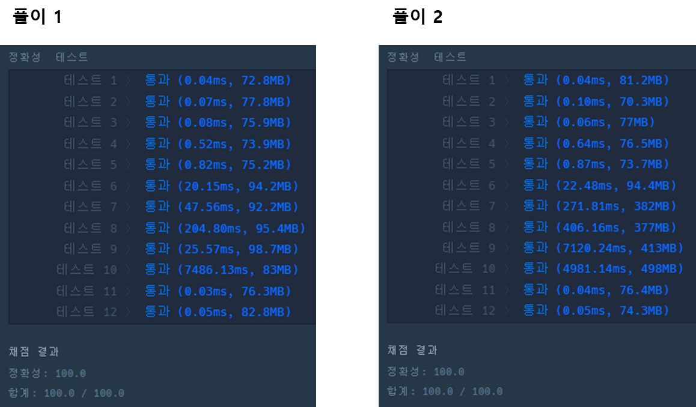

* [**탐욕법(Greedy) > 큰 수 만들기**](https://school.programmers.co.kr/learn/courses/30/lessons/42883)

---

### **문제 설명**

어떤 숫자에서 k개의 수를 제거했을 때 얻을 수 있는 가장 큰 숫자를 구하려 합니다.

예를 들어, 숫자 1924에서 수 두 개를 제거하면 [19, 12, 14, 92, 94, 24] 를 만들 수 있습니다. 이 중 가장 큰 숫자는 94 입니다.

문자열 형식으로 숫자 number와 제거할 수의 개수 k가 solution 함수의 매개변수로 주어집니다. number에서 k 개의 수를 제거했을 때 만들 수 있는 수 중 가장 큰 숫자를 문자열 형태로 return 하도록 solution 함수를 완성하세요.

### **제한 조건**

* number는 2자리 이상, 1,000,000자리 이하인 숫자입니다.
* k는 1 이상 number의 자릿수 미만인 자연수입니다.

### **알고리즘**

문자열 number에서 k 개의 수를 제거했을 때 만들 수 있는 수 중 가장 큰 숫자를 문자열 형태로 반환하는 문제이다.

**4177252841과 k는 4가 주어질 때, 문자열의 길이 10 - 4 = 6이기 때문에 6자리의 가장 큰 수를 만들어야 한다.** 그리고 힌트를 통해 생각해 본 결과. 한 자릿수를 채우기 위한 범위를 아래처럼 나타낼 수 있었다.

| 1자리 | 2자리 | 3자리 | 4자리 | 5자리 | 6자리 |
| --- | --- | --- | --- | --- | --- |
| 41772 | 5 | 2 | 8 | 4 | 1 |

> 이 표가 의미하는 것은 6자리의 숫자를 만들 때 첫 번째 자리를 제외하면 남는 5자리의 숫자를 만들기 위해서는 5개의 숫자가 남아있어야 한다.  
>  즉 뒤의 52841 5개의 숫자는 문제에서 요구하는 결과를 반환하기 위해 꼭 남아 있어야 하는 범위이다.   
> 그렇다면 첫 번째 자리는 이 5개의 숫자를 제외하고 41772에서 하나 정해야만 한다.

41772의 범위에서 첫 번째 7이 가장 크므로, 첫 번째 자리 수는 7이 되고 4,1,7은 기존의 number 문자열에서 제거한다.

그렇다면 다시 number는 7252841이 남게 되고 위의 과정을 다시 수행하면 아래와 같다.

| 1자리 | 2자리 | 3자리 | 4자리 | 5자리 | 6자리 |
| --- | --- | --- | --- | --- | --- |
| 7 | 725 | 2 | 8 | 4 | 1 |

  한 자리를 채웠기 때문에 만들어야 하는 5자리 수 중 맨 뒤 4자리는 확보한 뒤, 나머지 수들에서 큰 값을 찾는다. 이러한 과정을 반복하면 문제가 원하는 답을 반환할 수 있다.

### **풀이**

#### **풀이 1**

```java
class Solution {
    public String solution(String number, int k) {
        StringBuilder answer = new StringBuilder();
        int length = number.length() - k;
        int start = 0;

        while (start < number.length() && answer.length() != length){
            int left = k + answer.length() + 1;
            int max = 0;
            for(int j=start; j<left; j++){
                if(max < number.charAt(j) - '0'){
                    max = number.charAt(j) - '0';
                    start = j + 1;
                }
            }
            answer.append(Integer.toString(max));
        }
        return answer.toString();
    }
}
```

#### **풀이 2**

```java
class Solution {
    public String solution(String number, int k) {
        StringBuilder answer = new StringBuilder();
        // 가장 큰 값의 인덱스 정보
        int idx = 0;
        // 만들어야 하는 자리 수, 고정된 값
        int scope = number.length() - k;

        for(int i=1; i<= scope; i++){
            // 최대 값 
            int max = Integer.MIN_VALUE;
            // 각 자리 수를 정하기 위해 정해진 범위를 탐색
            for(int j=0; j<number.length() - (scope - i); j++){
                int target = number.charAt(j) - '0';
                // 9는 바로 최대값 갱신
                if(target == 9){
                    max = 9;
                    idx = j;
                    break;
                }else if(max < target){
                    max = target;
                    idx = j;
                }
            }
            answer.append(max);
            // 최대값의 인덱스 ~ 현재 문자열의 마지막까지 범위를 새로운 문자열로 갱신
            number = number.substring(idx+1);
        }

        return answer.toString();
    }
}
```

---

### **성능**



**풀이 1은 while문 한개로 구현하였고, 풀이 2는 이중 반복문을 통해 문제 풀이하였다.**

**풀이 1과 풀이 2를 성능으로 비교한다면 풀이 1이 더 빠른 경우도 있지만, 테스트 10같은 경우는 풀이 2가 성능상 우위에 있다.**

> Point : 6  
>   
> 난이도가 **중상**정도 **되는 것 같다...  
> 처음에 문제 접근을 어떻게 해야하나  
> 고민하고 또 고민해서 문제를 그려서 풀이하게 되었다.**
