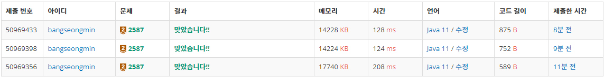

* [2587번, 대표값2](https://www.acmicpc.net/problem/2587)

[2587번: 대표값2

어떤 수들이 있을 때, 그 수들을 대표하는 값으로 가장 흔하게 쓰이는 것은 평균이다. 평균은 주어진 모든 수의 합을 수의 개수로 나눈 것이다. 예를 들어 10, 40, 30, 60, 30의 평균은 (10 + 40 + 30 + 60 +

www.acmicpc.net](https://www.acmicpc.net/problem/2587)

---

### **문제**

어떤 수들이 있을 때, 그 수들을 대표하는 값으로 가장 흔하게 쓰이는 것은 평균이다.

평균은 주어진 모든 수의 합을 수의 개수로 나눈 것이다.

예를 들어 10, 40, 30, 60, 30의 평균은 (10 + 40 + 30 + 60 + 30) / 5 = 170 / 5 = 34가 된다.

평균 이외의 또 다른 대표값으로 중앙값이라는 것이 있다.

중앙값은 주어진 수를 크기 순서대로 늘어 놓았을 때 가장 중앙에 놓인 값이다.

예를 들어 10, 40, 30, 60, 30의 경우, 크기 순서대로 늘어 놓으면 10 30 30 40 60 이 되고 따라서 중앙값은 30이 된다.

다섯 개의 자연수가 주어질 때 이들의 평균과 중앙값을 구하는 프로그램을 작성하시오.

### **입력과 출력**

* **입력**
  + 첫째 줄부터 다섯 번째 줄까지 한 줄에 하나씩 자연수가 주어진다. 주어지는 자연수는 100 보다 작은 10의 배수이다.
* **출력**
  + 첫째 줄에는 평균을 출력하고, 둘째 줄에는 중앙값을 출력한다. 평균과 중앙값은 모두 자연수이다.

### **알고리즘**

다섯 개의 자연수를 입력받아 평균과 중앙값을 구하는 문제이다.

> **평균**   
> 평균은 주어진 모든 수의 합을 수의 개수로 나눈 것  
>   
> **중앙값**  
> 주어진 수를 크기 순서대로 늘어 놓았을 때 가장 중앙에 놓인 값

### **풀이**

#### **풀이 1 : [Scanner + Arrays.sort + System.out.println]**

```java
import java.util.Arrays;
import java.util.Scanner;

// For 백준
public class Main{

    public static void main(String[] args) {
        solution();
    }

    public static void solution() {
        Scanner in = new Scanner(System.in);

        int[] numbers = new int[5];

        for(int i=0; i<5; i++){
            numbers[i] = in.nextInt();
        }

        // 정렬
        Arrays.sort(numbers);

        int average = Arrays.stream(numbers).sum()/numbers.length;
        int median = numbers[2];

        System.out.println(average);
        System.out.println(median);
    }
}
```

#### **풀이 2 : [BufferedReader+ **Arrays.sort + System.out.println**]**

```java
import java.io.BufferedReader;
import java.io.IOException;
import java.io.InputStreamReader;
import java.util.Arrays;

// For 백준
public class Main{

    public static void main(String[] args) throws IOException {
        solution1();
    }

    public static void solution1() throws IOException {
        BufferedReader br = new BufferedReader(new InputStreamReader(System.in));

        int[] numbers = new int[5];

        for(int i=0; i<5; i++){
            numbers[i] = Integer.parseInt(br.readLine());
        }

        // 정렬
        Arrays.sort(numbers);

        int average = Arrays.stream(numbers).sum()/numbers.length;
        int median = numbers[2];

        System.out.println(average);
        System.out.println(median);
    }
}
```

#### **풀이 3 : [BufferedReader+ **Arrays.sort + StringBuilder**]**

```java
import java.io.BufferedReader;
import java.io.IOException;
import java.io.InputStreamReader;
import java.util.Arrays;
import java.util.Scanner;

// For 백준
public class Main{

    public static void main(String[] args) throws IOException {
        solution1();
    }

    public static void solution1() throws IOException {
        BufferedReader br = new BufferedReader(new InputStreamReader(System.in));

        int[] numbers = new int[5];

        for(int i=0; i<5; i++){
            numbers[i] = Integer.parseInt(br.readLine());
        }

        // 정렬
        Arrays.sort(numbers);

        int average = Arrays.stream(numbers).sum()/numbers.length;
        int median = numbers[2];

        StringBuilder sb = new StringBuilder();
        sb.append(average).append("\n");
        sb.append(median).append("\n");

        System.out.println(sb);
    }
}
```

---

### **성능**



2587번 실핼결과

**채점 번호 : 50969433- 방법 3 : BufferedReader + Arrays.sort + StringBuilder**

**채점 번호 : 50969398 -  방법 2 : BufferedReader + **Arrays.sort + System.out.println****

**채점 번호 : 50969356****-  방법 1 : **Scanner****+ ****Arrays.sort + System.out.println********

**Scanner 보다 **BufferedReader 가 성능적으로 우수하다.****

**2개를 출력할 때는 StringBuilder를 사용하는 것보다 System.out.println을 사용하는 것이 성능적으로 약간에 우위에 있다.**
