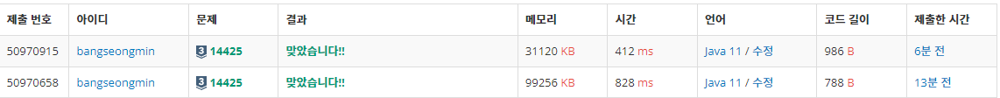

* [14425번, 문자열 집합](https://www.acmicpc.net/problem/14425)

[14425번: 문자열 집합

첫째 줄에 문자열의 개수 N과 M (1 ≤ N ≤ 10,000, 1 ≤ M ≤ 10,000)이 주어진다.  다음 N개의 줄에는 집합 S에 포함되어 있는 문자열들이 주어진다. 다음 M개의 줄에는 검사해야 하는 문자열들이 주어

www.acmicpc.net](https://www.acmicpc.net/problem/14425)

---

### **문제**

총 N개의 문자열로 이루어진 집합 S가 주어진다.

입력으로 주어지는 M개의 문자열 중에서 집합 S에 포함되어 있는 것이 총 몇 개인지 구하는 프로그램을 작성하시오.

### **입력과 출력**

* **입력**첫째 줄에 문자열의 개수 N과 M (1 ≤ N ≤ 10,000, 1 ≤ M ≤ 10,000)이 주어진다.   
  다음 N개의 줄에는 집합 S에 포함되어 있는 문자열들이 주어진다.   
  입력으로 주어지는 문자열은 알파벳 소문자로만 이루어져 있으며, 길이는 500을 넘지 않는다. 집합 S에 같은 문자열이 여러 번 주어지는 경우는 없다.
* **출력**첫째 줄에 M개의 문자열 중에 총 몇 개가 집합 S에 포함되어 있는지 출력한다.

### **알고리즘**

**N개의 문자열을 저장하고 M개에 문자열을 입력받아 N개의 문자열과 M개의 문자열의 중복된 값의 개수를 출력하는 문제이다.**

**자료구조 선정과정에서 삽입과 검색(또는 삭제)가 용이한 자료구조를 선정하면 된다.**

**삽입과 검색이 용이한 HashSet를 선정하였다.**

### **풀이**

#### **방법 1 : [Scanner + HashSet]**

```java
import java.util.HashSet;
import java.util.Scanner;

// For 백준
public class Main{

    public static void main(String[] args){
        solution();
    }

    public static void solution() {
        Scanner in = new Scanner(System.in);

        String[] temp = in.nextLine().split(" ");
        int N = Integer.parseInt(temp[0]);
        int M = Integer.parseInt(temp[1]);

        HashSet<String> set = new HashSet<>();

        // N개 입력
        for(int i=0; i<N; i++){
            set.add(in.nextLine());
        }

        // M개 입력 후 N개 중에 존재여부 확인
        int count = 0;
        for(int i=0; i<M;i++){
            String s = in.nextLine();
            if(set.contains(s))
                count++;
        }

        System.out.println(count);
    }
}
```

#### **방법 2 : [BufferedReader + HashSet]**

```java
import java.io.BufferedReader;
import java.io.IOException;
import java.io.InputStreamReader;
import java.util.HashSet;
import java.util.StringTokenizer;

// For 백준
public class Main{

    public static void main(String[] args) throws IOException {
        solution1();
    }

    public static void solution1() throws IOException {
        BufferedReader br = new BufferedReader(new InputStreamReader(System.in));
        StringTokenizer st = new StringTokenizer(br.readLine());

        int N = Integer.parseInt(st.nextToken());
        int M = Integer.parseInt(st.nextToken());

        HashSet<String> set = new HashSet<>();

        // N개 입력
        for(int i=0; i<N; i++){
            set.add(br.readLine());
        }

        // M개 입력 후 N개 중에 존재여부 확인
        int count = 0;
        for(int i=0; i<M;i++){
            if(set.contains(br.readLine()))
                count++;
        }

        System.out.println(count);
    }
}
```

---

### **성능**



14425번 실행결과

**채점 번호 : 50970915 -  방법 2 : BufferedReader + HashSet**

**채점 번호 : 50970658****-  방법 1 : **Scanner****+ **HashSet******

**검색에 용이한 HashSet을 동일하게 사용하였고,**

**입력에 속도차이는 2배이상 나는 것을 볼 수 있다.**
