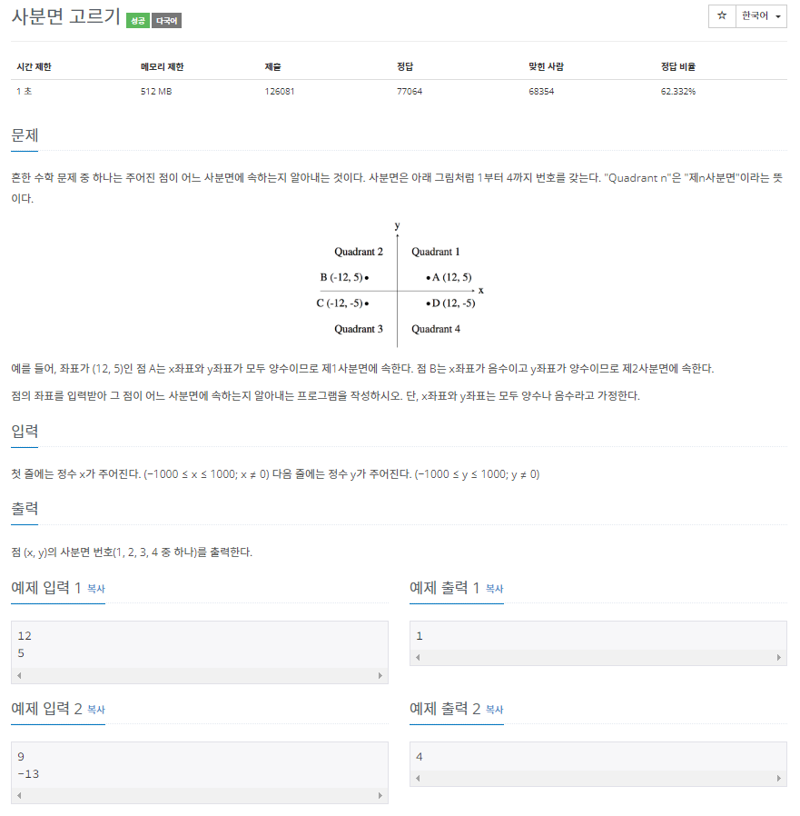
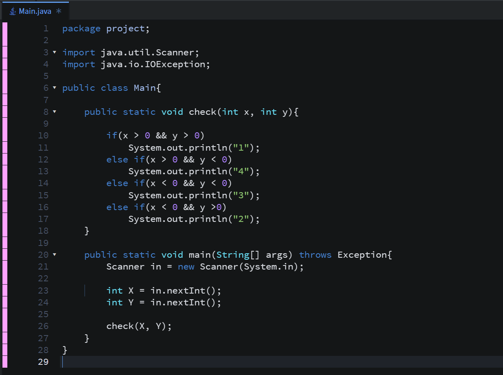
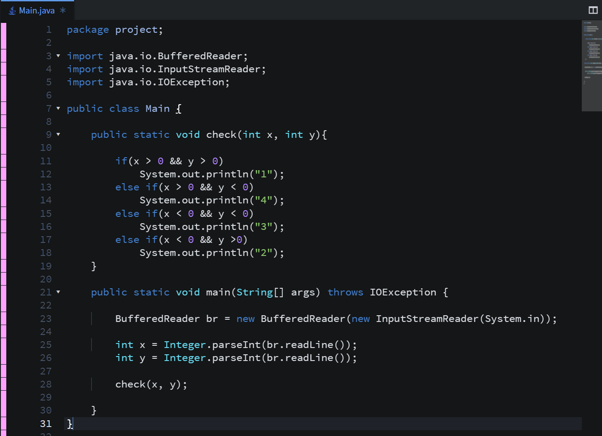
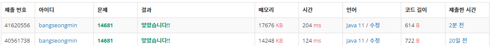

* **문제**

---

* **간단 설명**

**1. X, Y 좌표를 입력받아 사분면을 고르는 문제입니다.**

**혹시.. 기억 안나신다고요??!! 그래서 제가 준비했습니다!!**

**- 1사분면 : X > 0, Y > 0**

**- 2사분면 : X < 0, Y > 0**

**- 3사분면 : X > 0, Y < 0**

**- 4사분면 : X < 0, Y <0**

**2) 순서**

**(1 단계) X, Y값을 입력받는다.**

**(2 단계) 입력된 X, Y값에 따라 사분면을 출력한다.**

* **풀이**

**- 방법 1(Scanner)**

**- 방법 2(BufferedReader)**

* **성능 비교**

**방법 1 - 204ms**

**방법 2 - 124ms**

* **정리**

**작성하면서 느낀것은 성능이 고정되어 가는 느낌이네요ㅎㅎ**
