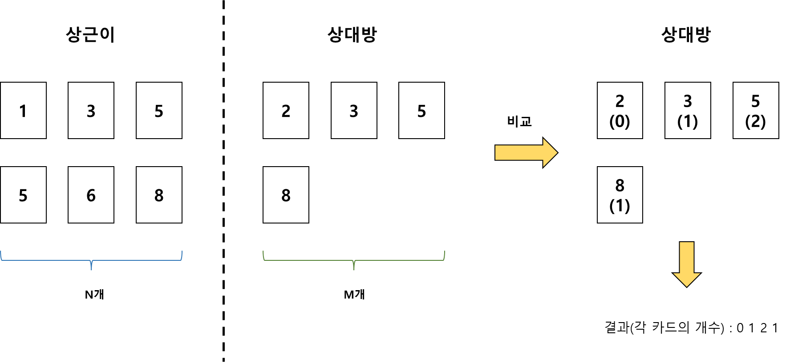
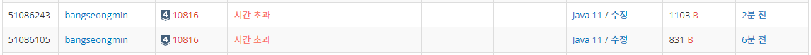
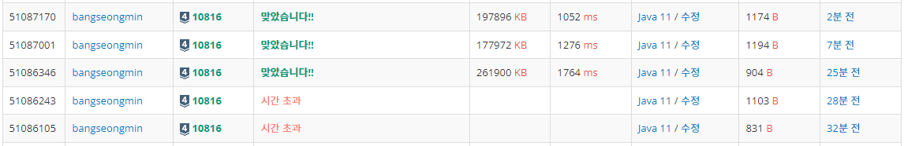

* [10816번, 숫자 카드 2](https://www.acmicpc.net/problem/10816)

[10816번: 숫자 카드 2

첫째 줄에 상근이가 가지고 있는 숫자 카드의 개수 N(1 ≤ N ≤ 500,000)이 주어진다. 둘째 줄에는 숫자 카드에 적혀있는 정수가 주어진다. 숫자 카드에 적혀있는 수는 -10,000,000보다 크거나 같고, 10,

www.acmicpc.net](https://www.acmicpc.net/problem/10816)

---

### **문제**

숫자 카드는 정수 하나가 적혀져 있는 카드이다. 상근이는 숫자 카드 N개를 가지고 있다. 정수 M개가 주어졌을 때, 이 수가 적혀있는 숫자 카드를 상근이가 몇 개 가지고 있는지 구하는 프로그램을 작성하시오.

### **입력과 출력**

* **입력**
  + 첫째 줄에 상근이가 가지고 있는 숫자 카드의 개수 N(1 ≤ N ≤ 500,000)이 주어진다. 둘째 줄에는 숫자 카드에 적혀있는 정수가 주어진다. 숫자 카드에 적혀있는 수는 -10,000,000보다 크거나 같고, 10,000,000보다 작거나 같다.
  + 셋째 줄에는 M(1 ≤ M ≤ 500,000)이 주어진다. 넷째 줄에는 상근이가 몇 개 가지고 있는 숫자 카드인지 구해야 할 M개의 정수가 주어지며, 이 수는 공백으로 구분되어져 있다. 이 수도 -10,000,000보다 크거나 같고, 10,000,000보다 작거나 같다.
* **출력**
  + 첫째 줄에 입력으로 주어진 M개의 수에 대해서, 각 수가 적힌 숫자 카드를 상근이가 몇 개 가지고 있는지를 공백으로 구분해 출력한다.

### **알고리즘**

이 문제는 [숫자 카드1](tistory-211.html) 문제와 유사한 문제이다.

[[백준] 10815번 - 숫자 카드1 (Java/자바)

10815번, 집합과 맵 - 숫자 카드 10815번: 숫자 카드 첫째 줄에 상근이가 가지고 있는 숫자 카드의 개수 N(1 ≤ N ≤ 500,000)이 주어진다. 둘째 줄에는 숫자 카드에 적혀있는 정수가 주어진다. 숫자 카드

to-be-a-artist.tistory.com](tistory-211.html)



알고리즘

위 그림과 같이 상근이의 카드 N개를 입력받고, M개의 카드를 입력받아 M개를 기준으로 N개 숫자와 중복된 카드의 카드의 개수를 출력하는 문제이다.

### **풀이**

#### **방법 1 : [Scanner + System.out.println + HashMap]**

```java
import java.util.*;

// For 백준
public class Main{

    public static void main(String[] args){
        solution();
    }

    public static void solution() {
        Scanner in = new Scanner(System.in);

        int N = in.nextInt();

        // 숫자와 개수
        HashMap<Integer, Integer> map = new HashMap<>();

        in.nextLine();
        String[] numbers = in.nextLine().split(" ");

        for(int i=0; i<N; i++){
            int temp = Integer.parseInt(numbers[i]);
            map.put(temp, map.getOrDefault(temp, 0)+1);
        }

        int M = in.nextInt();
        in.nextLine();
        numbers = in.nextLine().split(" ");

        for(int i=0; i<M; i++){
            int temp = Integer.parseInt(numbers[i]);
            System.out.print(map.getOrDefault(temp, 0)+" ");
        }
    }
}
```

#### **방법 2 **: [BufferedReader + System.out.println **+ HashMap**]****

```java
import java.io.BufferedReader;
import java.io.IOException;
import java.io.InputStreamReader;
import java.util.*;

// For 백준
public class Main{

    public static void main(String[] args) throws IOException {
        solution1();
    }

    public static void solution1() throws IOException {
        BufferedReader br = new BufferedReader(new InputStreamReader(System.in));
        StringTokenizer st;

        // N 입력
        int N = Integer.parseInt(br.readLine());

        // 숫자와 개수
        HashMap<Integer, Integer> map = new HashMap<>();

        // N개 정수 입력
        st = new StringTokenizer(br.readLine());
        while (st.hasMoreTokens()){
            int temp = Integer.parseInt(st.nextToken());
            map.put(temp, map.getOrDefault(temp, 0)+1);
        }

        // M 입력
        int M = Integer.parseInt(br.readLine());
        st = new StringTokenizer(br.readLine());
        while (st.hasMoreTokens()){
            int temp = Integer.parseInt(st.nextToken());
            System.out.print(map.getOrDefault(temp, 0)+" ");
        }
    }
}
```

> 
>
> 잠깐!!   
> System.out.println을 여러번 실행할 경우  
> 문제 시간 제한 1초를 초과하게 되므로  
> 방법1과 방법2는 시간초과이다.



10816번, 숫자 카드 2

#### **방법 3 **: [**Scanner**+ StringBuilder **+ HashMap**]****

```java
import java.util.*;

// For 백준
public class Main{

    public static void main(String[] args){
        solution();
    }

    public static void solution() {
        Scanner in = new Scanner(System.in);

        int N = in.nextInt();

        // 숫자와 개수
        HashMap<Integer, Integer> map = new HashMap<>();

        in.nextLine();
        String[] numbers = in.nextLine().split(" ");

        for(int i=0; i<N; i++){
            int temp = Integer.parseInt(numbers[i]);
            map.put(temp, map.getOrDefault(temp, 0)+1);
        }

        int M = in.nextInt();
                in.nextLine();
        numbers = in.nextLine().split(" ");

        StringBuilder sb = new StringBuilder();
        for(int i=0; i<M; i++){
            int temp = Integer.parseInt(numbers[i]);
            sb.append(map.getOrDefault(temp, 0)+" ");
        }
        System.out.println(sb);
    }
}
```

#### **방법 4 **: [BufferedReader + StringBuilder **+ HashMap**]****

```java
import java.io.BufferedReader;
import java.io.IOException;
import java.io.InputStreamReader;
import java.util.*;

// For 백준
public class Main{

    public static void main(String[] args) throws IOException {
        solution1();
    }

    public static void solution1() throws IOException {
        BufferedReader br = new BufferedReader(new InputStreamReader(System.in));
        StringTokenizer st;

        // N 입력
        int N = Integer.parseInt(br.readLine());

        // 숫자와 개수
        HashMap<Integer, Integer> map = new HashMap<>();

        // N개 정수 입력
        st = new StringTokenizer(br.readLine());
        while (st.hasMoreTokens()){
            int temp = Integer.parseInt(st.nextToken());
            map.put(temp, map.getOrDefault(temp, 0)+1);
        }

        // M 입력
        int M = Integer.parseInt(br.readLine());
        st = new StringTokenizer(br.readLine());
        StringBuilder sb = new StringBuilder();

        while (st.hasMoreTokens()){
            int temp = Integer.parseInt(st.nextToken());
            sb.append(map.getOrDefault(temp, 0)).append(" ");
        }

        System.out.println(sb);
    }
}
```

#### **방법 5 **: [BufferedReader + StringBuilder **+ Int[]**]****

* Counting 정렬을 응용하여 풀이

```java
import java.io.BufferedReader;
import java.io.IOException;
import java.io.InputStreamReader;
import java.util.*;

// For 백준
public class Main{

    public static void main(String[] args) throws IOException {
        solution1();
    }

    public static void solution1() throws IOException {
        BufferedReader br = new BufferedReader(new InputStreamReader(System.in));
        StringTokenizer st;

        // N 입력
        int N = Integer.parseInt(br.readLine());

        // -10,000,000 ~ 10,000,000 범위에 수
        int[] counter = new int[20_000_001];

        // N개 정수 입력
        st = new StringTokenizer(br.readLine());
        while (st.hasMoreTokens()){
            int temp = Integer.parseInt(st.nextToken())+ 10_000_000;
            counter[temp]++;
        }

        // M 입력
        int M = Integer.parseInt(br.readLine());
        st = new StringTokenizer(br.readLine());

        StringBuilder sb = new StringBuilder();

        while (st.hasMoreTokens()){
            int temp = Integer.parseInt(st.nextToken())+ 10_000_000;
            sb.append(counter[temp]).append(" ");
        }

        System.out.println(sb);
    }
}
```

---

### **성능**



10816번, 문제 풀이 실행 결과

**채점 번호 : 51087170 -  방법 5 : BufferedReader + ******StringBuilder****** + ********int[]**********

**채점 번호 : 51087001 -  방법 4 : **BufferedReader + ******StringBuilder********+ ********HashMap**********

**채점 번호 : 51086346 -  방법 3 : ****Scanner********+ StringBuilder + **HashMap********

**채점 번호 : 51086243 -  방법 2 : BufferedReader ****+ System.out.println + **HashMap********

**채점 번호 : 51086105****-  방법 1 : **Scanner****+ System.out.println + **HashMap******

******[자료구조 측면]******

**Key 값을 저장하고 해당 Key 값의 개수를 파악하기 위해 **검색의 속도가 빠른** HashMap 자료구조를 선택하였다.**

**int배열에 조금 더 최적화되어 있기 때문에 개수를 파악할 수 있는 int[] 배열에 속도가 우수한 것을 볼 수 있다.**

**[입력]**

**Scanner보다 BufferedReader가 속도에서 우수한 것을 볼 수 있다.**

**[출력]**

**System.out.println을 여러 번 출력하는 것보다 StringBuilder에 저장하여 한번에 출력하는 것이 성능적으로 우수하다.**
