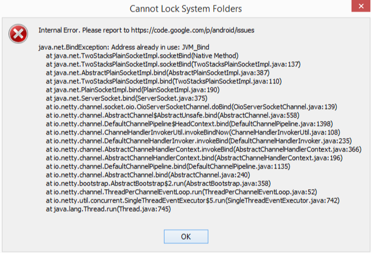
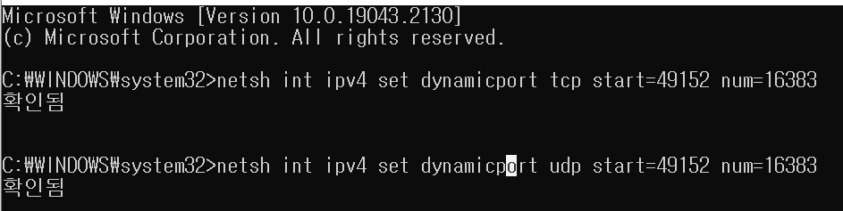
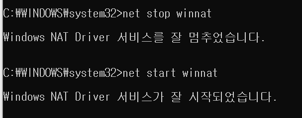

### **Intellj 실행 에러**



실행 에러

#### **분석**

* [Intellj에서 제공해주는 해결 방법](https://intellij-support.jetbrains.com/hc/en-us/articles/360007568559)

[Start Failed, Internal error: recovering IDE to the working state after the critical startup error

Symptoms IDE shows the Start Failed dialog with the exception stacktrace and the following text: Internal error. Please report to https://jb.gg/ide/critical-startup-errors Cause There are multiple ...

intellij-support.jetbrains.com](https://intellij-support.jetbrains.com/hc/en-us/articles/360007568559)
> Intellj 에서 제공해주는 방법으로는 문제가 해결되지 않았다...  
>   
> 
>
> 이러한 고민은 필자가 아닌  
> 다른 사람도 이미 경험한 문제일거라 생각했다!

* [Intellij IDEA 실행이 안되는 오류](https://pmandocom.tistory.com/97)를 참고하여 오류 종류를 확인하였다.

> **🔎 오류**  
> java.net.BindException: Address already in use: bind  
>   
> **원인은 다른 어플리케이션에서 IntelliJ가 사용하는 포트를 이미 잡아버린 경우이기 때문이다.**  
> 이를 위해 재부팅하는 방법도 있겠지만, 포트를 변경시켜주는 방법이 있다.

#### **해결 방법**

**1. 재부팅 - 재부팅을 통해 포트번호를 정리하는 방법**

**2. 포트를 범위를 변경시켜주는 방법**

**1. cmd를 관리자 권한으로 실행시킨다.**

**2. 아래와 같이 명령어를 실행한다.**

```java
netsh int ipv4 set dynamicport tcp start=49152 num=16383
netsh int ipv4 set dynamicport udp start=49152 num=16383
```



**3. Intellij 를 재실행한다.**

**만약, 동일한 에러가 발생한다면 Windows NAT를 중지시킨 후 재실행한다.**



이러한 방법을 통해서 문제를 해결할 수 있었다.
