* [1620번, 나는야 포켓몬 마스터 이다솜](https://www.acmicpc.net/problem/1620)

[1620번: 나는야 포켓몬 마스터 이다솜

첫째 줄에는 도감에 수록되어 있는 포켓몬의 개수 N이랑 내가 맞춰야 하는 문제의 개수 M이 주어져. N과 M은 1보다 크거나 같고, 100,000보다 작거나 같은 자연수인데, 자연수가 뭔지는 알지? 모르면

www.acmicpc.net](https://www.acmicpc.net/problem/1620)

---

### **문제**

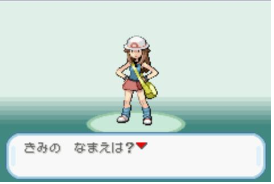

안녕? 내 이름은 이다솜. 나의 꿈은 포켓몬 마스터야. 일단 포켓몬 마스터가 되기 위해선 포켓몬을 한 마리 잡아야겠지? 근처 숲으로 가야겠어.

(뚜벅 뚜벅)

얏! 꼬렛이다. 꼬렛? 귀여운데, 나의 첫 포켓몬으로 딱 어울린데? 내가 잡고 말겠어. 가라! 몬스터볼~

(펑!) 헐랭... 왜 안 잡히지?ㅜㅜ 몬스터 볼만 던지면 되는 게 아닌가...ㅜㅠ

(터벅터벅)

어? 누구지?


오박사 : 나는 태초마을의 포켓몬 박사 오민식 박사라네. 다솜아, 포켓몬을 잡을 때는, 일단 상대 포켓몬의 체력을 적당히 바닥으로 만들어놓고 몬스터 볼을 던져야 한단다. 자, 내 포켓몬 이상해꽃으로 한번 잡아보렴. 포켓몬의 기술을 쓰는 것을 보고 포켓몬을 줄지 안줄지 결정을 하겠네. 자 한번 해보아라. 다솜아.

이다솜 : 이상해꽃이라...음.. 꽃이니깐 왠지 햇빛을 받아서 공격을 할 것 같은데... 음... 이상해꽃! 햇빛공격!!!

(꼬렛이 이상해꽃에게 공격을 받아 체력이 25 감소했다.)    가라! 몬스터 볼!!!    (꼬렛을 잡았습니다.)    야호! 신난다. 꼬렛을 잡았다.

오박사 : 오우!! 방금 쓴 공격은 솔라빔이라고 하네.. 어떻게 공격을 한 건가? 솔라빔이란 공격에 대해서 공부를 한 건가?

이다솜 : 꽃이니깐 왠지 햇빛을 제대로 받으면 광합성을 해서 음.. 그냥 그럴 것 같아서요 ☞☜

오박사 : 다른 아이들은 넝쿨채찍이나, 나뭇잎 공격을 하는데, 다솜이는 역시 뭔가 다르구나. 그럼 나와 함께 연구소로 가자꾸나. 내가 포켓몬을 한 마리 줄 테니, 너의 꿈을 펼쳐보아라. 꿈은 이루어진단다.

이다솜 : 네! 오박사님, 고마워요.ㅜㅜ

오박사 : 가자. 나의 연구소는 너의 옆집의 아랫집이란다. 같이 가도록하자. 지금 포켓몬을 주마.

이다솜 : 네. 야호!!


오영식 : 어? 오박사님 얘는 누구인가요?

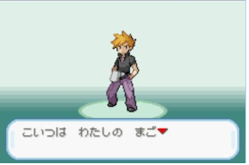

오박사 : 얘는 너의 라이벌이 될 친구 이다솜이라고 하네. 자, 포켓몬을 한 마리 골라보도록 해봐라 다솜아. 레이디퍼스트 네가 먼저 골라봐라.

이다솜 : 저는 생각해둔 포켓몬이 있어요. 피카츄 골라도 될까요?

오박사 : 그래 여기 피카츄가 한 마리 있단다. 피카츄를 가져가거라.

오영식 : 그럼 저는 이브이를 가져가겠어요. 그럼 나중에 보자 이다솜.

이다솜 : 그럼 꼬렛을 다시 잡으러 가야겠다. 영식아, 그리고 민식박사님 빠잉!

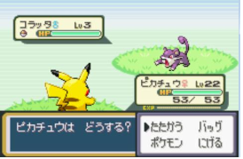

이다솜 : 피카츄 공격!

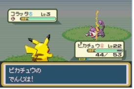

가라 몬스터 볼!

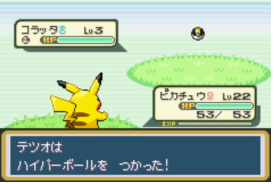

이다솜 : 야호! 신난다. 꼬렛을 잡았다!!!!!

이다솜 : 그럼! 일단 사천왕을 이기고 오겠어!


이다솜 : 여기가 사천왕과 대결하려면 가야하는 곳인가..

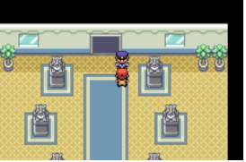

경비원 : 사천왕과 대결을 하려면, 마을의 체육관 리더를 이겨서 배지를 8개를 모아야 한다네... 배지를 모아서 오도록 하게

이다솜 : 잉ㅠㅜ... 그럼 배지부터 모아야 하는구나ㅠㅜㅠㅜ 나쁘당 그냥 좀 봐주지..

<1 년 후>

그동안의 줄거리 : 이다솜은 일단 상록 숲의 체육관 리더에게 도전을 했다. 하지만 상록숲 체육관의 리더는 실종된 상태. 따라서 회색마을부터 도전하기로 했다. 체육관의 리더를 이기면서, 로켓단을 해체시키기도 하고, 여러 가지 사건도 있었다. 결국 전설의 포켓몬도 잡고, 이제 사천왕을 이기려고 도전하기로 했다. 사천왕은 모두 가볍게 이기고, 이제 마지막 라이벌 오!영!식! 이다.


오영식 : 훗. 1년 전의 그 이다솜이 사천왕을 이기고 현재 포켓몬 마스터인 나에게 덤벼? 어디 한번 덤벼보시지.

이다솜 : 헐랭... 나를 우습게보네.... 한번 두고 보시지! 그럼 대결이닷!

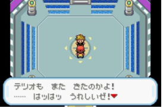
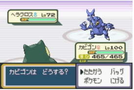
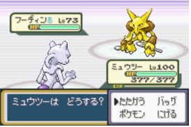
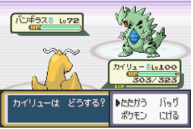
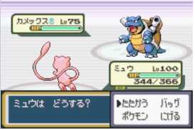
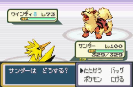
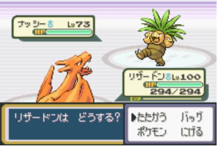
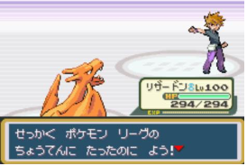

이다솜 : 휴... 이겼다.

오영식 : 내가 지다니 분하다. ㅜㅜ

오박사 : 그럼 다솜아 이제 진정한 포켓몬 마스터가 되기 위해 도감을 완성시키도록 하여라. 일단 네가 현재 가지고 있는 포켓몬 도감에서 포켓몬의 이름을 보면 포켓몬의 번호를 말하거나, 포켓몬의 번호를 보면 포켓몬의 이름을 말하는 연습을 하도록 하여라. 나의 시험을 통과하면, 내가 새로 만든 도감을 주도록 하겠네.

### **입력과 출력**

* 입력
  + 첫째 줄에는 도감에 수록되어 있는 포켓몬의 개수 N이랑 내가 맞춰야 하는 문제의 개수 M이 주어져. N과 M은 1보다 크거나 같고, 100,000보다 작거나 같은 자연수
  + 둘째 줄부터 N개의 줄에 포켓몬의 번호가 1번인 포켓몬부터 N번에 해당하는 포켓몬까지 한 줄에 하나씩 입력으로 들어오고, 포켓몬의 이름은 모두 영어로만 이루어져있다. **첫 글자만 대문자**이고, **나머지 문자는 소문자로만** 이루어져 있어.
  + **일부 포켓몬**은 **마지막 문자만 대문자**일 수도 있어. 포켓몬 이름의 최대 길이는 20, 최소 길이는 2야. 그 다음 줄부터 총 M개의 줄에 내가 맞춰야하는 문제가 입력으로 들어와. 문제가 알파벳으로만 들어오면 포켓몬 번호를 말해야 하고, 숫자로만 들어오면, 포켓몬 번호에 해당하는 문자를 출력해야해. 입력으로 들어오는 숫자는 반드시 1보다 크거나 같고, N보다 작거나 같고, 입력으로 들어오는 문자는 반드시 도감에 있는 포켓몬의 이름만 주어져.
* 출력
  + 첫째 줄부터 차례대로 M개의 줄에 각각의 문제에 대한 답을 말해줬으면 좋겠어!!!. 입력으로 숫자가 들어왔다면 그 숫자에 해당하는 포켓몬의 이름을, 문자가 들어왔으면 그 포켓몬의 이름에 해당하는 번호를 출력하면 돼.

### **알고리즘**

**제한 조건**

* 1 ≤ N, M ≤ 100,000
* 포켓몬 이름의 첫글만 대문자이고, 소문자로만 이루어져있지만, 일부 포켓몬은 마지막 문자만 대문자일 수 있다.
* 포켓몬 이름의 최대 길이는 20, 최소 길이는 2

**첫째 줄에 N과 M을 입력받는다.**

* N은 입력받을 문자열의 개수
* M은 찾아야하는 대상의 개수

둘째 줄부터 N개에 문자열을 입력받고, M개를 자연수 또는 문자열로 입력받아 해당 값에 해당 순서 또는 문자열을 반환해준다.

아래 그림 처럼 N개를 입력받고 문제 M개를 맞추는 구조이다.


문제 풀이 알고리즘

### **풀이**

#### **방법 1 : [Scanner + HashMap + StringBuilder]**

```java
import java.util.HashMap;
import java.util.Scanner;

// For 백준
public class Main{

    public static void main(String[] args){
        solution();
    }

    public static void solution() {
        Scanner in = new Scanner(System.in);

        String temp = in.nextLine();

        int N = Integer.parseInt(temp.split(" ")[0]);
        int M = Integer.parseInt(temp.split(" ")[1]);

        // 포켓몬 이름과 번호
        HashMap<String, Integer> map = new HashMap<>();
        String[] nameArr = new String[N + 1];
        StringBuilder sb = new StringBuilder();

        // 숫자 1부터 저장되므로 1부터 시작하는 반복문으로 설게
        for(int i=1; i<=N; i++){
            // 문자열은 소문자로 통일
            String name = in.nextLine();
            map.put(name, i);
            nameArr[i] = name;
        }

        for(int i=0; i < M; i++){
            temp = in.nextLine();
            if(isNum(temp)){
                sb.append(nameArr[Integer.parseInt(temp)]).append("\n");
            }else{
                sb.append(map.get(temp)).append("\n");
            }
        }

        System.out.println(sb);
    }

    // 이 문자열이 숫자인지 아닌지 판단하는 함수
    public static boolean isNum(String str) {
        for (int i = 0; i < str.length(); i++) {
            if (!Character.isDigit(str.charAt(i))) {
                return false;
            }
        }
        return true;
    }
}
```

#### **방법 2 : **[BufferedReader + HashMap + StringBuilder]****

```java
import java.io.BufferedReader;
import java.io.IOException;
import java.io.InputStreamReader;
import java.util.HashMap;
import java.util.StringTokenizer;

// For 백준
public class Main{

    public static void main(String[] args) throws IOException {
        solution1();
    }

    // 이 문자열이 숫자인지 아닌지 판단하는 함수
    public static boolean isNum(String str) {
        for (int i = 0; i < str.length(); i++) {
            if (!Character.isDigit(str.charAt(i))) {
                return false;
            }
        }
        return true;
    }

    public static void solution1() throws IOException {
        BufferedReader br = new BufferedReader(new InputStreamReader(System.in));
        StringTokenizer st = new StringTokenizer(br.readLine());

        // N 입력
        int N = Integer.parseInt(st.nextToken());
        int M = Integer.parseInt(st.nextToken());

        // 포켓몬 이름과 번호
        HashMap<String, Integer> map = new HashMap<>();
        String[] nameArr = new String[N + 1];
        StringBuilder sb = new StringBuilder();

        // 숫자 1부터 저장되므로 1부터 시작하는 반복문으로 설게
        for(int i=1; i<=N; i++){
            String name = br.readLine();
            map.put(name, i);
            nameArr[i] = name;
        }

        for(int i=0; i < M; i++){
            String temp = br.readLine();
            if(isNum(temp)){
                sb.append(nameArr[Integer.parseInt(temp)]).append("\n");
            }else{
                sb.append(map.get(temp)).append("\n");
            }
        }

        System.out.println(sb);
    }
}
```

#### 

---

### **성능**

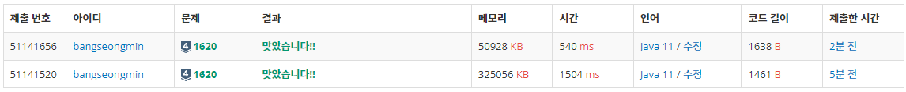

1620번, 실행 결과

**채점 번호 : 51141656 - 방법 2 : BufferedReader + HashMap + StringBuilder**

**채점 번호 : 51141520 - 방법 1 : Scanner + HashMap + StringBuilder**

System.out.println을 반복해서 사용할 경우, **시간 초과**가 발생한다.

검색에 용이한 HashMap을 사용하는게 가장 이상적인 선택인 것 같다.
