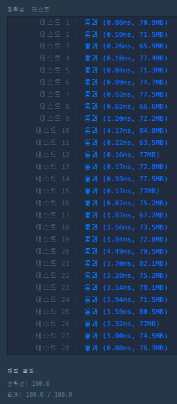

* 2020 KAKAO BLIND RECRUITMENT > 문자열 압축

---

### **문제 설명**

**데이터 처리 전문가가 되고 싶은 "어피치"는 문자열을 압축하는 방법에 대해 공부를 하고 있습니다. 최근에 대량의 데이터 처리를 위한 간단한 비손실 압축 방법에 대해 공부를 하고 있는데, 문자열에서 같은 값이 연속해서 나타나는 것을 그 문자의 개수와 반복되는 값으로 표현하여 더 짧은 문자열로 줄여서 표현하는 알고리즘을 공부하고 있습니다.   
간단한 예로 "aabbaccc"의 경우 "2a2ba3c"(문자가 반복되지 않아 한번만 나타난 경우 1은 생략함)와 같이 표현할 수 있는데, 이러한 방식은 반복되는 문자가 적은 경우 압축률이 낮다는 단점이 있습니다. 예를 들면, "abcabcdede"와 같은 문자열은 전혀 압축되지 않습니다. "어피치"는 이러한 단점을 해결하기 위해 문자열을 1개 이상의 단위로 잘라서 압축하여 더 짧은 문자열로 표현할 수 있는지 방법을 찾아보려고 합니다.   

예를 들어, "ababcdcdababcdcd"의 경우 문자를 1개 단위로 자르면 전혀 압축되지 않지만, 2개 단위로 잘라서 압축한다면 "2ab2cd2ab2cd"로 표현할 수 있습니다. 다른 방법으로 8개 단위로 잘라서 압축한다면 "2ababcdcd"로 표현할 수 있으며, 이때가 가장 짧게 압축하여 표현할 수 있는 방법입니다.   

다른 예로, "abcabcdede"와 같은 경우, 문자를 2개 단위로 잘라서 압축하면 "abcabc2de"가 되지만, 3개 단위로 자른다면 "2abcdede"가 되어 3개 단위가 가장 짧은 압축 방법이 됩니다. 이때 3개 단위로 자르고 마지막에 남는 문자열은 그대로 붙여주면 됩니다.   

압축할 문자열 s가 매개변수로 주어질 때, 위에 설명한 방법으로 1개 이상 단위로 문자열을 잘라 압축하여 표현한 문자열 중 가장 짧은 것의 길이를 return 하도록 solution 함수를 완성해주세요.**

### **제한 사항**

* s의 길이는 1 이상 1,000 이하입니다.
* s는 알파벳 소문자로만 이루어져 있습니다.

### **알고리즘**

**반복되는 문자열을 압축하여 가장 짧은 문자열의 길이를 만드는 문제이다.**

문제의 핵심은 substring(start, end)메소드이다. substring 메소드는 start에 시작 인덱스, end에 끝나는 인덱스를 입력하면 start 인덱스부터 (end-1)인덱스 까지의 문제열을 반환한다.

이 문제에서 문자열을 나눌 수 있는 범위는 1이상 s.length()/2까지가 될 수 있다.

예제 입력 1의 경우 길이 4까지 문자열을 압출할 수 있는데, 5이상이 안되는 이유는 문제에서 제시하듯 앞에서부터 5를 나누어보면 5/3으로 나누어지기 때문에 압축이 불가능해지게 된다.

| 압축 크기 | aabbaccc | | | | | | | |
| --- | --- | --- | --- | --- | --- | --- | --- | --- |
| 1 | a | a | b | b | a | c | c | c |
| 2 | aa | | bb | | ac | | cc | |
| 3 | aab | | | bac | | | cc | |
| 4 | aabb | | | | accc | | | |

예제 1에서는 다음과 같이 중첩이 발생하여 줄일 수 있는 압축 크기는 1뿐이다.

이러한 과정을 반복문을 통해 표현하면 다음과 같다.

```java
for(int i=1; i<= s.length()/2; i++){
    for(int j=0; j<=s.length(); j+=i){
         s.substring(j*i, (j*i)+i):
    }
}
```

### **풀이**

#### **풀이 1**

```java
public static int solution(String s) {
        int answer = s.length();

        if(s.length() == 1) return 1;

        for(int i = 1; i< s.length()/2; i++){
            int duple = 1;                               // 중복 개수
            String str = s.substring(0, i);             // 압출할 문자
            StringBuilder result = new StringBuilder(); // 압축완료한 문자를 저장

            for(int j=i; j<= s.length(); j+=i){
                String next = s.substring(j, Math.min(i + j, s.length()));
                if(str.equals(next)) duple++;
                else{
                    // 압축이 안되었을 경우 공백, 압축이 되었을 경우 duple을 붙여준다.
                    result.append(duple != 1 ? duple : "").append(str);
                    str = next;
                    duple = 1;
                }
            }
            result.append(duple);
            answer = Math.min(answer, result.length());
        }

        return answer;
    }
```

---

### **성능**



> Point : 3  
>   
> 이 문제는 풀이하면서 오랜시간이 걸리지는 않았다.  
> 하지만 다른 방식으로 어떻게 풀어야할지는 생각나지 않았다...  
> 더 좋은 문제풀이 방법이 있다면 꼭 알려주고 가세요!! ㅎ
