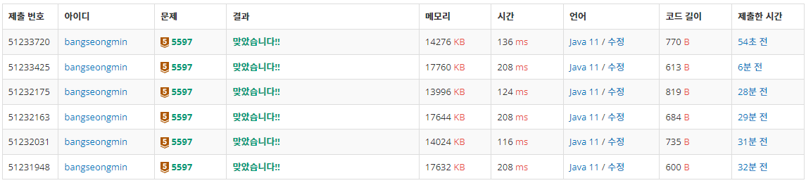

* [5597번, 과제 안 내신 분..?](https://www.acmicpc.net/problem/5597)

[5597번: 과제 안 내신 분..?

X대학 M교수님은 프로그래밍 수업을 맡고 있다. 교실엔 학생이 30명이 있는데, 학생 명부엔 각 학생별로 1번부터 30번까지 출석번호가 붙어 있다. 교수님이 내준 특별과제를 28명이 제출했는데,

www.acmicpc.net](https://www.acmicpc.net/problem/5597)

---

### **문제**

X대학 M교수님은 프로그래밍 수업을 맡고 있다. 교실엔 학생이 30명이 있는데, 학생 명부엔 각 학생별로 1번부터 30번까지 출석번호가 붙어 있다. 교수님이 내준 특별과제를 28명이 제출했는데, 그 중에서 제출 안 한 학생 2명의 출석번호를 구하는 프로그램을 작성하시오.

### **입력과 출력**

* 입력
  + 입력은 총 28줄로 각 제출자(학생)의 출석번호 n(1 ≤ n ≤ 30)가 한 줄에 하나씩 주어진다. 출석번호에 중복은 없다.
* 출력
  + 출력은 2줄이다. 1번째 줄엔 제출하지 않은 학생의 출석번호 중 가장 작은 것을 출력하고, 2번째 줄에선 그 다음 출석번호를 출력한다.

### **알고리즘**

학생 30 명중에서 과제를 제출하지 않은 학생 수를 찾아내는 문제이다.

입력으로 28명의 출석번호를 입력받아 제외하고, 입력받지 않은 번호를 출력하면 된다.

### **풀이**

#### **방법 1 : [Scanner + boolean[] + System.out.println]**

```java
import java.io.IOException;
import java.util.Scanner;

// For 백준
public class Main{

    public static void main(String[] args) {
        solution();
    }

    public static void solution() {
        Scanner in = new Scanner(System.in);

        int size = 30;      // 학생 수

        boolean[] attendances = new boolean[size];

        for(int i=0; i<size-2; i++){
            int attend = in.nextInt();
            attendances[attend-1] = true;
        }

        for(int i=0; i<size; i++){
            if(!attendances[i])
                System.out.println(i+1);
        }
    }
}
```

#### **방법 2 : [BufferedReader + boolean[] + System.out.println]**

```java
import java.io.BufferedReader;
import java.io.IOException;
import java.io.InputStreamReader;


// For 백준
public class Main{

    public static void main(String[] args) throws IOException {
        solution1();
    }

    public static void solution1() throws IOException {
        BufferedReader br = new BufferedReader(new InputStreamReader(System.in));

        int size = 30;      // 학생 수
        boolean[] attendances = new boolean[size];

        for(int i=0; i<size-2; i++){
            int attend = Integer.parseInt(br.readLine());
            attendances[attend-1] = true;
        }

        for(int i=0; i<size; i++){
            if(!attendances[i])
                System.out.println(i+1);
        }
    }
}
```

#### **방법 3: [Scanner+ boolean[] + StringBuilder]**

```java
import java.io.IOException;
import java.util.Scanner;

// For 백준
public class Main{

    public static void main(String[] args) {
        solution();
    }

    public static void solution() {
        Scanner in = new Scanner(System.in);

        int size = 30;      // 학생 수

        boolean[] attendances = new boolean[size];

        for(int i=0; i<size-2; i++){
            int attend = in.nextInt();
            attendances[attend-1] = true;
        }

        StringBuilder sb = new StringBuilder();
        for(int i=0; i<size; i++){
            if(!attendances[i])
                sb.append(i+1).append("\n");
        }
        System.out.println(sb);
    }
}
```

#### **방법 4 : [**BufferedReader**+ boolean[] + StringBuilder]**

```java
import java.io.BufferedReader;
import java.io.IOException;
import java.io.InputStreamReader;


// For 백준
public class Main{

    public static void main(String[] args) throws IOException {
        solution1();
    }

    public static void solution1() throws IOException {
        BufferedReader br = new BufferedReader(new InputStreamReader(System.in));

        int size = 30;      // 학생 수
        boolean[] attendances = new boolean[size];

        for(int i=0; i<size-2; i++){
            int attend = Integer.parseInt(br.readLine());
            attendances[attend-1] = true;
        }

        StringBuilder sb = new StringBuilder();
        for(int i=0; i<size; i++){
            if(!attendances[i])
                sb.append(i+1).append("\n");
        }
        System.out.println(sb);
    }
}
```

#### **방법 5 : [Scanner+ Set<Byte> + **System.out.println]****

```java
import java.util.Scanner;
import java.util.Set;
import java.util.stream.Collectors;
import java.util.stream.IntStream;

// For 백준
public class Main{

    public static void main(String[] args) {
        solution();
    }

    public static void solution() {
        Scanner in = new Scanner(System.in);

        Set<Byte> nums = IntStream.range(1, 31).mapToObj(e -> (byte)e).collect(Collectors.toSet());

        int size = 30;
        for(int i=0; i<size-2; i++){
            nums.remove(new Byte(in.nextLine()));
        }

        for(int num : nums){
            System.out.println(num);
        }
    }
}
```

#### **방법 6 : [****BufferedReader****+ Set<Byte> + **System.out.println]****

```java
import java.io.BufferedReader;
import java.io.IOException;
import java.io.InputStreamReader;
import java.util.Set;
import java.util.stream.Collectors;
import java.util.stream.IntStream;

// For 백준
public class Main{

    public static void main(String[] args) throws IOException {
        solution1();
    }

    public static void solution1() throws IOException {
        BufferedReader br = new BufferedReader(new InputStreamReader(System.in));

        Set<Byte> nums = IntStream.range(1, 31).mapToObj(e -> (byte)e).collect(Collectors.toSet());

        int size = 30;
        for(int i=0; i<size-2; i++){
            nums.remove(new Byte(br.readLine()));
        }

        for(int num : nums){
            System.out.println(num);
        }

    }
}
```

---

### **성능**



5597번, 실행 결과

**채점 번호 : 51233720 - 방법 6 : BufferedReader + Set<Byte> + System.out.println**

**채점 번호 : 51233425 - 방법 5 : Scanner +**Set<Byte> + System.out.println****

**채점 번호 : 51232175 - 방법 4 : BufferedReader + Boolean[] + StringBuilder**

**채점 번호 : 51232163 - 방법 3 : Scanner + **Boolean[]** + StringBuilder**

**채점 번호 : 51232031 - 방법 2 : BufferedReader + **Boolean[]** **+ System.out.println****

**채점 번호 : 51231948 - 방법 1 : Scanner + **Boolean[]** **+ System.out.println****

자료구조면에서 방법1, 2과 방법 5,6을 비교하면 방법 1, 2가 성능이 우수하다.

**즉 Boolean[]이 Set<Byte]를 사용할 때보다 성능이 우수하다.**

**입력 기능면에서 Scanner보다 BufferReader의 성능이 우수하다.**

**출력 기능면에서는 출력 기능이 2번 사용한다는 점에서 System.out.println이 StringBuilder보다 성능이 우수하다.**

> 이번 문제는 난이도 낮기 때문에  
> Stream을 이용해 풀이해보려고 노력하였다.  
> Stream을 이용하면 가독성이 높아지고  
> 코드가 간결해진다는 장점이 있기 때문이다.
