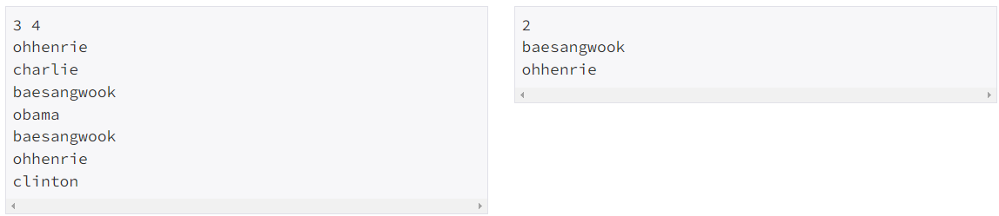
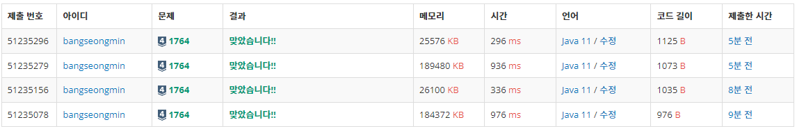

### **문제**

김진영이 듣도 못한 사람의 명단과, 보도 못한 사람의 명단이 주어질 때, 듣도 보도 못한 사람의 명단을 구하는 프로그램을 작성하시오.

### **입력과 출력**

* **입력**
  + 첫째 줄에 듣도 못한 사람의 수 N, 보도 못한 사람의 수 M이 주어진다.
  + 둘째 줄부터 N개의 줄에 걸쳐 듣도 못한 사람의 이름
  + N+2째 줄부터 보도 못한 사람의 이름이 순서대로 주어진다.
  + 이름은 띄어쓰기 없이 알파벳 소문자로만 이루어지며, 그 길이는 20 이하이다.
  + N, M은 500,000 이하의 자연수
* **출력**
  + 듣보잡의 수와 그 명단을 사전순으로 출력한다.

### **알고리즘**

듣도 못한 사람의 명단을 N개와 보도 못한 사람의 수 M개를 입력받아 중복되는 사람의 개수와 이름을 출력하는 문제이다.

N개를 입력받고 저장한 후에, M개를 입력받으면서 존재여부를 판단하여 중복 여부를 조회하여야 하므로 HashSet 자료구조를 사용하도록 하겠다.



예제 입력 1

### **풀이**

#### **방법 1 : [Scanner + System.out.println]**

```java
public class Main{

    public static void main(String[] args) throws IOException {
        solution();
    }

    public static void solution() {
        Scanner in = new Scanner(System.in);

        String[] temp = in.nextLine().split(" ");
        int N = Integer.parseInt(temp[0]);
        int M = Integer.parseInt(temp[1]);

        HashSet<String> set = new HashSet<>();
        ArrayList<String> list = new ArrayList<>();

        for(int i=0; i<N; i++) {
            set.add(in.nextLine());
        }

        for(int i=0; i<M; i++){
            String name = in.nextLine();
            if(set.contains(name))
                list.add(name);
        }

        System.out.println(list.size());

        Collections.sort(list);
        for(String name : list){
            System.out.println(name);
        }
    }
}
```

#### **방법 2 **: [BuffedReader+ System.out.println]****

```java
public class Main{

    public static void main(String[] args) throws IOException {
        solution();
    }

    public static void solution() throws IOException {
        BufferedReader br = new BufferedReader(new InputStreamReader(System.in));
        StringTokenizer st = new StringTokenizer(br.readLine());
        int N = Integer.parseInt(st.nextToken());
        int M = Integer.parseInt(st.nextToken());

        HashSet<String> set = new HashSet<>();
        ArrayList<String> list = new ArrayList<>();

        for(int i=0; i<N; i++) {
            set.add(br.readLine());
        }

        for(int i=0; i<M; i++){
            String name = br.readLine();
            if(set.contains(name))
                list.add(name);
        }

        System.out.println(list.size());

        Collections.sort(list);
        for(String name : list){
            System.out.println(name);
        }
    }
}
```

#### **방법 3 ****: [**Scanner**+ StringBuilder()]******

```java
public class Main{

    public static void main(String[] args) throws IOException {
        solution();
    }

    public static void solution() {
        Scanner in = new Scanner(System.in);

        String[] temp = in.nextLine().split(" ");
        int N = Integer.parseInt(temp[0]);
        int M = Integer.parseInt(temp[1]);

        HashSet<String> set = new HashSet<>();
        ArrayList<String> list = new ArrayList<>();

        for(int i=0; i<N; i++) {
            set.add(in.nextLine());
        }

        for(int i=0; i<M; i++){
            String name = in.nextLine();
            if(set.contains(name))
                list.add(name);
        }

        StringBuilder sb = new StringBuilder();

        sb.append(list.size()).append("\n");

        Collections.sort(list);
        for(String name : list){
            sb.append(name).append("\n");
        }
        System.out.println(sb);
    }
}
```

#### **방법 4******: [****BuffedReader****+ StringBuilder()]********

```java
public class Main{

    public static void main(String[] args) throws IOException {
        solution();
    }

    public static void solution() throws IOException {
        BufferedReader br = new BufferedReader(new InputStreamReader(System.in));
        StringTokenizer st = new StringTokenizer(br.readLine());
        int N = Integer.parseInt(st.nextToken());
        int M = Integer.parseInt(st.nextToken());

        HashSet<String> set = new HashSet<>();
        ArrayList<String> list = new ArrayList<>();

        for(int i=0; i<N; i++) {
            set.add(br.readLine());
        }

        for(int i=0; i<M; i++){
            String name = br.readLine();
            if(set.contains(name))
                list.add(name);
        }

        StringBuilder sb = new StringBuilder();

        sb.append(list.size()).append("\n");

        Collections.sort(list);
        for(String name : list){
            sb.append(name).append("\n");
        }

        System.out.println(sb);
    }
}
```

---

### **성능**



1764번, 실행 결과

**채점 번호 : 51235296 - 방법 4 : BufferedReader + StringBuilder**

**채점 번호 : 51235279 - 방법 3 : Scanner + StringBuilder**

**채점 번호 : 51235156 - 방법 2 : BufferedReader + System.out.println**

**채점 번호 : 51235078 - 방법 1 : Scanner + **System.out.println****

**입력면에서 BufferedReader가 Scanner보다 약 3배 성능이 뛰어다는 것을 볼 수 있다.**

**출력면에서 StringBuilder가 System.out.println보다 약 5~10%정도 성능향상을 볼수 있다.**
