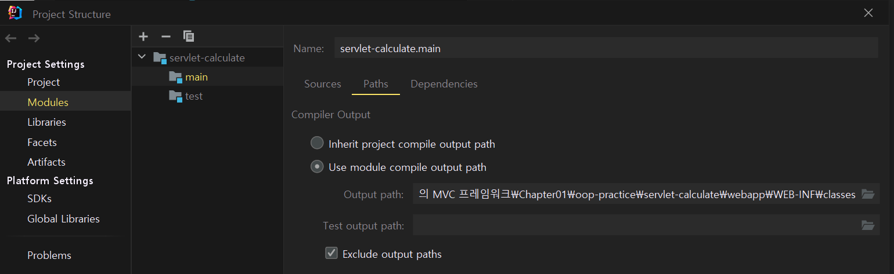

Tomcat

---

#### **상황**

@WebServlet 어노테이션에 Path를 설정하고 내장 톰캣도 실행이 되는 것을 확인하고

Intellij에서 지원하는 http Reqeust를 사용하여 GET 요청을 보내었는데, 404 에러 메시지가 발생하는 것을 볼 수 있었다.

**@WebServlet를 적용한 Servlet 구현체**

```java
@WebServlet("/calculate")
public class CalculatorServlet implements Servlet {

    private static final Logger log = LoggerFactory.getLogger(CalculatorServlet.class);

    // Life Cycle과 관련된 메소드
    @Override
    public void init(ServletConfig config) throws ServletException {
        log.info("init");
    }

    @Override
    public void service(ServletRequest request, ServletResponse response) throws ServletException, IOException {
        log.info("service");
    }

    @Override
    public void destroy() {

    }

    // Life Cycle과 관련 없는 메소드

    @Override
    public ServletConfig getServletConfig() {
        return null;
    }


    @Override
    public String getServletInfo() {
        return null;
    }

}
```

**내장 Tomcat 실행 코드**

```java
public class WebApplicationServerLauncher {

    private static final Logger logger = LoggerFactory.getLogger(WebApplicationServerLauncher.class);

    public static void main(String[] args) throws Exception {
        // 내장 톰캣
        String webappDirLocation = "webapp/";
        Tomcat tomcat = new Tomcat();
        tomcat.setPort(8080);

        tomcat.addWebapp("/", new File(webappDirLocation).getAbsolutePath());
        logger.info("configuring app with basedir: {}", new File("./" + webappDirLocation).getAbsolutePath());

        tomcat.start();
        tomcat.getServer().await();
    }
}
```

**요청 URL**

```
GET http://localhost:8080/calculate
```

#### **문제**

**내장 톰캣 실행 클래스에 상세한대로 Output Path가 설정되어 있지 않았기 때문이다. 해당 설정이 되어 있지 않은 경우, WEB-INF 폴더가 webapp 폴더 내부가 아닌 동일 계층에 생성되기 때문이다.**

#### **해결 방법**

**해결방법은 간단하다. Output Path를 변경시키면 된다.**

**Project Structure > Project Settings > Modules > Pahts**



[Intellij] Output path 설정

다음과 같이 Output path를 변경시켜주면 된다. 프로젝트 내부 src 폴더와 같은 계층에 있는 webapp 폴더 내부에 해당 설정을 하면 된다.
