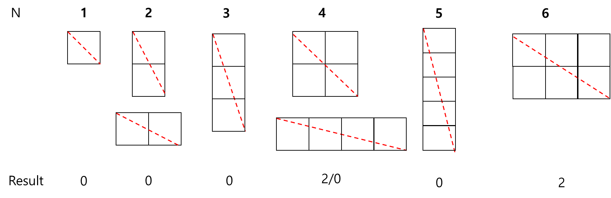
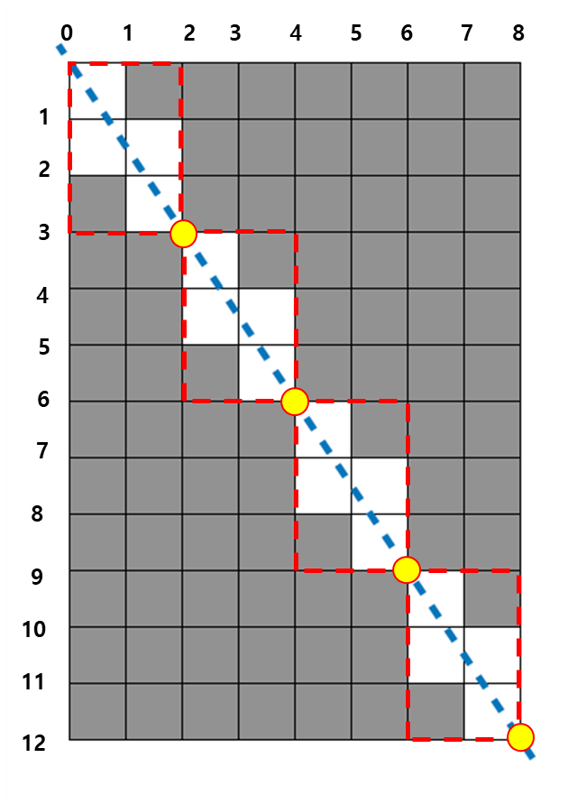
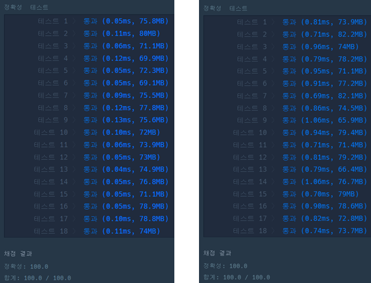

### **문제 설명**

가로 길이가 Wcm, 세로 길이가 Hcm인 직사각형 종이가 있습니다. 종이에는 가로, 세로 방향과 평행하게 격자 형태로 선이 그어져 있으며, 모든 격자칸은 1cm x 1cm 크기입니다. 이 종이를 격자 선을 따라 1cm × 1cm의 정사각형으로 잘라 사용할 예정이었는데, 누군가가 이 종이를 대각선 꼭지점 2개를 잇는 방향으로 잘라 놓았습니다. 그러므로 현재 직사각형 종이는 크기가 같은 직각삼각형 2개로 나누어진 상태입니다. 새로운 종이를 구할 수 없는 상태이기 때문에, 이 종이에서 원래 종이의 가로, 세로 방향과 평행하게 1cm × 1cm로 잘라 사용할 수 있는 만큼만 사용하기로 하였습니다.   
가로의 길이 W와 세로의 길이 H가 주어질 때, 사용할 수 있는 정사각형의 개수를 구하는 solution 함수를 완성해 주세요.

### **제한 사항**

* W, H : 1억 이하의 자연수

### **알고리즘**

#### **방법 1 - 패턴 찾기**

**이 문제는 가로 W, 세로 H인 직사각형 종이에서 격자 형태로 선이 그러져 있을 때, 사용할 수 있는 정사각형의 개수를 구하는 문제이다. 문제 이해를 위해 정사각형의 개수를 늘리면서 파악하면 다음과 같은 모습을 볼 수 있다.**



| **W \* H** | **1\*1** | **1\*2** | **1\*3** | **2\*2** | **4\*1** | **1\*5** | **1\*6** | **2\*3** | **2\*4** |
| --- | --- | --- | --- | --- | --- | --- | --- | --- | --- |
| **Result** | **0** | **0** | **0** | **2** | **0** | **0** | **0** | **2** | **4** |
| **W \* H** | **1\*8** | **3\*3** | **2\*5** | **3\*4** | **2\*7** | **3\*5** | **4\*4** | **2\*9** | **3\*6** |
| **Result** | **0** | **6** | **4** | **6** | **6** | **8** | **12** | **8** | **12** |

이 과정에서 제외되는 사각형의 개수를 파악해보면

사용할 수 있는 사각형의 개수는

정사각형의 경우 (N -1) \* N개

직사각형의 경우 W \* H - (((W / 최대공약수) + (H / 최약공약수) - 1) \* 최대공약수) 개 를 사용할 수 있다.

최대공약수라는 것을 파악한 방법은 2 \* 3, 2 \*4를 비교하였을 때, 두 수의 공약수의 사용하였을 때 표와 같은 결과가 나오게 된다.

#### **방법 2 - 예제를 통한 접근**



예제로 문제를 파악하게 되면 다음과 같은 패턴을 확인할 수 있다.

반복이 끝나는 지점의 좌표를 구하면, (2,3), (4, 6), (6, 9), (8, 12)이다.

x는 2씩, y는 3씩 증가하는 것을 볼 수 있다. 2와 3은 8과 12을 4로 나누엇을 때 결과물이다.

**즉 최대공약수를 찾아야하는 문제이다.**

* 대각선이 지나가는 직사각형 패턴의 크기는 **( W / 최대 공약수) \* ( H / 최대 공약수)** 가 된다.
* 사용하지 못하는 정사각형을 구하기 위해서는 **정사각형의 개수 - (가로 길이 + 세로 길이 - 1)**이 된다.  
  1을 빼야하는 이유는 가로 길이, 세로 길이 중에 겹치는 부분이 있기 때문에 제거하는 것이다.

정리하면

> **사용할 수 있는 사각형의 개수 = ( W \* H) - (((W / 최대공약수) + (H / 최대공약수) - 1) \* 최대공약수)**

**방법 1과 방법 2에서 계산하는 방법은 동일하지만, 결과를 구하는 접근방식이 다르다.**

### **풀이**

#### **풀이 1 - 유클리드 호제법**

* 정사각형의 계산 방법을 사용할 경우, 테스트 12, 14에서 에러가 발생하므로 코드를 주석처리함.

```java
class Solution {
    public long solution(int w, int h) {

        // 정사각형인 경우
        // if(w == h) return (w-1) * h;

        // 직사각형인 경우
        long answer = gcd(w, h);
        return ((long) w * h) - (((w/answer) + (h/answer) -1) * answer);
    }

    // 유클리드 호제법
    public int gcd(int w, int h){
        while(h != 0){
            int temp = w % h;
            w = h;
            h = temp;
        }

        return w;
    }
}
```

#### **풀이 2 - 내장 함수**

```java
import java.math.BigInteger;

class Solution {
    public long solution(int w, int h) {

        int gcd = BigInteger.valueOf(w).gcd(BigInteger.valueOf(h)).intValue();
        long answer = ((long) w * h) - (((w / gcd) + (h/gcd) -1) * gcd);
        return answer;
    }
}
```

---

### **성능**



(좌) 방법 1 / (우) 방법 2

성능으로 비교하면 방법 1이 우수하겠지만, 간결한 코드는 방법 2이다.

### **후기**

> Point : 5  
>   
> 문제를 풀면서 정말 표를 그려서 풀고 나서...  
> 잠시동안 좌절해버렸다...  
> 테스트 12, 14번에서 어떤 결과가 나오길래 그러는 것일까라는 생각이 들었다...  
>   
> 정사각형에 대한 예외처리를 하지 않을 경우   
> 정상적으로 동작하기 때문에 이 점은 찾지는 않았다...   
>   
> 정답을 아시는 분 또는 개선할 점 등 의견이 있으시다면 남겨주세요!!
