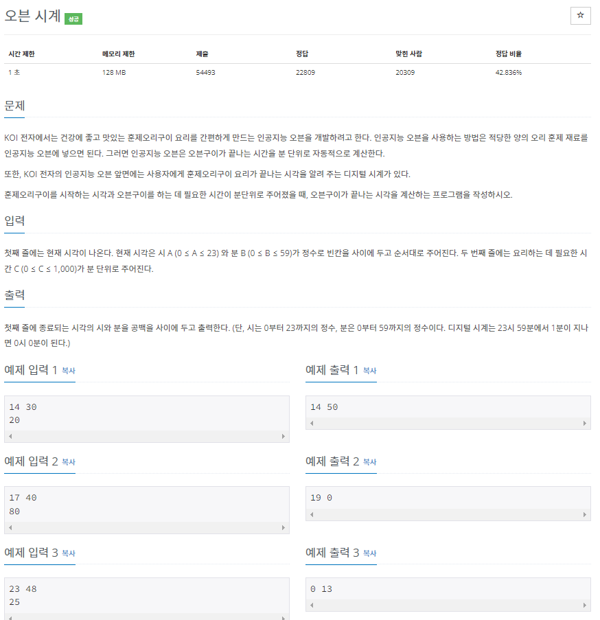
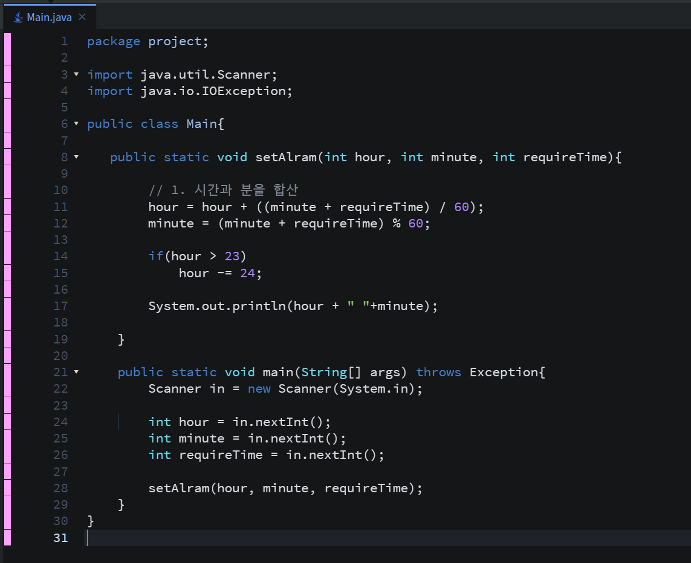
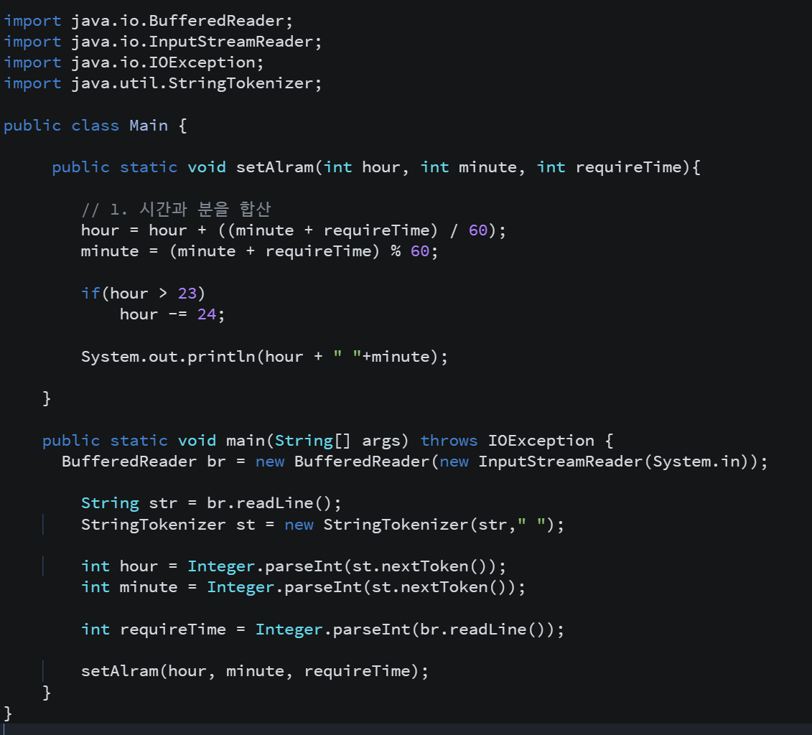
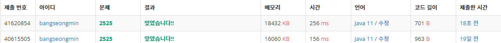

* **문제**

**- 정답률 42.836%로 이 문제를 해결하신분들은 상위 42%라는 말이겠죠?!!**

* **간단 설명**

**- 이 문제는 시간과 타이머 값을 입력받아 타이머 시간이 지난 후에 시간을 출력하는 문제이다.**

**- 분을 계산할 경우 60분이 최대라는 것을 유의하여 개발하셔야 합니다.**

**(유의사항) 시는 0부터 23까지 정수이고 분은 0부터 59까지**

**(1 단계) 시와 분을 입력받는다.**

**(2 단계) 타이머를 분으로 입력받는다.**

**(3 단계) 1단계에서 받은 시와 분에 타이머 값을 더하여 출력한다.**

* **풀이**

**- 방법 1(Scanner)**

**- 방법 2(BufferedReader)**

* **성능 비교**

**방법 1 - 256ms**

**방법 2 - 156ms**

* **정리**

**이 문제를 풀면서 2번 틀렸습니다... 어디서 틀렸나 했는데 24시로 계산될때 처리를 하지 않았기 때문이였습니다..**

**여러분도 저처럼 바보같은 행동하지 마시길 바랍니다!!**
