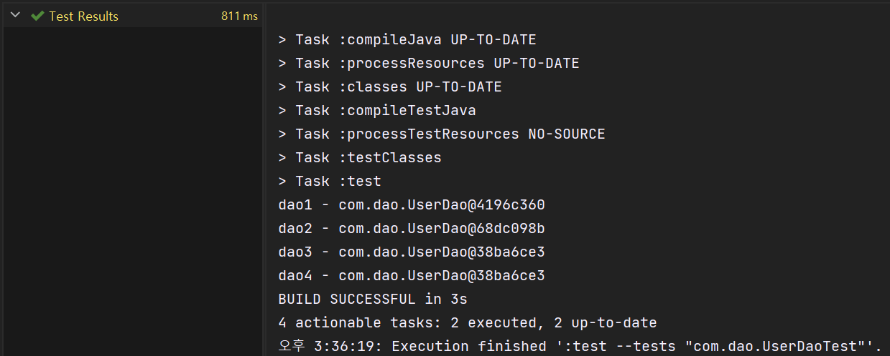
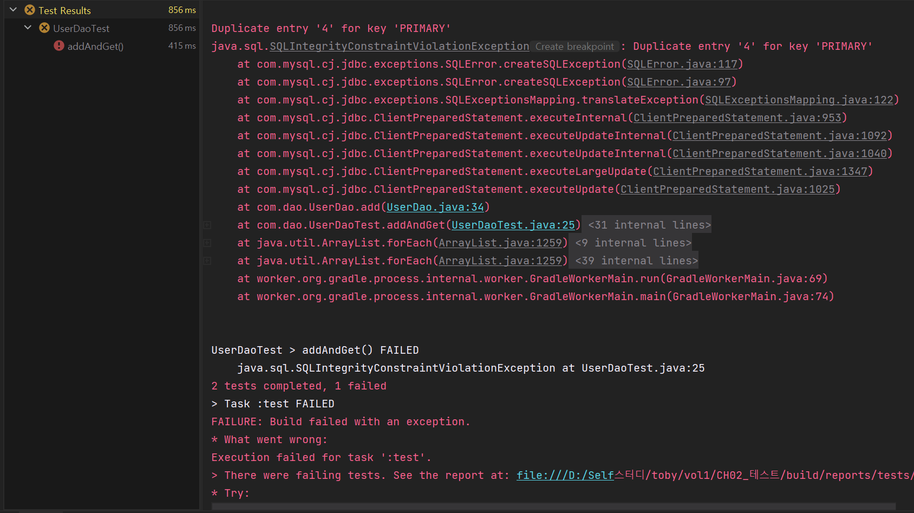
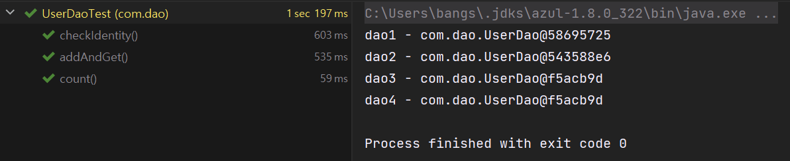

토비의 스프링

* 본 내용은 토비의 스프링을 공부하며 정리한 내용입니다.

---

## **개발자를 위한 테스팅 프레임워크 JUnit**

JUnit은 사실상 자바의 표준 테스팅 프레임워크라고 불릴 만큼 폭넓게 사용되고 있다. 스프링을 학습하고 제대로 활용하려면 최소한의 JUnit 테스트 작성 방법과 실행 방법은 알고 있어야 한다. 다시 말하지만 테스트 없이는 스프링도 의미 없다. 스프링 프레임워크 자체도 JUnit 프레임워크를 이용해 테스트를 만들어가며 개발됐다.

**JUnit의 특징**

* 스프링의 핵심 기능 중 하나인 스프링 테스트 모듈도 JUnit을 이용하기 때문에 스프링이 기능을 익히기 위해서라도 JUnit은 꼭 사용할 줄 알아야 한다.
* JUnit 테스트는 main() 메소드와 System.out.println()으로 만든 테스트만큼 단순하기 때문에 빠르게 작성할 수 있다.
* 테스트 작성 시 자주 필요한 편리한 여러 가지 부가기능도 제공한다.
* 대부분의 자바 IDE는 JUnit 테스트를 손쉽게 실행할 수 있는 JUnit 테스트 지원 기능을 내장하고 있어서 더욱 편리하게 JUnit 테스트를 만들고 활용할 수 있게 해준다.

---

### **JUnit 테스트 실행 방법**

#### **문제점과 해결방법**

> **💣 문제점**JUnitCore를 이용해 테스트를 실행하고 콘솔에 출력된 메시지를 보고 결과를 확인하는 방법은 가장 간단하기 하지만 테스트의 수가 많아지면 관리하기 힘들어진다.  
>   
> **💉 해결책**가장 좋은 JUnit 테스트 실행 방법은 자바 IDE에 내장된 JUnit 테스트 지원 도구를 사용하는 것이다.

**IDE**

대부분의 자바 개발자가 사용하고 있는 사실상의 표준 자바 IDE인 **이클립스**는 오래전부터 JUnit 테스트를 지원하는 기능을 제공하고 있다. **IntelliJ**는 **@Test**가 들어 있는 테스트 클래스를 선택한 뒤에, ▶을 실행하면 자동으로 실행된다. JUnitCore를 이용할 때처럼 main() 메소드를 만들지 않아도 된다.

    테스트가 시작되면 JUnit 테스트 정보를 표시해주는 뷰(View)가 나타나서 테스트 진행 상황을 보여준다. 테스트가 완료되면 테스트의 최종 결과가 그림 2-1과 같이 깔끔하게 나타난다.



2-1. Intellij JUnit 테스트 결과 : 테스트 성공

**🔎 결과 분석**

> 이 뷰에서 테스트의 총 수행시간, 실행한 테스트의 수와 작업에 대한 내용을 확인할 수 있다. 또한 어떤 테스트 클래스를 실행했는지도 알 수 있다. 테스트 클래스 내에 있는 **@Test**가 붙은 테스트 메소드의 이름도 모두 보여준다. 각 테스트 메소드와 클래스의 테스트 수행에 걸린 시간도 보여준다.

테스트가 실패해서 코드를 수정한 뒤, 다시 테스트를 실행하려면 JUnit 테스트 뷰의 녹색 Rerun Test 버튼을 클릭하면 된다. 또, 테스트 목록에서 테스트 클래스나 테스트 메소드를 더블클릭하면 해당 코드를 편집기에 보여준다. 테스트 실패라면 그림 2-2와 같은 결과가 나타난다. 이번엔 한 개의 테스트 메소드가 실패했음을 알 수 있다. 실패한 이유는 뷰의 아래 Failure Trace 항목에 자세히 나와 있다.



그림 2-2. Intellij JUnit 테스트 결과 : 테스트 실패

**JUnit**은 한 번에 여러 테스트 클래스를 동시에 실행할 수도 있다. Intellij에서는 소스 트리에서 특정 패키지를 선택하고 컨텍스트 메뉴의 Run "'Tests in' com.example"를 실행하면, 해당 패키지 아래에 있는 모든 JUnit 테스트를 한 번에 실행할 수도 있다. 이런 면에서 JUnitCore를 사용해 테스트를 실행하는 것보다 훨씬 편리하다. JUnit 테스트를 실행하는 이클립스의 단축키를 기억해두면 더욱 빠르고 편하게 테스트를 실행할 수 있다. "Ctrl+Shift+F10"를 순서대로 누르면 선택해둔 클래스나 패키지, 프로젝트의 테스트가 바로 실행된다.

> **[참고] 단축키의 설정은 원하는대로 설정이 가능하다.**

#### **빌드 툴**

프로젝트의 빌드를 위해 **ANT**나 **메이븐(Maven)** 같은 빌드 툴과 스크립트를 사용하고 있다면, 빌드 툴에서 제공하는 **JUnit 플러그인이나 태스크**를 이용해 JUnit 테스트를 실행할 수 있다. 테스트 실행 결과는 옵션에 따라서 HTML이나 텍스트 파일의 형태로 보기 좋게 만들어진다.

> 개발자 개인별로는 IDE에서 JUnit 도구를 활용해 테스트를 실행하는 게 가장 편리하다. 그런데 여러 개발자가 만든 코드를 모두 통합해서 테스트를 수행해야 할 때도 있다. 이런 경우에는 서버에서 모든 코드를 가져와 통합하고 빌드한 뒤에 테스트를 수행하는 것이 좋다. 이때는 빌드 스크립트를 이용해 JUnit 테스트를 실행하고 그 결과를 메일 등으로 통보받는 방법을 사용하면 된다.

---

### **테스트 결과의 일관성**

**💣문제점**

> 테스트를 실행하면서 가장 불편했던 일은, 매번 UserDaoTest 테스트를 실행하기 전에 DB의 USER 테이블 데이터를 모두 삭제해줘야 할 때였다. 깜빡 잊고 그냥 테스트를 실행했다가는 이전 테스트를 실행했을 때 등록됐던 사용자 정보와 기본키가 중복된다면서 add() 메소드 실행 중에 에러가 발생할 것이다.  
>   
> 테스트가 외부 상태에 따라 성공하기도 하고 실패하기도 한다는 점이다. DB 서버가 다운됐다거나 네트워크에 장애가 생겨서 DB에 접근하지 못하는 예외적인 상황이라면 이해할 수 있겠는데, **문제는 별도의 준비 작업 없이는 성공해야 마땅한 테스트가 실패하기도 한다**는 점이다. **반복적으로 테스트를 했을 때 테스트가 실패하기도 하고 성공하기도 한다면 이는 좋은 테스트라고 할 수가 없다.** **코드에 변경사항이 없다면 테스트는 항상 동일한 결과를 내야 한다.  
>   
> => UserDaoTest의 문제는 이전 테스트 때문에 DB에 등록된 중복 데이터가 있을 수 있다는 점이다.**

**💉 가장 좋은 해결책**

> addAndGet() 테스트를 마치고 나면 테스트가 등록한 사용자 정보를 삭제해서, 테스트를 수행하기 이전 상태로 만들어주는 것이다. 그러면 테스트를 아무리 여러 번 반복해서 실행하더라도 항상 동일한 결과를 얻을 수 있다.

---

#### **deleteAll()의 getCount() 추가**

일관성 있는 결과를 보장하는 테스트를 만들기 위해 준비할 게 있는데, UserDao에 새로운 기능을 추가해주는 일이다.

* **deleteAll**USER 테이블의 모든 레코드를 삭제해주는 메소드

**리스트 2-7. deleteAll() 메소드**

```java
public void deleteAll() throws SQLException{
    Connection c = dataSource.getConnection();

    PreparedStatement ps = c.prepareStatement("delete from users");
    ps.executeUpdate();

    ps.close();
    c.close();
}
```

* **getCount()**USER 테이블의 레코드 개수를 돌려주는 메소드

**리스트 2-8. getCount() 메소드**

```java
public int getCount() throws SQLException {
    Connection c = dataSource.getConnection();

    PreparedStatement ps = c.prepareStatement("select count(*) from users");

    ResultSet rs = ps.executeQuery();
    rs.next();
    int count = rs.getInt(1);

    rs.close();
    ps.close();
    c.close();

    return count;
}
```

---

#### **deleteAll()과 getCount()의 테스트**

deleteAll()과 getCount() 메소드의 기능은 add()와 get()처럼 독립적으로 자동 실행되는 테스트를 만들기가 애매하다.

굳이 테스트를 하자면 USER 테이블에 수동으로 데이터를 넣고 deleteAll()을 실행한 뒤에 테이블에 남은 게 있는지 확인해야 하는데, 사람이 테스트 과정에 참여해야 하니 자동화돼서 반복적으로 실행 가능한 테스트 방법은 아니다.

> 새로운 테스트를 만들기보다는 차리리 기존에 만든 addAndGet() 테스트를 확장하는 방법을 사용하는 편이 더 나을 것 같다. addAndGet() 테스트의 불편한 점을 실행 전에 수동으로 USER 테이블의 내용을 모두 삭제해줘야 하는 것이었다.  
>   
> deleteAll()을 이용하면 테이블의 모든 내용을 삭제할 수 있으니 이 메소드를 테스트가 시작될 때 실행해주는 것은 어떨까? 만약 deleteAll()이 잘 작동한다면 addAndGet() 테스트를 위해 매번 USER 테이블을 수동으로 삭제하는 수고를 하지 않아도 된다.

 deteleAll()을 넣는 것만으로는 조금 부족하다. deleteAll() 자체도 아직 검증이 안 됐는데 무턱대로 다른 테스트에 적용할 수 없다. 그래서 getCount()를 함께 적용해보자. deleteAll()이 기대한 대로 동작한다면, getCount()로 레코드의 개수를 가져올 경우 0이 나와야 한다. 그러므로 deleteAll()을 실행한 직후에 getCount()의 결과 값을 검증하고 코드를 넣어보자. 그런데 getCount()는 잘 동작하는지 어떻게 믿을 수 있을까? getCount() 메소드가 레코드의 레코드 숫자에 상관없이 항상 0을 돌려주는 버그를 갖고 있다면, deleteAll() 기능을 검증하는 데 사용할 수 없다. 검증 안 된 두 개를 붙였는데 우연히 테스트가 통과한다고 안심하는 것은 바람직하지 못하다.

    그래서 getCount()에 대한 검증 작업을 하나 더 추가한다. 이미 앞에서 add() 메소드가 정상적으로 DB 테이블에 데이터를 넣는 것을 확인했으니 add() 를 수행하고 나면 레코드 개수가 0에서 1로 바뀌어야 한다. 그렇다면 add() 메소드를 실행 한뒤에 getCount()의 결과를 한 번 더 확인해보자. deleteAll() 직후에는 0이 나오고 add() 직후에는 1이 나온다면, getCount()의 기능이 바르게 동작한다고 볼 수 있다. 그리고 getCount()가 바르게 동작한다는 확신이 있다면, deleteAll() 직후에 항상 0이 나오는 것을 보고 deleteAll()의 기능도 바르게 동작한다고 생각할 수 있다.

**리스트 2-9. deleteAll()과 getCount()가 추가된 addAndGet() 메소드**

```java
@Test
public void addAndGet() throws SQLException {
    ApplicationContext context = new GenericXmlApplicationContext("applicationContext.xml");
    UserDao userDao = context.getBean("userDao", UserDao.class);

    userDao.deleteAll();
    assertThat(userDao.getCount(), is(0));

    User user = new User();
    user.setId("0");
    user.setName("test123");
    user.setPassword("test123");

    userDao.add(user);
    assertThat(userDao.getCount(), is(1));

    User result = userDao.get(user.getId());

    assertThat(result.getName(), is(user.getName()));
    assertThat(result.getPassword(), is(user.getPassword()));
}
```

---

#### **동일한 결과를 보장하는 테스트**

**🩺 변경된 점**

> DB의 테이블을 삭제하는 작업 없이 다시 테스트를 실행해보자. 테스트를 반복해서 여러 번 실행해도 계속 성공할 것이다. 이전에는 테스트를 하기 전에 매번 직접 DB에서 데이터를 삭제해야 했지만, 이제는 그런 번거로운 과정이 필요 없어졌다. 테스트가 어떤 상황에서 반복적으로 실행된다고 하더라도 동일한 결과가 나올 수 있게 된 것이다. 설령 테스트 수행 직접에 DB에 작업을 하느라 USER 테이블에 정보를 넣어뒀더라도 이제는 문제가 되지 않는다. addAndGet() 테스트가 시작될 때 항상 기존의 데이터를 지우고 시작하기 때문이다. 단위 테스트는 코드가 바뀌지 않는다면 매번 실행할 때마다 동일한 테스트 결과를 얻을 수 있어야 한다.

    동일한 테스트 결과를 얻을 수 있는 다른 방법도 있다. addAndGet()을 실행해서 등록된 User 레코드를 삭제해주는 방법을 생각해볼 수 있다. 물론 이것도 나쁜 방법은 아니다 .하지만 addAndGet() 테스트 실행 이전에 다른 이유로 USER 테이블에 데이터가 들어가있다면 이때는 테스트가 실패할 수도 있다. addAndGet() 테스트만 DB를 사용할 것이 아니라면 아무래도 이전에 어떤 작업을 하다가 테스트를 실행할지 알 수 없다. 따라서 테스트 후에 USER 테이블을 지워주는 것도 좋지만, 그보다는 테스트하기 전에 테스트 실행에 문제가 되지 않는 상태를 만들어주는 편이 더 나을 것이다.

**📖 정리**

> 단위 테스트는 항상 일관성 있는 결과가 보장돼야 한다는 점을 잊어선 안 된다. DB에 남아 있는 데이터와 같은 외부 환경에 영향을 받지 말아야 하는 것은 물론이고, 테스트를 실행하는 순서를 바꿔도 동일한 결과가 보장되도록 만들어야 한다.

---

### **포괄적인 테스트**

#### **🔎 getCount() 메소드 점검**

> 기존의 테스트에서 확인할 수 있었던 것은 deleteAll()을 실행했을 때 테이블이 비어 있는 경우(0)와 add()를 한 번 호출한 뒤의 결과(1) 뿐이다.  
>   
> **Q. 두 개 이상의 레코드를 add() 했을 때는 getCount()의 실행 결과가 어떻게 될까?  
> A.** 0과 1 두 가지를 해봤으니 나머지도 당연히 잘될 것이라고 추정할 수도 있겠지만 미처 생각하지 못한 문제가 숨어 있을지도 모르니 더 꼼꼼한 테스트를 해보는 것이 좋은 자세다. 테스트를 안 만드는 것도 위험한 일이지만, 성의 없이 테스트를 만드는 바람에 문제가 있는 코드인데도 테스트가 성공하게 만드는 건 더 위험하다. 특히 한 가지 결과만 검증하고 마는 것은 상당히 위험하다. 

---

#### **getCount() 테스트 보완**

여러 개의 User를 동록해가면서 getCount()의 결과를 매번 확인해보겠다. 테스트 기능을 기존의 addAndGet() 메소드에 추가하는 건 별로 좋은 생각이 아니다. 테스트 메소드는 한 번에 한 가지 검증 목적에만 충실한 것이 좋다. 그러므로 getCount()를 위한 새로운 테스트 메소드를 만들어보자.

**테스트 시나리오**

1. 먼저 USER 테이블의 데이터를 모두 지우고 getCount()로 레코드 개수가 0임을 확인한다.
2. 3개의 사용자 정보를 하나씩 추가하면서 매번 getCount()의 결과가 하나씩 증가하는지 확인하는 것이다.

**테스트를 만들기 전**

> User 클래스에 한 번에 모든 정보를 넣을 수 있도록 리스트 2-10과 같이 초기화가 가능한 생성자를 추가한다. User 오브젝트를 여러 번 만들고 값을 넣어야 하니, 한 번에 설정 가능한 생성자를 만들어두면 편리하다.

**리스트 2-10. 파라미터가 있는 User 클래스 생성자**

```java
public User(String id, String name, String password){
    this.id = id;
    this.name = name;
    this.password = password;
}

// 자바빈의 규약을 따르는 클래스에 생성자를 명시적으로 추가했을 때는 파라미터가 없는 디폴트 생성자도 함께 정의해주는 것을 잊지 말자.
public User(){	
}
```

**새로 만든 생성자를 이용하면 addAndGet() 테스트의 코드도 다음과 같이 간략히 수정할 수 있다.**

```java
UserDao dao = context.getBean("userDao", UserDao.class);
User user = new User("gyumee", "박성철", "springno1");
...
```

**리스트 2-11. getCount() 테스트**

```java
@Test
public void count() throws SQLException {
    ApplicationContext context = new GenericXmlApplicationContext("applicationContext.xml");

    UserDao dao = context.getBean("userDao", UserDao.class);
    User user1 = new User("gyumee", "박성철", "springno1");
    User user2 = new User("leegw700", "이길원", "springno2");
    User user3 = new User("bumjin", "박범진", "springno3");

    dao.deleteAll();
    assertThat(dao.getCount(), is(0));

    dao.add(user1);
    assertThat(dao.getCount(), is(1));

    dao.add(user2);
    assertThat(dao.getCount(), is(2));

    dao.add(user3);
    assertThat(dao.getCount(), is(3));
}
```

**🔎 코드 분석**

> 1. 3 개의 User 오브젝트를 준비  
> 2. deleteAll()을 이용해 테이블의 내용을 모두 삭제  
> 3. deleteAll()을 검증하기 위해 getCount()가 0임을 확인  
> 4. User 오브젝트들을 하나씩 넣으면서 매번 getCount()가 하나씩 증가되는지를 확인  
> 위 순서대로 진행하는 코드이다.



JUnit 테스트 실행 결과

**🔥 주의해야 할 점**

> **두 개의 테스트가 어떤 순서로 실행되는지는 알 수 없다는 것이다**.  
> Junit은 특정한 테스트 메소드의 실행 순서를 보장해주지 않는다. 테스트의 결과가 테스트 실행 순서에 영향을 받는다면 테스트를 잘못 만든 것이다. 예를 들어 addAndGet() 메소드에서 등록한 사용자 정보를 count() 테스트에서 활용하는 식으로 테스트를 만들면 안 된다. **모든 테스트는 실행 순서에 상관없이 독립적으로 항상 동일한 결과를 낼 수 있도록 해야 한다.**

---

#### **addAndGet() 테스트 보완**

> **🤷‍♂️ What ?**add() 후에 코드 개수도 확인해보도록 했고, get()으로 읽어와서 값도 모두 비교해봤으니 add()의 기능은 충분히 검증된 것 같다. **하지만** id를 조건으로 해서 사용자를 검색하는 기능을 가진 get()에 대한 테스트는 조금 부족한 감이 있다. get()이 파라미터로 주어진 id에 해당하는 사용자를 가져온 것인지, 그냥 아무거나 가져온 것인지 테스트에서 검증하지는 못했다. ****=> get 메소드에 대한 검증 요구****
>
> **🤷‍♀️ How ?**User를 하나 더 추가해서 두 개의 User를 add()하고, 각 User의 id를 파라미터로 전달해서 get() 을 실행하도록 만들어보자. 이렇게 하면 주어진 id에 해당하는 정확한 User 정보를 가져오는지 확인할 수 있다.

**리스트 2-12. get() 테스트 기능을 보완한 addAndGet() 테스트**

```java
@Test
public void addAndGet() throws SQLException {
    ApplicationContext context = new GenericXmlApplicationContext("applicationContext.xml");
    UserDao userDao = context.getBean("userDao", UserDao.class);
    User user1 = new User("gyumee", "박성철", "springno1");
    User user2 = new User("leegw700", "이길원", "springno2");

    userDao.deleteAll();
    assertThat(userDao.getCount(), is(0));

    userDao.add(user1);
    userDao.add(user2);
    assertThat(userDao.getCount(), is(2));

    User result1 = userDao.get(user1.getId());
    assertThat(result1.getName(), is(user1.getName()));
    assertThat(result1.getPassword(), is(user1.getPassword()));

    User result2 = userDao.get(user1.getId());
    assertThat(result2.getName(), is(user2.getName()));
    assertThat(result2.getPassword(), is(user2.getPassword()));
}
```

---

#### **get() 예외조건에 대한 테스트**

> ****🙋‍♂️ Q :**get() 메소드에 전달된 id 값에 해당하는 사용자 정보가 없다면 어떻게 될까?**  
> 🙆‍♀️ **A** : 두 가지 방법이 있을 것이다. 하나는**null과 같은 특별한 값을 리턴하는 것**이고, 다른 하나는 **id에 해당하는 정보를 찾을 수 없다고 예외를 던지는 것**이다.(이중 예외를 던지는 것을 채택)

****🤷‍♀️**What ?**

> **주어진 id에 해당하는 정보가 없다는 의미를 가진 예외 클래스가 하나 필요**하다. 스프링이 정의한 데이터 액세스 예외 클래스 중**EmptyResultDataAccessException** 예외를 이용하겠다.

**🤷‍♀️ When ?**

> UserDao의  get() 메소드에서 쿼리를 실행해 결과를 가져왔을 때 아무것도 없으면 이 예외를 던지도록 만들면 된다.

**🕵️‍♂️ How ?**

> 일반적으로 테스트 중에 예외가 던져지면 테스트 메소드의 실행은 중단되고 테스트는 실패한다.  
> **assertThat()**은 **통한 검증 실패(X)** **테스트 에러(O)**이다. 그런데 이번에는 반대로 테스트 진행 중에 특정 예외가 던져지면 테스트가 성공한 것이고, 예외가 던져지지 않고 정상적으로 작업을 마치면 테스트가 실패했다고 판단해야 한다.  
> **문제는 예외 발생 여부는 메소드를 실행해서 리턴 값을 비교하는 방법으로 확인할 수 없다는 점**이다. 즉 assertThat() 메소드로는 검증이 불가능하다.  
>   
> 이런 경우를 위해 JUnit은 예외조건 테스트를 위한 특별한 방법을 제공해준다. 테스트 방법은 간단하다. 모든 User 데이터를 지우고 존재하지 않는 id로 get() 메소드를 실행하는 게 전부다. 이 테스트에서 중요한 것은 @Test 어노테이션의 expected 엘리먼트다. expected는 테스트 메소드 실행 중에 발생하리라 기대하는 예외 클래스를 넣어주면 된다. 이때 **EmptyResultDataAccessException** 이 던져지면 성공이고, 아니면 실패다.  
>   
> **@Test**에 **expected**를 추가해놓으면 보통의 테스트와는 반대로, 정상적으로 테스트 메소드를 마치면 테스트가 실패하고, expected에서 지정한 예외가 던져지면 테스트가 성공한다. 예외가 반드시 발생해야 하는 경우를 테스트하고 싶을 때 유용하게 쓸 수 있다.

****리스트 2-13. get() 메소드의 예외상황에 대한 테스트****

```java
@Test(expected = EmptyResultDataAccessException.class)
void getUserFailure() throws SQLException {
    ApplicationContext context = new GenericXmlApplicationContext("applicationContext.xml");

    UserDao dao = context.getBean("userDao", UserDao.class);
    dao.deleteAll();
    assertThat(dao.getCount(), is(0));

    dao.get("unknown_id");  // 이 메소드 실행 중에 예외가 발생해야 한다. 예외가 발생하지 않으면 테스트가 실패한다.

}
```

**이 테스트를 실행시키면 어떻게 될까**?

> 당연히 테스트는 실패한다.  
> get() 메소드에서 쿼리 결과의 첫 번째 로우(row)를 가져오게 하는 rs.next()를 실행할 때 가져올 로우가 없다는 SQLException이 발생할 것이다. 아직 UserDao 코드에는 손을 대지 않았으니 실패하는 것이 당연하다.

**🔥 [참고] JUnit5에서 실행할 경우**

> JUnit4의 기능이 JUnit5에서 사라진 것들이 있다. 그중 expected 엘리먼트가 있다. 이러한 문제를 해결하는 방법이 여러가지 있겠지만, 이에 대한 정보는 따로 정리해두었다.  
>   
> **참고 :** [JUnit5 예외 처리](tistory-227.html)

---

#### **테스트를 성공시키기 위한 코드의 수정**

**리스트 2-14. 데이터를 찾지 못하면 예외를 발생시키도록 수정한 get() 메소드**

```java
public User get(String id) throws SQLException {
    Connection c = dataSource.getConnection();

    PreparedStatement ps = c.prepareStatement("select * from users where id = ?");
    ps.setString(1, id);

    ResultSet rs = ps.executeQuery();

    // as-is
    // rs.next();
    // User user = new User();
    // user.setId(rs.getString("id"));
    // user.setName(rs.getString("name"));
    // user.setPassword(rs.getString("password"));

    // to-be
    User user = null;       // User는 null 상태로 초기화해놓는다.
    // id 조건으로 한 쿼리의 결과가 있으면 User 오브젝트를 만들고 값을 넣어준다.
    if(rs.next()){
        user = new User();
        user.setId(rs.getString("id"));
        user.setName(rs.getString("name"));
        user.setPassword(rs.getString("password"));
    }

    rs.close();
    ps.close();
    c.close();

    if(user == null) throw new EmptyResultDataAccessException(1);

    return user;
}
```

> 테스트를 할 때는 기존에 만들어둔 두 개의 테스트도 함께 실행한다. 세 개의 테스트가 모두 성공했다면, 새로 만든 getUserFailure() 테스트뿐만 아니라 기존에 get()으로 사용자 정보를 가져오는 addAndGet() 테스트도 성공한 것이다. 따라서 get()으로 정상적인 결과를 가져오는 경우와 예외적인 경우에 대해 모두 테스트가 성공한 셈이다.  
>   
> 만약 get() 메소드에 예외를 발생시키는 기능을 추가하다가 기존 코드를 잘못 건드렸을 경우 정상적인 조건하에서 get()을 실행시켰을 때 문제가 발생할 수도 있다. 이때는 addAndGet() 테스트가 실패할 테니, 이를 확인하고 다시 get() 메소드의 오류를 잡아주면 된다. 최종적으로 **모든 테스트가 성공하면, 새로 추가한 기능도 정상적으로 동작하고 기존의 기능에도 영향을 주지 않았다는 확신을 얻을 수 있다.**

---

#### **포괄적인 테스트**

**포괄적인 테스트가 필요한 이유**

> JDBC를 이용한 DAO를 개발해본 경험이 많은 개발자라면, 이 정도의 간단한 DAO는 굳이 이런 다양한 테스트를 하지 않고 코드만 살펴봐도 문제가 생기지 않으리라고 자신할 수 있을지도 모르겠다. 하지만 이렇게 DAO의 메소드에 대한 포괄적인 테스트를 만들어두는 편이 훨씬 안전하고 유용하다. 특히 평소에는 정상적으로 잘 동작하는 것처럼 보이지만 막상 특별한 상황이 되면 엉뚱하게 동작하는 코드를 만들었는데 테스트도 안 해봤다면, 나중에 문제가 발생했을 때 원인을 찾기 힘들어서 고생하게 될지도 모른다. 종종 단순하고 간단한 테스트가 치명적인 실수를 피할 수 있게 해주기도 한다.

**🔥 주의 사항**

> **개발자가 테스트를 직접 만들 때 자주 하는 실수는 성공하는 테스트만 골라서 만드는 것이다.**  
>   
> 개발자는 머릿속으로 이 코드가 잘 돌아가는 케이스를 상상하면서 코드를 만드는 경우가 일반적이다. 그래서 테스트를 작성할 때도 문제가 될 만한 상황이나, 입력 값 등은 교묘히도 잘 피해서 코드를 만드는 습성이 있다. 이것은 테스트 코드를 통한 자동 테스트뿐 아니라, UI를 통한 수동 테스트를 할 때도 빈번하게 발생하는 문제다. 개발자들은 "내 PC에서는 잘 되는데"라는 변명을 곧잘 하는데, 이는 사실 개발자 PC에서 테스트할 때는 예외적인 상황은 모두 피하고 정상적인 케이스만 테스트 해봤다는 뜻이다. 이런 이유 때문에 QA팀이나 고객의 인수담당자에 의해 꼼꼼하게 준비된 시나리오를 따라 다양한 경우에 대한 전문적인 테스트가 수행될 필요가 있다.  
>   
> 하지만 개발자도 조금만 신경을 쓰면 자신이 만든 코드에서 발생할 수 있는 다양한 상황과 입력 값을 고려하는 포괄적인 테스트를 만들 수 있다. 스프링의 창시자인 **로드 존슨**은 **"항상 네거티브 테스트를 먼저 만들라"**는 조언을 했다. 개발자는 빨리 테스트를 만들어 성공하는 것을 보고 다음 기능으로 나아가고 싶어하기 때문에, 긍정적인 경우를 골라서 성공할 만한 테스트를 먼저 작성하게 되기가 쉽다. 그래서 **테스트를 작성할 때 부정적인 케이스를 먼저 만드는 습관을 들이는게 좋다**.

---

### **테스트가 이끄는 개발**

get() 메소드의 예외 테스트를 만드는 과정을 다시 돌아보면 한 가지 흥미로운 점을 발견할 수 있다. 작업한 순서를 잘 생각해보면 새로운 기능을 넣기 위해 UserDao 코드를 수정하고, 그런 다음 수정한 코드를 검증하기 위해 테스트를 만드는 순서로 진행한 것이 아니다. 반대로 테스트를 먼저 만들어 테스트가 실패하는 것을 보고 나서 UserDao의 코드에 손을 대기 시작했다. 테스트할 코드도 안 만들어놓고 테스트 코드부터 만드는 것은 좀 이상하다고 생각할지 모르겠다. 그런데 이런 순서를 따라서 개발을 진행하는 구체적인 개발 전략이 실제로 존재한다.

#### **기능설계를 위한 테스트**

가장 먼저 '존재하지 않는 id로 get() 메소드를 실행하면 특정한 예외가 던져져야 한다'는 식으로 만들어야 할 기능을 결정했다. 그러고나서 UserDao 코드를 수정하는 대신 getUserFailure() 테스트를 먼저 만들었다. 테스트할 코드도 없는데 어떻게 테스트를 만들 수 있었을까? 그것은 만들어진 코드를 보고 이것을 어떻게 테스트할까라고 생각하면서 getUserFailure()를 만든 것이 아니라, 추가하고 싶은 기능을 코드로 표현하려고 했기 때문에 가능했다.

getUserFailure() 테스트에는 만들고 싶은 기능에 대한 조건과 행위, 결과에 대한 내용이 잘 표현되어 있다. 테스트 코드의 내용을 정리해보면 표 2-1과 같다.

|  | **단계** | **내용** | **코드** |
| --- | --- | --- | --- |
| 조건 | 어떤 조건을 가지고 | 가져올 사용자 정보가 존재하지 않는 경우에 | dao.deleteAll(); assertThat(dao.getCount(), is(0)); |
| 행위 | 무엇을 할 때 | 존재하지 않는 id로 get()을 실행하면 | get("unknown\_id"); |
| 결과 | 어떤 결과가 나온다. | 특별한 예외가 던져진다. | @Test(expected=EmptyResultDataAccessException.class); |

이렇게 비교해보면 이 테스트 코드는 마치 잘 작성된 하나의 기능정의서처럼 보인다. 그래서 보통 기능설계, 구현, 테스트라는 일반적인 개발 흐름의 기능설계에 해당하는 부분을 이 테스트 코드가 일부분 담당하고 있다고 볼 수 있다. 이런 식으로 추가하고 싶은 기능을 일반 언어가 아니라 테스트 코드로 표현해서, 마치 코드로 된 설계 문서처럼 만들어놓은 것이라고 생각해보자. 그러고 나서 실제 기능을 가진 애플리케이션 코드를 만들고 나면, 바로 이 테스트를 실행해서 설계한 대로 코드가 동작하는지를 빠르게 검증할 수 있다.

만약 테스트가 실패하면 이때는 설계한 대로 코드가 만들어지지 않았음을 바로 알 수 있다. 그리고 문제가 되는 부분이 무엇인지에 대한 정보도 테스트 결과를 통해 얻을 수 있다. 다시 코드를 수정하고 테스트를 수행해서 테스트가 성공하도록 애플리케이션 코드를 계속 다듬어간다. 결국 테스트가 성공한다면, 그 순간 코드 구현과 테스트라는 두 가지 작업이 동시에 끝나는 것이다.

---

#### **테스트 주도 개발**

**테스트 주도 개발(TDD, Test Driven Development)**

> 만들고자 하는 기능의 내용을 담고 있으면서 만들어진 코드를 검증도 해줄 수 있도록 테스트 코드를 먼저 만들고, 테스트를 성공하게 해주는 코드를 작성하는 방식의 개발 방법을 의미하고 테스트를 코드보다 먼저 작성한다고 해서 테스트 우선 개발(Test First Development) 이라고도 한다.

**TDD의 기본 원칙**

> **실패한 테스트를 성공시키기 위한 목적이 아닌 코드는 만들지 않는다**

**TDD 방식으로 개발해야 하는 이유**

* 개발자들이 정신없이 개발을 하다 보면 사이사이 테스트를 만들어서 코드를 점검할 타이밍을 놓치는 경우가 많다
* 코드를 만들고 나서 시간이 많이 지나면 테스트를 만들기가 귀찮아진다.
* 작성한 코드가 많기 때문에 무엇을 테스트해야 할지 막막할 수 있다.

**TDD 장점**

> 1. TDD는 테스트를 먼저 만들고 그 테스트가 성공하도록 하는 코드만 만드는 식으로 진행하기 때문에 테스트를 빼먹지 않고 꼼꼼하게 만들어낼 수 있다.  
> 2. 테스트를 작성하는 시간과 애플리케이션 코드를 작성하는 시간의 간격이 짧아진다.   
> 3. 코드에 대한 피드백을 매우 빠르게 받을 수 있게 된다.  
> 4. 매번 테스트가 성공하는 것을 보면서 작성한 코드에 대한 확신을 가질 수 있어, 가벼운 마음으로 다음 단계로 넘어갈 수가 있다.   
>   
> **즉 자신감과 마음의 여유을 얻을 수 있다.**

---

### **테스트 코드 개선**

UserDaoTest 코드를 잘 살펴보면 기계적으로 반복되는 부분이 눈에 띈다. 다음과 같이 스프링의 애플리케이션 컨텍스트를 만드는 부분과 컨텍스트에서 UserDao를 가져오는 부분이다.

```java
ApplicationContext context = new GenericXmlApplicationContext("applicationContext.xml");
UserDao userDao = context.getBean("userDao", UserDao.class);
```

중복된 코드를 일반적으로 사용했던 메소드 추출 리팩토링 방법 말고 JUnit이 제공하는 기능을 활용해보겠다.

#### **@Before**

**리스트 2-15. 중복 코드를 제거한 UserDaoTest**

```java
package com.dao;

public class UserDaoTest {

    // setUp 메소드에서 만드는 오브젝트를 테스트 메소드에서 사용할 수 있도록 인스턴스 변수로 선언
    private UserDao dao;

    // JUnit이 제공하는 어노테이션, @Test 메소드가 실행되기 전에 먼저 실행돼야 하는 메소드
    @BeforeEach
    public void setUp(){
        ApplicationContext context = new GenericXmlApplicationContext("applicationContext.xml");
        this.dao = context.getBean("userDao", UserDao.class);
    }

    @Test
    public void addAndGet() throws SQLException {

        User user1 = new User("gyumee", "박성철", "springno1");
        User user2 = new User("leegw700", "이길원", "springno2");

        this.dao.deleteAll();
        assertThat(this.dao.getCount(), is(0));

        this.dao.add(user1);
        this.dao.add(user2);
        assertThat(this.dao.getCount(), is(2));

        User result1 = this.dao.get(user1.getId());
        assertThat(result1.getName(), is(user1.getName()));
        assertThat(result1.getPassword(), is(user1.getPassword()));

        User result2 = this.dao.get(user2.getId());
        assertThat(result2.getName(), is(user2.getName()));
        assertThat(result2.getPassword(), is(user2.getPassword()));
    }

    @Test
    public void checkIdentity() {

        DaoFactory factory = new DaoFactory();
        UserDao dao1 = factory.userDao();
        UserDao dao2 = factory.userDao();

        ApplicationContext context = new AnnotationConfigApplicationContext(DaoFactory.class);
        UserDao dao3 = context.getBean("userDao", UserDao.class);
        UserDao dao4 = context.getBean("userDao", UserDao.class);

        System.out.println("dao1 - "+dao1);
        System.out.println("dao2 - "+dao2);
        System.out.println("dao3 - "+dao3);
        System.out.println("dao4 - "+dao4);
    }

    @Test
    public void count() throws SQLException {
        User user1 = new User("gyumee", "박성철", "springno1");
        User user2 = new User("leegw700", "이길원", "springno2");
        User user3 = new User("bumjin", "박범진", "springno3");

        dao.deleteAll();
        assertThat(dao.getCount(), is(0));

        dao.add(user1);
        assertThat(dao.getCount(), is(1));

        dao.add(user2);
        assertThat(dao.getCount(), is(2));

        dao.add(user3);
        assertThat(dao.getCount(), is(3));
    }

    @Test
    public void getUserFailure() throws SQLException {
        dao.deleteAll();
        assertThat(dao.getCount(), is(0));

        // 이 메소드 실행 중에 예외가 발생해야 한다. 예외가 발생하지 않으면 테스트가 실패한다.
        assertThatThrownBy(() -> {
            dao.get("unkown_id");
        }).isInstanceOf(EmptyResultDataAccessException.class);
    }
}
```

**🔎 코드 분석**

> 1. 중복됐던 코드를 넣을 setUp()이라는 이름의 메소드를 생성  
> 2. 애플리케이션 컨텍스트를 생성하는 부분과 불러오는 코드를 setUp() 메소드로 이동  
> 3. 로컬 변수인 dao를 테스트 메소드에 접근할 수 있도록 인스턴스 변수로 변경  
> 4. setUp()에서는 getBean()이 돌려주는 UserDao 오브젝트를 인스턴스 변수로 선언한 dao에 저장  
> 5. setUp() 메소드에 @BeforeEach라는 어노테이션을 추가해준다.

**[참고] JUnit 4 vs JUnit 5**

> JUnit 4에서는 @Before, @After 어노테이션을 사용하였지만, JUnit5에서는 어노테이션 이름이 변경되었다.  
> @Before -> @BeforeEach  
> @After -> @AfterEach  
>   
> 자세한 정보는 [JUnit 5 사용법](tistory-234.html)을 참고해주세요.

**JUnit이 하나의 테스트 클래스를 가져와 테스트를 수행하는 방식**

1. 테스트 클래스에서 @Test가 붙은 public이고 void형이며 파라미터가 없는 테스트 메소드를 모두 찾는다.
2. 테스트 클래스의 오브젝트를 하나 만든다.
3. @Before가 붙은 메소드가 있으면 실행한다.
4. @Test가 붙은 메소드를 하나 호출하고 테스트 결과를 저장해둔다.
5. @After가 붙은 메소드가 있으면 실행한다.
6. 나머지 테스트 메소드에 대해 2~5번을 반복한다.
7. 모든 테스트의 결과를 종합해서 돌려준다.

실제로는 이보다 더 복잡한데, 간단히 정리하면 JUnit 테스트는 위의 7단계를 거쳐서 진행된다고 볼수 있다.

JUnit은 @Test가 붙은 메소드를 실행하기 전과 후에 각각 @Before와 @After가 붙은 메소드를 자동으로 실행한다. 보통 하나의 테스트 클래스 안에 있는 테스트 메소드들은 공통적인 준비 작업과 정리 작업이 필요한 경우가 많다. 이런 작업들을 @Before, @After가 붙은 메소드에 넣어두면 JUnit이 자동으로 메소드를 실해주니 매우 편리하다. 각 테스트 메소드에서 직접 setUp()과 같은 메소드를 직접 호출할 필요도 없다.

대신 @Before나 @After 메소드를 테스트 메소드에서 직접 호출하지 않기 때문에 서로 주고받을 정보나 오브젝트가 있다면 인스턴스 변수를 이용해야 한다. UserDaoTest에서는 스프링 컨테이너에서 가져온 UserDao 오브젝트를 인스턴스 변수 dao에 저장해뒀다가, 각 테스트 메소드에서 사용하게 만들었다.

또 한가지 꼭 기억해야 할 사항은 각 테스트 메소드를 실행할 때마다 테스트 클래스의 오브젝트를 새로 만든다는 점이다. 한번 만들어진 테스트 클래스의 오브젝트는 하나의 테스트 메소드를 사용하고 나면 버려진다. 테스트 클래스가 @Test 테스트 메소드를 두 개 갖고 있다면, 테스트가 실행되는 중에 JUnit은 이 클래스의 오브젝트를 두 번 만들것이다. 그림 2-4는 JUnit이 테스트를 실행하는 방법과 순서를 보여준다.


그림 2-4. JUnit의 테스트 메소드 실행 방법

**🙋‍♂️ Q&A**

> **왜 테스트 메소드를 실행할 때마다 새로운 오브젝트를 만드는 것일까? 그냥 테스트 클래스마다 하나의 오브젝트만 만들어놓고 사용하는 편이 성능도 낫고 더 효율적이지 않을까?**   
>   
> JUnit 개발자는 각 테스트가 서로 영향을 주지 않고 독립적으로 실행됨을 확실히 보장하기 위해 매번 새로운 오브젝트를 만들게 했다. 덕분에 인스턴스 변수도 부담없이 사용할 수 있다. 다음 테스트 메소드가 실행될 때는 새로운 오브젝트가 만들어져서 다 초기화될 것이다.  
>   
>   
> **테스트 메소드의 일부에서만 공통적으로 사용되는 코드가 있다면 어떻게 해야 할까?**이때는 @Before를 사용하기보다는, 일반적인 메소드 추출 방법을 써서 메소드를 분리하고 테스트 메소드에서 직접 호출해 사용하도록 만드는 편이 낫다. 아니면 아예 공통적인 특징을 지닌 테스트 메소드를 모아서 별도의 테스트 클래스로 만드는 방법도 생각해 볼 수 있다.

---

#### **픽스처**

> **테스트를 수행하는 데 필요한 정보나 오브젝트를 픽스처(fixture)라 한다. 일반적으로 픽스처는 여러 테스트에서 반복적으로 사용되기 때문에 @Before 메소드를 이용해 생성해두면 편리하다.**  
> 예. UserDaoTest에서라면 dao가 대표적인 픽스처다. 테스트 중에 add() 메소드에 전달하는 User 오브젝트들도 픽스처라고 볼 수 있다. 

**리스트 2-16. User 픽스처를 적용한 UserDaoTest**

```java
public class UserDaoTest {

    private UserDao dao;
    private User user1;
    private User user2;
    private User user3;

    @BeforeEach
    public void setUp(){
        ApplicationContext context = new GenericXmlApplicationContext("applicationContext.xml");
        this.dao = context.getBean("userDao", UserDao.class);

        this.user1 = new User("test1", "유재석", "springno1");
        this.user2 = new User("test2", "이수근", "springno2");
        this.user3 = new User("test3", "강호동", "springno3");
    }
    ...
}
```
