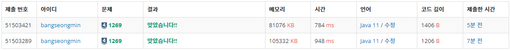

* [1269번, 대칭 차집합](https://www.acmicpc.net/problem/1269)

[1269번: 대칭 차집합

첫째 줄에 집합 A의 원소의 개수와 집합 B의 원소의 개수가 빈 칸을 사이에 두고 주어진다. 둘째 줄에는 집합 A의 모든 원소가, 셋째 줄에는 집합 B의 모든 원소가 빈 칸을 사이에 두고 각각 주어

www.acmicpc.net](https://www.acmicpc.net/problem/1269)

---

### **문제**

자연수를 원소로 갖는 공집합이 아닌 두 집합 A와 B가 있다. 이때, 두 집합의 대칭 차집합의 원소의 개수를 출력하는 프로그램을 작성하시오. 두 집합 A와 B가 있을 때, (A-B)와 (B-A)의 합집합을 A와 B의 대칭 차집합이라고 한다.

예를 들어, A = { 1, 2, 4 } 이고, B = { 2, 3, 4, 5, 6 } 라고 할 때,  A-B = { 1 } 이고, B-A = { 3, 5, 6 } 이므로, 대칭 차집합의 원소의 개수는 1 + 3 = 4개이다.

### **입력과 출력**

* 입력
  + 첫째 줄에 집합 A의 원소의 개수와 집합 B의 원소의 개수가 빈 칸을 사이에 두고 주어진다.
  + 둘째 줄에는 집합 A의 모든 원소가, 셋째 줄에는 집합 B의 모든 원소가 빈 칸을 사이에 두고 각각 주어진다.
  + 각 집합의 원소의 개수는 200,000을 넘지 않으며, 모든 원소의 값은 100,000,000을 넘지 않는다.
* 출력
  + 첫째 줄에 대칭 차집합의 원소의 개수를 출력한다.

### **알고리즘**

**이 문제를 풀기 위해서는 차집합에 대한 이해가 필요하다.**

**차집합**

> 두 집합에서, 하나의 집합에 포함되고 다른 집합에는 포함되지 않는 모든 원소의 집합을 의미한다.

즉 A-B는 A와 B가 공통된 부분을 제거한 A이고, B-A는 A와 B가 공통된 부분을 제거한 B이다.

대칭 차집합은 (A-B)와 (B-A)의 합집합을 의미한다.


대칭 차집합

문제는 대칭 차집합의 원소의 개수를 구하는 것이므로 A-B, B-A 중 차집합 하나를 구하여 중복된 개수를 파악하면 대칭 차집합의 원소의 개수를 구할 수 있다. 즉 중복되지 않은 개수를 구하면 된다.

### **풀이**

#### **방법 1 : [Scanner + HashSet]**

```java
import java.io.IOException;
import java.util.HashSet;
import java.util.Scanner;

public class Main{

    public static void main(String[] args) throws IOException {
        solution();
    }

    public static void solution() {
        Scanner sc = new Scanner(System.in);

        HashSet<Integer> A = new HashSet<>();
        HashSet<Integer> B = new HashSet<>();

        // 첫째 줄에 집합 A의 원소의 개수와 집합 B의 원소의 개수
        String[] line = sc.nextLine().split(" ");
        int N = Integer.parseInt(line[0]);
        int M = Integer.parseInt(line[1]);

        // 둘째 줄에는 집합 A의 모든 원소
        line = sc.nextLine().split(" ");
        for(int i=0; i<N; i++){
            A.add(Integer.valueOf(line[i]));
        }

        // 셋째 줄에는 집합 B의 모든 원소
        line = sc.nextLine().split(" ");
        for(int i=0; i<M; i++){
            B.add(Integer.valueOf(line[i]));
        }

        // A-B
        int cnt = 0;

        for(int value : A){
            if(B.contains(value)){
                cnt++;
            }
        }

        cnt = (A.size() + B.size()) - cnt * 2;

        System.out.println(cnt);
    }
}
```

#### **방법 2 : [BufferedReader + HashSet]**

```java
import java.io.BufferedReader;
import java.io.IOException;
import java.io.InputStreamReader;
import java.util.HashSet;
import java.util.StringTokenizer;

public class Main{

    public static void main(String[] args) throws IOException {
        solution();
    }

    public static void solution() throws IOException {
        BufferedReader br = new BufferedReader(new InputStreamReader(System.in));
        StringTokenizer st;

        HashSet<Integer> A = new HashSet<>();
        HashSet<Integer> B = new HashSet<>();

        // 첫째 줄에 집합 A의 원소의 개수와 집합 B의 원소의 개수
        st = new StringTokenizer(br.readLine());
        int N = Integer.parseInt(st.nextToken());
        int M = Integer.parseInt(st.nextToken());

        // 둘째 줄에는 집합 A의 모든 원소
        st = new StringTokenizer(br.readLine());
        for(int i=0; i<N; i++){
            A.add(Integer.valueOf(st.nextToken()));
        }

        // 셋째 줄에는 집합 B의 모든 원소
        st = new StringTokenizer(br.readLine());
        for(int i=0; i<M; i++){
            B.add(Integer.valueOf(st.nextToken()));
        }

        // A-B
        int cnt = 0;

        for(int value : A){
            if(B.contains(value)){
                cnt++;
            }
        }

        cnt = (A.size() + B.size()) - cnt * 2;

        System.out.println(cnt);
    }
}
```

---

### **성능**



1269번, 실행 결과

**채점 번호 : 51503421- 방법 2 : BufferedReader + ****HashSet******

**채점 번호 : 51503289- 방법 1 : Scanner + **HashSet****
