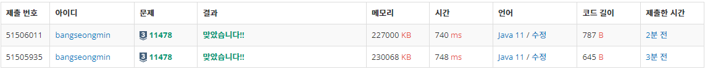

### **문제**

문자열 S가 주어졌을 때, S의 서로 다른 부분 문자열의 개수를 구하는 프로그램을 작성하시오.

부분 문자열은 S에서 연속된 일부분을 말하며, 길이가 1보다 크거나 같아야 한다.

예를 들어, ababc의 부분 문자열은 a, b, a, b, c, ab, ba, ab, bc, aba, bab, abc, abab, babc, ababc가 있고, 서로 다른것의 개수는 12개이다.

### **입력과 출력**

* 입력
  + 첫째 줄에 문자열 S가 주어진다. S는 알파벳 소문자로만 이루어져 있고, 길이는 1,000 이하이다.
* 출력
  + 첫째 줄에 S의 서로 다른 부분 문자열의 개수를 출력한다.

### **알고리즘**

이 문제의 Key는 substring이다.

원본 문자열을 자르는 길이 변경하여 중복없이 저장하는 문제이다.

부분 문자열은 연속된 일부분이라고 하였으므로 순서가 지켜져야한다.

예를 들어, abcde일 경우

1 단계(길이 1) - a, b, c, d, e

2 단계(길이 2) - ab, bc, cd, de

3 단계(길이 3) - abc, bcd, cde

4 단계(길이 4) - abcd, bcde

5 단계(길이 5) - abcde

이와 같이 총 개수는 5 + 4 + 3 + 2 + 1 = 15개이다.

조건 중 문자열에 문자가 중복되지 않는 조건이 없으므로 중복체크를 할 수 있는 자료형을 선택해야한다.

이를 위해 HashSet을 사용할 것이다.

### **풀이**

**방법 1 : [Scanner + HashSet]**

```java
import java.util.HashSet;
import java.util.Scanner;

// For 백준
public class Main{

    public static void main(String[] args) {
        solution();
    }

    public static void solution() {
        Scanner sc = new Scanner(System.in);
        String origin = sc.nextLine();

        HashSet<String> set = new HashSet<>();

        for(int length=1; length <= origin.length(); length++){
            for(int i=0; i<origin.length(); i++){
                if(i+length > origin.length())
                    break;

                set.add(origin.substring(i, i+length));
            }
        }

        System.out.println(set.size());
    }
}
```

**방법 2 : [BufferedReader + HashSet]**

```java
import java.io.BufferedReader;
import java.io.IOException;
import java.io.InputStreamReader;
import java.util.HashSet;

// For 백준
public class Main{

    public static void main(String[] args) throws IOException {
        solution();
    }

    public static void solution() throws IOException {
        BufferedReader br = new BufferedReader(new InputStreamReader(System.in));
        String origin = br.readLine();

        HashSet<String> set = new HashSet<>();

        for(int length=1; length <= origin.length(); length++){
            for(int i=0; i<origin.length(); i++){
                if(i+length > origin.length())
                    break;

                set.add(origin.substring(i, i+length));
            }
        }

        System.out.println(set.size());
    }
}
```

---

### **성능**



11478번, 실행 결과

**채점 번호 : 51506011- 방법 2 : BufferedReader + ****HashSet******

**채점 번호 : 51505935- 방법 1 : Scanner + **HashSet****

****이 문제의 경우, Scanner와 BufferedReader에 성능 차이는 크지 않았다.****
