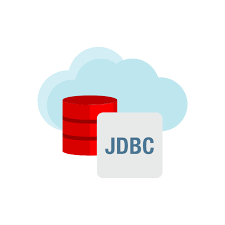
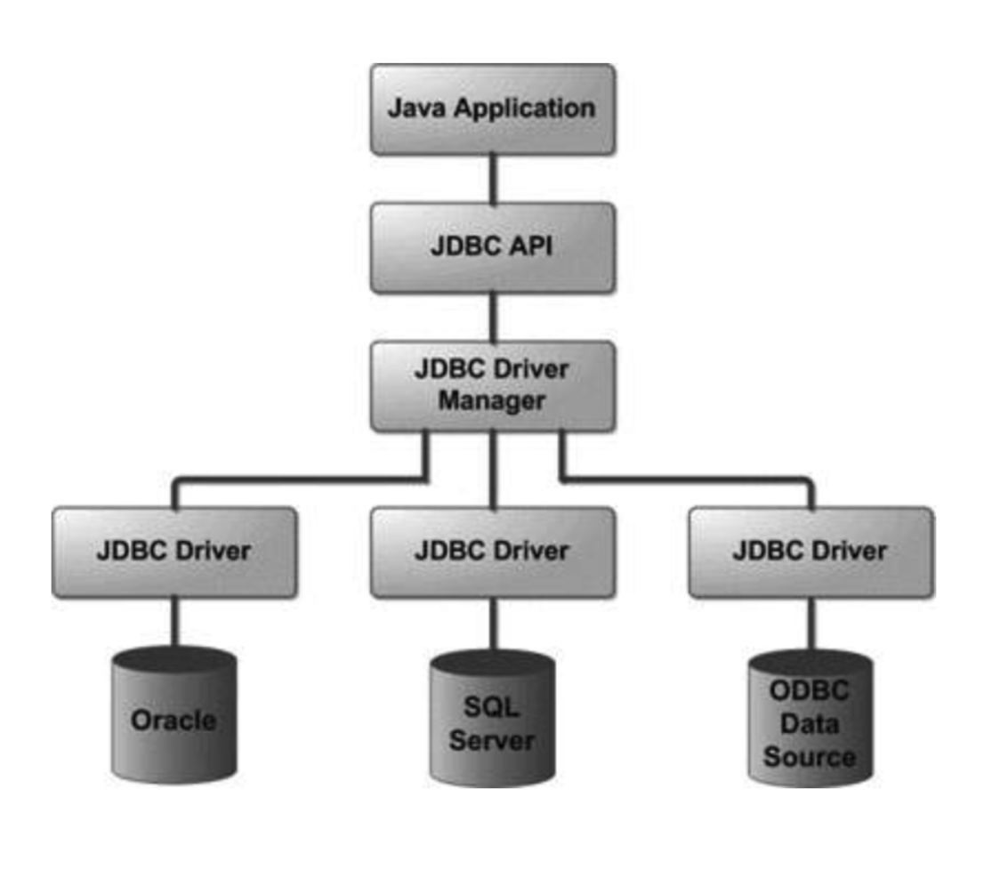

JDBC

---

### JDBC 개념 소개

#### JDBC를 이용하여 간단한 CRUD 학습

📖 JDBC(Java Database Connectivity)

> - 자바 애플리케이션에서 DB 프로그래밍을 할 수 있도록 도와주는 표준 인터페이스이기 때문에 DBMS 종류에 상관없다.  
> - JDBC 인터페이스들을 구현한 구현체들은 각 데이터베이스 벤더 사들이 제공하고 이를 JDBC 드라이버라고 한다.  
> - 자바 코드에서는 JDBC 인터페이스에만 의존하기 때문에 DB를 변경하더라도 코드를 변경할 필요가 없다.



JDBC 구조

---

### **DB 커넥션 풀 개념 소개**

#### **📖 DBCP(Database Connection Pool)**

> - 미리 일정량의 DB 커넥션을 생성해서 풀에 저장해 두고 있다가 HTTP 요청에 따라 필요할 때 풀에서 커넥션을 가져다 사용하는 기법  
> - 참고로 스프링 부트 2.0부터는 디폴트 커넥션 풀로 HikariCP 사용  
> - DBCP 라이브러리 종류로는 HikariCP, Apache CommonsCP, Tomcat JDBCP 등이 있고, HikariCP 사용할 것이다.

#### **🔥 커넥션 풀 사용시 유의 사항**

> - 커넥션의 사용 주체는 **WAS 스레드**(=HTTPServer에서 만들었던 스레드)이므로 커넥션 개수는 WAS 스레드 수와 함께 고려해야 한다.   
> - 커넥션 수를 크게 설정하면 메모리 소모가 큰 대신 동시 접속자 수가 많아지더라도 사용자 대기 시간이 상대적으로 줄어들게 되고, 반대로 커넥션 개수를 작게 설정하면 메모리 소모는 적은 대신 그만큼 대기시간이 길어질 수 있다. 따라서 적정량의 커넥션 객체를 생성해 두어야 한다.  
>   
> (설명) DB 접근을 필요하는 동시 접속자 수가 너무 많은 경우에는 한정된 커넥션 개수 때문에 커넥션이 반납될 때까지 기다려야 할 수 있다. 그렇다고 커넥션 풀에 너무 많은 커녁션을 미리 생성해둘 경우에는 커넥션 또한 객체이기 때문에 메모리를 많이 차지하게 된다. 즉 커넥션 수를 크게 설정하게 되면 메모리 손해가 큰 대신 동시 접속자 수가 많아지더라도 사용자 대기시간이 상대적으로 줄어들게 되고, 반대로 커넥션 개수를 작게 설정하게 되면 메모리 소모는 적은 대신 대기시간이 길어질 수 있다. 따라서 자신이 처한 환경에 맞게 적정량의 커넥션 객체를 생성해 두어야 한다.  
>   
> 커넥션 풀을 적용하기 위해서는 자바의 DataSource를 사용한다.

#### **DataSource**

> - 커넥션 획득하기 위한 표준 인터페이스  
> - HikariCP의 DataSource 사용

---

### **JDBC 프로그래밍 실습**

**의존성 추가**

```java
dependencies {
    // HikariCP
    implementation 'com.zaxxer:HikariCP:5.0.1'
    // spring-jdbc
    implementation 'org.springframework:spring-jdbc:5.3.22'

    testImplementation 'org.junit.jupiter:junit-jupiter-api:5.8.1'
    testRuntimeOnly 'org.junit.jupiter:junit-jupiter-engine:5.8.1'

    // 테스트 가독성을 위한 assertJ
    testImplementation 'org.assertj:assertj-core:3.22.0'
    // 인메모리 DB인 H2database
    testImplementation 'com.h2database:h2:2.1.214'
}
```

**ConnectionManager**

```java
package org.example;

public class ConnectionManager {

    public static DataSource getDataSource() {
        HikariDataSource hikariDataSource = new HikariDataSource();
        hikariDataSource.setDriverClassName("org.h2.Driver");
        hikariDataSource.setJdbcUrl("jdbc:h2:mem://localhost/~/jdbc-practice;MODE=MySQL;DB_CLOSE_DELAY=-1");
        hikariDataSource.setUsername("sa");
        hikariDataSource.setPassword("");

        return hikariDataSource;
    }
}
```

**User**

```java
package org.example;

public class User {
    private final String email;
    private final String name;
    private final String userId;
    private final String password;

    public User(String userId, String password, String name, String email) {
        this.userId = userId;
        this.password = password;
        this.name = name;
        this.email = email;
    }

    public String getEmail() {
        return email;
    }

    public String getName() {
        return name;
    }

    public String getUserId() {
        return userId;
    }

    public String getPassword() {
        return password;
    }

    @Override
    public boolean equals(Object o) {
        if (this == o) return true;
        if (o == null || getClass() != o.getClass()) return false;
        User user = (User) o;
        return Objects.equals(email, user.email) && Objects.equals(name, user.name) && Objects.equals(userId, user.userId) && Objects.equals(password, user.password);
    }

    @Override
    public int hashCode() {
        return Objects.hash(email, name, userId, password);
    }
}
```

**UserDao**

```java
package org.example;

public class UserDao {

    private Connection getConnection() {
        String url = "jdbc:h2:mem://localhost/~/jdbc-practice;MODE=MySQL;DB_CLOSE_DELAY=-1";
        String id = "sa";
        String pw = "";

        try {
            Class.forName("org.h2.Driver");
            return DriverManager.getConnection(url, id, pw);
        } catch (Exception ex) {
            return null;
        }
    }

    public void create(User user) throws SQLException {
        Connection con = null;
        PreparedStatement pstmt = null;

        try {
            con = getConnection();
            String sql = "INSERT INTO USERS VALUES (?, ?, ?, ?)";

            pstmt = con.prepareStatement(sql);

            pstmt.setString(1, user.getUserId());
            pstmt.setString(2, user.getPassword());
            pstmt.setString(3, user.getName());
            pstmt.setString(4, user.getEmail());

            pstmt.executeUpdate();
        } finally {
            if (pstmt != null)
                pstmt.close();

            if (con != null)
                con.close();
        }
    }

    public User findByUserId(String userId) throws SQLException {
        Connection con = null;
        PreparedStatement pstmt = null;
        ResultSet rs = null;

        try {
            con = getConnection();
            String sql = "SELECT userId, password, name, email FROM USERS WHERE userid = ?";
            pstmt = con.prepareStatement(sql);
            pstmt.setString(1, userId);
            rs = pstmt.executeQuery();

            User user = null;
            if (rs.next()) {
                user = new User(
                        rs.getString("userId"),
                        rs.getString("password"),
                        rs.getString("name"),
                        rs.getString("email"));
            }

            return user;
        } finally {
            if (rs != null)
                rs.close();

            if (pstmt != null)
                pstmt.close();

            if (con != null)
                con.close();
        }
    }
}
```

**UserDao 테스트 코드**

```java
package org.example;

public class UserDaoTest {

    @BeforeEach     // 테스트 코드 실행 전에 수행해야할 작업
    void setUp() {
        ResourceDatabasePopulator populator = new ResourceDatabasePopulator();

        // "db_schema.sql"파일을 ClassPathResource를 통해 읽어와서 스크립트 추가
        populator.addScript(new ClassPathResource("db_schema.sql"));
        // "db_schema.sql"파일의 Query 실행
        DatabasePopulatorUtils.execute(populator, ConnectionManager.getDataSource());
    }

    @Test
    void createTest() throws SQLException {
        // DAO 생성
        UserDao userDao = new UserDao();

        // DAO에 해당 USER 정보 저장을 요청
        userDao.create(new User("wizard", "password", "name", "email"));

        // DAO에 해당 아이디에 대한 정보 조회
        User user = userDao.findByUserId("wizard");

        // 검증
        assertThat(user).isEqualTo(new User("wizard", "password", "name", "email"));
    }
}
```

**🔎 코드 분석**

> UserDao 테스트 코드를 통해 JDBC를 간단하게 사용할 수 있었고, Create, Read 작업을 실행하는 코드이다.  
> 현재 코드는 응집도가 낮고, 결합도가 높은 코드이다. 또한 중복된 코드가 많아 유지보수가 불편한 코드이다.  
> 그렇기 때문에 리팩토링 과정이 필요하다.

---

### **JDBC 코드 리팩토링 및 DB 커넥션 풀 적용**

**1. UserDao의 getConnection() => ConnectionManager 클래스로 이동**

* 확장이 용이하게 변경
* 커넥션 풀 적용

```java
package org.example;

public class ConnectionManager {

    private static final String DB_DRIVER = "org.h2.Driver";
    private static final String DB_URL = "jdbc:h2:mem://localhost/~/jdbc-practice;MODE=MySQL;DB_CLOSE_DELAY=-1";
    private static final String DB_USERNAME = "sa";
    private static final String DB_PASSWORD = "";
    public static final int MAX_POOL_SIZE = 40;

    private static final DataSource ds;

    static {
        // DataSource는 하나이기 때문에 static 으로 초기화

        HikariDataSource hikariDataSource = new HikariDataSource();
        hikariDataSource.setDriverClassName(DB_DRIVER);
        hikariDataSource.setJdbcUrl(DB_URL);
        hikariDataSource.setUsername(DB_USERNAME);
        hikariDataSource.setPassword(DB_PASSWORD);

        // 커넥션 풀의 최대 개수 설정
        hikariDataSource.setMaximumPoolSize(MAX_POOL_SIZE);
        hikariDataSource.setMinimumIdle(MAX_POOL_SIZE);

        ds = hikariDataSource;
    }


    // 커넥션 Pool 적용
    public static Connection getConnection() {
        try {
            // DataSource로부터 Connection을 받아온다.
            return ds.getConnection();
        } catch (SQLException e) {
            throw new IllegalStateException(e);
        }
    }

    public static DataSource getDataSource() {
        return ds;
    }
}
```

**🔎 코드 분석**

> 커넥션을 받아오는 코드를 커넥션 풀을 적용해서 받아오도록 변경됨.

**2. UserDao의 비효율적인 코드**

* 현재 코드는 요청이 변경될 때마다 변경되어야 하는 부분이 많다.**(확장성과 유지보수의 어려움)**

**1. JdbcTemplate 클래스를 라이브러리처럼 사용하자.**

* create() -> executeUpdate() 으로 메소드명 변경
* 변경될 수 있는 코드를 외부에서 주입받도록 변경

**💣 문제**

> PreparedStatement를 외부에서 전달받기 위해서는 Connection 으로부터 PreparedStatement을 얻어서 주입받아아 인자로 전달해야한다는 문제가 발생한다. 즉 executeUpdate()를 요청하는 쪽에서 Connection에 대해 알아야한다.

**💉 해결**

> PreparedStatement에 파라미터를 설정하는 부분 즉 setString()부분만 인자로 받으면 된다. 이를 위해 PreparedStatementSetter라는 인터페이스를 사용하여 setting을 할 수 있게 할 것이다.

**PreparedStatementSetter 인터페이스**

```java
public interface PreparedStatementSetter {
    void setter(PreparedStatement pstmt) throws SQLException;
}
```

**JdbcTemplate**

```java
package org.example;

public class JdbcTemplate {

    public void executeUpdate(User user, String sql, PreparedStatementSetter pss) throws SQLException {
        Connection con = null;
        PreparedStatement pstmt = null;

        try {
            con = ConnectionManager.getConnection();

            pstmt = con.prepareStatement(sql);

            pss.setter(pstmt);

            pstmt.executeUpdate();
        } finally {
            if (pstmt != null)
                pstmt.close();

            if (con != null)
                con.close();
        }
    }
}
```

**UserDao**

```java
package org.example;

public class UserDao {

    // AS-IS
    public void create(User user) throws SQLException{
        Connection con = null;
        PreparedStatement pstmt = null;

        try{
            con = ConnectionManager.getConnection();
            String sql = "INSERT INTO USERS VALUES (?, ?, ?, ?)";   // 변경될 수 있는 요소

            pstmt = con.prepareStatement(sql);

            pstmt.setString(1, user.getUserId());
            pstmt.setString(2, user.getPassword());
            pstmt.setString(3, user.getName());
            pstmt.setString(4, user.getEmail());

            pstmt.executeUpdate();
        }finally {
            if (pstmt != null)
                pstmt.close();

            if (con != null)
                con.close();
        }
    }

    // TO-BE
    public void create(User user) throws SQLException {
        JdbcTemplate jdbcTemplate = new JdbcTemplate();
        String sql = "INSERT INTO USERS VALUES (?, ?, ?, ?)";
        jdbcTemplate.executeUpdate(user, sql, pstmt -> {
            pstmt.setString(1, user.getUserId());
            pstmt.setString(2, user.getPassword());
            pstmt.setString(3, user.getName());
            pstmt.setString(4, user.getEmail());
        });
    }
}
```

🔎 코드 분석

> 변경되는 부분은 API 호출자 입장에서 원하는 방식으로 변경하여 처리할 수 있도록 리팩토링되었다.  
> 이를 통해 API를 사용하는 쪽에서는 입장에서는 Connection을 닫는 작업 등을 신경쓰지 않아도 된다.  
> => **관심사 분리**

**2. 동일한 방법으로 findById() => executeQuery()로 변경**

> **변경이 필요한 부분**  
> 1. Query  
> 2. setString()  
> 3. getString()

**RowMapper 인터페이스**

```java
public interface RowMapper {

    Object map(ResultSet resultSet) throws SQLException;
}
```

**JdbcTemplate**

```java
package org.example;

import java.sql.Connection;
import java.sql.PreparedStatement;
import java.sql.ResultSet;
import java.sql.SQLException;

public class JdbcTemplate {

    public Object executeQuery(String sql, PreparedStatementSetter pss, RowMapper rowMapper) throws SQLException {
        Connection con = null;
        PreparedStatement pstmt = null;
        ResultSet rs = null;

        try {
            con = ConnectionManager.getConnection();
            pstmt = con.prepareStatement(sql);
            pss.setter(pstmt);

            rs = pstmt.executeQuery();

            Object obj = null;
            if (rs.next()) {
                return rowMapper.map(rs);
            }

            return obj;

        } finally {
            if (rs != null)
                rs.close();

            if (pstmt != null)
                pstmt.close();

            if (con != null)
                con.close();
        }
    }

}
```

**UserDao**

```java
package org.example;

public class UserDao {

    // AS-IS
    public User findByUserId(String userId) throws SQLException {
        Connection con = null;
        PreparedStatement pstmt = null;
        ResultSet rs = null;

        try {
            con = ConnectionManager.getConnection();
            String sql = "SELECT userId, password, name, email FROM USERS WHERE userid = ?";
            pstmt = con.prepareStatement(sql);
            pstmt.setString(1, userId);
            rs = pstmt.executeQuery();

            User user = null;
            if (rs.next()) {
                user = new User(
                        rs.getString("userId"),
                        rs.getString("password"),
                        rs.getString("name"),
                        rs.getString("email"));
            }

            return user;
        } finally {
            if (rs != null)
                rs.close();

            if (pstmt != null)
                pstmt.close();

            if (con != null)
                con.close();
        }
    }

    // TO-BE : 변경되는 부분은 API 호출자 입장에서 전달하면 된다.
    public User findByUserId(String userId) throws SQLException {
        JdbcTemplate jdbcTemplate = new JdbcTemplate();
        String sql = "SELECT userId, password, name, email FROM USERS WHERE userid = ?";

        return (User) jdbcTemplate.executeQuery(sql,
                pstmt -> pstmt.setString(1, userId),

                resultSet -> new User(
                        resultSet.getString("userId"),
                        resultSet.getString("password"),
                        resultSet.getString("name"),
                        resultSet.getString("email")
                ));
    }
}
```

#### **📖 정리**

> 1. 변경되는 부분은 메소드 호출자마다 다르기 때문에 메소드 인자를 통해 변경되도록 함.  
> 2. HikariCP를 사용해서 Connection Pool을 적용할 수 있다.  
> 3. **Connection Pool Size 개수는 모니터링을 통해 MaximumPoolSize 개수를 정하면 된다.****⭐**⭐****⭐****
