## MVC 프레임워크 만들기

---

### **리플렉션 API 개념 소개 및 실습**

#### **Reflection**

* **힙 영역에 로드돼 있는 클래스 타입의 객체를 통해 필드/메소드/생성자를 접근 제어자와 상관 없이 사용할 수 있도록 지원하는 API**힙 영역에 로드돼 있는 클래스 타입의 객체를 가져오는 방법은 총 3 가지가 있다.1. 클래스.클래스  
  2. 인스턴스.getClass  
  3. Class.forName  

  참고로 JVM의 클래스 로더는 클래스 파일에 대한 로딩이 끝나면 클래스 파일의 객체를 생성해서 메모리 힙 영역에 저장한다.

* **컴파일 시점이 아닌 런타임 시점에 동적으로 특정 클래스의 정보를 추출해낼 수 있는 프로그래밍 기법**
* **주로 프레임워크 또는 라이브러리 개발 시 사용됨**

[참고] [Baeldung - reflections libraray에 대한 구체적인 사용방법](https://www.baeldung.com/reflections-library)

---

#### **Reflection 사용하는 프레임워크/라이브러리 소개**

* Spring Framework - Ex. DI
* Test Framework - Ex. JUnit
* JSON Serialization/Deserialization 라이브러리 - Ex. Jackson
* etc

---

#### **실습**

> @Controller 애노테이션이 설정돼 있는 모든 클래스를 찾아서 출력한다.

**용어 정리**

* **@Target** : 사용자가 만든 어노테이션이 부착될 수 있는 타입을 지정하는 어노테이션이다.
* ElementType.TYPE : Class, interface (including annotation type), or enum declaration에 붙일 수 있는 어노테이션
* ElementType.Method :  Method에 붙일 수 있는 어노테이션
* **@Retention :** 어느 시점까지 어노테이션의 메모리를 가져갈 지 설정하는 어노테이션이다.

즉, Target 어노테이션을 통해 대상을 정하고, Retention 어노테이션을 통해 기간을 정한다.

**Controller 어노테이션**

```java
package org.example.annotation;

@Target({ElementType.TYPE})         // 클래스에 어노테이션을 붙이고 싶기 때문에 대상을 TYPE으로 지정함.
@Retention(RetentionPolicy.RUNTIME) // 유지 기간은 런타임 기간까지
public @interface Controller {
}
```

**HomeController 클래스**

```java
package org.example.controller;

@Controller
public class HomeController {

    @RequestMapping(value = "/", method = ReqeustMethod.GET)
    public String home(HttpServletRequest request, HttpServletResponse response){

        // Controller 어노테이션이 붙은 클래스만 찾는 것이기 메소드는 사실 필요 없다
        return "home";
    }
}
```

**RequestMapping 어노테이션**

```java
package org.example.annotation;

@Target({ElementType.TYPE, ElementType.METHOD})     // RequestMapping은 클래스와 메소드에 붙일 수 있다.
@Retention(RetentionPolicy.RUNTIME)                 // 유지 기간은 런타임 기간까지
public @interface RequestMapping {

    String value() default "";

    // GET, POST 등 메소드에 따라 RequestMethod를 요청할 수 있고, GET 요청에 URL Path를 입력할 수 있기 때문에 URL Path에 해당하는 value와 GET 요청인지 POST 요청인지에 따른 메소드 설정
    ReqeustMethod[] method() default {};
}
```

**RequestMethod Enum 클래스**

```java
package org.example.annotation;

public enum ReqeustMethod {
    GET, POST, PUT, DELETE
}
```

**ReflectionTest 클래스**

```java
package org.example;

/**
 *  @ Controller 애노테이션이 설정돼 있는 모든 클래스를 찾아서 출력한다.
 */

public class ReflectionTest {

    private static final Logger logger = LoggerFactory.getLogger(ReflectionTest.class);

    @Test
    void controllerScan() {
        // 해당 패키지 밑에 있는 클래스에 대해서
        Reflections reflections = new Reflections("org.example");

        Set<Class<?>> beans = new HashSet<>();
        // "Controller"라는 어노테이션이 붙은 클래스를 찾는다.
        beans.addAll(reflections.getTypesAnnotatedWith(Controller.class));
        logger.debug("beans: [{}]", beans);
    }
}
```

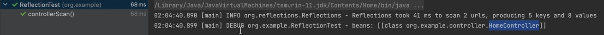

실행 결과 : 성공

**Service 어노테이션**

```java
package org.example.annotation;

@Target({ElementType.TYPE})
@Retention(RetentionPolicy.RUNTIME)
public @interface Service {
}
```

**HomeService 클래스**

```java
package org.example.controller;

@Service
public class HomeService {
}
```

**ReflectionTest 클래스**

```java
package org.example;

/**
 *  @ Controller 애노테이션이 설정돼 있는 모든 클래스를 찾아서 출력한다.
 */

public class ReflectionTest {

    private static final Logger logger = LoggerFactory.getLogger(ReflectionTest.class);

    @Test
    void controllerScan() {
        // 해당 패키지 밑에 있는 클래스에 대해서
        Reflections reflections = new Reflections("org.example");

        Set<Class<?>> beans = new HashSet<>();
        // "Controller"라는 어노테이션이 붙은 클래스를 찾는다.
        beans.addAll(reflections.getTypesAnnotatedWith(Controller.class));
        beans.addAll(reflections.getTypesAnnotatedWith(Service.class));
        logger.debug("beans: [{}]", beans);
    }
}
```

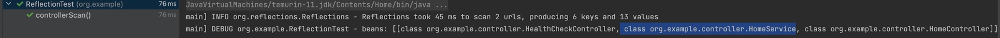

실행 결과

**ReflectionTest 클래스 리팩토링**

```java
package org.example;

/**
 *  @ Controller 애노테이션이 설정돼 있는 모든 클래스를 찾아서 출력한다.
 */

public class ReflectionTest {

    private static final Logger logger = LoggerFactory.getLogger(ReflectionTest.class);

    @Test
    void controllerScan() {
        Set<Class<?>> beans = getTypesAnnotatedWith(List.of(Controller.class, Service.class));

        logger.debug("beans: [{}]", beans);
    }

    private Set<Class<?>> getTypesAnnotatedWith(List<Class<? extends Annotation>> annotations) {
        // 해당 패키지 밑에 있는 클래스에 대해서
        Reflections reflections = new Reflections("org.example");

        Set<Class<?>> beans = new HashSet<>();
        // "Controller"라는 어노테이션이 붙은 클래스를 찾는다.

        // AS-IS
        // beans.addAll(reflections.getTypesAnnotatedWith(Controller.class));
        // beans.addAll(reflections.getTypesAnnotatedWith(Service.class));

        // TO-BE
        annotations.forEach(annotation -> beans.addAll(reflections.getTypesAnnotatedWith(annotation)));

        return beans;
    }

     // model 테스트를 위한 코드
    @Test
    void showClass() {
        Class<User> clazz = User.class;
        // 클래스 이름 - org.example.model.User
        logger.debug(clazz.getName());

        // 클래스 필드 정보 - [private java.lang.String org.example.model.User.userId, private java.lang.String org.example.model.User.name]
        logger.debug("User all declared fields: [{}]", Arrays.stream(clazz.getDeclaredFields()).collect(Collectors.toList()));

        // 생성자 정보 - [public org.example.model.User(java.lang.String,java.lang.String)]
        logger.debug("User all declared constructors: [{}]", Arrays.stream(clazz.getDeclaredConstructors()).collect(Collectors.toList()));

        // 메소드 정보 - [public boolean org.example.model.User.equals(java.lang.Object), public int org.example.model.User.hashCode(), public boolean org.example.model.User.equalsUser(org.example.model.User)]
        logger.debug("User all declared methods: [{}]", Arrays.stream(clazz.getDeclaredMethods()).collect(Collectors.toList()));
    }

    // 힙 영역에 로드돼 있는 클래스 타입의 객체를 가져오는 방법 3가지
    @Test
    void load() throws ClassNotFoundException {
        // 방법 1
        Class<User> clazz = User.class;

        // 방법 2
        User user = new User("wizard", "name");
        Class<? extends User> clazz2 = user.getClass();

        // 방법 3
        Class<?> clazz3 = Class.forName("org.example.model.User");

        // 동일성 체크
        logger.debug("clazz: [{}]", clazz);
        logger.debug("clazz2: [{}]", clazz2);
        logger.debug("clazz3: [{}]", clazz3);

        assertThat(clazz == clazz2).isTrue();
        assertThat(clazz2 == clazz3).isTrue();
        assertThat(clazz3 == clazz).isTrue();
    }
}
```

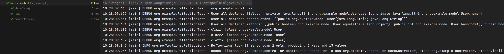

실행 결과

**📖 정리**

> **1. 어노테이션(Controller, Service 등)을 직접 생성하여 어노테이션의 원리를 이해할 수 있다.**  
> **2. Reflection을 통해 패키지 내부에 존재하는 클래스를 파악할 수 있다.**  
> **3. 테스트 클래스 리팩토링을 통한 확장가능한 코드로 변경**  
> **4. 힙영역에 로드돼 있는 클래스 타입의 객체를 가져오는 방법 3가지**  
> **5. model을 생성하여 클래스 이름, 클래스 필드 정보, 생성자 정보, 메소드 정보를 파악할 수 있다.**

---

### 프런트 컨트롤러 패턴 개념 소개

#### **프런트 컨트롤러 패턴**

* 모든 요청을 단일 Handler(처리기)에서 처리하도록 하는 패턴  
  => 중앙 집중식 요청 매커니즘을 갖고 있음.
* 스프링 웹 MVC 프레임워크의 DispatcherServlet(프런트 컨트롤러 역할)이 프런트 컨트롤러 패턴으로 구현돼 있음

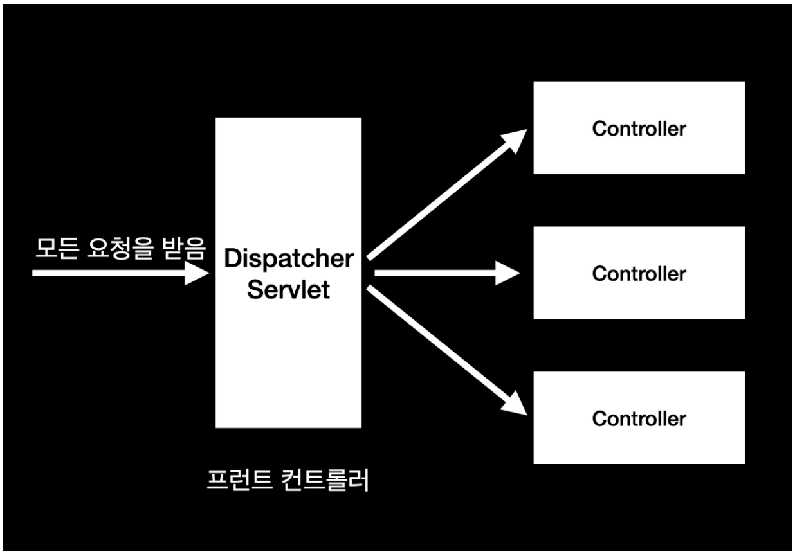

DispatcherServlet

---

#### **Forward**

* 서블릿에서 클라이언트(웹 브라우저)를 거치지 않고 바로 다른 서블릿(또는 JSP)에게 요청하는 방식  
  **즉 URL 주소가 변경되지 않는다.**
* Forward 방식은 서버 내부에서 일어나는 요청이기 때문에 기존의 생성된 HttpServletRequest, HttpServletResponse 객체가 새롭게 생성되지 않고, 공유된다.  

  RequestDispatcher dispatcher = request.getRequestDispatcher("포워드 할 서블릿 또는 JSP")  
  dispatcher.forward(reqeust, response)

#### **Redirect**

* 서블릿이 클라이언트(웹 브라우저)를 다시 거쳐 다른 서블릿(또는 JSP)에게 요청하는 방식  
  **즉 URL 주소가 변경된다.**
* Redirect 방식은 클라이언트로부터 새로운 요청이기 때문에 HttpServletRequest, HttpServletResponse 객체가 생성됨
* HttpServlet 객체의 sendRedirect() 이용

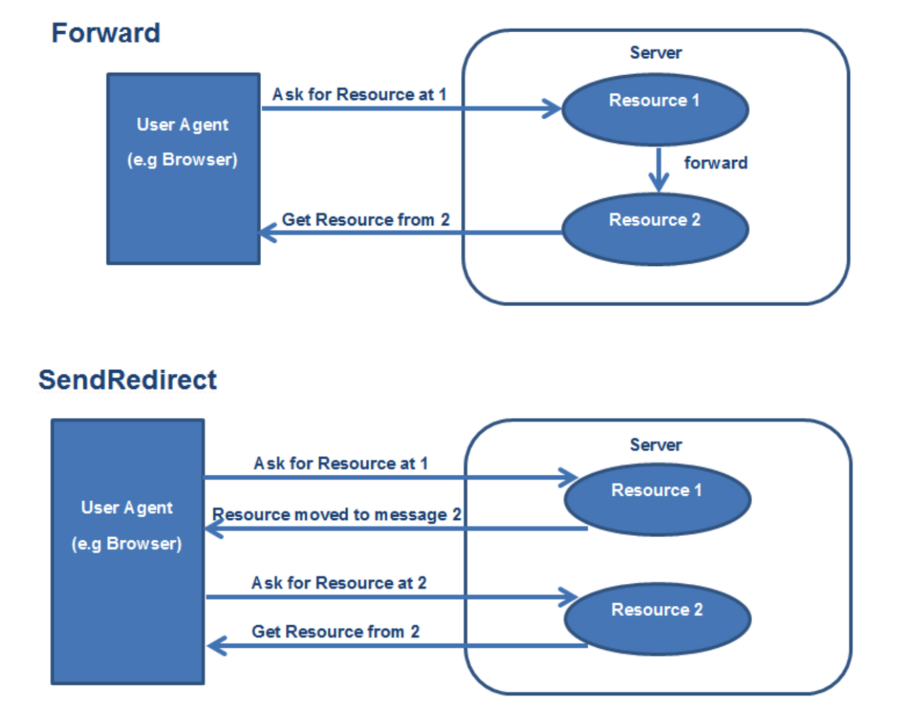

Forward와 Redirect 비교

> **Forward 방식**  
> Forward 방식은 서버 내부에서 일어나는 요청이기 때문에 기존 요청에 의해 생성된 HttpServletRequest와 HttpServletResponse 객체를 서버 내부에서 일어나는 요청에게 전달할 때 새롭게 생성해서 전달하는 것이 아닌 기존 객체를 전달하여 공유하는 방식이다.  
>   
> **Redirect 방식**  
> Redirect 방식은 해당 요청이 들어왔을 때 응답을 웹 브라우저에게 주고, 다시 웹 브라우저에서 다른 서블릿(또는 JSP)에게 요청을 하는 방식이다. 즉 Redirect 방식은 새로운 요청이기 때문에 HttpServletRequest와 HttpServletResponse 객체가 새롭게 생성되게 된다.

**🔊 요약**

> 1. **프론트 컨트롤러 패턴**은 모든 요청을 단일 Handler인 DispatcherServlet이 받아서 적절한 Controller에게 위임해준다.  
> 2. **Forward 방식**은 서블릿에서 클라이언트(웹 브라우저)를 거치지 않고 다른 서블릿 또는 JSP에게 요청하는 방식으로 URL 주소가 변경되지 않는다.  
> 3. **Redirect 방식**은 서블렛에서 클라이언트(웹 브라우저)를 다시 거쳐 다른 서블릿 또는 JSP에게 요청하는 방식으로 **URL 주소가 변경**된다.

---

### 프론트 컨트롤러 패턴 실습

**요구사항**

> 모든 요청을 DispatcherServlet이 받아서 적절한 Controller에게 작업을 위임한다.

**1단계 : 의존성 추가**

```java
dependencies {
    // WAS - embedded Tomcat
    implementation 'org.apache.tomcat.embed:tomcat-embed-core:8.5.42'
    implementation 'org.apache.tomcat.embed:tomcat-embed-jasper:8.5.42'

    // Tomcat은 서블릿을 실행하기 때문에 Servlet 필요
    implementation 'javax.servlet:javax.servlet-api:4.0.1'

    // 간단한 JSTL을 위한 용도
    implementation 'javax.servlet:jstl:1.2'

    // log를 위한 용도
    implementation 'ch.qos.logback:logback-classic:1.2.3'

    testImplementation 'org.junit.jupiter:junit-jupiter-api:5.8.1'
    testRuntimeOnly 'org.junit.jupiter:junit-jupiter-engine:5.8.1'
}
```

**2단계 : WebApplicationServer 클래스 생성**

* main 메소드를 실행했을 때, Tomcat이 실행되도록 구현

```java
package org.example;

public class WebApplicationServer {
    private final static Logger log = LoggerFactory.getLogger(WebApplicationServer.class);

    public static void main(String[] args) throws LifecycleException {
        String webappDirLocation = "webapps/";
        Tomcat tomcat = new Tomcat();
        tomcat.setPort(8080);

        tomcat.addWebapp("/", new File(webappDirLocation).getAbsolutePath());
        log.info("configuring app with basedir: {}", new File("./"+webappDirLocation).getAbsolutePath());

        tomcat.start();
        tomcat.getServer().await();
    }
}
```

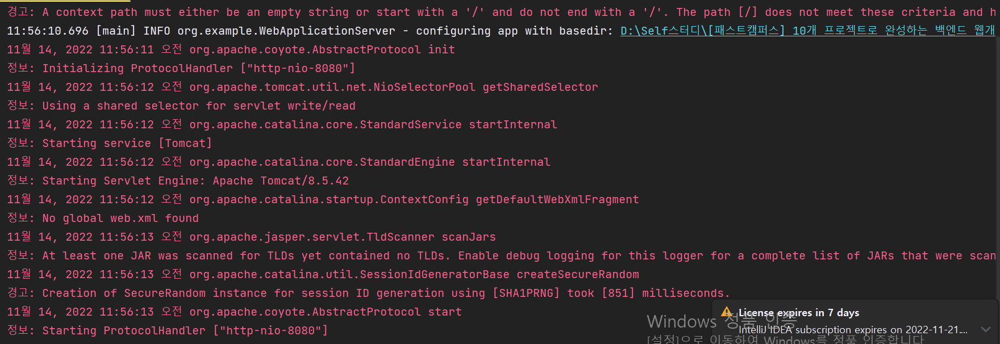

실행 결과 : 서버 실행 성공

**3단계 : mvc 패키지에 DispatcherServlet 클래스 생성**

* Tomcat에 의해 실행되기 위해 Servlet이 되어야하기 때문에 HttpServlet 상속
* 모든 경로에서 호출되기 위해 경로를 '/'으로 설정
* service를 통해 확인 가능

```java
package org.example.mvc;

@WebServlet("/")
public class DispatcherServlet extends HttpServlet {

    private static final Logger log = LoggerFactory.getLogger(DispatcherServlet.class);


    @Override
    protected void service(HttpServletRequest request, HttpServletResponse response) throws ServletException, IOException {
        // 모든 경로에 대해 호출되는지 판단하기 위한 로그
        log.info("DispatcherServlet#service");
    }
}
```

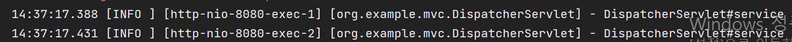

모든 요청에 대해 DispatcherServlet이 호출되는지 테스트

**4단계 : controller 패키지를 생성하고 controller 인터페이스 구현**

```java
package org.example.mvc.controller;

public interface Controller {

    String handleRequest(HttpServletRequest request, HttpServletResponse response) throws Exception;
}
```

**5단계 : controller 인터페이스에 대한 구현체**

```java
package org.example.mvc.controller;

public class HomeController implements Controller{

    @Override
    public String handleRequest(HttpServletRequest request, HttpServletResponse response) throws Exception {
        return "home.jsp";
    }
}
```

**6단계 : RequestMappingHandlerMapping 클래스 생성**

* URI 경로와 Controller 맵핑정보 저장

```java
package org.example.mvc;

public class RequestMappingHandlerMapping {

    // [Key] URI Path, [Value] Controller
    private Map<String, Controller> mappings = new HashMap<>();

    // 인덱스 페이지에 대한 설정
    void init(){
        mappings.put("/", new HomeController());
    }

    // URI 경로에 따른 컨트롤러 호출 메소드
    public Controller findHanlder(String uriPath){
        return mappings.get(uriPath);
    }
}
```

**7단계 : DispatcherServlet에 RequestMappingHandlerMapping 객체 적용**

```java
package org.example.mvc;

@WebServlet("/")
public class DispatcherServlet extends HttpServlet {

    private static final Logger log = LoggerFactory.getLogger(DispatcherServlet.class);

    private RequestMappingHandlerMapping rmhm;

    @Override
    public void init() throws ServletException {
        rmhm = new RequestMappingHandlerMapping();
        rmhm.init();
    }

    @Override
    protected void service(HttpServletRequest request, HttpServletResponse response) throws ServletException, IOException {
        // 모든 경로에 대해 호출되는지 판단하기 위한 로그
        log.info("[DispatcherServlet] service started");

        try {
            Controller handler = rmhm.findHanlder(request.getRequestURI());     // 1. 요청된 경로를 통해 적절한 컨트롤러 반환
            String viewName = handler.handleRequest(request, response);         // 2. Handler에게 작업을 위임하고 해당 viewName을 받는다.

            RequestDispatcher requestDispatcher = request.getRequestDispatcher(viewName);   
            requestDispatcher.forward(request, response);

        } catch (Exception e) {
            log.error("exception occurred [{}]", e.getMessage(), e);
            throw new ServletException(e);
        }
    }
}
```

> 이를 통해 DispatcherServlet의 원리와 역할을 이해할 수 있고, 원하는 대로 커스터마이징할 수 있다.

---

### MVC 프레임워크 만들기 개념 소개

#### [**스프링 웹 MVC 프레임워크**](https://docs.spring.io/spring-framework/docs/3.2.x/spring-framework-reference/html/mvc.html)

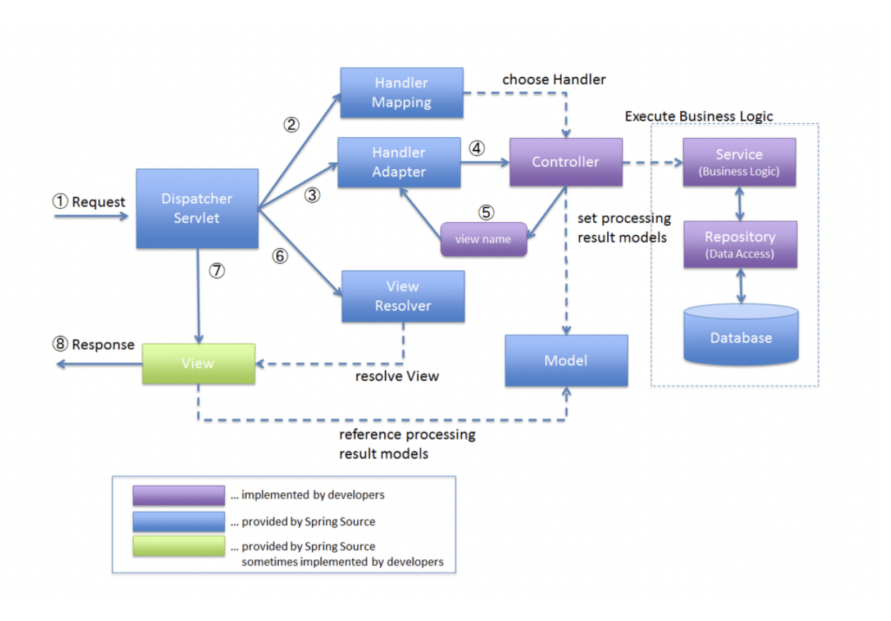

Spring MVC 프레임워크 구조

1. 클라이언트로부터 요청이 들어오면 **DispatcherServlet**이 요청을 받게 된다.
2. **DispatcherServlet**는 **HandlerMapping**을 통해 적절한 **Handler**(=**Controller**)를 찾는다.
3. ****DispatcherServlet****는 ******HandlerApdater******를 통해 해당********Handler**(=**Controller**)******를 실행한다.
4. **HandlerApdater**를 통해 적절한 **Adapter**에서 **Handler**(=**Controller**)를 실행한다.
5. **Controller**는 해당 리턴 값으로 **view name**을 반환해준다.
6. ****DispatcherServlet****는 ****view name****을 가지고 **View Resolver**를 통해서 **view** 객체를 리턴받는다.
7. 최종적으로 **Veiw Render**를 통해 응답 값을 리턴해준다.

직접 구현할 MVC 프레임워크는 **애노테이션 기반 MVC 프레임워크**이다.

* **DispatcherServlet**
* **AnnotationHandlerMapping**
* **HandlerAdapter**
* **ViewResolver**

---

### MVC 프레임워크 만들기 실습

#### 서비스 로직 구현

**1. UserListController 클래스 생성**

> 해당 Controller를 생성하는 이유는 현재 Controller가 하나이기 때문에 편의를 위해 추가적으로 구현

```java
package org.example.mvc.controller;

public class UserListController implements Controller{
    @Override
    public String handleRequest(HttpServletRequest request, HttpServletResponse response) throws Exception {
        return "/user/list.jsp";
    }
}
```

**2. UserListController 에 대한 list.jsp 구현**

```java
<%@ page contentType="text/html;charset=UTF-8" language="java" %>
<%@ taglib prefix="c" uri="http://java.sun.com/jsp/jstl/core" %>

<!DOCTYPE html>
<html lang="kr">
<head>
    <meta charset="UTF-8">
    <title>list</title>
</head>
<body>

<table>
    <thead>
    <tr>
        <th>#</th>
        <th>아이디</th>
        <th>이름</th>
        <th></th>
    </tr>
    </thead>
    <tbody>
    <c:forEach items="${users}" var="user" varStatus="status">
        <tr>
            <th scope="row">${status.count}</th>
            <td>${user.userId}</td>
            <td>${user.name}</td>
            </td>
        </tr>
    </c:forEach>
    </tbody>
</table>
</body>
</html>
```

**🔎 코드 분석**

> users를 가지고 foreach문을 돌면서 userId와 name을 출력하고 있다. 이를 위해 jsp파일에 users를 전달해주는 부분이 필요하다. 즉 UserListController에서 list.jsp를 전달할 때 users라는 정보를 함께 전달해야 한다.

**3. UserListController 에서 Users  정보 전달**

```java
package org.example.mvc.controller;

public class UserListController implements Controller{
    @Override
    public String handleRequest(HttpServletRequest request, HttpServletResponse response) throws Exception {
        // Users 정보 전달(현재 User 관련 클래스가 없으므로 List.of()형태로 임시 조치)
        request.setAttribute("users", List.of());

        return "/user/list.jsp";
    }
}
```

**4. RequestMappingHandlerMapping에 UserListController 추가**

```java
package org.example.mvc;

public class RequestMappingHandlerMapping {

    // [Key] URL Path, [Value] Controller
    private Map<String, Controller> mappings = new HashMap<>();

    // 인덱스 페이지에 대한 설정
    void init(){
        mappings.put("/", new HomeController());
        mappings.put("/users", new UserListController());
    }

    // URI 경로에 따른 컨트롤러 호출 메소드
    public Controller findHanlder(String uriPath){
        return mappings.get(uriPath);
    }
}
```

**📖 정리**

> Controller가 추가될때마다 경로와 Controller를 추가해주면 DispatcherServlet에서 적절한 Controller를 찾아서 화면에 노출해줄 수 있다.

---

#### **💣 문제점**

**1. URI에 HTTP Method에 따른 다양한 Controller를 구현할 수 없다. 즉 URI와 Controller는 일대일로 연결되고 있다.**

▶ RequestMappingHandlerMapping에 mappings의 key 구조를 URI와 HTTP Method로 구성되도록하여 문제를 해결 할 수 있다.

```java
package org.example.mvc;

public class RequestMappingHandlerMapping {

    // [Key] URL Path, [Value] Controller
    private Map<String, Controller> mappings = new HashMap<>();

    // 인덱스 페이지에 대한 설정
    void init(){
        // AS-IS
        mappings.put("/", new HomeController());
        mappings.put("/users", new HomeController());

        // TO-BE
        mappings.put(new HandlerKey(RequestMethod.GET, "/"), new HomeController());
        mappings.put(new HandlerKey(RequestMethod.GET, "/users"), new UserListController());
        mappings.put(new HandlerKey(RequestMethod.POST, "/users"), new UserListController());
    }

    // URI 경로에 따른 컨트롤러 호출 메소드
    public Controller findHanlder(String uriPath){
        return mappings.get(uriPath);
    }
}
```

* **HandlerKey 클래스**

```java
package org.example.mvc;

public class HandlerKey {

    private final RequestMethod method;
    private final String uriPath;

    public HandlerKey(RequestMethod method, String uriPath) {
        this.method = method;
        this.uriPath = uriPath;
    }
}
```

* **RequestMappingHandlerMapping 클래스**

```java
package org.example.mvc;

import org.example.mvc.controller.Controller;
import org.example.mvc.controller.HomeController;
import org.example.mvc.controller.RequestMethod;
import org.example.mvc.controller.UserListController;

import java.util.HashMap;
import java.util.Map;

public class RequestMappingHandlerMapping {

    // [Key] URL Path, [Value] Controller
    private Map<HandlerKey, Controller> mappings = new HashMap<>();

    // 인덱스 페이지에 대한 설정
    void init(){
        mappings.put(new HandlerKey(RequestMethod.GET, "/"), new HomeController());
        mappings.put(new HandlerKey(RequestMethod.GET, "/users"), new UserListController());
        // mappings.put(new HandlerKey(RequestMethod.POST, "/users"), new UserCreateController());
    }

    // URI 경로에 따른 컨트롤러 호출 메소드
    public Controller findHanlder(String uriPath){
        return mappings.get(uriPath);
    }
}
```

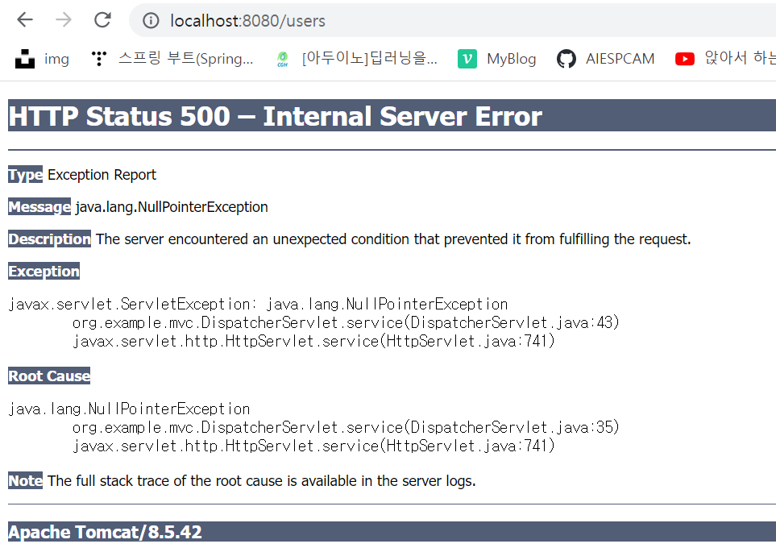

테스트&nbsp; 실행 결과

**🔎 실패 원인**

> 원인은 mappings의 Key가 HandlerKey라는 객체로 변경되었다. 그러므로 Key를 get할 때 해당하는 Key와 같은지를 객체끼리 비교를 하게 된다. 객체간 비교를 위해 **equals and hashCode**를 구현해주어야 한다.

---

**변경된 코드**

* **HandlerKey 클래스**

```java
package org.example.mvc;

public class HandlerKey {
    ...

    @Override
    public boolean equals(Object o) {
        if (this == o) return true;
        if (o == null || getClass() != o.getClass()) return false;
        HandlerKey that = (HandlerKey) o;
        return method == that.method && Objects.equals(uriPath, that.uriPath);
    }

    @Override
    public int hashCode() {
        return Objects.hash(method, uriPath);
    }
}
```

* **RequestMappingHandlerMapping 클래스**

```java
package org.example.mvc;

public class RequestMappingHandlerMapping {
    ...

    // URI 경로에 따른 컨트롤러 호출 메소드
    public Controller findHanlder(HandlerKey handlerKey){
        return mappings.get(handlerKey);
    }
}
```

* **DispatcherServlet 클래스**

```java
package org.example.mvc;

@WebServlet("/")
public class DispatcherServlet extends HttpServlet {
    ...

    @Override
    protected void service(HttpServletRequest request, HttpServletResponse response) throws ServletException, IOException {
        // 모든 경로에 대해 호출되는지 판단하기 위한 로그
        log.info("[DispatcherServlet] service started");

        try {
            Controller handler = rmhm.findHanlder(new HandlerKey(RequestMethod.valueOf(request.getMethod()), request.getRequestURI()));     // 1. 요청된 경로를 통해 적절한 컨트롤러 반환
            String viewName = handler.handleRequest(request, response);         // 2. Handler에게 작업을 위임하고 해당 viewName을 받는다.

            // 3. 해당 view 에 대해 forward
            RequestDispatcher requestDispatcher = request.getRequestDispatcher(viewName);
            requestDispatcher.forward(request, response);

        } catch (Exception e) {
            log.error("exception occurred [{}]", e.getMessage(), e);
            throw new ServletException(e);
        }
    }
}
```

* UserCreateController 클래스 생성

```java
package org.example.mvc.controller;

public class UserCreateController implements Controller {
    @Override
    public String handleRequest(HttpServletRequest request, HttpServletResponse response) throws Exception {
        // user 추가
        return "redirect:/users";
    }
}
```

**🔎 코드 분석**

> User 정보를 저장하기 위한 User 클래스와 저장소가 필요하다.

---

* **User 클래스**

```java
package org.example.mvc.model;

public class User {
    private final String userId;
    private final String name;

    public User(String userId, String name) {
        this.userId = userId;
        this.name = name;
    }

    public String getUserId() {
        return userId;
    }

    public String getName() {
        return name;
    }

}
```

* **UserRepository**

```java
package org.example.mvc.repository;

public class UserRepository {

    private static Map<String, User> users = new HashMap<>();

    public static void save(User user){
        users.put(user.getUserId(), user);	// User의 Id를 Key로 저장
    }
}
```

* **UserCreateController**

```java
package org.example.mvc.controller;

public class UserCreateController implements Controller {
    @Override
    public String handleRequest(HttpServletRequest request, HttpServletResponse response) throws Exception {
        UserRepository.save(new User(request.getParameter("userId"), request.getParameter("name")));    // user 저장
        return "redirect:/users";       // GET /users
    }
}
```

---

* **ForwardController**

```java
package org.example.mvc.controller;

public class ForwardController implements Controller{
    private String forwardUriPath;

    public ForwardController(String forwardUriPath) {
        this.forwardUriPath = forwardUriPath;
    }

    @Override
    public String handleRequest(HttpServletRequest request, HttpServletResponse response) throws Exception {
        return forwardUriPath;
    }
}
```

* **RequestMappingHandlerMapping에** **ForwardController****등록**

```java
package org.example.mvc;

public class RequestMappingHandlerMapping {

    // [Key] URI Path, [Value] Controller
    private Map<HandlerKey, Controller> mappings = new HashMap<>();

    // 인덱스 페이지에 대한 설정
    void init(){
        mappings.put(new HandlerKey(RequestMethod.GET, "/"), new HomeController());
        mappings.put(new HandlerKey(RequestMethod.GET, "/users"), new UserListController());
        mappings.put(new HandlerKey(RequestMethod.POST, "/users"), new UserCreateController());
        mappings.put(new HandlerKey(RequestMethod.GET, "/user/form"), new ForwardController("/user/form.jsp"));
    }

    // URI 경로에 따른 컨트롤러 호출 메소드
    public Controller findHanlder(HandlerKey handlerKey){
        return mappings.get(handlerKey);
    }
}
```

**🔥 ForwardController와 다른 Controller의 차이점**

> ForwardController는 해당 URI 경로로 이동만 시켜준다.  
> 다른 Controller는 처리를 하고 이동한다.

**/user/form 페이지 테스트**

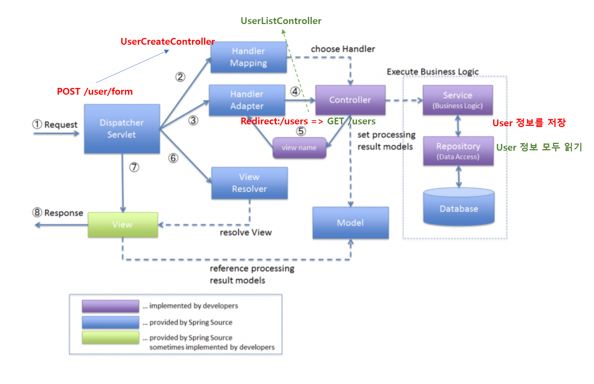

MVC 시나리오

**💣 문제 발견**

```java
package org.example.mvc;

@WebServlet("/")
public class DispatcherServlet extends HttpServlet {
    ...

    protected void service(HttpServletRequest request, HttpServletResponse response) throws ServletException, IOException {
        log.info("[DispatcherServlet] service started");

        try {
            Controller handler = rmhm.findHanlder(new HandlerKey(RequestMethod.valueOf(request.getMethod()), request.getRequestURI()));
            // redirect vs forward
            String viewName = handler.handleRequest(request, response);

            RequestDispatcher requestDispatcher = request.getRequestDispatcher(viewName);
            requestDispatcher.forward(request, response);

        } catch (Exception e) {
            log.error("exception occurred [{}]", e.getMessage(), e);
            throw new ServletException(e);
        }
    }
}
```

> 현재 코드에 경우 redirect 요청에 대한 처리를 할 수 없는 상태이므로 forward 방식과 redirect 방식이 둘다 이루어질 수 있도록 분리되는 코드로 변경해야 한다.   
>   
> 현재 HandlerMapping으로 Controller를 찾아 HandlerAdapater없이 바로 실행시키는 구조다. 즉 **Handler Adapater**와 **View Resolver**가 필요하다.

---

#### **View Resolver 구현**

**역할**

> View Resolver를 통해 Redirect View인지, JSP View인지 판단하는 역할

* **View 인터페이스** - Redirect View 또는 JSP View 일 수 있기 때문에 다형성을 위해 인터페이스로 선언

```java
package org.example.mvc.view;

public interface View {
    void render(Map<String, ?> model, HttpServletRequest request, HttpServletResponse response) throws Exception;
}
```

* **JSP View**

```java
package org.example.mvc.view;

public class JspView implements View {

    private final String name;

    public JspView(String name) {
        this.name = name;
    }

    @Override
    public void render(Map<String, ?> model, HttpServletRequest request, HttpServletResponse response) throws Exception {
        model.forEach(request::setAttribute);  // request.setAttribute("users", List.of); 형태와 동일

        // forward 방식
        RequestDispatcher requestDispatcher = request.getRequestDispatcher(name);
        requestDispatcher.forward(request, response);
    }
}
```

* **Redirect View**

```java
package org.example.mvc.view;

public class RedirectView implements View{

    public static final String DEFAULT_REDRIECT_PREFIX = "redirect:";
    private final String name;

    public RedirectView(String name) {
        this.name = name;
    }

    @Override
    public void render(Map<String, ?> model, HttpServletRequest request, HttpServletResponse response) throws Exception {
        // 자체적으로 'redirect:'가 붙기 때문에 중복 제거
        response.sendRedirect(name.substring(DEFAULT_REDRIECT_PREFIX.length()));
    }
}
```

* **ViewResolver 인터페이스**

**역할**

> ViewName을 받아서 View를 결정하는 역할이다.

```java
package org.example.mvc.view;

public interface ViewResolver {
    View resolveView(String viewname);
}
```

* **JspViewResolver -** **ViewResolver 인터페이스 구현체**

```java
package org.example.mvc.view;

public class JspViewResolver implements ViewResolver{
    @Override
    public View resolveView(String viewname) {
        if(viewname.startsWith(DEFAULT_REDRIECT_PREFIX)){
            return new RedirectView(viewname);
        }else{
            return new JspView(viewname+".jsp");
        }
    }
}
```

**🔎 코드 분석**

> viewname이 redirect 형태일 경우, RedirectView로 이동하고  
> viewname이 jsp 형태일 경우, JspView로 분리된다.

* **DispatcherServlet에서 ViewResolver 적용**

```java
package org.example.mvc;

@WebServlet("/")
public class DispatcherServlet extends HttpServlet {
    private List<ViewResolver> viewResolvers;

    @Override
    public void init() throws ServletException {
        rmhm = new RequestMappingHandlerMapping();
        rmhm.init();

        viewResolvers = Collections.singletonList(new JspViewResolver());
    }

    @Override
    protected void service(HttpServletRequest request, HttpServletResponse response) throws ServletException, IOException {
        // 모든 경로에 대해 호출되는지 판단하기 위한 로그
        log.info("[DispatcherServlet] service started");

       	Controller handler = rmhm.findHandler(new HandlerKey(RequestMethod.valueOf(reqeust.getMethod()), request.getRequestURI());

        String viewName = handler.handleRequest(request, response);

        // ViewResolver
        for (ViewResolver viewResolver : viewResolvers) {
            View view = viewResolver.resolveView(viewName);
            view.render(new HashMap<>(), request, response);	// 임시로 HashMap 사용
        }

    }
}
```

> /user/form에서 User 정보를 등록하더라도  
> 현재 UserListController에 유저 정보를 가져오는 코드가  
> 임시로 List.of 되어있어 아무것도 출력되지 않고 있다. 

* **UserListController**

```java
package org.example.mvc.controller;

public class UserListController implements Controller {
    @Override
    public String handleRequest(HttpServletRequest request, HttpServletResponse response) throws Exception {
        // Users 정보 전달

        request.setAttribute("users", UserRepository.findAll());

        return "/user/list";
    }
}
```

* **UserRepository**

```java
package org.example.mvc.repository;

public class UserRepository {

    private static Map<String, User> users = new HashMap<>();

    public static void save(User user){
        users.put(user.getUserId(), user);
    }

    public static Collection<User> findAll() {
        return users.values();
    }
}
```

**문제 발생**

> **[원인] : Property [name] not found on type**  
> list.jsp에서 user.userId와 user.name을 사용하고 있는데 현재 name에 대한 getter가 존재하지 않는다.

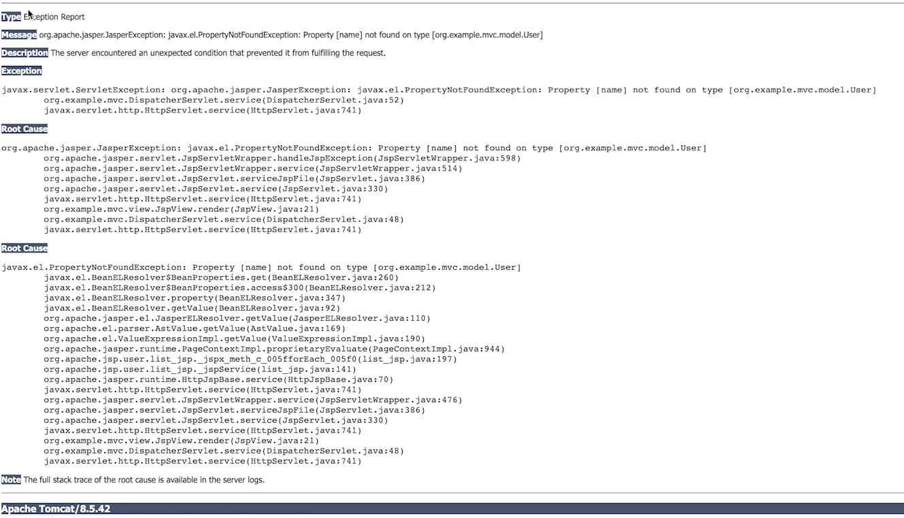

/user/form을 통해 회원가입 후, 500 에러 발생

* **User 클래스**

```java
package org.example.mvc.model;

public class User {
    private final String userId;
    private final String name;

    public User(String userId, String name) {
        this.userId = userId;
        this.name = name;
    }

    public String getUserId() {
        return userId;
    }

    public String getName() {
        return name;
    }
}
```

**💣 한글 깨짐 현상**

> 인코딩 방식이 원하는 대로 되지 않았기 때문이다. 이는 Servlet Filter를 통해 해결할 수 있다.  
> 참고. Filter는 Spring Framework가 동작하기 전에 수행한다.

```java
package org.example.mvc.filter;

@WebFilter("/")  // 모든 경로에 적용
public class CharacterEncodingFilter implements Filter {

    private static final String DEFAULT_ENCODING = "UTF-8";

    @Override
    public void init(FilterConfig filterConfig) throws ServletException {

    }

    @Override
    public void doFilter(ServletRequest request, ServletResponse response, FilterChain chain) throws IOException, ServletException {
        request.setCharacterEncoding(DEFAULT_ENCODING);
        response.setCharacterEncoding(DEFAULT_ENCODING);

        chain.doFilter(request, response);	// 다음 Filter로 이동
    }

    @Override
    public void destroy() {

    }
}
```

---

#### **HandlerAdapter**

* HandlerAdapter 인터페이스

```java
package org.example.mvc;

public interface HandlerAdapter {
    // 해당 Handler를 지원하는지 여부
    boolean supports(Object handler);

    // 해당 handler를 지원하는 경우 Model과 View를 반환
    ModelAndView handle(HttpServletRequest request, HttpServletResponse response, Object handler) throws Exception;
}
```

* DispatcherServlet 클래스

```java
package org.example.mvc;

@WebServlet("/")
public class DispatcherServlet extends HttpServlet {

    private List<HandlerAdapter> handlerAdapters;

    @Override
    public void init() throws ServletException {
        rmhm = new RequestMappingHandlerMapping();
        rmhm.init();

        handlerAdapters = List.of(new SimpleControllerHandlaerAdapter());
        viewResolvers = Collections.singletonList(new JSPViewResolver());
    }
}
```

* **SimpleControllerHandlerAdapter** 클래스

```java
package org.example.mvc;

public class SimpleControllerHandlerAdapter implements HandlerAdapter {
    @Override
    public boolean supports(Object handler) {
        // 전달된 handler가 Controller를 구현한 구현체인지 확인
        return (handler instanceof Controller);
    }

    @Override
    public ModelAndView handle(HttpServletRequest request, HttpServletResponse response, Object handler) throws Exception {
        // 해당 Controller에 viewName을 반환
        String viewName = ((Controller) handler).handleRequest(request, response);
        return new ModelAndView(viewName);
    }
}
```

* **DispatcherServlet**

```java
package org.example.mvc;

@WebServlet("/")
public class DispatcherServlet extends HttpServlet {

    private static final Logger log = LoggerFactory.getLogger(DispatcherServlet.class);

    private List<HandlerAdapter> handlerAdapters;

    @Override
    protected void service(HttpServletRequest request, HttpServletResponse response) throws ServletException, IOException {
        log.info("[DispatcherServlet] service started");

        try {
            Controller handler = rmhm.findHandler(new HandlerKey(RequestMethod.valueOf(reqeust.getMethod()), request.getRequestURI()));
            String view Name = handler.handleRequest(request, response);

            // HandlerAdapater
            HandlerAdapter handlerAdapter = handlerAdapters.stream()
                    .filter(ha -> ha.supports(handler))
                    .findFirst()
                    .orElseThrow(() -> new ServletException("No adapter for handler [" + handler + "]"));

            ModelAndView modelAndView = handlerAdapter.handle(request, response, handler);

            // ViewResolver
            for (ViewResolver viewResolver : viewResolvers) {
                View view = viewResolver.resolveView(modelAndView.getViewName());
                view.render(modelAndView.getModel(), request, response);
            }

        } catch (Exception e) {
            log.error("exception occurred [{}]", e.getMessage(), e);
            throw new ServletException(e);
        }
    }
}
```

* **ModelAndView**

```java
package org.example.mvc.view;

public class ModelAndView {
    private final Object view;

    private Map<String, Object> model = new HashMap<>();

    public ModelAndView(String viewName) {
        this.view = viewName;
    }

    public Map<String, Object> getModel() {
        return Collections.unmodifiableMap(model);	// 불변으로 반환
    }

    public String getViewName() {
        return (this.view instanceof String ? (String) this.view : null);
    }
}
```

**📖 상황 정리**

1. **DispatcherServlet**에서 요청이 들어온다.
2. **HandlerMapping**을 통해 **handler**를 찾는다.  
   **Controller handler = rmhm.findHandler();**
3. **HandlerAdapter**를 통해 지원하는 **Handler**를 찾는다.  
   **HandlerAdapter handlerAdapter = handlerAdapters.stream()**   
   **.filter(ha -> ha.supports(handler))**   
   **.findFirst()**   
   **.orElseThrow(() -> new ServletException("No adapter for handler [" + handler + "]"));**   

   **ModelAndView modelAndView = handlerAdapter.handle(request, response, handler);**
4. **HandlerAdapter** 내부에서 **handler**를 실행하여 **ModelAndView** 객체를 **DispatcherServlet**에 전달해준다. **@Override   
   public ModelAndView handle(HttpServletRequest request, HttpServletResponse response, Object handler) throws Exception {   
       String viewName = ((Controller) handler).handleRequest(request, response);   
       return new ModelAndView(viewName);   
   }**
5. **ViewResolver**에서 **ModelAndView**를 통해 해당하는 **View**를 찾아 **렌더링**해준다.  
   **for (ViewResolver viewResolver : viewResolvers) {**   
   **View view = viewResolver.resolveView(modelAndView.getViewName());**   
   **view.render(modelAndView.getModel(), request, response);**   
   **}**

---

#### **리팩토링**

**1. HandlerMapping 인터페이스로 전환**

* **HandlerMapping 인터페이스**

```java
package org.example.mvc;

public interface HandlerMapping {}
```

* **RequestMappingHandlerMapping를 **HandlerMapping의** 구현체로 변경**

```java
package org.example.mvc;

public class RequestMappingHandlerMapping implements HandlerMapping {

    private Map<HandlerKey, Controller> mappings = new HashMap<>();

    void init(){
        mappings.put(new HandlerKey(RequestMethod.GET, "/"), new HomeController());
        mappings.put(new HandlerKey(RequestMethod.GET, "/users"), new UserListController());
        mappings.put(new HandlerKey(RequestMethod.POST, "/users"), new UserCreateController());
        mappings.put(new HandlerKey(RequestMethod.GET, "/user/form"), new ForwardController("/user/form"));
    }

    public Controller findHanlder(HandlerKey handlerKey){
        return mappings.get(handlerKey);
    }
}
```

* **DispatcherServlet**  
  - 구체적인 클래스 타입이 아닌 인터페이스 타입으로 선언

```java
package org.example.mvc;

@WebServlet("/")
public class DispatcherServlet extends HttpServlet {

    private static final Logger log = LoggerFactory.getLogger(DispatcherServlet.class);

    private HandlerMapping hm;

    private List<HandlerAdapter> handlerAdapters;

    private List<ViewResolver> viewResolvers;

    @Override
    public void init() throws ServletException {
        RequestMappingHandlerMapping rmhm = new RequestMappingHandlerMapping();
        rmhm.init();

        hm = rmhm;

        handlerAdapters = List.of(new SimpleControllerHandlerAdapter(), new AnnotationHandlerAdapter());
        viewResolvers = Collections.singletonList(new JSPViewResolver());
    }
}
```

* **HandlerMapping 인터페이스**

```java
package org.example.mvc;

public interface HandlerMapping {
    Object findHanlder(HandlerKey handlerKey);
}
```

> 현재 Controller 인터페이스만 사용하지만, Annotation 형태로 사용가능하도록 확장하기 위해 Controller가 아닌 Object형태로 반환하도록 함.

> 
>
> [요구사항 추가]  
> Annotation 형태로 구현해주세요!

* **AnnotationHandlerMapping**

```java
package org.example.mvc;

public class AnnotationHandlerMapping implements HandlerMapping{

    @Override
    public Object findHanlder(HandlerKey handlerKey) {
        return null;
    }
}
```

* **DispatcherServlet**

```java
package org.example.mvc;

@WebServlet("/")
public class DispatcherServlet extends HttpServlet {

    // AS-IS
    private HandlerMapping hm;
    // TO-BE
    private List<HandlerMapping> handlerMappings;

    @Override
    public void init() throws ServletException {
        RequestMappingHandlerMapping rmhm = new RequestMappingHandlerMapping();
        rmhm.init();

        AnnotationHandlerMapping ahm = new AnnotationHandlerMapping();

        handlerMappings = List.of(rmhm, ahm);

        handlerAdapters = List.of(new SimpleControllerHandlerAdapter(), new AnnotationHandlerAdapter());
        viewResolvers = Collections.singletonList(new JSPViewResolver());
    }
}
```

* **Controller annotation 생성**

```java
package org.example.mvc.annotation;

@Target({ElementType.TYPE})
@Retention(RetentionPolicy.RUNTIME)
public @interface Controller {
}
```

* **RequestMapping annotation 생성**

```java
package org.example.mvc.annotation;

@Target({ElementType.METHOD, ElementType.TYPE})
@Retention(RetentionPolicy.RUNTIME)
public @interface RequestMapping {

    String value() default "";

    RequestMethod[] method() default {};
}
```

* **HomeController**

```java
package org.example.mvc.controller;

@Controller
public class HomeController{

    @RequestMapping(value = "/", method = RequestMethod.GET)
    public String handleRequest(HttpServletRequest request, HttpServletResponse response) throws Exception {
        return "home";
    }
}
```

> **AS-IS  
> Controller 인터페이스를 구현해야 Handler를 찾을 수 있었다.  
> TO-BE  
> 어노테이션 형태를 통해**Handler를 찾을 수 있도록 변경되었다.****

* **AnnotationHandlerMapping**

```java
package org.example.mvc;

public class AnnotationHandlerMapping implements HandlerMapping{

    private Map<HandlerKey, AnnotationHandler> handlers = new HashMap<>();

    @Override
    public Object findHanlder(HandlerKey handlerKey) {
        return handlers.get(handlerKey);
    }
}
```

* **DispatcherServlet**

```java
package org.example.mvc;

@WebServlet("/")
public class DispatcherServlet extends HttpServlet {

    @Override
    protected void service(HttpServletRequest request, HttpServletResponse response) throws ServletException, IOException {
        log.info("[DispatcherServlet] service started");

        String requestURI = request.getRequestURI();
        RequestMethod requestMethod = RequestMethod.valueOf(request.getMethod());

        try {
            // Handler Mapping(1개에서 List형태로 변환되었기 때문에 변경됨)
            Object handler = handlerMappings.stream()
                    .filter(hm -> hm.findHanlder(new HandlerKey(requestMethod, requestURI)) != null)
                    .map(hm -> hm.findHanlder(new HandlerKey(requestMethod, requestURI)))
                    .findFirst()
                    .orElseThrow(() -> new ServletException("No Handler for [" + requestMethod + "," + requestURI + "]"));


            // HandlerAdapater
            HandlerAdapter handlerAdapter = handlerAdapters.stream()
                    .filter(ha -> ha.supports(handler))
                    .findFirst()
                    .orElseThrow(() -> new ServletException("No adapter for handler [" + handler + "]"));

            ModelAndView modelAndView = handlerAdapter.handle(request, response, handler);


            // ViewResolver
            for (ViewResolver viewResolver : viewResolvers) {
                View view = viewResolver.resolveView(modelAndView.getViewName());
                view.render(modelAndView.getModel(), request, response);
            }

        } catch (Exception e) {
            log.error("exception occurred [{}]", e.getMessage(), e);
            throw new ServletException(e);
        }
    }
}
```

* **AnnotationHandlerMapping Reflection을 이용한 초기화**

```java
package org.example.mvc;

import org.example.mvc.annotation.Controller;
import org.example.mvc.annotation.RequestMapping;
import org.example.mvc.controller.RequestMethod;
import org.reflections.Reflections;

import java.util.Arrays;
import java.util.HashMap;
import java.util.Map;
import java.util.Set;

public class AnnotationHandlerMapping implements HandlerMapping{
    private final Object[] basePackage;
    private Map<HandlerKey, AnnotationHandler> handlers = new HashMap<>();

    public AnnotationHandlerMapping(Object... basePackage) {
        this.basePackage = basePackage;
    }

    public void initialize(){
        Reflections reflections = new Reflections(basePackage);

        // Controller 어노테이션이 붙은 클래스 객체를 모두 가져온다.
        Set<Class<?>> clazzesWithControllerAnnotation = reflections.getTypesAnnotatedWith(Controller.class);

        // 어노테이션으로 된 컨트롤러에서 메소드에 value와 HTTP Method를 얻기 위한 과정
        clazzesWithControllerAnnotation.forEach(clazz ->
                Arrays.stream(clazz.getDeclaredMethods())
                        .forEach(declaredMethod ->{
                            RequestMapping requestMapping = declaredMethod.getDeclaredAnnotation(RequestMapping.class);

                            // @RequestMapping(value = "/", method = RequestMethod.GET)
                            Arrays.stream(getRequestMethods(requestMapping))
                                    .forEach(requestMethod -> handlers.put(
                                            new HandlerKey(requestMethod, requestMapping.value()), new AnnotationHandler(clazz, declaredMethod)
                                    ));
                        })
        );

    }

    // requestMapping에 RequestMethod을 반환(1개 이상)
    private RequestMethod[] getRequestMethods(RequestMapping requestMapping) {
        return requestMapping.method();
    }


    @Override
    public Object findHanlder(HandlerKey handlerKey) {
        return handlers.get(handlerKey);
    }
}
```

* **AnnotationHandler**

```java
package org.example.mvc;

public class AnnotationHandler {
    private final Class<?> clazz;
    private final Method targetMethod;

    public AnnotationHandler(Class<?> clazz, Method targetMethod) {
        this.clazz= clazz;
        this.targetMethod = targetMethod;
    }

    public String handle(HttpServletRequest request, HttpServletResponse response) throws Exception{
        Constructor<?> declaredConstructor = clazz.getDeclaredConstructor();
        Object handler = declaredConstructor.newInstance();

        return (String) targetMethod.invoke(handler, request, response);
    }
}
```

> HandlerMapping을 통해 적절한 handler를 리턴하고, handlerAdapter을 통해 handler를 실행하는데 현재 adapter가 Controller 인터페이스 구현체만 지원하는 adapter밖에 없다. 그러므로 Annotation을 지원하는 adapter가 필요하다.

* **DispatcherServlet**

```java
package org.example.mvc;

@WebServlet("/")
public class DispatcherServlet extends HttpServlet {

    @Override
    public void init() throws ServletException {
        RequestMappingHandlerMapping rmhm = new RequestMappingHandlerMapping();
        rmhm.init();

        AnnotationHandlerMapping ahm = new AnnotationHandlerMapping("org.example");
        ahm.initialize();

        handlerMappings = List.of(rmhm, ahm);

        handlerAdapters = List.of(new SimpleControllerHandlerAdapter(), new AnnotationHandlerAdapter());
        viewResolvers = Collections.singletonList(new JSPViewResolver());
    }
}
```

* **AnnotationHandlerAdapter**

```java
package org.example.mvc;

public class AnnotationHandlerAdapter implements HandlerAdapter{
    @Override
    public boolean supports(Object handler) {
        return handler instanceof AnnotationHandler;
    }

    @Override
    public ModelAndView handle(HttpServletRequest request, HttpServletResponse response, Object handler) throws Exception {
        String viewName = ((AnnotationHandler) handler).handle(request, response);
        return new ModelAndView(viewName);
    }
}
```

> 가장 중요한 요점  
>   
> 1. Dispatcher Servlet에서 요청이 오면 가장 먼저 HandlerMapping을 하게 된다.  
> 2. HandlerMapping에서 Handler를 선택한다.  
> 3. HandlerAdapter를 통해 해당 Handler를 실행하면 ModelAndView 값을 리턴한다.  
> 4. ModelAndView 값을 ViewResolver에게 전달한면 view를 리턴받게 된다.  
> 5. 최종적으로 view를 render하면 결과가 그려지게 된다.
