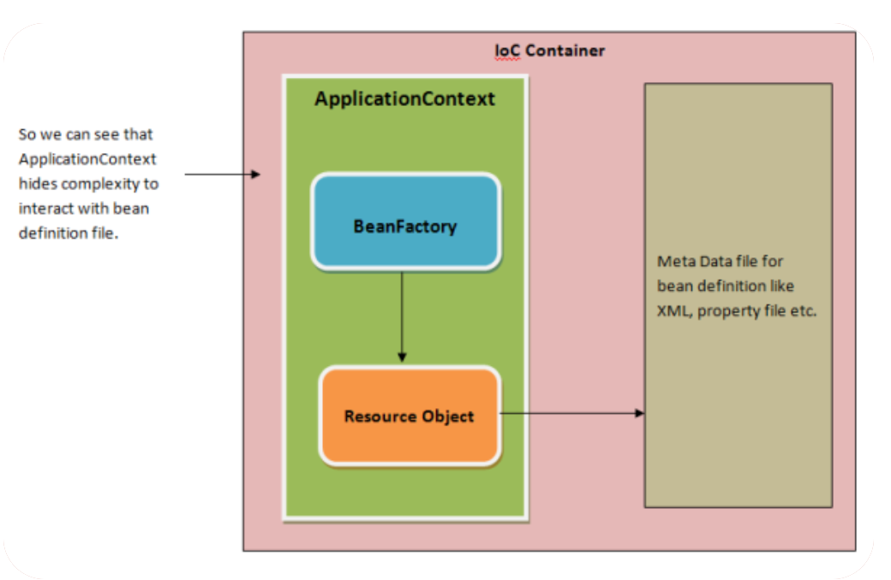
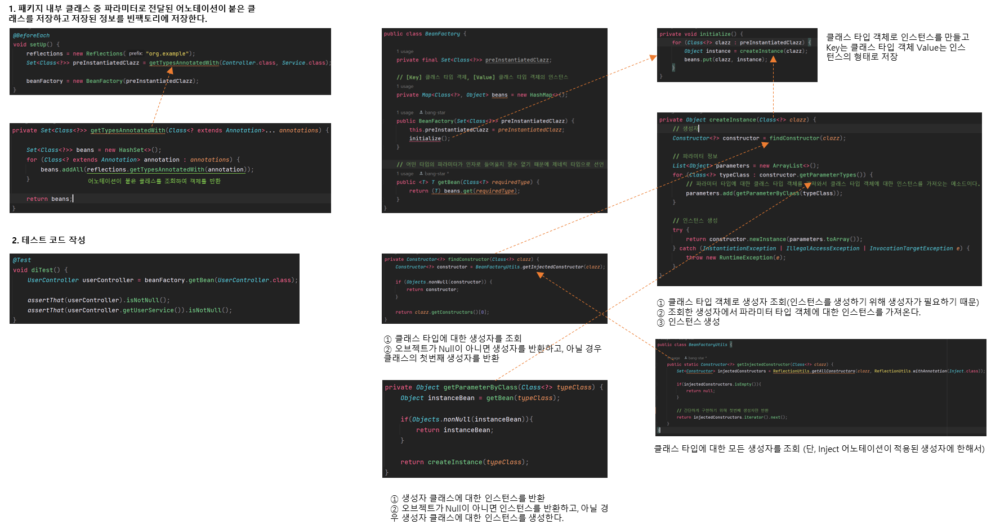
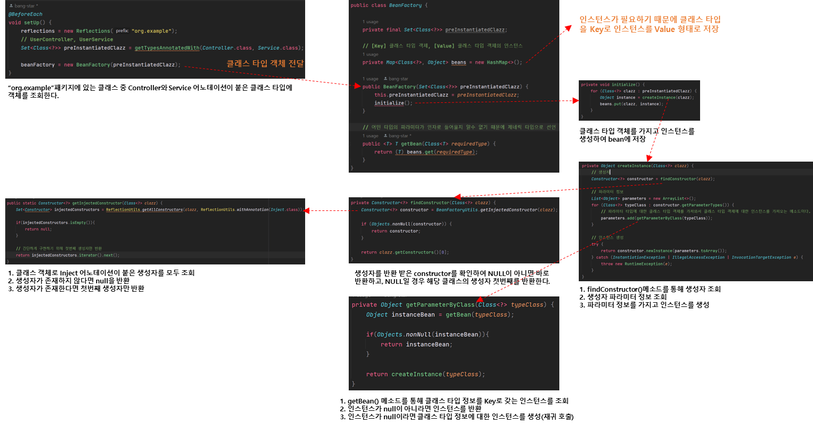

### DI 개념 소개 및 장점

#### DI(Dependency Injection)

* 의존성 주입
  + 한 객체가 다른 객체를 사용할 때 의존성이 있다고 함
* 런타임 시 의존 관계를 맺는 대상을 외부에서 결정하고 주입해 주는 것
* 스프링 프레임워크는 DI 기능을 지원해주는 프레임워크

#### DI 장점

* 의존성 주입을 인터페이스 기반으로 설계하면 코드가 유연해진다
  + 느슨한 결합도(loose coupling)
* 변경에 유연해짐
  + 결합도가 낮은 객체끼리는 부품을 쉽게 갈아끼울 수 있다
* 테스트하기 좋은 코드가 된다.

---

### DI 프레임워크 만들기

Spring IoC 컨테이너

> 테스트 코드를 통해서 IoC 컨테이너에  BeanFactory 구현할 것이다.

#### **구조**

간단하게 구현한 BeanFactory 구조

#### **실행 순서**

BeanFactory 테스트 코드 실행 순서

---

> BeanFactory 기능 일부를 구현하면서  
> 이해하기 쉽지 않아 구조와 실행 순서를  
> 그림을 통해 나타내보았다.  
>   
> 이를 통해 BeanFactory의 전반적인 구조를  
> 쉽게 이해할 수 있게 되었다.
