## **Spring Web MVC Framework**

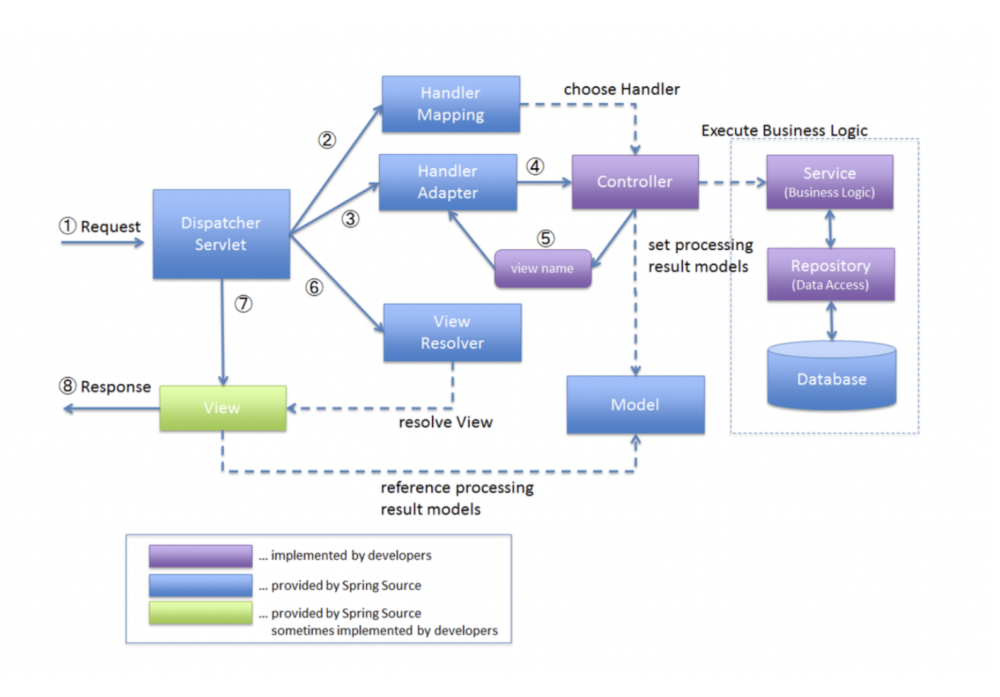

Spring Web MVC 프레임워크 구조

1. **DispatcherServlet**에서 요청을 받는다.
2. **HandlerMapping**을 통해 적절한 **Handler**(=**Controller**)를 선택한다.
3. **DispatcherServlet**에서 **HandlerAdapter**을 통해 선택한 **Handler**를 실행한다.
4. **Handler**는 **view name**을 반환한다.
5. **DispatcherServlet**이 **view name**을 **View Resolver**에게 전달한다.
6. **View Resolver**는 적절한 **view**를 선택한다.
7. **DispatcherServlet**에서 **view를** 클라이언트에게 전달한다.

---

### **직접 구현한 코드를 통해 알아보기**

**1.** **DispatcherServlet**에서 모든 요청에 받는다.

```java
package org.example.mvc;

@WebServlet("/")
public class DispatcherServlet extends HttpServlet {
    ...
}
```

**2.** **HandlerMapping**을 통해 적절한 **Handler**(=**Controller**)를 선택한다.

```java
package org.example.mvc;

@WebServlet("/")
public class DispatcherServlet extends HttpServlet {

    @Override
    protected void service(HttpServletRequest request, HttpServletResponse response) throws ServletException {
        String requestURI = request.getRequestURI();
        RequestMethod requestMethod = RequestMethod.valueOf(request.getMethod());

        Object handler = handlerMappings.stream()
                .filter(hm -> hm.findHandler(new HandlerKey(requestURI, requestMethod)) != null)
                .map(hm -> hm.findHandler(new HandlerKey(requestURI, requestMethod)))
                .findFirst()
                .orElseThrow(() -> new ServletException("No handler for [" + requestMethod + ", " + requestURI + "]"));
    }
}
```

**3.** **DispatcherServlet**에서 **HandlerAdapter**을 통해 선택한 **Handler**를 실행한다.

```java
package org.example.mvc;

@WebServlet("/")
public class DispatcherServlet extends HttpServlet {

    @Override
    protected void service(HttpServletRequest request, HttpServletResponse response) throws ServletException {
        ...
        HandlerAdapter handlerAdapter = handlerAdapters.stream()
                .filter(ha -> ha.supports(handler))
                .findFirst()
                .orElseThrow(() -> new ServletException("No adapter for handler [" + handler + "]"));

        ModelAndView modelAndView = handlerAdapter.handle(request, response, handler);
    }
}
```

**4. Handler**는 **view name**을 반환한다.

```java
public class SimpleControllerHandlerAdapter implements HandlerAdapter {
    @Override
    public boolean supports(Object handler) {
        return (handler instanceof Controller);
    }

    @Override
    public ModelAndView handle(HttpServletRequest request, HttpServletResponse response, Object handler)
            throws Exception {

        String viewName = ((Controller) handler).handleRequest(request, response);
        return new ModelAndView(viewName);
    }
}
```

**5.** **DispatcherServlet**이 **view name**을 **View Resolver**에게 전달한다.

**6. View Resolver**는 적절한 **view**를 선택한다.

**7. DispatcherServlet**에서 **view를** 클라이언트에게 전달한다.

```java
package org.example.mvc;

@WebServlet("/")
public class DispatcherServlet extends HttpServlet {

    @Override
    protected void service(HttpServletRequest request, HttpServletResponse response) throws ServletException {
        for (ViewResolver viewResolver : this.viewResolvers) {
            View view = viewResolver.resolveViewName(modelAndView.getViewName());
            view.render(modelAndView.getModel(), request, response);
        }
    }
}
```

---

### **Spring Web MVC와 비교**

#### **상속**

| **직접 구현한 DispatcherServlet** | **Spring Web MVC - DispatcherServlet** |
| --- | --- |
| 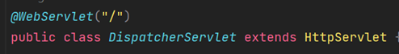 | 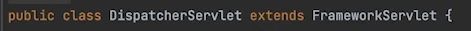  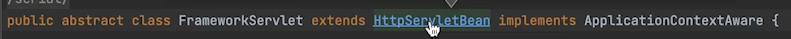  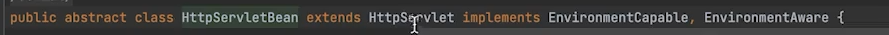 |

> 동일하게 HttpServlet을 상속받고 있다.

#### **HandlerMapping**

| **직접 구현한 DispatcherServlet** | **Spring Web MVC - DispatcherServlet** |
| --- | --- |
| 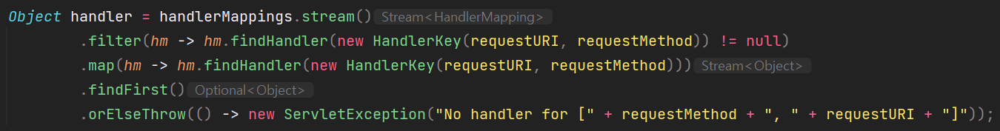 | 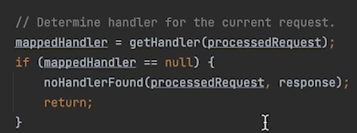  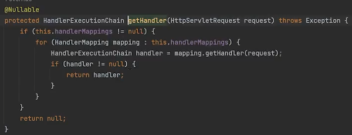 |

#### **HandlerAdapter**

| **직접 구현한 DispatcherServlet** | **Spring Web MVC - DispatcherServlet** |
| --- | --- |
| 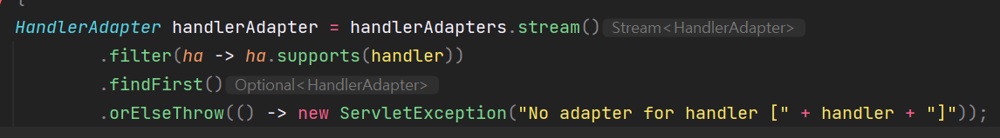 | 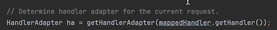     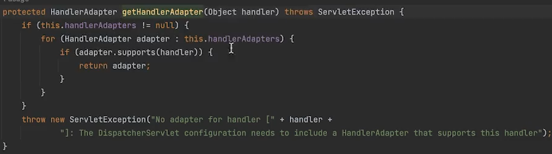 |
| 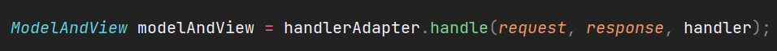   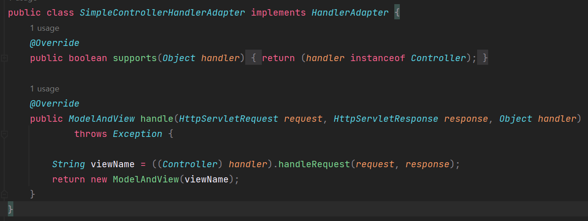 | 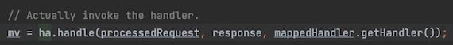   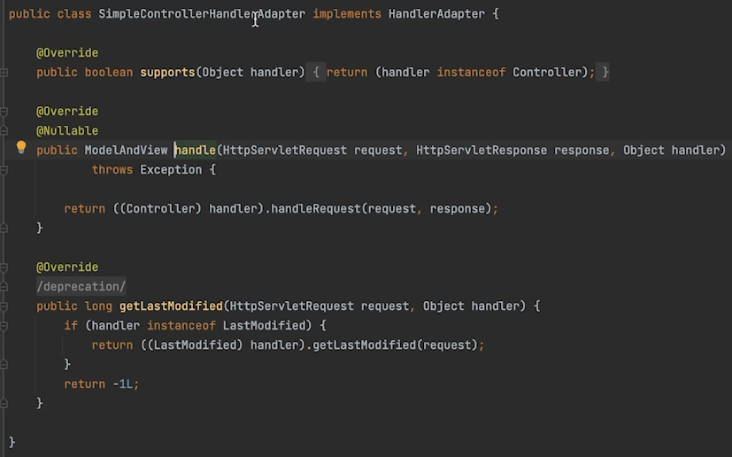 |

#### **View Resolver**

| **직접 구현한 DispatcherServlet** | **Spring Web MVC - DispatcherServlet** |
| --- | --- |
| 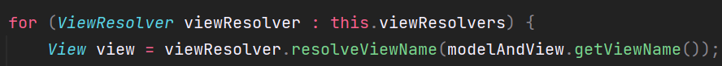 | 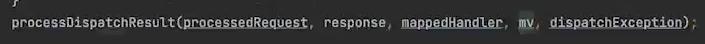   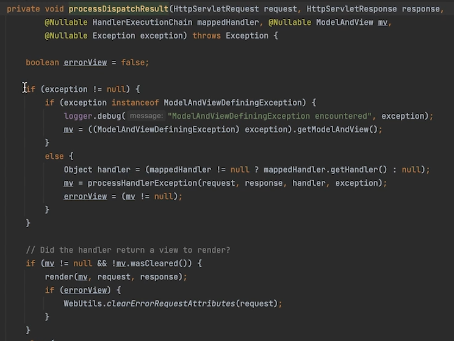    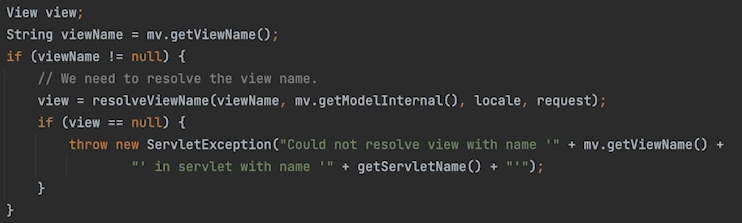   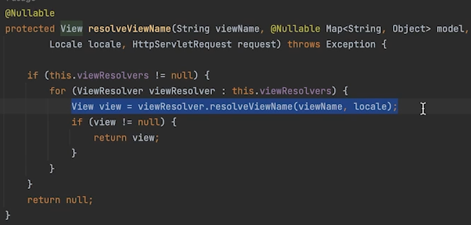 |
| 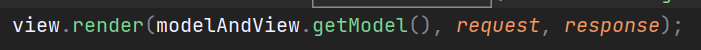 | 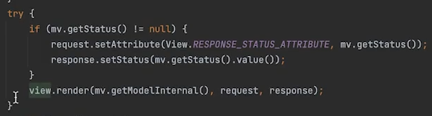 |

> Spring을 공부하면서  
> 사용자의 측면에서 사용하기만 하다가  
> 직접 간단하게 구현하였는데  
> 아주 귀중한 경험인 것 같다.  
>   
> Spring MVC 프레임워크를 공부는 하였지만  
> 내부적으로 어떻게 구현되어있는지에  
> 대해서는 훑고 지나갔었는데  
> 이를 통해 한 발 더 성장할 수 있게 되었다.
