## 게시판 서비스

---

### **개발 환경**

* **개발도구(IDE) : Intellij IDEA Ultimate 2022.1.2(유료버전)**  
  Spring Boot와의 연동 기능 때문에 Ultimate버전 사용
* **소스코드 관리: Git 2.38.1(현재 일자 최신버전)**
* **Git 호스팅 : GitHub**
* **Git GUI: GitKraken Pro 8.5.0(유료버전)**

---

### **프로젝트 기획**

#### **개발 목적 이해하기**

**게시판 서비스 프로젝트의 목표**

* 누구나 이해하기 쉬운 소재로 명확한 기능 요구사항을 만든다.
* 요구사항을 구현하는데 도움이 되는 각종 문서 작업을 경험한다.
* 자바 + 스프링 부트로 프로젝트 요구사항을 실제로 구현하는 기술적인 방법을 익힌다.
* 최신 버전의 기술을 사용해 보면서 기술 동향을 파악하고, 새로운 문제와 해결 방법을 확인한다.
* 기획과 문서 작성부터 개발, 형상관리, 테스트, 배포까지 개발 프로세스 전반을 경험한다.

---

**다양한 형태의 문서 작업 - 원활한 협업의 초석**

* **문서를 통해 개발할 프로젝트의 목적, 내용, 진행상황을 공유 (왜 하는지가 특히 중요)**
  + **무엇을, 어떻게** : 업무의 가이드. 동료의 생산성을 높여줌
  + **왜** : 함께 움직이는 원동력, 동료가 더 나은 방법을 제안하거나, 내 생각의 오류를 잡아줌
* **내용이 구체적일 수록, 동료들의 프로젝트 개발 내용이 잘 동기화되고 진행이 막히지 않음**
  + 주의 - 과도한 정보의 범람, 업데이트되지 않았거나 잘못된 정보가 주는 혼란
* **백업이 용이 : 문서는 지나간 일을 다시 꺼내야 할 때 쉽게 찾게 도와줌**
* **기억은 짧고 왜곡되지만, 문서는 수정 가능하고 발전하며 오래 감**
* **업무 기록을 남김으로써 업무 진척 상황과 내 성과가 잘 드러남**

---

**문서 작업**

* **diagrams.net**(구 draw.io) : 도메인과 ERD 설계, 유즈케이스
* **구글 시트** : API 디자인
* **깃 + 깃헙** : 커밋 메시지 작성, 프로젝트 관리 및 협업 환경 꾸미기

---

**개발의 목적 - 고객의 문제를 해결(+ 하는 과정을 공부)**

* **고객의 니즈와 문제를 정리**
  + 고객이 원치 않거나 고객의 문제를 해결해줄 수 없는 개발은 의미가 없다.
  + 공부가 목표 - 이 부분에서 다소 자유롭게(실패가 용인됨)
* **문제 → 요구사항 → 기능(feature) 도출 → 구현 방안의 기획 → 개발 계획 수립 → 실행**
* **공부 목표의 특전 : 가능한 한 최신 버전의 기술을 사용**
  + 최신 동향 파악
  + 아직 밝혀지지 않은 이슈를 직접 경험 → 해결 방법 찾기 → 할 수 있다면 해결까지

---

**게시판 만들기 프로젝트에서 해볼 개발 작업**

* **IDE** : Intellij IDA 2022.1.2 (Ultimate Edition)
* **언어** : Java 17
* **프레임워크** : spring boot 2.7.0
* **빌드 도구** : gradle 7.4.1  
  spring boot 프로젝트르 만들 때, spring initializr를 사용할 것인데 이때 Spring boot 설정한 버전에 맞춰서 적합한 gradle 버전이 선택되므로 중요하지 않음. 즉 직접 결정하지 않기 때문에 상대적으로 덜 중요하다.
* **git GUI** : GitKraken - git 형상 관리와 브랜치 전략 활용
* 각종 개발 전략과 도메인 설계, 실무 디자인 패턴, 비즈니스 로직의 구현을 경험

---

**테스트와 배포 - 고객에게 제품을 보여주고 성과를 확인하는 순간**

* **테스트**
  + 개발 요구사항이 빠짐 없이 모두 구현되었는가(일이 끝났는가)
  + 구현된 요구사항이 오류 없이 동작하는가(일이 잘 끝났는가)
* **배포**
  + 깃헙 릴리즈 작성
  + 클라우드 서버에 배포(Heroku)

**게시판 만들기 프로젝트에서 해볼 테스트와 배포는...**

* **테스트**
  + **JUnit 5.8.2**
  + **각종 테스트 라이브러리(Mockito, AssetJ 등)**
  + **스프링 부트 슬라이스 테스트 테크닉**
  + **깃헙 : 테스트/빌드 자동화**
* **배포**
  + **클라우드 서버에 배포(Heroku)**
    - **최근 보안 이슈로 일부 자동화 기능을 이용하지 못할 수 있음**
    - **Heroku를 사용하지 못할 경우, 로컬에서 실행**
  + **깃헙 : Heroku 배포 자동화**

---

**관련 자료**

* <https://www.diagrams.net/>
* <https://www.heroku.com/home>
* <https://junit.org/junit5/>
* <https://site.mockito.org/>
* <https://assertj.github.io/doc/>

---

#### **필요한 기술 정리하기**

**필요 세부 기술 목록을 뽑는 방법**

* 미리 사용 기술을 모두 파악한 후 처음부터 프로젝트에 넣는 방법

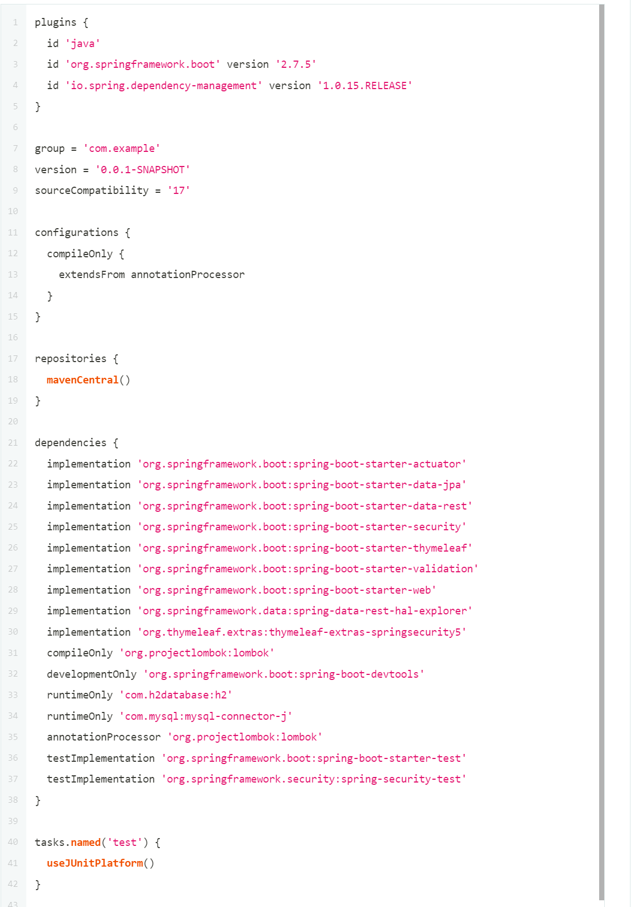

* 기능 하나를 만들 때마다 필요한 기술을 추가해 나가는 방법(Selected)

---

**예상하는 세부 기능들**

* 게시판, 댓글 도메인의 설계
* 도메인 데이터를 DB에 저장
* JSON API로 데이터 제공
* 사용자에게 웹 화면으로 서비스 제공 + 디자인 요소
  + 게시판 페이지
  + 게시글 페이지
  + 로그인 페이지
* 적절한 입출력 데이터의 검증
* 인증 기능
* 생산성에 도움이 되는 도구들 선택

---

**세부 기능으로부터 선택을 예상하는 기술(Spring Dependecy 기준)**

* **Java + Spring Boot 기반에서 선택**
* **웹 서비스 제공 → Spring Web**
* **도메인의 설계와 DB 저장 → Spring Data JPA, H2 Database, MySQL Driver**
* **JSON API로 데이터 제공 → Rest Repositories, Rest Repositories HAL Explorer**
* **웹 화면 : 서버 사이드 렌더링으로 접근 → 템플릿 엔징 → Thymeleaf**
* **디자인 요소 → Bootstrap 5.2**
* **적절한 입출력 데이터의 검증 → Validation**
* **인증 기능 → Spring Security**
* **생산성 → Lombok, Spring Boot DevTools, Spring Boot Actuator**

---

### **깃헙 프로젝트와 이슈 정리하기**

#### **.gitignore**

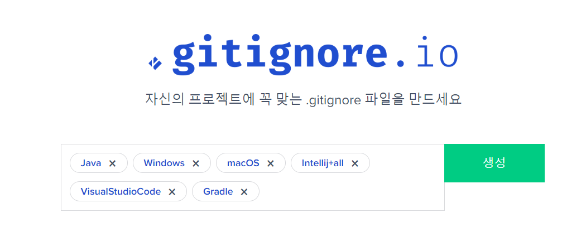

gitignore.io 사용

#### **Create a new repository**

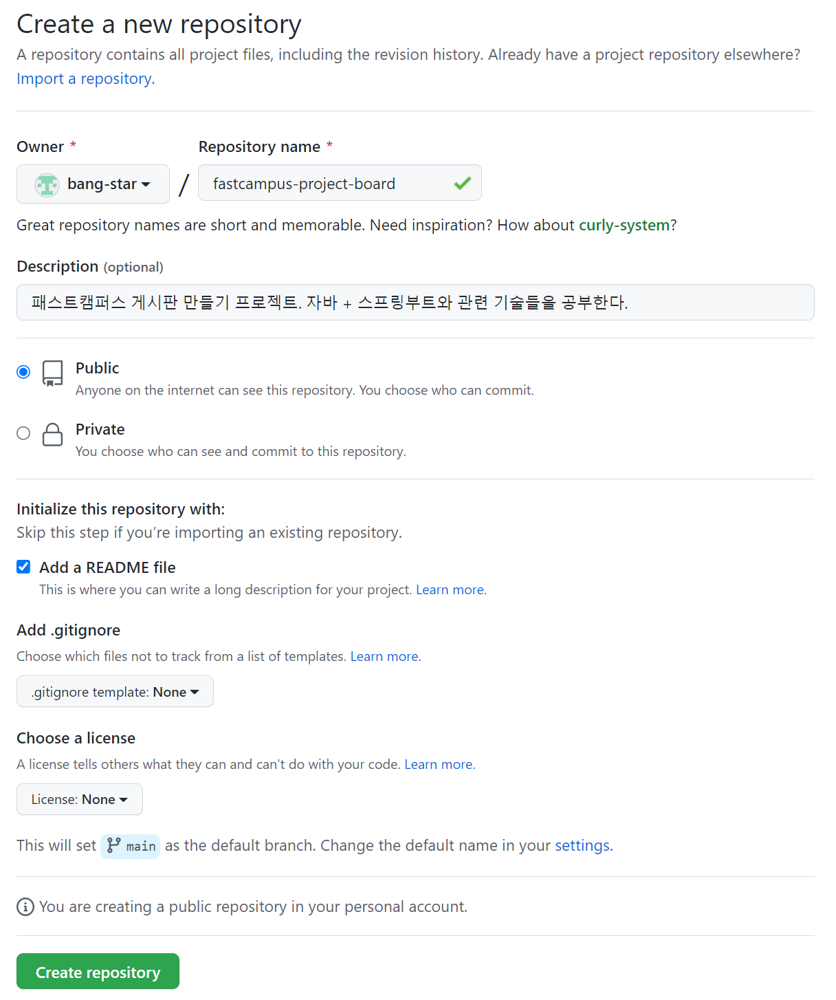

github에서 repo 생성''

> gitflow 도구는 여전히 master라는 이름을 쓰고 있기 때문에 의도치 않게 첫번째 커밋으로 master 브랜치를 자동생성해서 넘겨줄 수 있는 실수를 막기 위해 README file를 생성하여 자동으로 main 브랜치로 만드는 방법이 있다.

#### **원격 Repository Clone**

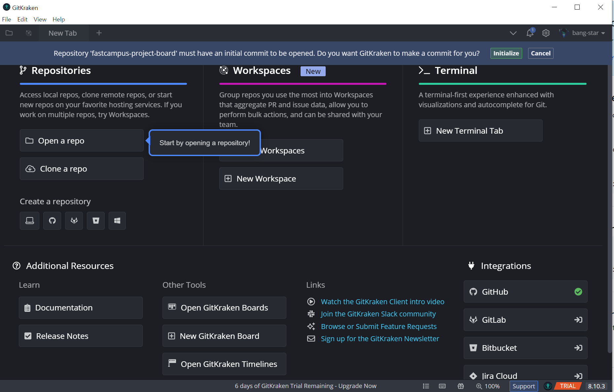

GitKraken을 활용하여 원격 repo를 clone

#### **Workspace를 사용하여 관리**

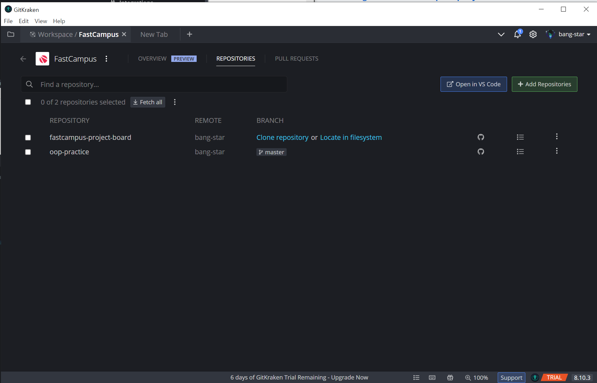

GitKraken을 활용하여 workspace를 생성하고 repo를 연결

> 원격 repository를 연결하여 clone을 할 수 있지만, Workspace를 사용하여 clone을 할 수 있다.

**1. reference 'refs/heads/master' not found 에러**

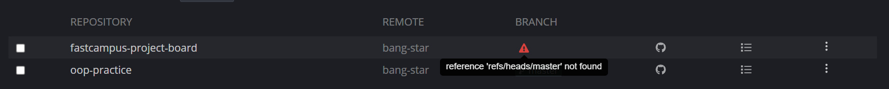

reference 'refs/heads/master' not found 에러

> 현재 원격 repo에 아무런 commit도 하지 않은 상태이기 때문에 발생하는 에러이다.  
> => 최초의 커밋이 필요하다.

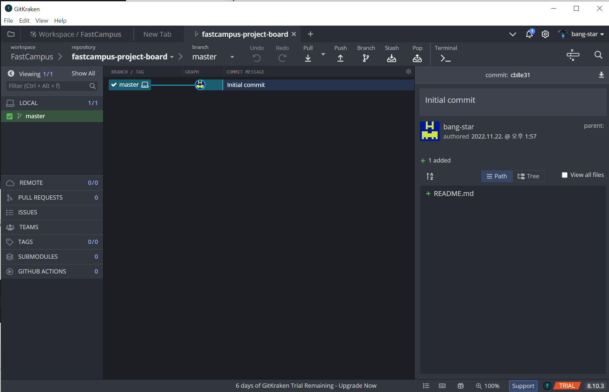

gitKraken을 통해 initialize하여 최초의 커밋 생성

#### **브랜치명 변경**

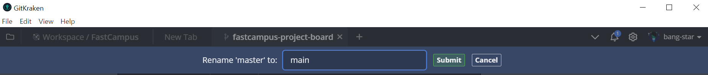

master &rarr; main branch로 변경

#### **원격 Repo 동기화**

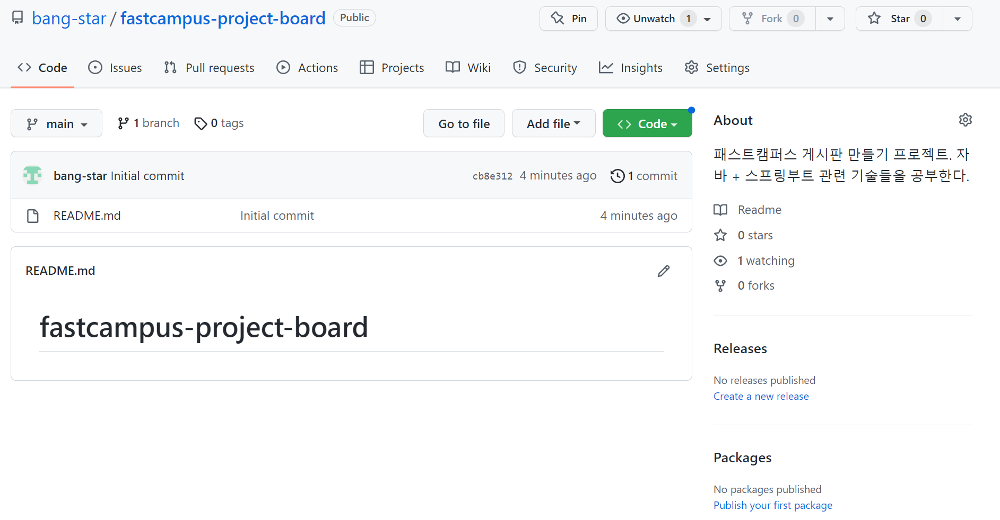

push를 통해 원격에 적용

#### **문서화**

* **issue**
  + 오류, 버그 및 '새로운 기능', 작업요청, 사소한 질문이나 의견등 제품에 관해 회사에서 대화의 대상이 되는 거의 모든 것을 의미한다.(참고 : [Atlassian JIRA](https://www.lesstif.com/jira/atlassian-jira-home-61898760.html))
  + 종류는 BUG(문제점), Improvement(개선사항), enhancement(새로운 개능) 등 커스터마이징하여 사용할 수 있다.
* **milestone**
  + 일반적으로 이정표라는 뜻으로 사용되지만 회사에서 진행하는 특정 프로젝트와 관련해서는 어떤 중요한 시점이라고 생각하시면 되겠다. 예를 들어 소프트웨어 개발 프로젝트라면 릴리즈 일정이나 알파, 베타 버전 릴리즈 일정 어떤 연구와 관련된 것이라면 연구 마감시한이나 프로시저 완료일, 논문 마감일 등 듯으로 해석하면 된다.
  + 프로젝트 진행 과정에서 특정할 만한 건이나 표를 말한다.
  + 프로젝트 일정관리를 위해 반드시 필요한 지점을 체크하기 위해 사용한다.
  + 프로젝트 성공을 위해 필수적인 사항들을 각 단계별로 체크함으로써 전체적인 일정이 늦춰지지 않고 제 시간 안에 과업이 종료될 수 있도록 관리하는데 도움을 준다.

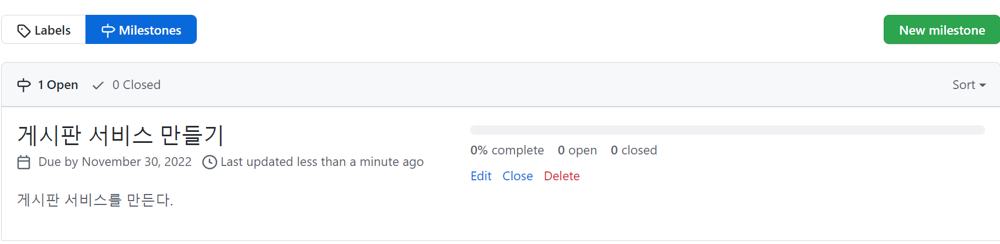

milestone 생성 후 예시

> milestone을 생성하고 issues를 연동하면 issue가 끝날때마다 progress바가 채워지게 된다.

* **Pull requests(PR)**
  + 실제로 완성한 기능을 반영해달라고 요청하는 것이다.
  + PR이 이루어지기 위해 코드 리뷰가 이루어지게 되며 조건에 부합하게 되면 기능이 반영되게 된다.
* **Actions**
  + 빌드와 배포 자동화 도구   
    즉 CI(Continuous Integration, 지속 통합)와 CD(Continuous Deployment, 지속 배포) 서비스
* **Projects**
  + Agile process을 적용하면서 칸반 보드가 많이 사용되면서 github에서 구현한 서비스이다.
  + 크게 Projects와 Projects(Beta)가 있다.
    - **Projects**
      * new Project를 통해 프로젝트를 생성하여 Basic kanban, Automated kanban, Automated kanban with reviews로 종류가 나뉘어진다.
      * 특정 repository에 종속된 프로젝트를 만든다.
    - **Projects(Beta)**
      * Projects에 기능이 Projects(Beta)에 포함되어 발전된 것이 Beta버전이다.
      * 현재 repository가 아닌 모든 repository를 모두 다룰 수 있는 프로젝트를 만든다.

> **현재는 Projects로 통일된 상태이다.**

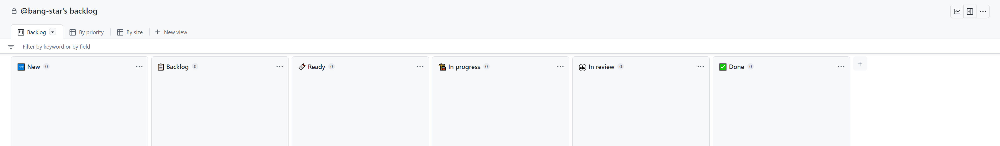

Project - Backlog형태로 생성

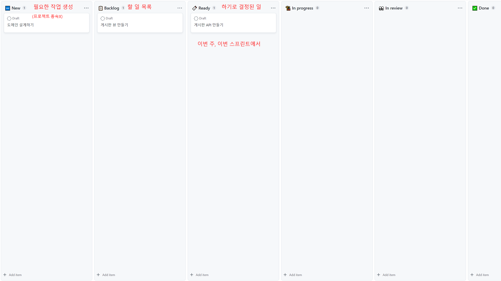

Backlog 생성 관리

**Project Issue**

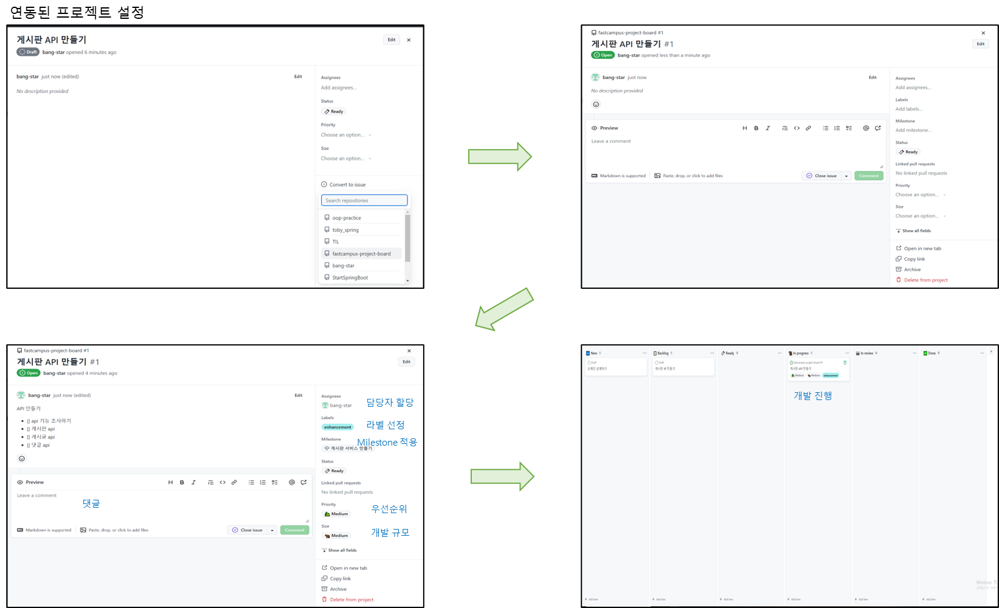

github projects를 활용하여 이슈 등록 및 칸반 보드 관리

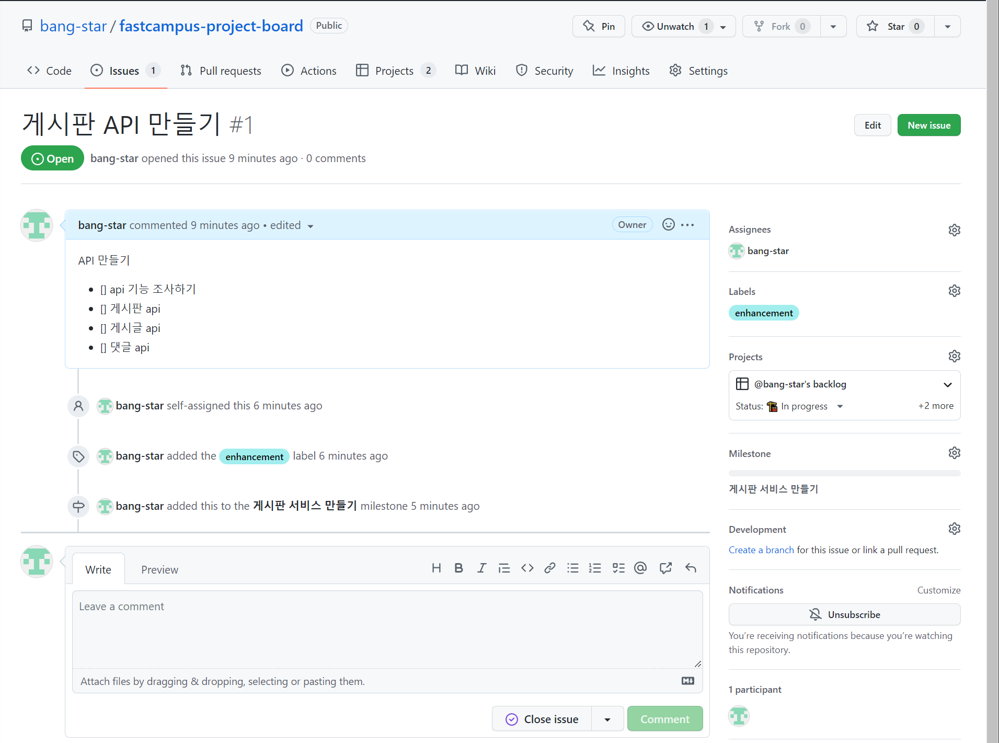

프로젝트에 적용된 Issue

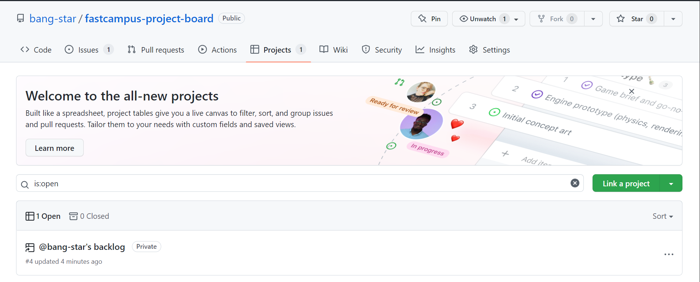

개발 프로젝트와 backlog 연동

* 현재 In progress에서 개발 완료 후 PR 요청을 한 후, 코드 리뷰를 통해 점검이 완료되고 개발 코드 반영되는 과정 외에도 자동화할 수 있다.

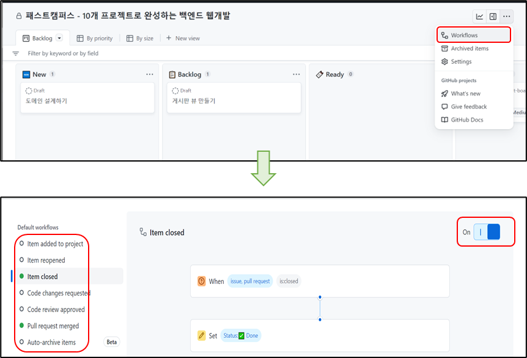

backlog 자동화 설정

> 구체적으로 **기본 동작**(In progress 내에 있는 개발을 마치고 PR하여 In reviews로 넘어가는 것 또는 PR 코드가 merge 되었을 때는 github에서 이미 자동화 해주고 있음)하는 것 외에 자동화 하고 싶은 Flow를 특정한 시나리오에 맞게 자동으로 하고 싶을 때 **Workflows**를 통해 설정할 수 있다.

* 구체적인 기한을 넣고 싶다면?

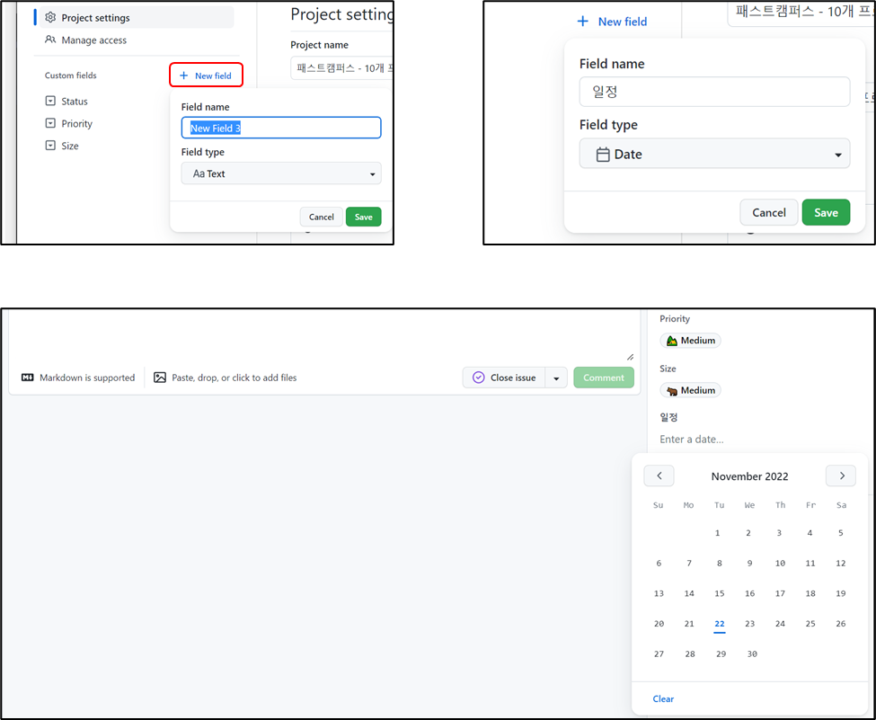

필드를 생성하여 구체적인 정보를 추가하는 과정

**Wiki**

* 문서 만드는 것
* confluence wiki와 유사함

**Settings**

> 현재 활성화되어 있지 않은 기능들이 있다.

* **Discussions**

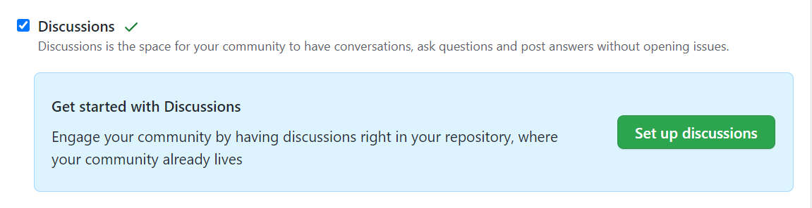

Disscustion 기능 활성화

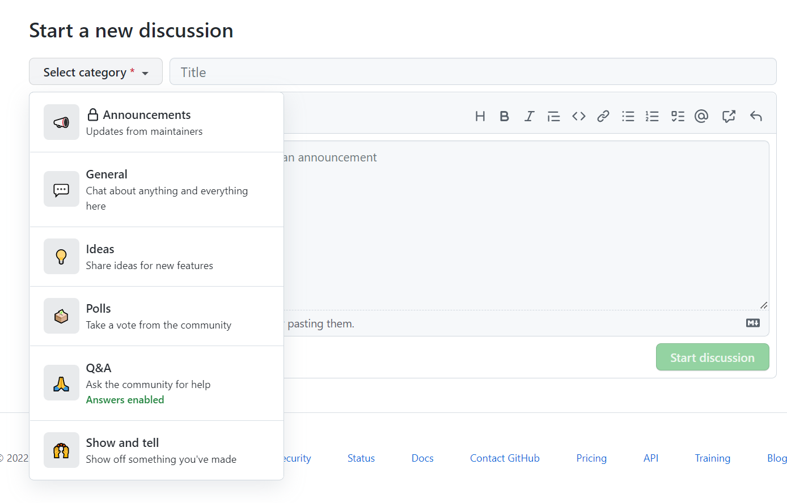

Discussion 생성

> 공지, 채팅, 투표, 질문 등 다양한 것을 추가할 수 있다.

---

> Github을 약 6년을 사용하였지만...  
> 모르는 기능이 있었다.  
>   
> 오늘도 어제보다 한 층더 발전한 나!  
> 
