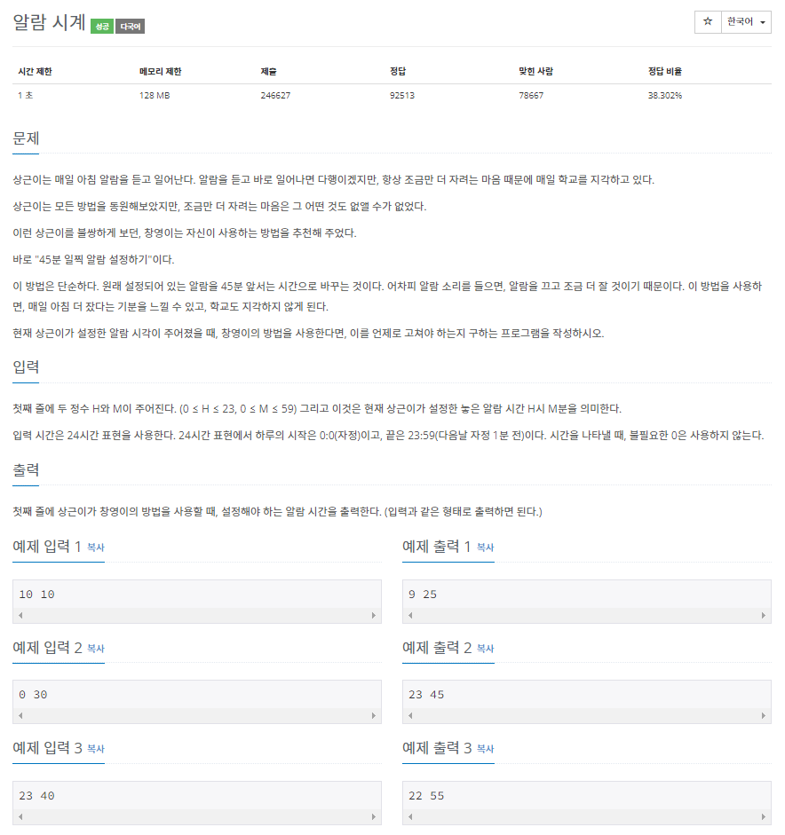
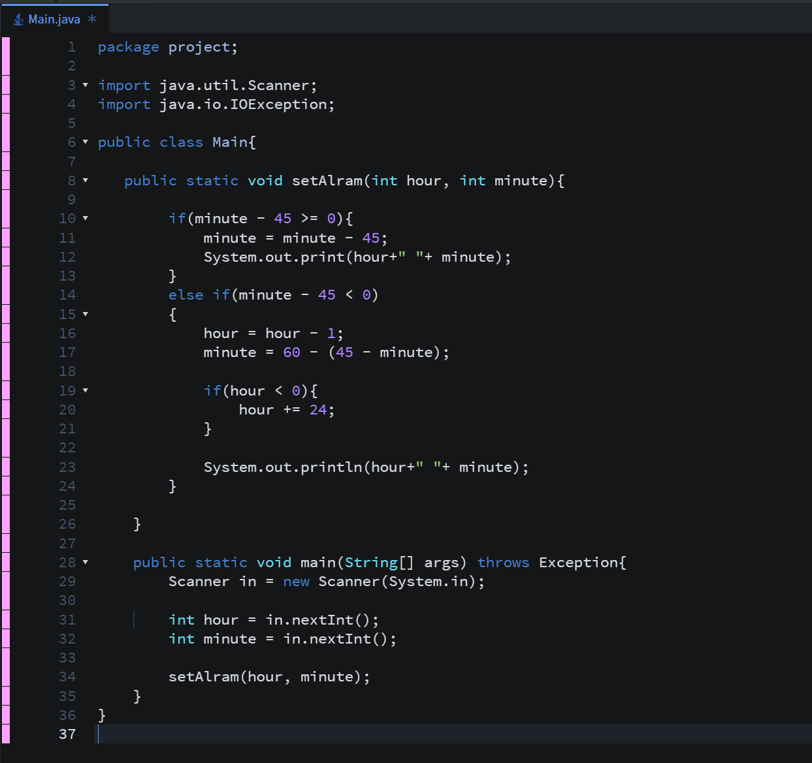
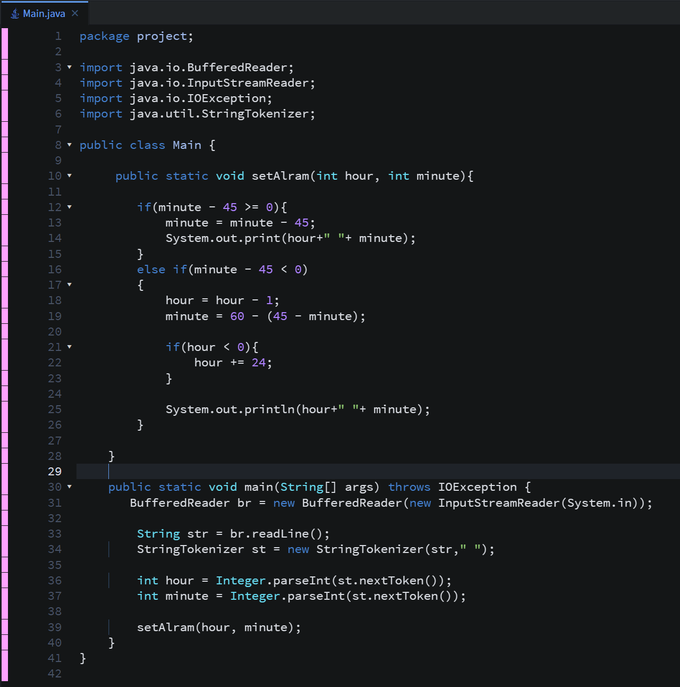
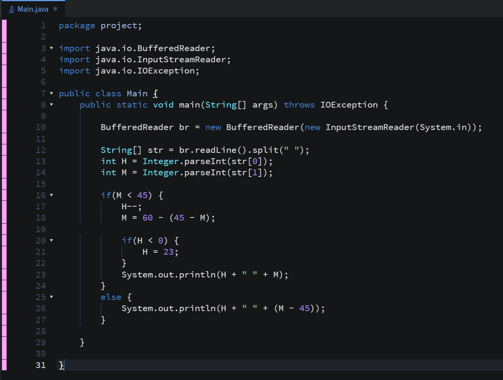
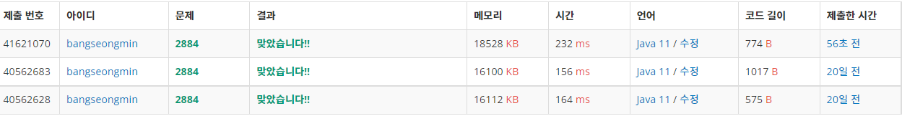

* **문제**

**- 이 문제는 정답률 38.302%로 이 문제를 해결하신분은 백준 상위 38%가 되셨습니다.**

---

* **간단 설명**

**- 시간을 입력받아 45분을 당긴 시간을 출력하는 문제입니다.**

**(1 단계) 시간을 입력받는다.**

**(2 단계) 입력 받은 시간에서 45분을 줄여줍니다.**

**(유의사항)**

**- 시는 0<= H <= 23, 분은 0<= M <= 59 입니다.**

---

* **풀이**

**- 방법 1(Scanner)**

---

**- 방법 2(BufferedReader)**

**- 방법 3(BufferedReader)**

**방법 3은 코드를 간략하게 줄여 메인 함수내부에서 처리하였습니다.**

---

* **성능 비교**

**- 방법 1 : 232ms**

**- 방법 2 : 156ms**

**- 방법 3 : 164ms**

**방법 1과 방법 2는 입력 받는 방법의 차이**

**방법 1,2와 방법 3는 구현의 차이**

* **정리**

**1일차에 많은 알고리즘 문제를 풀은 것 같습니다.**

**앞으로도 규칙적으로 많은 문제를 풀어서 포스팅 하도록 하겠습니다.**

