## **깃 브랜치 전략**

---

### **깃 브랜치 개념**

> 브랜치 전략이란 여러 개발자가 하나의 저장소를 사용하는 환경에서 저장소를 효과적으로 활용하기 위한 work-flow다.   
> 브랜치의 생성, 삭제, 병합 등 git의 유연한 구조를 활용해서, 각 개발자들의 혼란을 최대한 줄이며 다양한 방식으로 소스를 관리하는 역할을 한다.   
> 즉, **브랜치 생성에 규칙을 만들어서 협업을 유연하게 하는 방법론**을 말한다.

#### **필요한 이유는 무엇일까?**

* 어떤 브랜치가 최신 브랜치지?
* 어떤 브랜치를 끌어와서 개발을 시작해야 하지?
* 어디에 Push를 보내야 하지?
* 핫픽스를 해야하는데 어떤 브랜치를 기준으로 수정해야할까?
* 배포 버전은 어떤 걸 골라야하지?

이처럼 다양한 상황이 발생할 수 있는데 이런 상황을 최소화하기 위해 규칙을 만드는 것이 브랜치 전략이다.

#### **브랜치 전략을 세우는 이유와 요령**

* 하나의 프로젝트 소스코드를 여러 개발자가 다루면서 발생하는 각종 부작용을 해결하자
* 개발 협업을 원활하게 하기 위한 약속
* 전략을 세울 때 고려할 수 있는 요소들
  + 이 브랜치는 제품으로 내보낼 수 있는가?
  + 이 브랜치는 빌드 실패를 허용하는가?
  + 이 브랜치는 테스트 실패를 허용하는가?
  + 이 브랜치는 임시로 운영하는가? 유지하지 않고 수시로 삭제하는가?

---

### **Git-flow 전략**

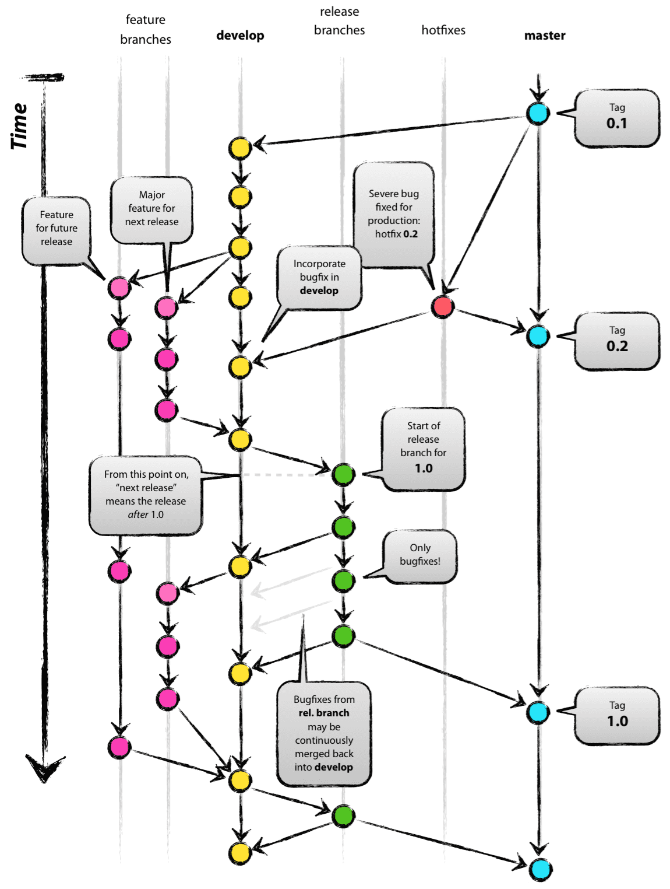

Git Flow 전략

* 기본적인 갸지의 이름은 아래의 5가지로 구분하곤 한다.
* **feature > develop > release > hotfix > master**
* 위 순서들은 왼쪽으로 갈수록 포괄적인 가지이며 master branch를 병합할 경우 그 왼쪽에 있는 hotfix 등 모든 가지들에 있는 커밋들도 병합하도록 구성하게 된다.
* 5가지 중, **항시 유지되는 메인 브랜치 master, develop 2가지**와 **merger 되면 사라지는 보조 브랜치 feature, release, hotfix 3가지**로 구성된다.

---

### **Git-flow브랜치 구조**

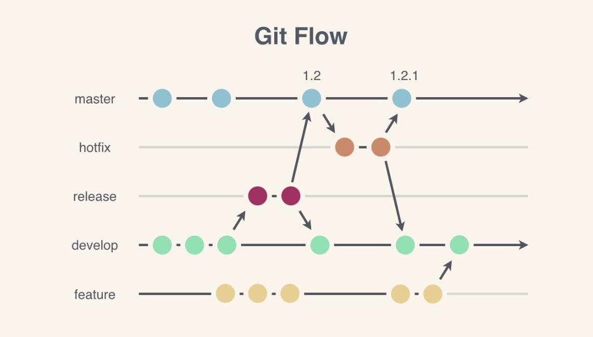

* **master** : 라이브 서버에 제품으로 **출시**되는 브랜치
* **develop** : 다음 출시 버전을 대비하여 **개발**하는 브랜치
* **feature** : **추가 기능** 개발 브랜치. develop 브랜치에 들어간다.
* **release** : **다음 버전** 출시를 준비하는 브랜치. develop 브랜치를  release 브랜치를 옮긴 후 QA, 테스트를 진행하고 master 브랜치로 합친다.
* **hotfix** : master 브랜치에서 발생한 **버그**를 수정하는 브랜치.

---

### **Github-flow 전략**

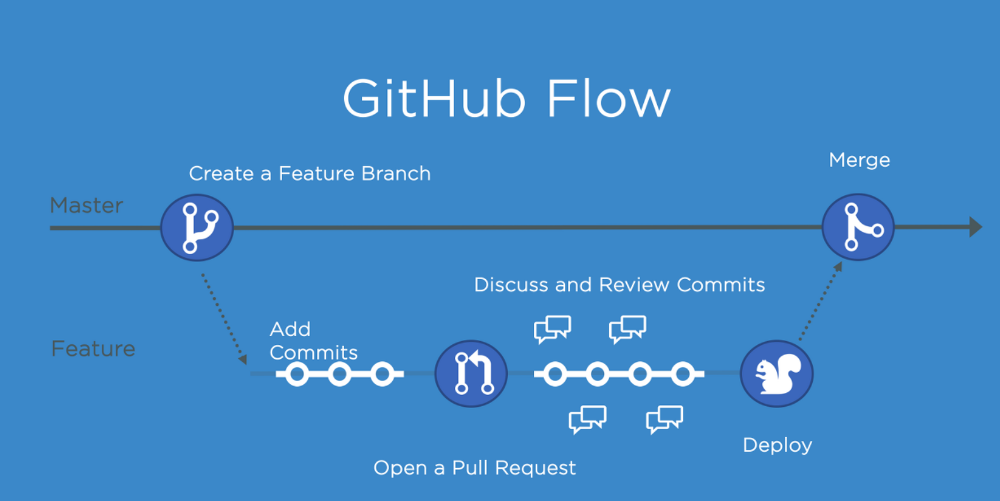

* Git flow가 좋은 방식이지만 GitHub에 적용하기에는 **복잡**하다는 Scott Chacon의 판단에 따라 만들어진 새로운 깃 관리 방식이다.
* **자동화 개념이 들어가 있다**라는 큰 특징이 존재하며 만일 자동화가 적용되어 있지 않은 곳에서만 수동으로 진행하면 된다.
* Git flow에 비해 흐름이 **단순해짐에 따라 그 규칙도 단순**해졌다.
* 기본적으로 master branch에 대한 규칙만 정확하게 정립되어 있다면 나머지 가지들에 대해서는 특별한 관여를 하지 않으며 pull request기능을 사용하도록 권장한다.

---

### **Github-flow 특징**

* release branch가 명확하게 구분되지 않은 시스템에서의 사용이 유용하다.
* GitHub 자체의 서비스 특성상 배포의 개념이 없는 시스템으로 되어있기 때문에 이 flow가 유용하다.
* 웹 서비스들에 배포의 개념이 없어지고 있는 추세이기 때문에 앞으로도 Git flow에 비해 사용하기에 더 수월할 것이다.
* hotfix와 가장 작은 기능을 구분하지 않는다.  
  모든 구분사항들도 결국 개발자가 전부 수정하는 일들 중 하나이기 때문이다.  
  이 대신 구분하는 것은 우선 순위가 어떤 것이 더 높은지에 대한 것이다.

---

### **github flow vs git flow**

* 1개월 이상의 긴 호흡으로 개발하여 주기적으로 배포, QA 및 테스트, hotfix 등 수행할 수 있는 여력이 있는 팀이라면 **git-flow**가 적합하다
* 수시로 릴리즈 되어야 할 필요가 있는 서비스를 지속적으로 테스트하고 배포하는 팀이라면 **github-flow** 와 같은 간단한 work-flow가 적합하다

---

### **Github Backlog**

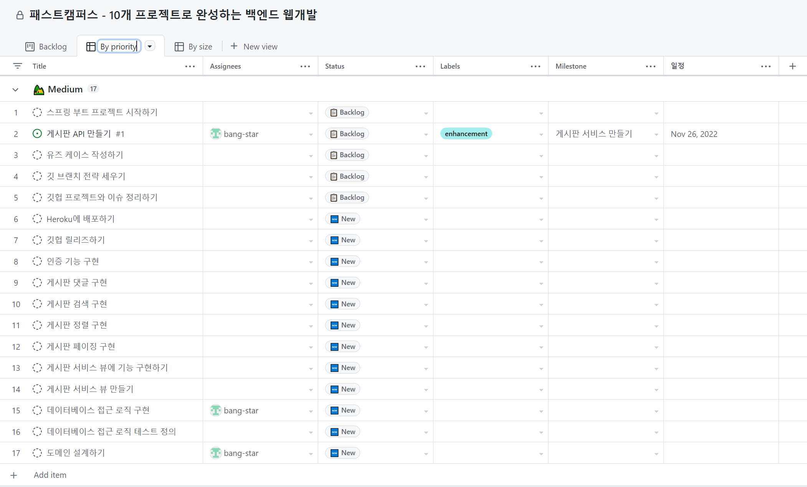

Backlog 리스트

* **"깃헙 프로젝트와 이슈 정리하기"를 Issue로 전환하고 종료**

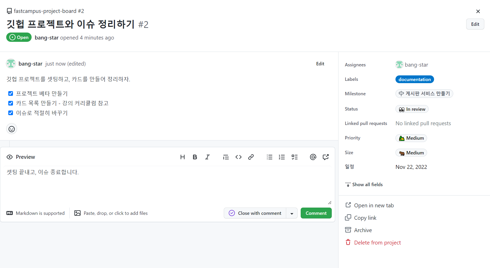

"깃헙 프로젝트와 이슈 정리하기"를 Issue로 전환

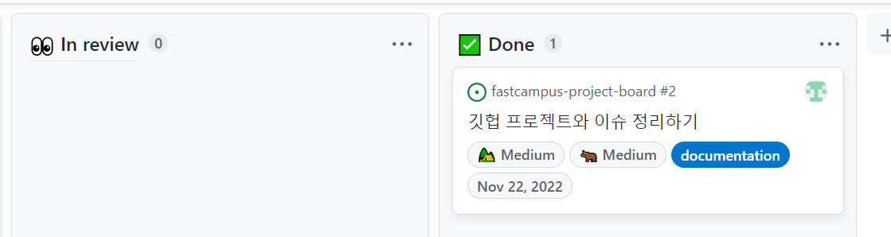

Issue close 이후, Backlog 자동화

* Status에서 New와 Backlog의 경계가 모호하므로 New를 제외하자

> **- status:"🆕 New" 명령어를 통해 "New" 상태를 제외하여 볼 수 있다.   
> 하지만 이 방법은 New을 가려는 주는데, 기둥을 없애지는 않는다는 문제가 있다.**

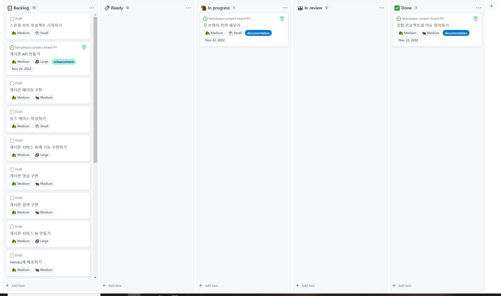

> settings → status →  "New"를 제거하면 된다.

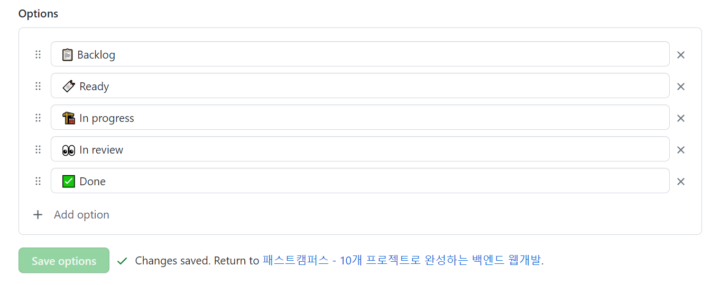

settings에 status에서 New 제거한 상태

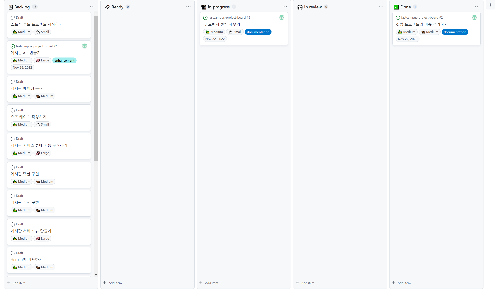

New 탭이 사라진 것 확인

* **Ready와  In Progress로 이동**

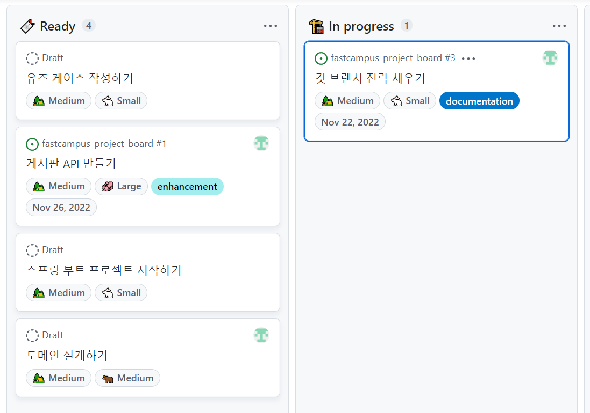

할일 목록과 진행할 일

---

#### **깃 브랜치 전략 선택하기**

1. Github-flow로 선택

> 많은 대기업과 개발회사에서는 정형화된 프로세스가 많아 Git-flow 전략을 사용한다.   
> Git-flow는 master 브랜치와 develop 브랜치를 분리한다는 중요한 특징이 있다. 빠르게 개발 브랜치를 만들고 배포하는 서비스에서는 다소 과한면이 있다. 그래서 Github-flow를 선택한다.

2. Github-flow 문제

> Git-flow는 오래되어 관련된 도구들이 많이 있지만, Github-flow는 나와있는 도구가 상대적으로 덜 알려져 있다.  
> Git-Kraken에서도 Git-flow 통합기능이 있는데 **Command+ ','**을 눌러서 사용할 수 있다.

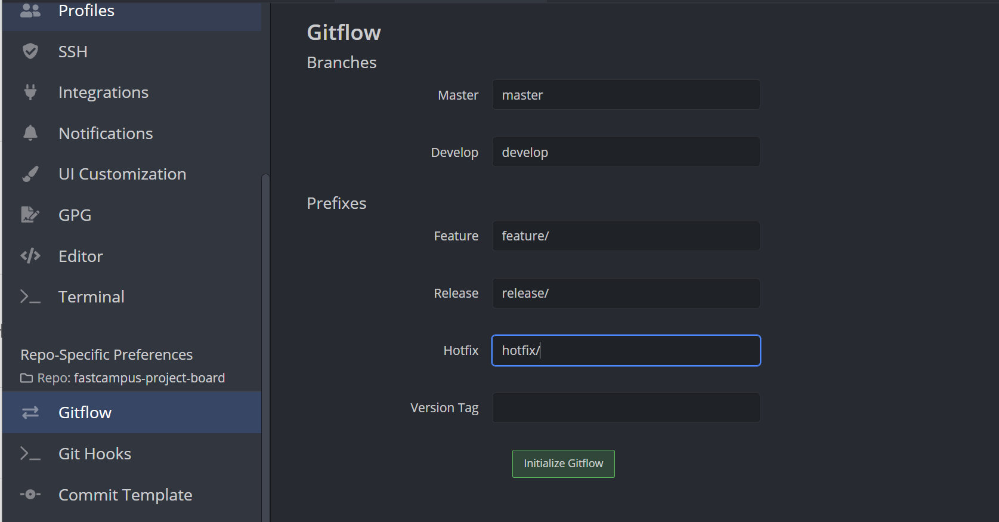

Gitflow 전략 적용 방법

> 이 기능은 Gitflow이므로 Github-flow는 못쓰는건가??  
>   
> 이것을 적당히 트릭을 사용해서 Github-flow를 활용할 수 있다.  
> 골자는 develop 브랜치를 두지 않는 것이다.

#### **깃 브랜치 전략 적용하기**

**1. 가짜 브랜치 생성**

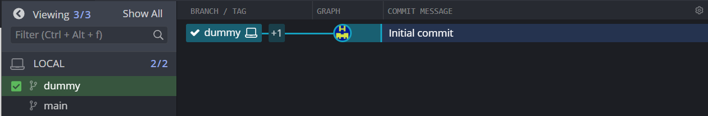

dummy 브랜치 생성

> 가짜 브랜치를 생성한 이유는 git-flow를 초기화하기 위해서는 반드시 Gitflow 옵션에 들어가는 브랜치가 실제로 만들어져 있어야 한다. 그래서 master 또는 develop을 안쓰겠다고 해서 develop을 지우면 안된다.   
>   
> feature 브랜치에 gitflow 전략은 feature을 만들어서 develop으로 가는 구조를 뛴다. 그래서 feature가 master로 바로 가지 않는다(gitflow 도구를 사용하면 그렇게 할 수가 없음).   
>   
> master(main) 브랜치 → develop, master 브랜치 → dummy으로 설정  
>   
> 기능적으로 master 브랜치를 사용하지 않고 develop만 가지고 개발을 하는데 develop이 main과 같은 역할을 한다.  
> 그래서 main브랜치는 즉 gitflow에 develop 브랜치는 production-ready 브랜치가 된다. 나머지는 동일한데 초기화는 하지만 사용하지 않을 것이다. 우리는 feature만 사용할 것이다. 이와 같이 gitflow를 github-flow로 우회해서 사용할 수 있다.

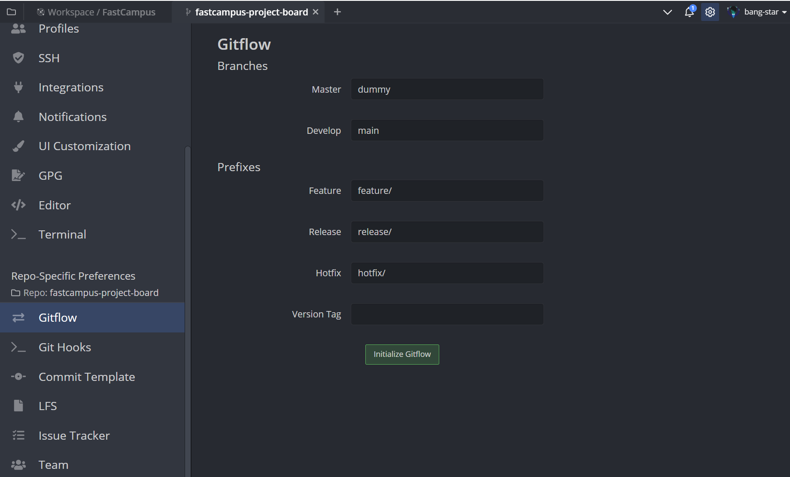

gitflow을 github-flow로 사용하는 방법

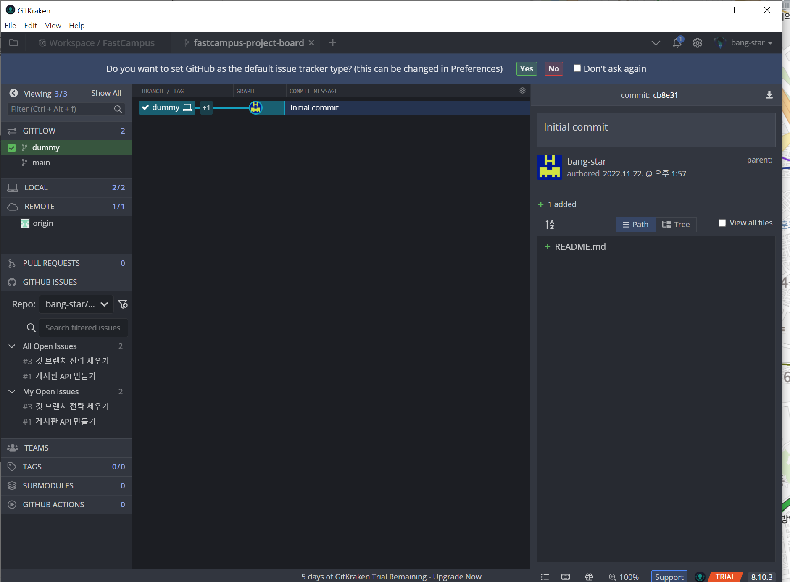

issue 연동 및 gitflow 상태 확인

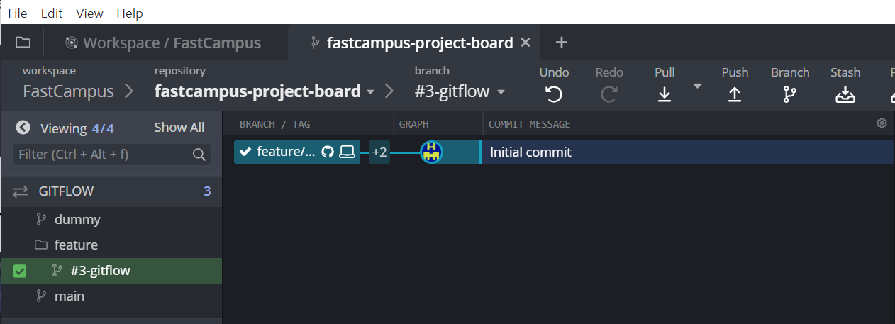

feature에 브랜치 추가

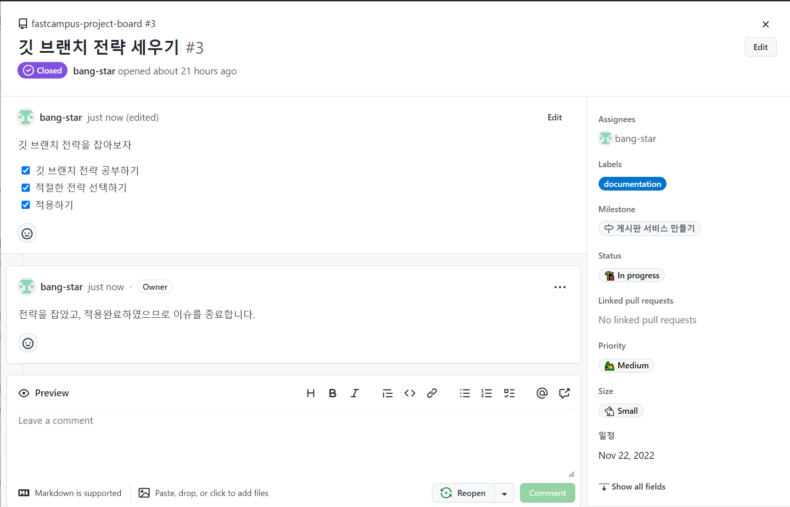

이슈 처리 완료

---

**Reference**

* [**Dev Scroll**](https://inpa.tistory.com/entry/GIT-%E2%9A%A1%EF%B8%8F-github-flow-git-flow-%F0%9F%93%88-%EB%B8%8C%EB%9E%9C%EC%B9%98-%EC%A0%84%EB%9E%B5#thankYou)
