### **유즈 케이스**

---

#### **Use Case 정의**

* 시스템이나 서비스를 설계할 때 전체적인 사용자 이용 패턴을 문서화한 것이다.
* 일반적으로 “시스템의 하나 이상의 액터 또는 이해관계자에게 관측 가능한 결과를 산출하는 시스템에 의해 수행되는 일련의 활동의 명세”1)로 정의할 수 있다. 조금 더 쉽게 표현하자면 어떤 행위와 관련된 액터 간에 수행되는 활동을 기술한 것이라고 이해할 수 있다. [참고 : 스마트그리드 표준화 프레임워크 3.0]

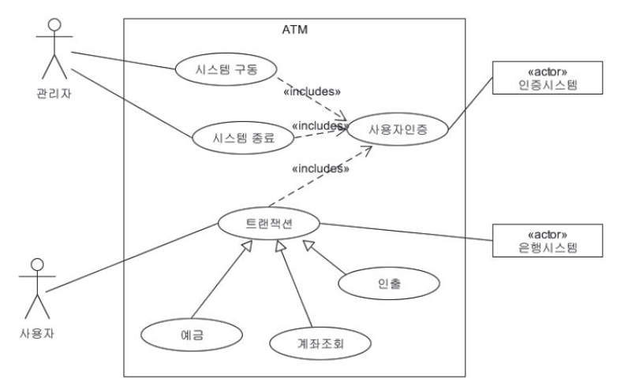

유즈 케이스

> 유즈 케이스를 그려서 설계하려는 시스템이 어떻게 생겼는지를 문서화하고 동료들과 커뮤니케이션할 때 보여준다. 유즈 케이스 방식 외에도 다른 방식으로 보여줄 수도 있다.   
>   
> 대표적인 도구로는 lucid chart가 있는데 lucid chart 무료 버전은 편집할 수 있는 문서 수가 개정 당 3개로 제한되어 적합하지 않다. 보편적으로 널리 알려져 있는 draw.io를 사용할 것이다.

#### **draw io 특징**

* github와 연동 가능

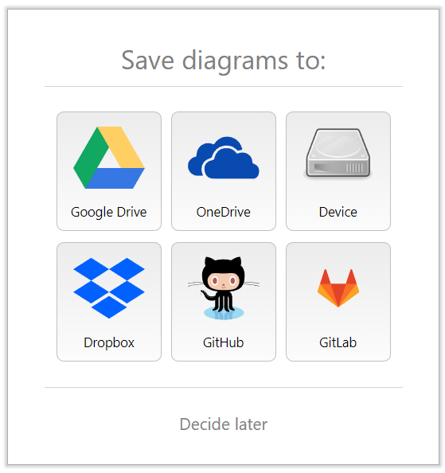

draw io와 연동가능한 도구

* lucid chart는 User Case Template이 있지만, draw io에는 User Case Template이 없기 때문에 Blank Diagram을 사용

#### **draw io을 활용하여 Use Case 그리기**

1. draw io 파일을 저장하기 위한 폴더 생성

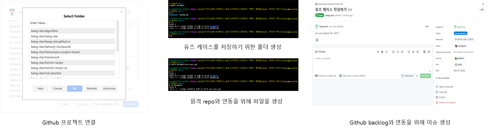

2. draw io 파일을 저장하기 위한 폴더 생성

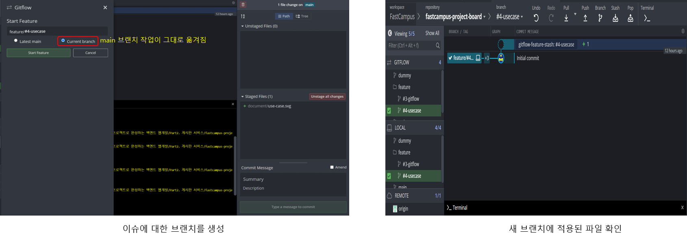

* 자동으로 statch commit 메시지가 전송된것을 확인할 수 있음

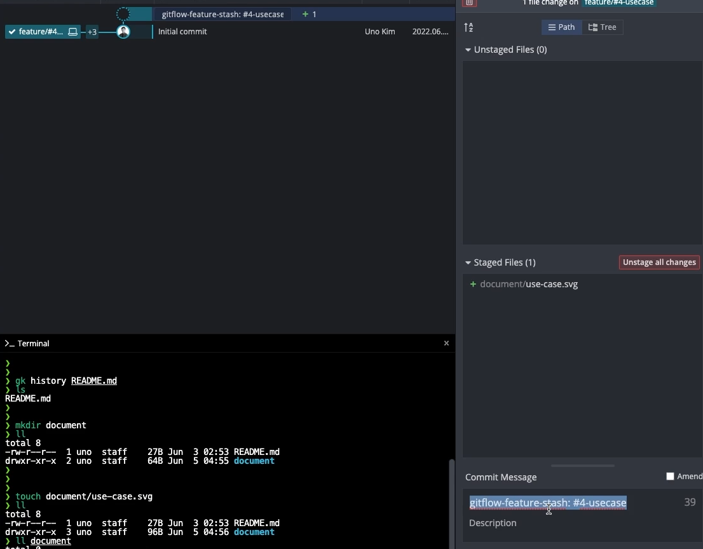

3. commit 메시지 전략 세우기

> github 기능 중에 [autolink-reference and URLS](https://docs.github.com/en/get-started/writing-on-github/working-with-advanced-formatting/autolinked-references-and-urls)라는 기능이 있다. 그중에서 Issue or pull requestURL을 #이슈번호를 통해 Issue와 연동가능하다.

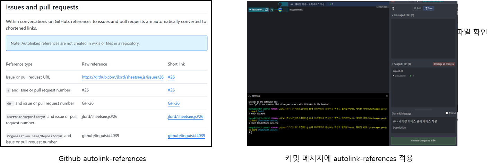

* commit 메시지를 통해 **작업한 이유(WHY)**를 작성하는 것이 좋다.

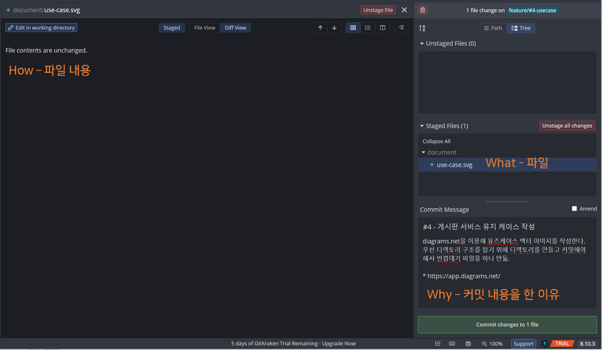

4. draw.io 작업 환경 설정

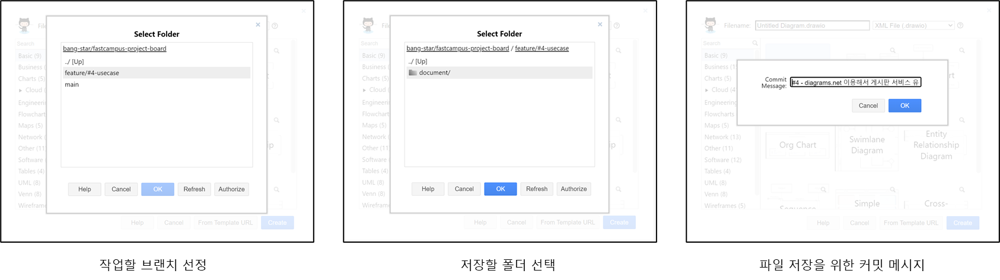

5. Use Case 그리기

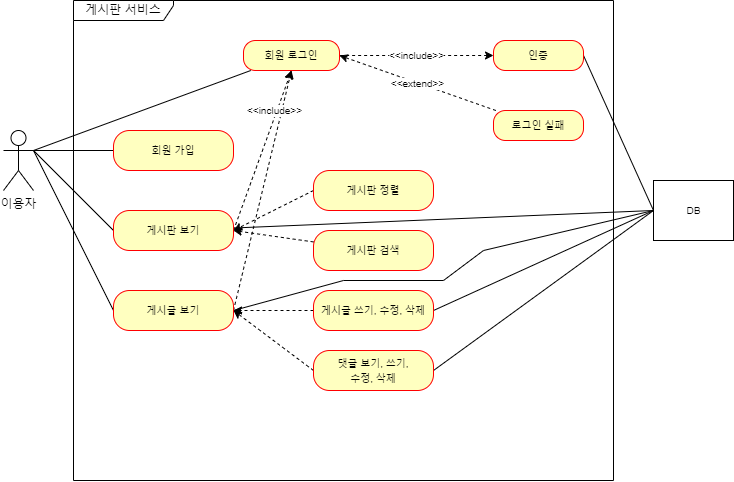

draw.io를 이용하여 만든 Use Case

* **포함 관계**  
  예시) 인증 기능은 회원 로그인 기능에 포함된다. 즉 로그인을 하면 인증이 들어간다.
* **확장 관계**  
  기능을 수행하면서 일어날 수 있는 분기 중에 하나를 의미한다.
* **연관 관계**시스템과 Actor, 시스템과 User case는 연관 관계로 실선으로 표현한다.

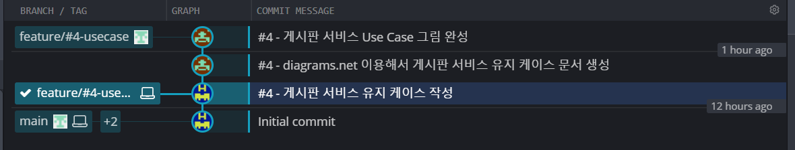

gitkraken을 통해 commit 상태 확인

#### 🔥 문제발생 -  git amend로 Commit 메시지 갈림

> Commit 메시지를 구체화하는 과정에서 원격 Repo와 Local Repo가 중간에서 갈리는 현상이 만들어졌다. 현재 상태에서 내가 수정한 것으로 반영되려면 시간적 순서가 엉켜버렸기 때문에 그냥 Push하면 안된다.   
>   
> 해결 방법   
> 1) POST Commit을 통해 꼬인 Commit을 날려버려야 한다. 이 부분을 잘 이해하고 있다면 Force Push를 해서 의도한대로 만들 수 있지만 이 방법은 협업 시 문제가 발생될 수 있다.

* **Before**

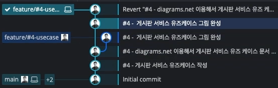

git ammend로 인해 발생한 문제

* **After**

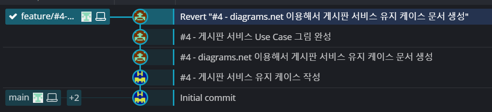

Force Push를 통해 문제 해결

**중복된 커밋**

> **This commit does not belong to any branch on this repository, and may belong to a fork outside of the repository.**

* github issue에 기록된 작업 목록

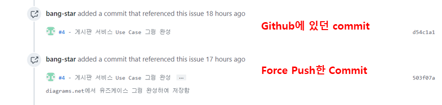

github issue에 작업 리스트

* gitkraken을 통해 확인하는 commit 리스트

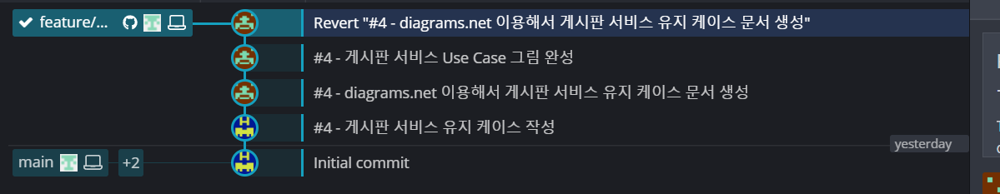

gitkraken을 통해 확인한 실제 모습

* 중복된 커밋에 나타나는 메시지

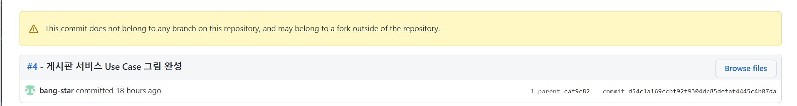

---

#### **Pull Request**

> 현재 Feature 브랜치 개발이 끝났고 즉 문서 작업 내용이 끝나서 Pull Ruquest 요청을 해야한다.  
>   
> **방법**  
> 1. 자동으로 만들어지는 Pull request  
> 2. New pull request 버튼을 클릭하여 반영 브랜치(main)를 확인하고 비교 브랜치(feature/#4-usecase)를 선택하는 방법

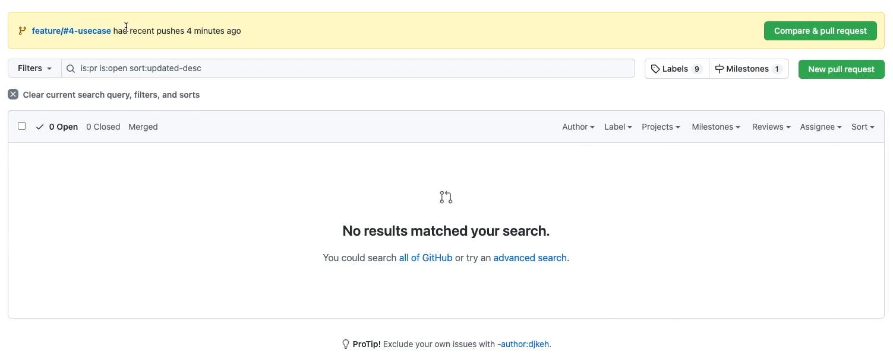

자동으로 생성되는 pull request

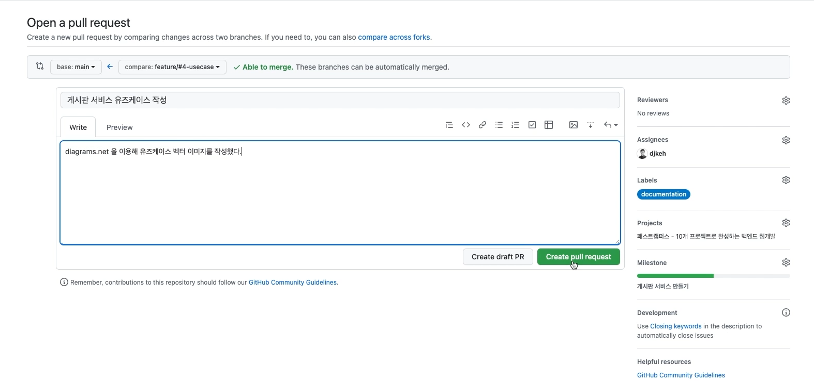

Pull Request 생성 화면

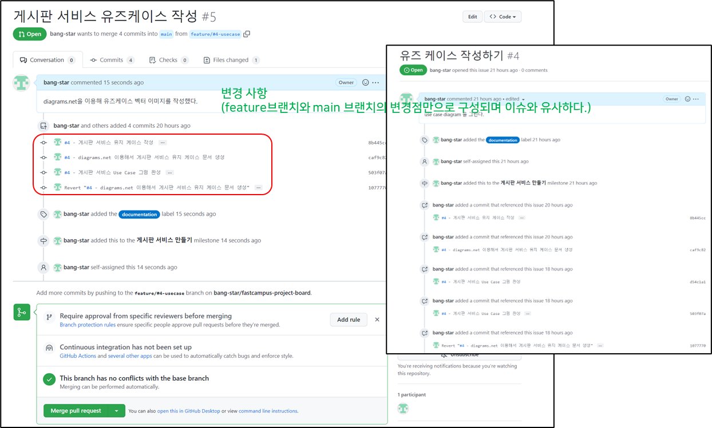

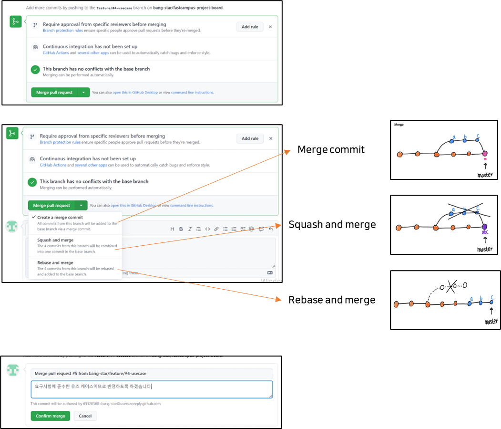

merger 과정과 merger 종류

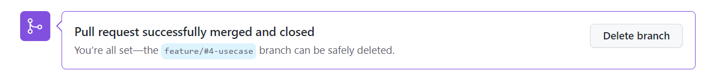

remote에 남아있는 feture 브랜치 삭제

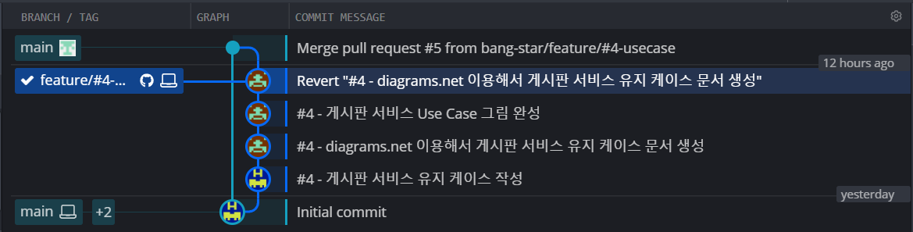

Gitkraken을 통해 확인하는 현재 commit 상태

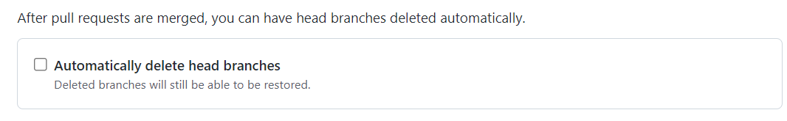

github에서 지원해주는 자동 브랜치 삭제

---

**요약**

> **1. Force Push 할때 주의해야하는 부작용(git amend로 Commit 메시지 갈림 현상)**  
> - remote에 저장된 내용은 amend하지 않는 것이 좋다.  
> - amend 하였을 경우 Force Push 하지 않는 것이 좋다.  
>   
> **2. merge가 끝나면 feature 브랜치가 remote에 남게 되는데 반드시 삭제해야한다.**- 브랜치가 사라진다고 작업 노드가 사라지는 것은 아니다.  
> - feature 브랜치가 많아지면 복잡해질 수 있다.
