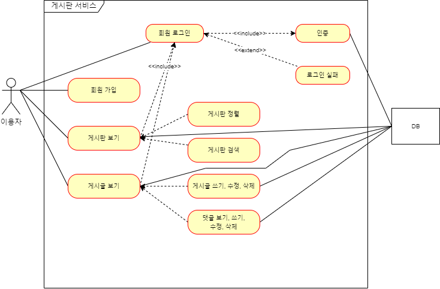

## **API 설계**

---

* End Point(URL)과 HTTP Method가 어떠한 기능을 하는지 문서화하는 것을 의미한다.

Use Flow

> API 설계는 Use Flow를 기반으로 작성함.

#### **Endpoints**

| 종류 | url | method | 기능 | 설명 |
| --- | --- | --- | --- | --- |
| view | / | GET | 루트 페이지 | 게시판 페이지로 이동 |
| /error | GET | 에러 페이지 |  |
| /login | GET | 로그인 페이지 |  |
| /sign-up | GET | 회원가입 페이지 |  |
| /articles | GET | 게시판 페이지 |  |
| /articles/{article-id} | GET | 게시글 페이지 |  |
| /articles/search | GET | 게시판 검색 전용 페이지 |  |
| /articles/search-hashtag | GET | 게시판 해시태그 검색 전용 페이지 |  |
| api | /api/sign-up | POST | 회원가입 |  |
| /api/login | GET | 로그인 요청 |  |
| /api/articles | GET | 게시글 리스트 조회 |  |
| /api/articles/{article-id} | GET | 게시글 단일 조회 |  |
| /api/articles | POST | 게시글 추가 |  |
| /api/articles/{article-id} | PUT,  PATCH | 게시글 수정 |  |
| /api/articles/{article-id} | DELETE | 게시글 삭제 |  |
| /api/articleComments | GET | 댓글 리스트 조회 |  |
| /api/articleComments/{article-comment-id} | GET | 댓글 단일 조회 |  |
| /api/articles/{article-id}/articleComments | GET | 게시글에 연관된 댓글 리스트 조회 |  |
| /api/articles/{article-id}/articleComments/{article-comment-id} | GET | 게시글에 연관된 댓글 단일 조회 |  |
| /api/articles/{article-id}/articleComments | POST | 댓글 등록 |  |
| /api/articles/{article-id}/articleComments/{article-comment-id} | PUT,  PATCH | 댓글 수정 |  |
| /api/articles/{article-id}/articleComments/{article-comment-id} | DELETE | 댓글 삭제 |  |

#### **API Spec.**

| url | method | 입력 데이터 구상 |
| --- | --- | --- |
| /api/sign-up | POST | id, 비밀번호, 이메일, 닉네임, 메모 |
| /api/login | GET | id, 비밀번호 |
| /api/articles | GET | 필터: 제목, 본문, id, 닉네임, 해시태그 |
| /api/articles/{article-id} | GET |  |
| /api/articles | POST | 필터: 제목, 본문, id, 닉네임, 해시태그 |
| /api/articles/{article-id} | PUT, PATCH | 제목, 본문, 해시태그 |
| /api/articles/{article-id} | DELETE | 게시글 id |
| /api/articleComments | GET | 필터: 본문, id, 닉네임 |
| /api/articleComments/{article-comment-id} | GET |  |
| /api/articles/{article-id}/articleComments | GET | 필터: 본문 |
| /api/articles/{article-id}/articleComments/{article-comment-id} | GET |  |
| /api/articles/{article-id}/articleComments | POST | 필터: 본문 id |
| /api/articles/{article-id}/articleComments/{article-comment-id} | PUT, PATCH | 본문 |
| /api/articles/{article-id}/articleComments/{article-comment-id} | DELETE | 댓글 id |
