## **기본 기능 개발**

---

### **스프링 부트 프로젝트 시작하기**

#### **스프린트**

* 팀이 일정량의 작업을 완료하는 시간이 정해진 짧은 기간입니다. 스프린트는 스크럼과 애자일 방법론의 핵심이며, 올바른 스프린트는 애자일 팀이 더 적은 수고를 통해 더 나은 소프트웨어를 제공하는 데 도움이 된다.   
  [참고 - [ATLASSIAN](https://www.atlassian.com/ko/agile/scrum/sprints)]
* 스프린트는 구글 수석디자이너 제이크 냅이 고안한 기획실행법으로, 팀원들과 토론을 통해 도출된 아이디어를 단기간 내에 프로토타입으로 제작하고 테스트하여 중요한 문제들에 대한 답을 찾아가는 과정입니다. 상품이나 서비스 혹은 조직이 당면한 문제에 대해 단기간 내에 시뮬레이션하여 시간과 자원을 효과적으로 사용할 수 있는 개발 방식으로 특히, 스타트업에서는 실제로 제품을 구축하고 실시하는 위험한 과정에 착수하기 전에 자신들이 제대로 가고 있는지 확인해볼 방법을 제시합니다.

#### **스프린트가 필요한 이유**

현재 Backlog(앞으로 해야할 일)가 많이 쌓여있다. 해야할 일이기 때문에 Backlog에서 Ready로 넘어가도 무방하지만 많기 때문에 장황해질 수 있다. 그래서 적당한 기준을 나눠서 Ready로 이동시키고 싶어졌다. 많은 개발 조직에서 애자일 프로세스를 도입해서 스프린트를 운용하는 것을 모방하여 본인의 프로젝트에 맞춰 적용해보려 한다.

#### **스프린트 설정**

* settings → Custom fields → New field

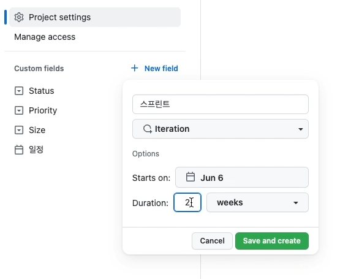

스프린트 설정

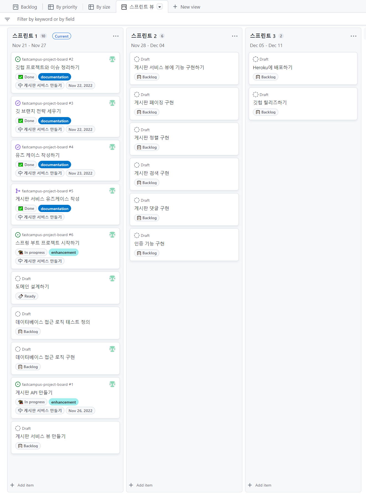

스프린트 뷰 설정

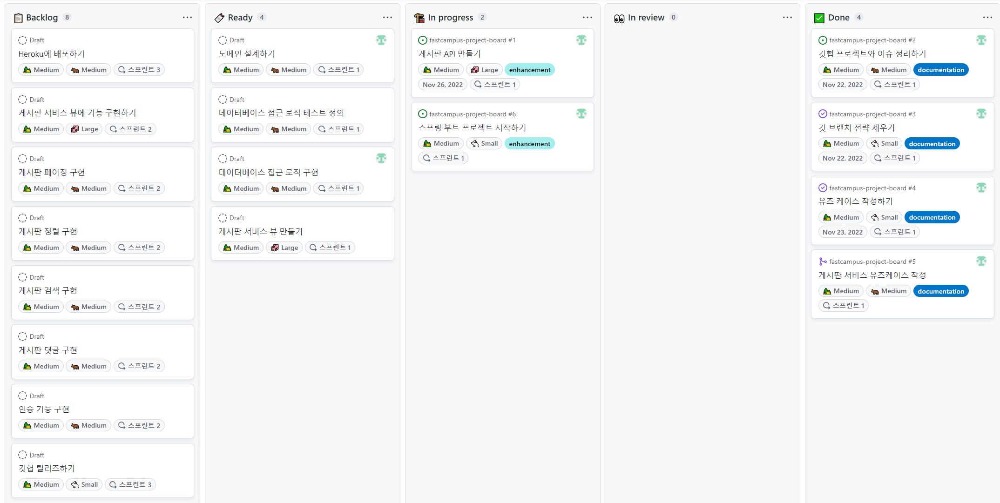

backlog 상태

> 스프린트를 설정함으로써 Backlog 뷰에서 Backlog과 Ready를 확실하게 구분함으로써 업무효율을 높일 수 있다.

#### **spring initializr**

**1. 프로젝트 생성**

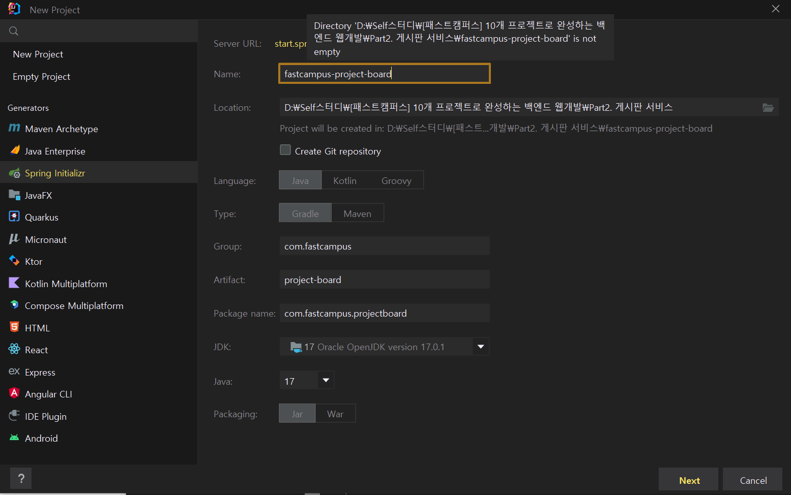

**2. Dependencies 설정**

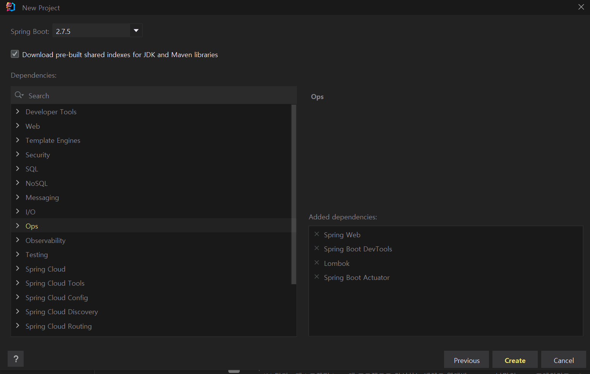

**3. Test 코드(빈껍데기 코드)를 실행하여 정상작동함을 확인할 수 있다.**

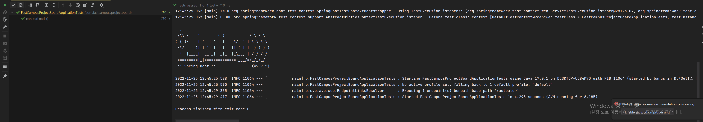

**4. .gitignore 변경**

intellij에서 제공한 .gitignore는 OS에 관련된 파일 또는 다른 IDE(VS Code)와 관련된 처리를 해주지 못하기 때문에 gitignore.io를 통해 이 문제를 해결하려 한다.

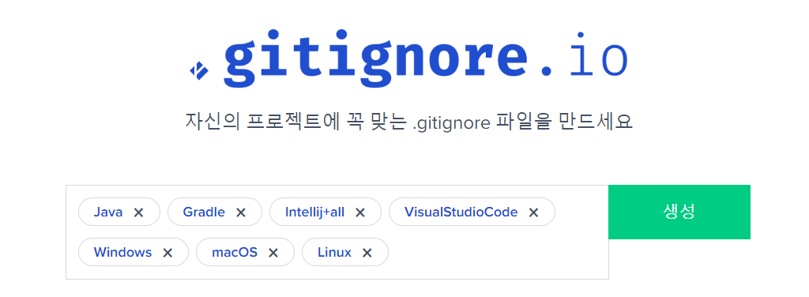

* .idea/codeStyles
* .idea/runConfigurations

위 두 가지는 ignore 제외 대상으로 되어 있는데, 주석처리를 통해 ignore 처리할 수 있다.

**5. Pull Requests**

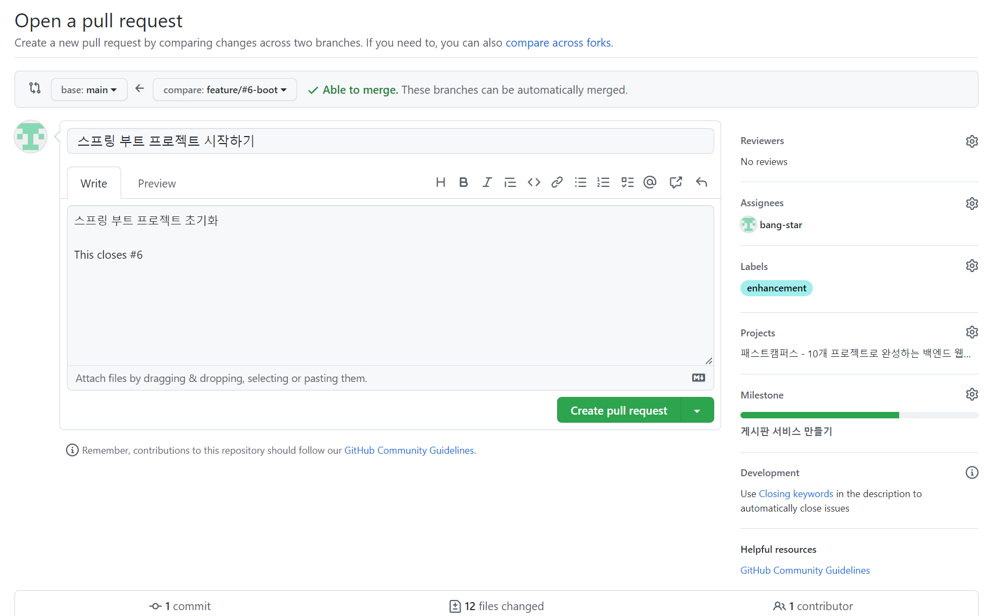

> **Linking a pull request to an issue**를 이용하여 **issue**와 **Pull Request**를 연결하여 자동으로 **issue**가 닫혀지도록 할 수 있다. 기능상에 차이는 전혀 없지만 close(es/d), fix(es/ed), resolve(s,d)이 있다.

**6. Inteliij에서 svg 파일 내용을 자동으로 포맷팅해주는 현상을 발견할 수 있었다.**

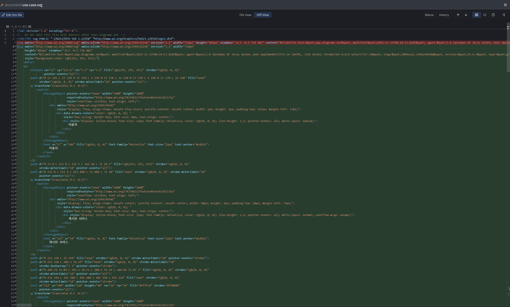

> 기존에 1줄로 긴 링크였는데, Intellij에서 자동 정렬을 통해 포맷팅해주었다. 원하지 않은 결과물이므로 되돌리기를 하려 한다.

* **Push 파일 중 일부 revert하는 과정**

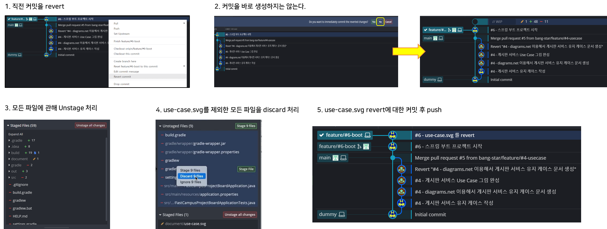

* 변경 파일 검토 후 comment

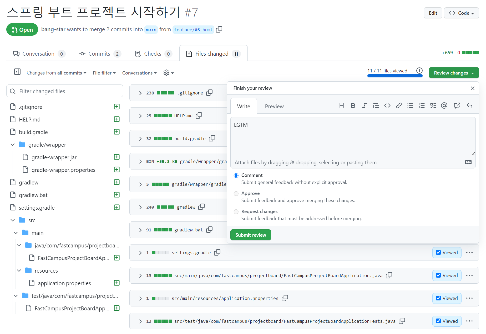

* Merge pull Request

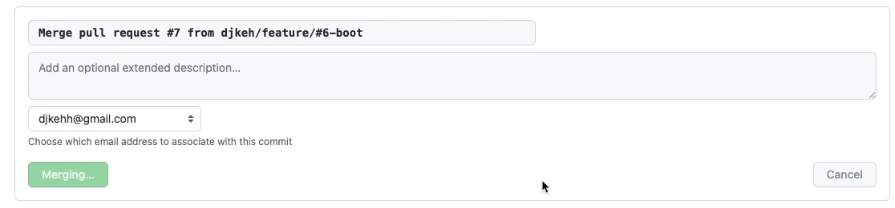

* setting에서 자동으로 PR후 브랜치가 삭제되도록 하였기 때문에 자동으로 삭제되는 현상을 볼 수 있다.

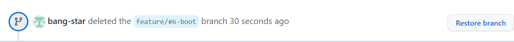

**7. Backlog에서 현재 작업이 마무리된 것을 확인**

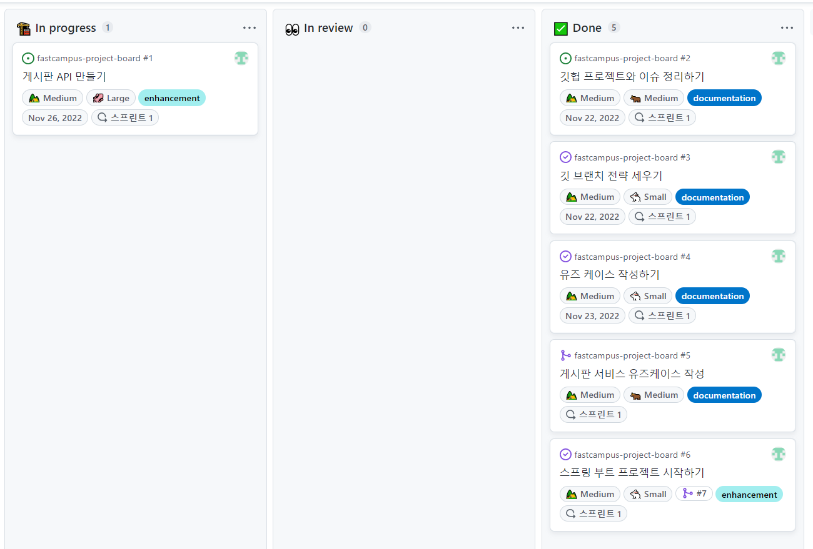

---

### **도메인 설계**

#### **Backlog**

**1. Backlog 확인**

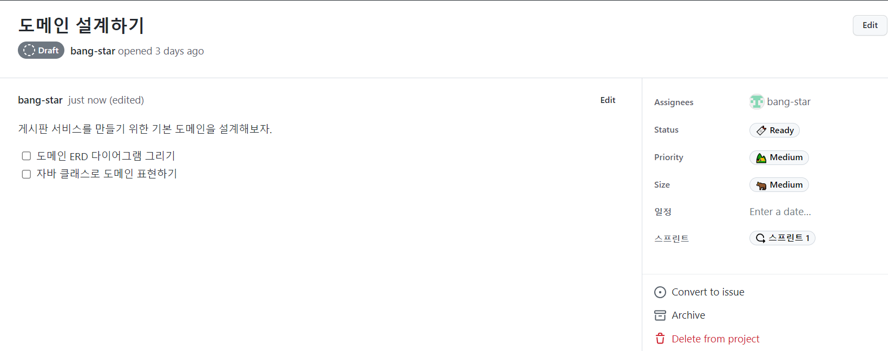

**2. Convert to issue**

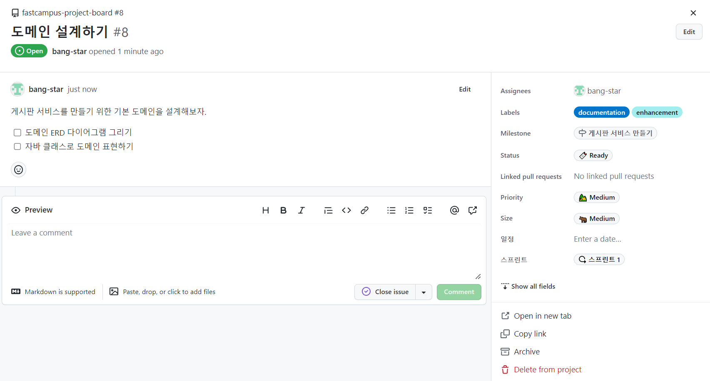

**3. diagram.net을 통해 ERD 생성**

[원문에서 이미지 보기](https://to-be-a-artist.tistory.com/243)

> 1. 굵은 글씨를 통해 Not Null 임을 표시함.  
> 2. meta-data는 구체적일 수록 좋기 때문에 생성일시, 생성자, 수정일시, 수정자를 공통적으로 기입  
> 3. 크기는 넉넉하게 함으로써 추후 관리가 용이하도록 설계

**4. Domain Class 설계**

> 데이터베이스 설계를 염두에 두고 이름을 테이블 명과 일치시켜서 만들 수 있는데, 테이블 명을 단수가 아닌 복수로 하자고 하는 사람들이 많이 있다. 그래서 클래스 명을 복수로 하는 경우도 있지만, 단수로 가져가고자 한다. 복수로 가져가는 분들의 일리도 있지만, 개인적으로 단수가 더 어울리지 않을까라는 생각이 든다.

* **게시글**

```java
public class Article {
    private Long id;
    private String title;               // 제목
    private String content;             // 본문
    private String hashtag;             // 해시태그

    private LocalDateTime createdAt;    // 생성일시
    private String createdBy;           // 생성자
    private LocalDateTime modifiedAt;   // 수정일시
    private String modifiedBy;          // 수정자자
}
```

* **댓글**

```java
public class ArticleComment {

    private Long id;
    private Article article;            // 게시글 (ID)
    private String content;             // 본문

    private LocalDateTime createdAt;    // 생성일시
    private String createdBy;           // 생성자
    private LocalDateTime modifiedAt;   // 수정일시
    private String modifiedBy;          // 수정자자
}
```

**5. Pull Request**

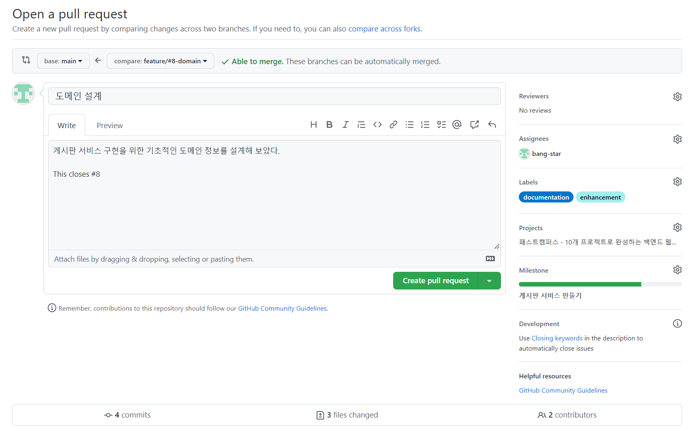

Pull Request 요청 과정

**6. Backlog 상태 확인**

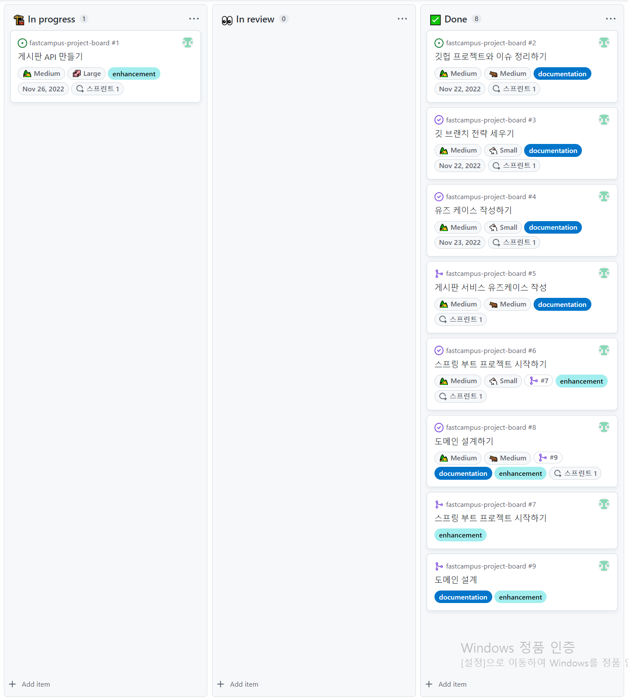

> **·** issue와 pull request는 각각 다른 번호로 되어있기 때문에 분리된 모습을 확인할 수 있다.

---

**참고**

* [Linking a pull request to an issue](https://docs.github.com/en/issues/tracking-your-work-with-issues/linking-a-pull-request-to-an-issue)
* [should table name be plural or singular](https://www.google.com/search?q=should+table+name+be+plural+or+singular&ei=dFiAY4KeBJn7hwON-4m4Cg&oq=should+table+name+be+plural+&gs_lcp=Cgxnd3Mtd2l6LXNlcnAQARgAMgUIABCABDIECAAQHjIGCAAQCBAeMgYIABAIEB46CggAEEcQ1gQQsANKBAhBGABKBAhGGABQ5gFY5gFgvQdoAXABeACAAXGIAXGSAQMwLjGYAQCgAQHIAQrAAQE&sclient=gws-wiz-serp)
