## **데이터베이스 접근 로직**

> 실제로 데이터베이스에 접근할 수 있는 환경을 구성하고 그 환경에 제대로 동작하는지 테스트하고, 테스트를 바탕으로 접근 로직을 구현할 것이다.

---

### **데이터베이스 접근 로직 테스트 정의**

#### **Backlog 점검**

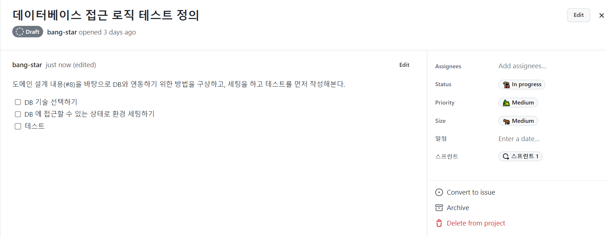

---

#### **Backlog to Issue**

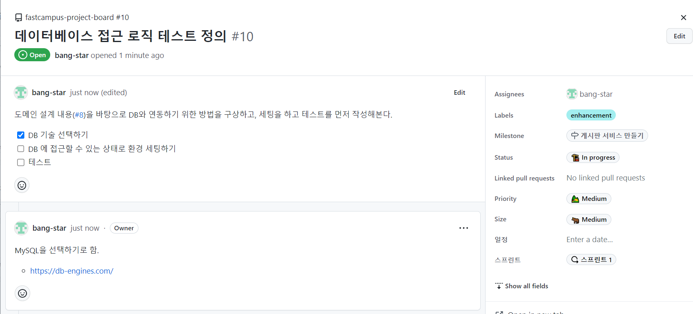

**데이터베이스 선정**

* **MySQL**
  + 실무와 공부 목적으로 많이 사용되고 있는 오픈 소스 데이터베이스이기 때문이다.
  + [**DB-Engines**](https://db-engines.com/en/)에 따르면 Oracle 사에 Oracle과 MySQL이 가장 인기 있는 데이터베이스로 선정되어 있다.

---

#### **MySQL 연결**

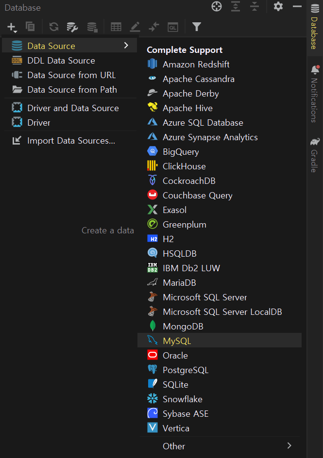

* [**Datagrip**](https://www.jetbrains.com/datagrip/?source=google&medium=cpc&campaign=15034927843&term=datagrip&gclid=CjwKCAiAyfybBhBKEiwAgtB7fgeG2eFcPLSHob-St-c9Z5Ed4kS5NIm_kK92DNzZGtuRBHl85wPEgRoCmY0QAvD_BwE)

> JetBrain에서 지원하는 Datagrip이라는 소프트웨어이다.   
> 데이터베이스 통합 관리도구로 관계형 데이터베이스와 NoSQL까지 모두 연동해서 사용할 수 있다.  
> Intellij-utlimate버전을 사용할 경우, 플러그인 형식 포함되어 사용할 수 있다.

* **Datagrip을 활용하여 MySQL 연결**

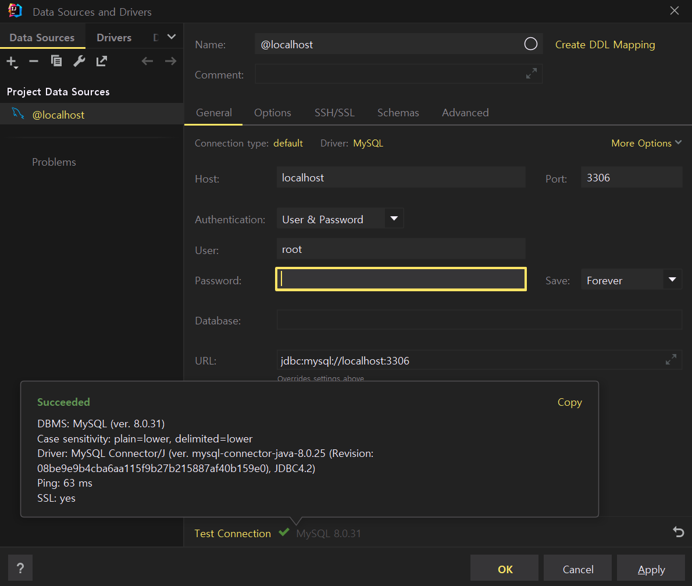

* **게시판을 위한 데이터베이스 생성**

```sql
create database board;
```

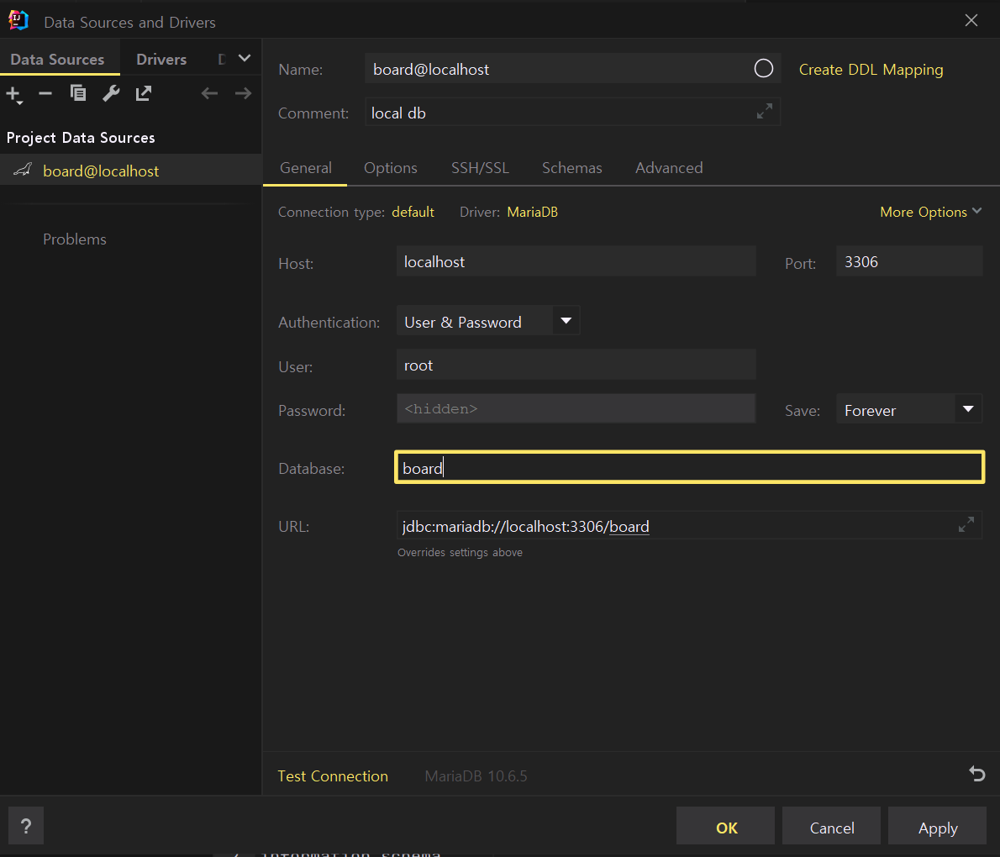

> board 데이터베이스에 접근하도록 데이터베이스를 설정한다.

* **root 계정이 아닌 새로운 계정 생성**

```sql
create user 'artist'@'localhost' identified by 'thisisTESTpw!#%&';
select `user` from `mysql`.`user`;
```

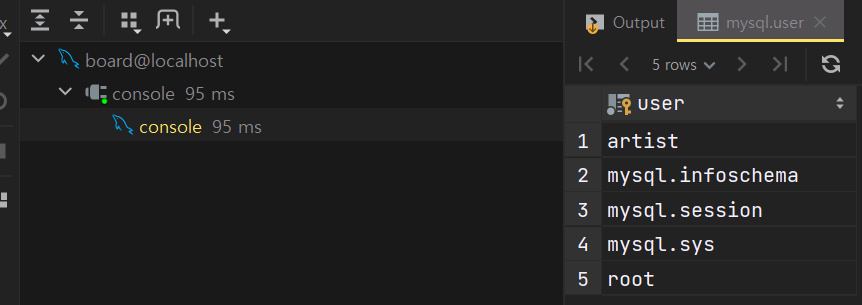

* **사용자 권한 생성 및 확인**

```sql
# 권한 확인
show grants for 'artist'@'localhost';
# 권한 부여
grant all on `board`.* to 'artist'@'localhost' with grant option;
```

> 권한이 현재 없으므로 board 데이터베이스에 한해서 모든 권한을 부여한다. artist 계정은 동일한 범위 내에서 다른 계정에게 권한을 부여할 수 있는 권한을 갖게 된다.

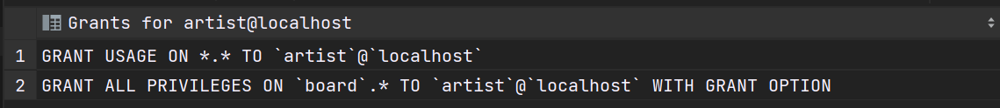

부여된 권한 확인

> 실제로 데이터베이스 권한정책에 반영되기 위해 다시 읽게 해야한다.

```sql
# 현재 사용중인 MySQL의 캐시를 지우고 새로운 설정을 적용하기 위해 사용
flush privileges;
```

---

#### **DB 에 접근할 수 있는 상태로 환경 세팅**

* 연결하기 위한 기술로 **JPA**
* connecter로서 Driver가 필요하므로 **MySQL Driver**
* 테스트용 인메모리 데이터베이스 **H2**

> 환경을 분리시킴으로써 테스트 코드가 실제 데이터베이스에 영향이 가지 않도록 하기 위함.

**의존성 추가**

```java
implementation 'org.springframework.boot:spring-boot-starter-data-jpa'
runtimeOnly 'com.h2database:h2'
runtimeOnly 'com.mysql:mysql-connector-j'
```

---

#### **Make Domain to Entity**

**JPA 에 접근하기 위한 프로퍼티 설정**

```sql
# 스프링 부트의 디버그 로그를 보는 기능
debug: false
# actuator에 endpoints중에 감춰져있는 기능을 모두 활성화
management.endpoints.web.exposure.include: "*"

logging:
  level:
    # 구체적으로 보고 싶은 로그 레벨을 설정
    com.fastcampus.projectboard: debug
    # spring web을 사용할 때 위에 debug를 true로 할 경우 end-point와 api를 호출하거나 view에 접근할 때마다 request, response 로그를 디버그 로그가 다 보여준다.
    # 위에 debug를 키면 다른 것도 너무 많이 나오므로 debug를 false로 둔다. 그래서 request, response 로그만 볼 수 있도록 설정
    org.springframework.web.servlet: debug
    # jpa기술을 사용할 때 query 로그를 디버그 로그로 관찰할 수 있는데, 안에 들어가는 binding 파라미터들은 물음표로 나오게 되고 실제 파라미터 내용이 보이지 않게 된다.
    # 파라미터 내용을 볼수 있게 도와주는 기능이다.
    org.hibernate.type.descriptor.sql.BasicBinder: trace

  spring:
    datasource:
      url: jdbc:mysql://localhost:3306/board
      username: artist
      password: [REDACTED]
      driver-class-name: com.mysql.cj.jdbc.Driver
    jpa:
      # 테스트용 데이터베이스를 띄울 때, 맨 처음 초기값으로 실행하였으면 하는 sql을 실행해준다.
      defer-datasource-initialization: true
      # 자동으로 DDL 문을 만들어주는 기능
      hibernate.ddl-auto: create
      # SQL Query를 보여주는 기능
      show-sql: true
      # 현재 사용하고 있는 구현체에서 전용으로 사용되고 있는 프로퍼티가 있을 경우 추가하여 활성화시킬 수 있다.
      properties:
        # 한줄로 나와야 하는 query를 예쁘게 포맷팅해서 보여주는 기능
        hibernate.format_sql: true
        # JPA에서 연관관계가 맵핑이 된 복잡한 Query를 한 번에 벌크로 select할 수 있게 하는 기능
        hibernate.default_batch_fetch_size: 100
    # h2-web-console을 활성화할 것인지 여부
    h2.console.enabled: false
    # data.sql을 언제 작동할 것인지에 대한 여부
    sql.init.mode: always


---

spring:
  config.activate.on-profile: testdb
#  datasource:
#    url: jdbc:h2:mem:board;mode=mysql
#    driverClassName: org.h2.Driver
#  sql.init.mode: always
#  test.database.replace: none
```

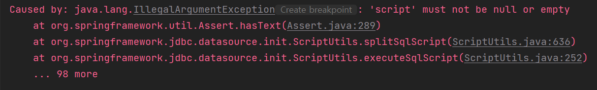

> 원인 : data.sql 파일이 현재 비어있기 때문에 발생하는 문제이다.  
> 해결 : data.sql을 지우는 방법 또는 내용을 채워줘야 한다. 현재 필요가 없으므로 삭제하고 나중에 Entity를 만들고 테스트를 진행할 시에 새로 만들어주도록 한다.

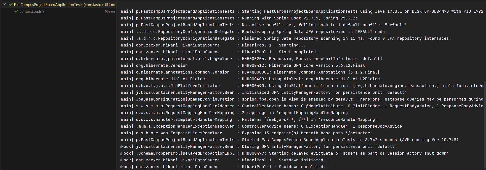

테스트 코드 실행 결과 : 성공

**JPA 어노테이션을 활용하여 Entity로 전환**

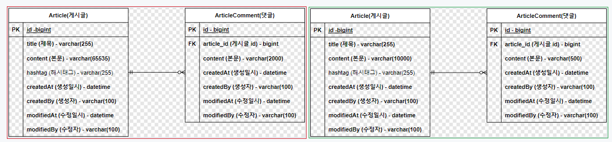

Article(게시물)과 ArticleComment(댓글)의 content 사이즈 변경

---

#### **게시글**

```java
package com.fastcampus.projectboard.domain;

@Getter
@ToString
@Table(indexes = {
        @Index(columnList = "title"),
        @Index(columnList = "hashtag"),
        @Index(columnList = "createdAt"),
        @Index(columnList = "createdBy")
})
@Entity
public class Article extends AuditingFields {
    @Id
    @GeneratedValue(strategy = GenerationType.IDENTITY)
    private Long id;

    @Setter @Column(nullable = false) private String title;                                         // 제목
    @Setter @Column(nullable = false, length = 10000) private String content;                       // 본문

    @Setter private String hashtag;                                                                 // 해시태그

    private LocalDateTime createdAt;             // 생성일시
    private String createdBy;                    // 생성자
    private LocalDateTime modifiedAt;            // 수정일시
    private String modifiedBy;                   // 수정자
}
```

> **\* Setter를 클래스 영역이 아닌 필드 영역에 적용한 이유**  
> : 사용자가 특정 필드에 접근하는 것을 막기 위해서이다.

**JPA Auditing**

> Java에서 ORM 기술인 JPA를 사용하여 도메인을 관계형 데이터베이스 테이블에 매핑할 때 공통적으로 도메인들이 가지고 있는 필드나 컬럼들이 존재한다. 대표적으로 생성일자, 수정일자, 식별자 같은 필드 및 컬럼이 있다.   
>   
> 도메인마다 공통으로 존재한다는 의미는 결국 코드가 중복된다는 의미이다. 데이터베이스에서 누가, 언제하였는지 기록을 잘 남겨놓아야 한다. 그렇기 때문에 생성일, 수정일 컬럼은 대단히 중요한 데이터이다.    
>   
> JPA에서는 Audit이라는 기능을 제공하고 있다. Audit은 감시하다, 감사하다라는 뜻으로 Spring Data JPA에서 시간에 대해서 자동으로 값을 넣어주는 기능이다. 도메인을 영속성 컨텍스트에 저장하거나 조회를 수행한 후에 update를 하는 경우 매번 시간 데이터를 입력하여 주어야 하는데, audit을 이용하면 자동으로 시간을 매핑하여 데이터베이스의 테이블에 넣어주게 된다

* **JpaConfig**

```java
package com.fastcampus.projectboard.config;

@EnableJpaAuditing
@Configuration
public class JpaConfig {
}
```

```java
package com.fastcampus.projectboard.domain;

@Getter
@ToString
@Table(indexes = {
        @Index(columnList = "title"),
        @Index(columnList = "hashtag"),
        @Index(columnList = "createdAt"),
        @Index(columnList = "createdBy")
})
@Entity
public class Article extends AuditingFields {
    @Id
    @GeneratedValue(strategy = GenerationType.IDENTITY)
    private Long id;

    @Setter private String title;                                         // 제목
    @Setter private String content;                       // 본문

    @Setter private String hashtag;                                                                 // 해시태그

    @CreatedDate private LocalDateTime createdAt;             // 생성일시
    @CreatedBy private String createdBy;                    // 생성자
    @LastModifiedDate private LocalDateTime modifiedAt;            // 수정일시
    @LastModifiedBy private String modifiedBy;                   // 수정자
}
```

🔥 **문제 발생**

> 생성일시 같은 경우는 쉽게 알아낼 수 있으나, 인증 기능을 구현하지 않아 누가 만들었는지에 대한 정보는 알 수가 없다.  
> 이에 대한 임시 방편이 필요하다.

```java
@EnableJpaAuditing
@Configuration
public class JpaConfig {

    @Bean
    public AuditorAware<String> auditorAware(){
        return () -> Optional.of("artist");        // TODO: 스프링 시큐리티로 인증 기능을 붙이게 될 때, 수정하자.
    }
}
```

**Null 필드와 Not Null 필드 정책 반영**

```java
package com.fastcampus.projectboard.domain;

@Getter
@ToString
@Table(indexes = {
        @Index(columnList = "title"),
        @Index(columnList = "hashtag"),
        @Index(columnList = "createdAt"),
        @Index(columnList = "createdBy")
})
@Entity
public class Article extends AuditingFields {
    @Id
    @GeneratedValue(strategy = GenerationType.IDENTITY)
    private Long id;

    @Setter @Column(nullable = false) private String title;                                         // 제목
    @Setter @Column(nullable = false, length = 10000) private String content;                       // 본문

    @Setter private String hashtag;                                                                 // 해시태그

    @CreatedDate @Column(nullable = false, updatable = false) private LocalDateTime createdAt;             // 생성일시
    @CreatedBy @Column(nullable = false, updatable = false, length = 100) private String createdBy;                    // 생성자
    @LastModifiedDate @Column(nullable = false) private LocalDateTime modifiedAt;            // 수정일시
    @LastModifiedBy @Column(nullable = false, length = 100) private String modifiedBy;                   // 수정자
}
```

**생성자**

```java
protected Article() {}

private Article(String title, String content, String hashtag) {
    this.title = title;
    this.content = content;
    this.hashtag = hashtag;
}

public static Article of(String title, String content, String hashtag) {
    return new Article(title, content, hashtag);
}
```

* [기본 생성자가 필요한 이유](https://velog.io/@ohzzi/JPA%EC%9D%98-%EC%97%94%ED%8B%B0%ED%8B%B0%EC%97%90-protected-public-%EA%B8%B0%EB%B3%B8-%EC%83%9D%EC%84%B1%EC%9E%90%EA%B0%80-%ED%95%84%EC%9A%94%ED%95%9C-%EC%9D%B4%EC%9C%A0)

> 모든 Entity는 Hibernate 구현체를 사용하는 경우 기본 생성자를 가지고 있어야 한다.

* **Static Factory Method**

> **객체 생성의 역할을 하는 클래스 메서드**로 다음과 같은 장점을 갖고 있다.  
> 1. 정적 팩토리 메서드를 사용하면 메서드 이름에 객체의 생성 목적을 담아 낼 수 있다.  
> 2. 정적 팩터리 메서드와 캐싱구조를 함께 사용하면 매번 새로운 객체를 생성할 필요가 없어진다.  
> 3. 하위 자료형 객체를 반환할 수 있다.  
> 4. 객체 생성을 캡슐화할 수 있다.

---

**🔥 동등성, 동일성 비교를 위한 Equals and HashCode**

```java
@Override
public boolean equals(Object o) {
    if (this == o) return true;
    if(!(o instanceof Article article)) return false;
    return id != null && id.equals(article.id);
}

@Override
public int hashCode() {
    return Objects.hash(id);
}
```

> 게시글 클래스를 Collection을 이용하여 사용한다면 중복 요소를 제거하거나 정렬을 하기 위해 객체간 비교가 필요하다.  
>   
> **해결 방법**  
> 1. **@EqualsAndHashCode 어노테이션**기본적인 방식으로 EqualsAndHashCode가 구성되는데 즉 모든 필드를 비교해서 표준적인 방식으로 구현하게 된다.  
> 그러나 Entity에 대해서는 독특한 EqualsAndHashCode가 필요하다.   
>   
> **2. 직접 구현  
> 1) id 필드만 적용** - 동등성 검사를 하기 위해 모든 필드를 검사할 필요가 없다.  
> **2) [pattern matching(java 14+이상)](https://www.baeldung.com/java-pattern-matching-instanceof)  
> 3) 영속화가 되어있지 않은 경우 -** 데이터베이스에 데이터를 연결시키지 않았을 경우 id가 null이기 때문에 확인해줄 필요가 있다.

---

#### **댓글**

```java
package com.fastcampus.projectboard.domain;

@Getter
@ToString
@Table(indexes = {
        @Index(columnList = "content"),
        @Index(columnList = "createdAt"),
        @Index(columnList = "createdBy")
})
@Entity
public class ArticleComment extends AuditingFields {

    @Id
    @GeneratedValue(strategy = GenerationType.IDENTITY)
    private Long id;

    @Setter @ManyToOne(optional = false) private Article article;            			// 게시글 (ID)
    @Setter @Column(nullable = false, length = 500) private String content;             // 본문

    protected ArticleComment() { }

    private ArticleComment(Article article, String content) {
        this.article = article;
        this.content = content;
    }

    public static ArticleComment of(Article article, String content){
        return new ArticleComment(article, content);
    }

    @CreatedDate @Column(nullable = false, updatable = false) private LocalDateTime createdAt;             // 생성일시
    @CreatedBy @Column(nullable = false, updatable = false, length = 100) private String createdBy;                    // 생성자
    @LastModifiedDate @Column(nullable = false) private LocalDateTime modifiedAt;            // 수정일시
    @LastModifiedBy @Column(nullable = false, length = 100) private String modifiedBy;                   // 수정자

    @Override
    public boolean equals(Object o) {
        if (this == o) return true;
        if (!(o instanceof ArticleComment that)) return false;
        return id != null && id.equals(that.id);
    }

    @Override
    public int hashCode() {
        return Objects.hash(id);
    }
}
```

> **게시글에서 적용한 것들을 동일하게 적용**

**양방향 바인딩**

> 현재 댓글에서 게시글은 바인딩되어있으나 게시글에서 댓글에 대해서는 되어 있지 않다.

```java
package com.fastcampus.projectboard.domain;

public class Article extends AuditingFields {
    @Setter private String hashtag;                                                                 // 해시태그

    @ToString.Exclude
    @OrderBy("id")
    @OneToMany(mappedBy = "article", cascade = CascadeType.ALL)
    private final Set<ArticleComment> articleComments = new LinkedHashSet<>();

}
```

* **@ToString.Exclude**  
  1. Performance Issue 문제 해결 가능  
  2. 순환 참조 문제 해결 가능  
  즉 서로 참조되어 있으므로 한 곳에서 연결을 끊어줄 필요가 있다.

---

#### **Repository**

* 게시글

```java
public interface ArticleRepository extends JpaRepository<Article, Long> {
}
```

* 댓글

```java
public interface ArticleCommentRepository extends JpaRepository<ArticleComment, Long> {
}
```

---

#### **JPA CRUD 테스트**

> 특정 Repository 테스트를 위한 코드가 아닌 JPA 정상 작동하는지 여부를 판별하기 위한 코드이다.

**테스트 데이터**

대량에 테스트 데이터 생성 도구 중[Mockaroo](https://www.mockaroo.com/)를 사용하여 ERD 설계를 바탕으로 스키마를 생성하여 게시글 123개, 댓글 1000개를 생성함.

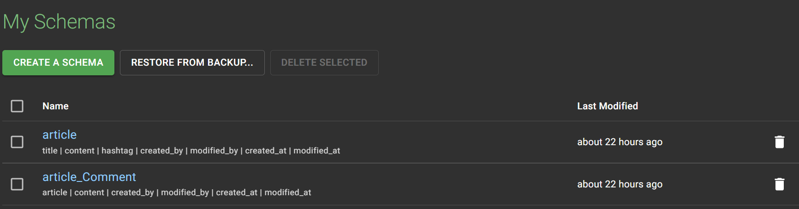

Spring boot에 미리 약속된 파일 이름인 data.sql이라는 파일을 생성하여 테스트 데이터를 생성하는 query를 삽입한다.

**Entity에 Auditing 적용**

```java
@EntityListeners(AuditingEntityListener.class)
@Entity
public class Article {
}
```

```java
@EntityListeners(AuditingEntityListener.class)
@Entity
public class ArticleComment {
}
```

**테스트 코드**

```java
package com.fastcampus.projectboard.repository;

@Import(JpaConfig.class)
@DataJpaTest
@DisplayName("JPA 연결 테스트")
class JpaRepositoryTest {

    private final ArticleRepository articleRepository;
    private final ArticleCommentRepository articleCommentRepository;

    // 생성자 주입 패턴
    public JpaRepositoryTest(   
            @Autowired ArticleRepository articleRepository,
            @Autowired ArticleCommentRepository articleCommentRepository
    ) {
        this.articleRepository = articleRepository;
        this.articleCommentRepository = articleCommentRepository;
    }

    @DisplayName("select 테스트")
    @Test
    void givenTestData_whenSelecting_thenWorksFine(){
        // Given

        // When
        List<Article> articles = articleRepository.findAll();

        //Then
        assertThat(articles)
                .isNotNull()
                .hasSize(123);
    }

    @DisplayName("insert 테스트")
    @Test
    void givenTestData_whenInserting_thenWorksFine(){
        // Given
        long previousCount = articleRepository.count();

        // When
        Article savedArticle = articleRepository.save(Article.of("new article", "new content", "#spring"));

        //Then
        assertThat(articleRepository.count()).isEqualTo(previousCount + 1);
    }

    @DisplayName("update 테스트")
    @Test
    void givenTestData_whenUpdating_thenWorksFine(){
        // Given
        Article article = articleRepository.findById(1L).orElseThrow(() -> new NullPointerException("존재하지 않은 게시글 정보입니다."));
        String updatedHashtag = "#springboot";
        article.setHashtag(updatedHashtag);

        // When
        Article savedArticle = articleRepository.saveAndFlush(article);

        //Then
        assertThat(savedArticle).hasFieldOrPropertyWithValue("hashtag", updatedHashtag);
    }

    @DisplayName("delete 테스트")
    @Test
    void givenTestData_whenDeleting_thenWorksFine(){
        // Given
        Article article = articleRepository.findById(1L).orElseThrow(() -> new NullPointerException("존재하지 않은 게시글 정보입니다."));
        long previousArticleCount = articleRepository.count();
        long previousArticleCommentCount = articleCommentRepository.count();
        int deletedCommentsSize = article.getArticleComments().size();

        // When
        articleRepository.delete(article);

        //Then
        assertThat(articleRepository.count()).isEqualTo(previousArticleCount - 1);
        assertThat(articleCommentRepository.count()).isEqualTo(previousArticleCommentCount - deletedCommentsSize);
    }
}
```

> **\* @DataJpaTest -** 슬라이스 테스트(각 레이어를 독립적으로 테스트하는 것)를 하겠다는 의미 **\* @Import 어노테이션** - 직접 만든 JpaConfig 적용하기 위함.  
> **\* 최신버전에 SpringBoot에서는 TEST에서도 생성자 주입패턴을 이용할 수 있음.  
> \* 🔥 update 테스트 시에 saveAndFlush()가 적용되는 이유**: JUnit으로 테스트를 실행하면 모든 테스트 메소드들은 @DataJpaTest 어노테이션으로 인해 자동으로 Transaction이 걸려있다. 테스트 시 모든 Transaction은 기본으로 rollback으로 동작한다. 그러므로 테스트 메소드 내에서 변경점이 중요하지 않다면 생략될 수 있다.   
> 예시로 update 테스트에서 영속성 컨텍스트에서 가져온 데이터를 save하고 추가적인 동작으로 조회를 하거나 작업을 하지 않고 끝내버리면 어차피 rollback할거라서 변경될 것이 없으므로 영속성 컨텍스트의 변경 내용을 데이터베이스에 반영하는 flush 작업이 필요하다.

---

### **데이터베이스 로직 구현**

#### **Backlog to Issue**

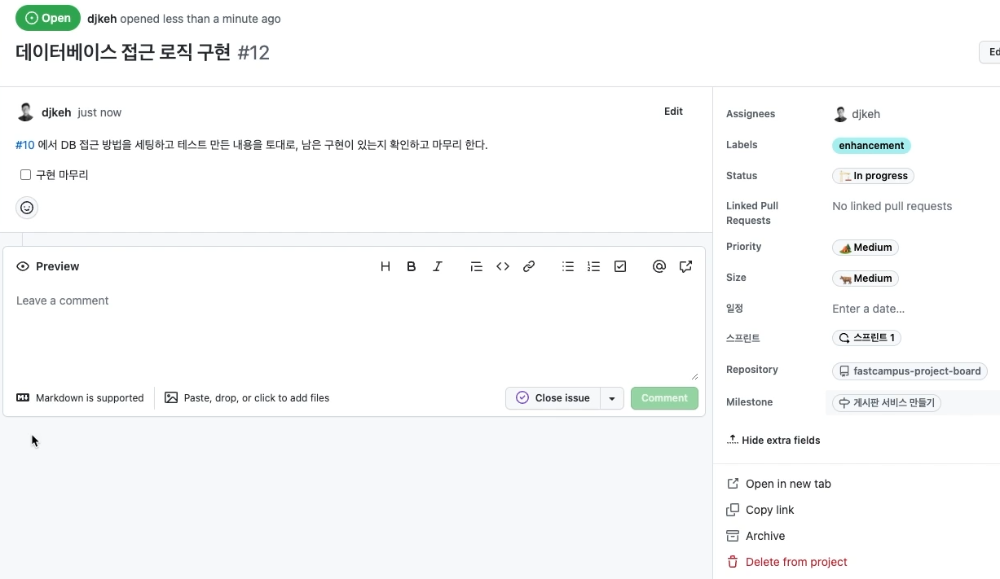

**공통 필드 추출**

현재 id, 메타 데이터(생성일시, 생성자, 수정일시, 수정자 정보)는 게시글과 댓글에 중복되고 있다.

* **상속을 이용한 @MappedSuperClass**

```java
@MappedSuperclass
public abstract class BaseEntity {
  // ...
}
```

```java
@Entity
public class User extends BaseEntity {
  // ...
}
```

* **조합을 이용한 @Embeddable, @Embedded**공통 필드를 묶어서 필드를 추가하는 방법으로 클래스명 자체가 중요해진다.   
  영속성 컨텍스트를 통해 데이터를 넘겨받아서 애플리케이션에서 열었을 때는 위에 방법처럼 보인다. 즉 한 단계가 더 만들어지는 현상과 같다.

```java
@Embeddable
public class Name {
  private final String firstName;
  private final String lastName;
  // ...
}
```

```java
@Entity
public class User {

  @Embedded
  private final Name userName;
  // ...
}
```

* **1 Entity to 1 Database Table**

> 1 Entity to 1 Database Table 전략을 사용한다면 이는 불필요한 작업이다.   
>   
> 모든 컬럼들이 중복에 상관없이 다 들어나게 코드를 작성하면 테이블 단위 변경에 유연해진다는 장점이 있다.  
> 예시로 게시글에는 수정자, 수정일자가 필요하고 댓글에는 필요없게 만들 수 있다.  
> 무엇보다 추출한다는 것은 한 단계 더 depth가 들어가게 되므로 코드가 한눈에 보이지 않는다는 단점이 있다.  
>   
> 추출하지 않는다면 코드가 장황해질 수 있다는 Trade off 현상이 발생한다. 즉 개인의 선호와 팀 단위 논의에 따라 결정된다.

* **@AttributeOverride**

@MappedSuperclass 를 통해 상속 받은 경우나 @Embedded 를 통해 다른 객체를 필드에 선언한 경우 해당 엔티티에서는 다른 컬럼명을 사용하고 싶을 때가 있다. 이러한 경우에 사용할 수 있는 어노테이션이다.

```java
@Entity
@AttributeOverride(name = "id", column = @Column(name = "article_id"))
public class Article extends BaseEntity {
  // ...
}
```

여러 개의 정보를 바꾸고 싶을 때 방법은 아래와 같다.

```java
@Entity
@AttributeOverrides({
  @AttributeOverride(name = "id", column = @Column(name = "article_id")),
  @AttributeOverride(name = "createTime" column = @Column(name = "article_create_time"))
})
public class Article extends BaseEntity {
  // ...
}
```

```java
@Enitty
public class Author {

  @Embedded
  @AttributeOverrides({
    @AttributeOverride(name = "firstName", column = @Column(name = "author_first_name")),
    @AttributeOverride(name = "lastName", column = @Column(name = "author_last_name"))
  })
  private final Name authorName;
  // ...
}
```

**MappedSuperclass를 적용한 결과**

```java
package com.fastcampus.projectboard.domain;

@Getter
@ToString
@EntityListeners(AuditingEntityListener.class)
@MappedSuperclass
public class AuditingFields {

    @DateTimeFormat(iso = DateTimeFormat.ISO.DATE_TIME)
    @CreatedDate
    @Column(nullable = false, updatable = false)
    private LocalDateTime createdAt;             // 생성일시

    @CreatedBy
    @Column(nullable = false, updatable = false, length = 100)
    private String createdBy;                    // 생성자

    @DateTimeFormat(iso = DateTimeFormat.ISO.DATE_TIME)
    @LastModifiedDate
    @Column(nullable = false)
    private LocalDateTime modifiedAt;            // 수정일시

    @LastModifiedBy
    @Column(nullable = false, length = 100)
    private String modifiedBy;                  // 수정자

}
```

> **\* Parsing rule 설정**  
> createAt과 modifiedAt에 경우 웹 화면에 보여주거나 웹 화면에서 파라미터를 받아서 세팅을 할 때 Parsing이 잘되어야 하므로 파싱에 대한 규칙을 설정하는 방법으로 @DateTimeFormat이 있다.  
>   
> **\* updatable = false**해당 필드는 업데이트 불가능하도록 설정하는 방법이다.

* **Pull Requests**

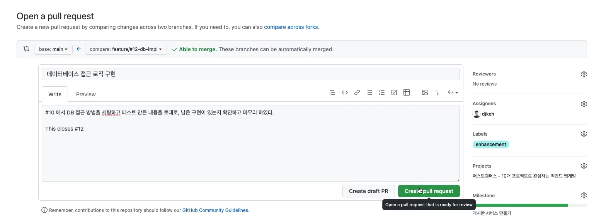

* **Backlog 현황**

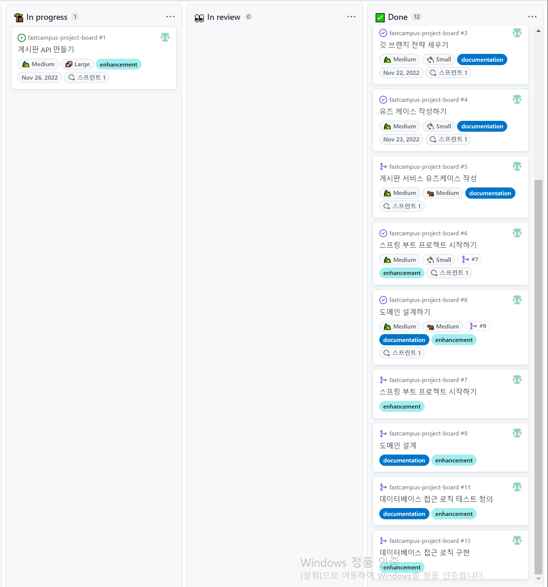
