## **게시판 서비스 뷰 만들기**

---

### **뷰 엔드 포인트 정의**

#### ❗ **Backlog to Issue**

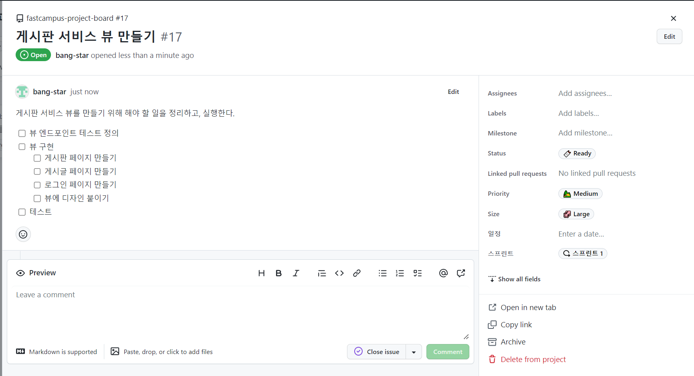

#### **view API**

인증과 관련된 로그인, 회원가입 페이지는 현재 인증이 구현되지 않았으므로 추후에 구현할 예정

| view | /articles | GET | 게시판 페이지 |
| --- | --- | --- | --- |
| /articles/{article-id} | GET | 게시글 페이지 |
| /articles/search | GET | 게시판 검색 전용 페이지 |
| /articles/search-hashtag | GET | 게시판 해시태그 검색 전용 페이지 |

#### **의존성 추가**

서버 사이드 템플릿엔진을 사용하기로 결정하였으므로 **thymeleaf** 추가

```java
implementation 'org.springframework.boot:spring-boot-starter-thymeleaf'
```

#### **Controller 생성과 테스트**

```java
package com.fastcampus.projectboard.controller;

@RequestMapping("/articles")
@Controller
public class ArticleController {
}
```

```java
package com.fastcampus.projectboard.controller;

@DisplayName("View 컨트롤러 - 게시글")
@Import(SecurityConfig.class)
@WebMvcTest(ArticleController.class)
class ArticleControllerTest {

    private final MockMvc mvc;

    public ArticleControllerTest(@Autowired MockMvc mvc) {
        this.mvc = mvc;
    }

    @Disabled("구현 중")
    @DisplayName("[view][GET] 게시글 리스트 (게시판) 페이지 - 정상 호출")
    @Test
    void givenNothing_whenRequestingArticlesView_thenReturnsArticlesView() throws Exception {
        // Given

        // When & Then
        mvc.perform(get("/articles"))
                .andExpect(status().isOk())
                .andExpect(content().contentType(MediaType.TEXT_HTML))
                .andExpect(view().name("articles/index"))
                .andExpect(model().attributeExists("articles"));
    }

    @Disabled("구현 중")
    @DisplayName("[view][GET] 게시글 상세 페이지 - 정상 호출")
    @Test
    void givenNothing_whenRequestingArticleView_thenReturnsArticleView() throws Exception {
        // Given

        // When & Then
        mvc.perform(get("/articles/1"))
                .andExpect(status().isOk())
                .andExpect(content().contentType(MediaType.TEXT_HTML))
                .andExpect(view().name("articles/detail"))
                .andExpect(model().attributeExists("article"))
                .andExpect(model().attributeExists("articleComments"));
    }

    @Disabled("구현 중")
    @DisplayName("[view][GET] 게시글 검색 전용 페이지 - 정상 호출")
    @Test
    void givenNothing_whenRequestingArticleSearchView_thenReturnsArticleSearchView() throws Exception {
        // Given

        // When & Then
        mvc.perform(get("/articles/search"))
                .andExpect(status().isOk())
                .andExpect(content().contentType(MediaType.TEXT_HTML))
                .andExpect(view().name("articles/search"));
    }

    @Disabled("구현 중")
    @DisplayName("[view][GET] 게시글 해시태그 검색 페이지 - 정상 호출")
    @Test
    void givenNothing_whenRequestingArticleHashtagSearchView_thenReturnsArticleHashtagSearchView() throws Exception {
        // Given

        // When & Then
        mvc.perform(get("/articles/search-hashtag"))
                .andExpect(status().isOk())
                .andExpect(content().contentType(MediaType.TEXT_HTML))
                .andExpect(view().name("articles/search-hashtag"));
    }
}
```

* **실제 소스코드에서는 @Autowired을 생략 가능하지만, 테스트 코드에서는 @Autowired을 생략하면 안된다.**
* **WebMvcTest 테스트는 모든 컨트롤러를 읽어들이기 때문에 테스트 대상이 되는 컨트롤러로 제한함.**
* **view-name이 일치 여부를 판단하는 코드 삽입**
* **실패하는 유닛 테스트를 모두 `@Disabled` 처리하여 Build가 성공하도록 설정**

> 현재 테스트를 구현하지 않아 테스트가 실패하는 코드이다. gradle의 기본 동작은 test 과정을 내포하고 있기 때문에 gradle-build가 실패하게 될 것이다. 이러한 상태로 build test 자동화 도구에 올라갈 경우 build가 통과하지 않는상황이 발생할 수 있다.  
>   
> 그래서 많은 개발 조직들이 커밋의 최소조건으로 테스트가 성공할 것으로 둔다. 테스트가 통과하지 커밋도 자유롭게 올릴 수 있는 정책도 만들 수 있다. 이러한 이유 때문에 테스트는 실패하지 않게끔 개발을 하기도 한다.  
>   
> **해결 방법**  
> 1) build에 테스트를 제외 시키는 옵션을 넣어서 테스트 없이 빌드만 할 수 있다.  
> 2) 실패하는 테스트를 ignore 처리하는 방법(✔️)

#### **Commit을 통해 알아보는 진행상황**

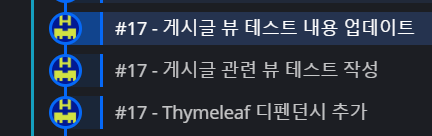

---

### **게시판 페이지 만들기**

**Thymeleaf**

* Spring 단순한 markup 파일로 보지 않고 Thymeleaf 템플릿 파일로 인식한다.
* 위치는 resources안에 templates 폴더로 기본값 셋팅이 되어 있다.(수동으로 변경가능)

#### **게시판 서비스 뷰**

```html
<!DOCTYPE html>
<html lang="ko">
<head>
  <meta charset="UTF-8">
  <title>게시판 페이지</title>
</head>

<body>

  <header>
    header 삽입부
    <hr>
  </header>

  <main>
    <form>
      <label for="search-type" hidden>유형</label>
      <select id="search-type" name="search-type">
        <option>제목</option>
        <option>본문</option>
        <option>ID</option>
        <option>닉네임</option>
        <option>해시태그</option>
      </select>
      <label for="search-value" hidden>검색어</label>
      <input id="search-value" type="search" placeholder="검색어..." name="search-value">
      <button type="submit">검색</button>
    </form>

    <table>
      <thead>
        <tr>
          <th>제목</th>
          <th>해시태그</th>
          <th>작성자</th>
          <th>작성일</th>
        </tr>
      </thead>
      <tbody>
        <tr>
          <td>첫글</td>
          <td>#java</td>
          <td>Uno</td>
          <td>2022-01-01</td>
        </tr>
        <tr>
          <td>두번째글</td>
          <td>#spring</td>
          <td>Uno</td>
          <td>2022-01-02</td>
        </tr>
        <tr>
          <td>세번째글</td>
          <td>#java</td>
          <td>Uno</td>
          <td>2022-01-03</td>
        </tr>
      </tbody>
    </table>

    <nav>
      <table>
        <tr>
          <td>previous</td>
          <td>1</td>
          <td>2</td>
          <td>3</td>
          <td>4</td>
          <td>next</td>
        </tr>
      </table>
    </nav>
  </main>

  <footer>
    <hr>
    footer 삽입부
  </footer>

</body>
</html>
```

* Makeup 언어에 [Sementic tag](https://www.w3schools.com/html/html5_semantic_elements.asp)를 이용하여 게시글 페이지 구성

```java
package com.fastcampus.projectboard.controller;

@RequestMapping("/articles")
@Controller
public class ArticleController {

    @GetMapping
    public String articles(ModelMap map){
        map.addAttribute("articles", List.of());

        return "articles/index";
    }
}
```

```java
package com.fastcampus.projectboard.controller;

@DisplayName("View 컨트롤러 - 게시글")
@Import(SecurityConfig.class)
@WebMvcTest(ArticleController.class)
class ArticleControllerTest {

    private final MockMvc mvc;

    public ArticleControllerTest(@Autowired MockMvc mvc) {
        this.mvc = mvc;
    }

    @DisplayName("[view][GET] 게시글 리스트 (게시판) 페이지 - 정상 호출")
    @Test
    void givenNothing_whenRequestingArticlesView_thenReturnsArticlesView() throws Exception {
        // Given

        // When & Then
        mvc.perform(get("/articles"))
                .andExpect(status().isOk())
                .andExpect(content().contentType(MediaType.TEXT_HTML))
                .andExpect(view().name("articles/index"))
                .andExpect(model().attributeExists("articles"));
    }
}
```

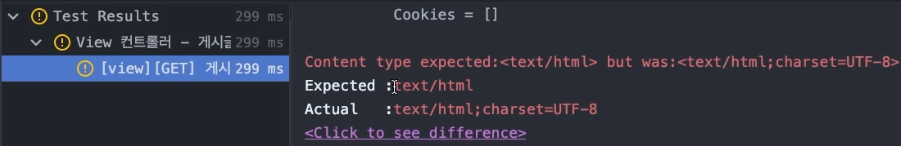

> 현재 예상되는 contentType은 text/html로 설정하였는데, 추가적인 옵션이 있다는 사실을 확인할 수 있었다.  
> contentType → contentTypeCompatibleWith로 전환하면 호환되는 타입까지 확인할 수 있게 된다.

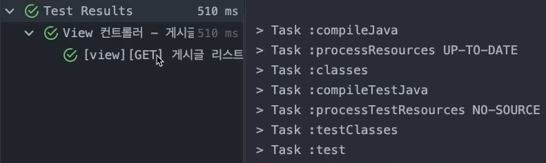

테스트 실행 결과 : 성공

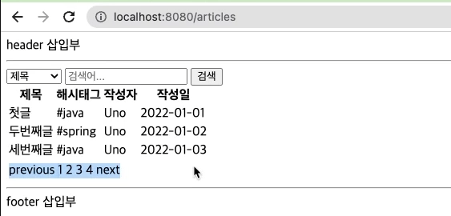

서비스 실행 결과 : 정상 작동

#### **Component 방식으로 전환**

header와 footer 등 중복되는 요소들을 컴포넌트화를 통해 재사용할 수 있게 만드는 방법이다.

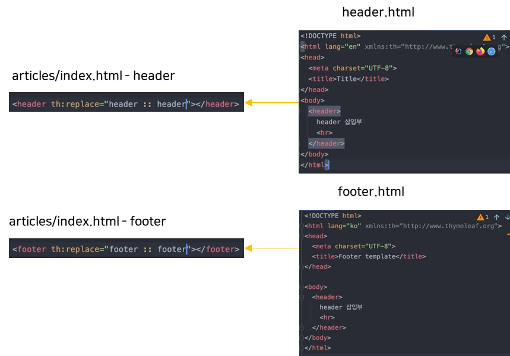

header와 footer의 컴포넌트화

#### **Commit을 통해 알아보는 진행상황**

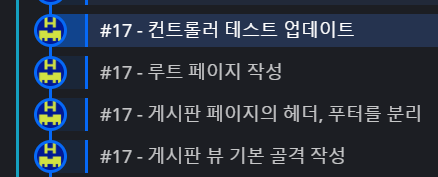

---

### **게시글 페이지 만들기**

#### **Thmyeleaf 3 - decoupled Template Logic**

thymeleaf 템플릿을 완전히 순수 html5로 표현하는 위해 모든 thymeleaf 문법을 분리하여 개발하는 방식이다.

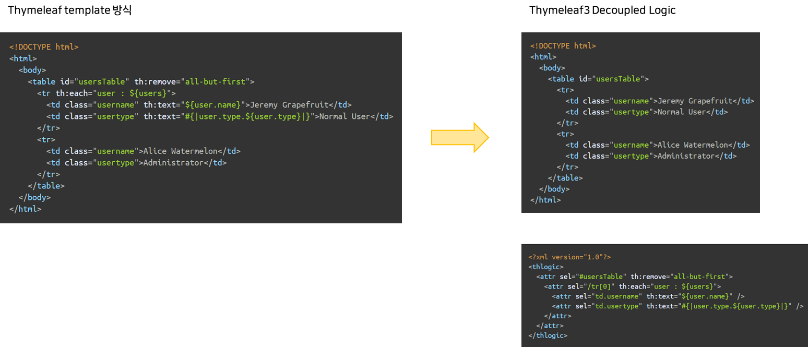

Thymeleaf 공식 문서

> decoupled 템플릿 로직을 통해   
> 기본 몸통이 되는 Markup에서는 순수한 html markup으로 표현하고  
> 분리된 곳에서 thymeleaf 문법을 독립적으로 표현할 수 있도록 변경하는 방법이다.  
>   
> 이를 통해 순수한 static mockup 페이지를 만들 수 있어 싱글 파일로 디자이너 또는 프론트 엔드 개발자에게 전달하여 사용할 수 있게 해줄 수 있다.

SpringBoot 2.0부터 Thymeleaf3.0 버전이 적용되어 기능이 나온지 오래되었지만.. Decoupled 템플릿 로직을 기본 프로퍼티로 빼놓지 않았다. 그렇기 때문에 이 부분을 직접 JavaConfig로 직접 잡아줘야된다는 문제가 있다.

**적용하려는 이유**

> 기능을 넣기 위해 Thymeleaf 태그를 넣고, 디자인을 입히면서 디자인을 위해 태그나 클래스를 넣으면서 index.html이 뚱뚱해질 것으로 예상되어 가능한 한 순수한 마크업으로 남겨서 사용하고 싶기 때문이다.

**적용 방법**

```java
package com.fastcampus.projectboard.config;

@Configuration
public class ThymeleafConfig {

    @Bean
    public SpringResourceTemplateResolver thymeleafTemplateResolver(
            SpringResourceTemplateResolver defaultTemplateResolver,
            Thymeleaf3Properties thymeleaf3Properties
    ) {
        defaultTemplateResolver.setUseDecoupledLogic(thymeleaf3Properties.isDecoupledLogic());

        return defaultTemplateResolver;
    }


    @RequiredArgsConstructor
    @Getter
    @ConstructorBinding
    @ConfigurationProperties("spring.thymeleaf3")
    public static class Thymeleaf3Properties {
        /**
         * Use Thymeleaf 3 Decoupled Logic
         */
        private final boolean decoupledLogic;
    }

}
```

> **thymeleafTemplateResolver**라는 **Bean**을 등록하고 리턴타입은 **SpringResourceTemplateResolver**이다.  
> Thymeleaf AutoConfigure를 불렀을 때 즉 Thymeleaf를 SpringBoot 프로젝트에 넣었을 때 AutoConfig이 자동으로 잡히는데 그때 잡히는 기본 Resolver(**defaultTemplateResolver**)이다. defaultTemplateResolver 기능을 그대로 가져와서 기능을 하나 추가하는 작업(**setUseDecoupledLogic**)이다.

> Configuration Property를 개발자가 직접 생성한 경우에   
> Scan을 해주기 위해 Application Class에    
> @ConfigurationPropertiesScan을 추가해주어야 한다.

```java
package com.fastcampus.projectboard;

@ConfigurationPropertiesScan
@SpringBootApplication
public class FastCampusProjectBoardApplication {

	public static void main(String[] args) {
		SpringApplication.run(FastCampusProjectBoardApplication.class, args);
	}
}
```

이를 통해 우리는 application.yaml에서 직접 제어하여 활성화시킬 수 있다.

```java
spring:
  thymeleaf3:
    decoupled-logic: true
```

---

#### **🔥 불편해! - 직접 만든 커스텀 프로퍼티 추천 활성화 방법**

application.yaml에서 ymeleaf에는 관련 정보를 표시해주지만 thymeleaf3의 경우는 추천해주지 않고 있다. thymeleaf3와 IDE를 더 매끄럽게 연동하는 방법은 build.gradle에서 디펜던시에 spring configuration processor를 추가하는 것이다.

```
annotationProcessor 'org.springframework.boot:spring-boot-configuration-processor'
```

사용자가 직접만든 커스텀 프로퍼티도 문서 세팅이 가능해지고, IDE의 지원을 받게된다.

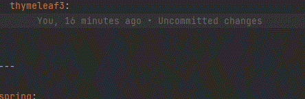

---

#### **decoupled Template Logic 적용**

index.html에서 Tymeleaf 로직을 제거하고 로직은 동일한 디렉토리 위에 index.th.xml 파일을 생성한다.

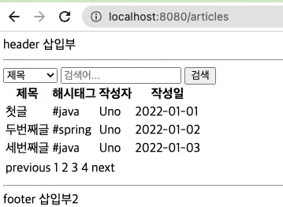

서비스 실행 결과 : 정상 작동

---

#### **게시글 페이지 컨트롤러**

ArticleController에서 게시글 맵핑을 위한 코드 구현

```java
@GetMapping("/{articleId}")
public String article(@PathVariable Long articleId, ModelMap map){
    map.addAttribute("article", "article"); // TODO: 구현할 떄 여기에 실제 데이터를 넣어줘야 함.
    map.addAttribute("articleComments", List.of());

    return "articles/detail";
}
```

#### **게시글 페이지 뷰**

게시판 서비스와 동일하게 **decoupled logic**을 적용하여 구현

```html
<!DOCTYPE html>
<html lang="ko">
<head>
    <meta charset="UTF-8">
    <title>게시글 페이지</title>
</head>
<body>

<header id="header"></header>
<main>
    <header>
        <h1>첫번째 글</h1>
    </header>
    <aside>
        <p>Jyc</p>
        <p><a href="mailto:#">작성자 이메일 주소</a></p>
        <p><time datetime="2022-01-01T00:00:00">2022-01-01</time></p>
        <p>#java</p>
    </aside>

    <section>
        <p>본문<br><br></p>

        <div>
            <form>
                <label for="articleComment" hidden>댓글</label>
                <textarea id="articleComment" placeholder="댓글 쓰기.." rows="3"></textarea>
                <button type="submit">쓰기</button>
            </form>

            <ul>
                <li>
                    <div>
                        <time><small>2022-01-01</small></time>
                        <strong>Jyc</strong>
                        <p>
                            Lorem ipsum dolor sit amet, consectetur adipiscing elit.<br>
                            Lorem ipsum dolor sit amet
                        </p>
                    </div>
                </li>
                <li>
                    <div>
                        <time><small>2022-01-01</small></time>
                        <strong>Jyc</strong>
                        <p>
                            Lorem ipsum dolor sit amet, consectetur adipiscing elit.<br>
                            Lorem ipsum dolor sit amet
                        </p>
                    </div>
                </li>
            </ul>
        </div>
        <nav>
            <a href="#">이전 글</a>
            <a href="#">다음 글</a>
        </nav>
    </section>
</main>
<footer id="footer"></footer>

</body>
</html>
```

main 에 header를 하나 더 사용하였다. 이로 인해 디커플링 로직 인식에 오류가 발생할 수 있으므로 header 와 footer에 id를 추가하여 디커플링 로직에서 selector는 아이디를 검색하는 방식으로 변경하였다.

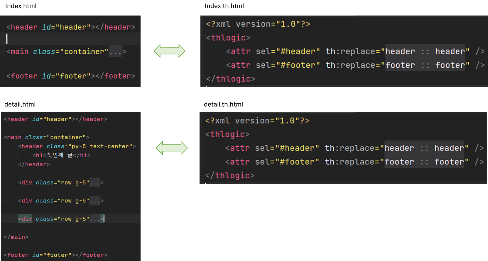

decoupled logic 변경 point

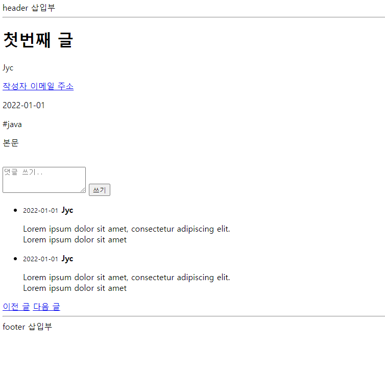

'게시글 뷰 서비스 실행 결과 : 정상 작동

#### **Commit을 통해 알아보는 진행상황**

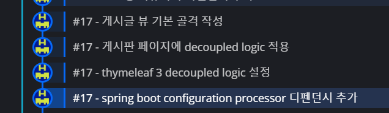

---

### **Rebase Merge**

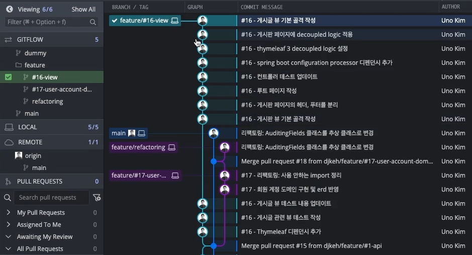

현재 **Feature/#16-view** 브랜치에서 작업중이다.

그런데 중간에 다른 작업이 끼어져있다.

**1. Feature/#17-user-account-erd** 브랜치에서 다른 작업을 완료하고 **Push**하여 **Merge**가 완료된 상태이다.

2. 최신화된 **main** 브랜치에서 **Feature/refactoring** 브랜치를 만들어 리팩토링 작업을 완료 후 **Rebase-Merge**가 된 상태이다.

> Github에 Rebase-Merge를 할 경우, 해당 Remote Branch가 없었던 것처럼 main 브랜치에 Commit으로 옮겨가게 된다.  
> 마치 다른 branch가 없었던 것처럼 보이므로 깔끔하다는 장점이 있다. 로컬에서 삭제하면 그래프에서 완전히 보이지 않게 된다.

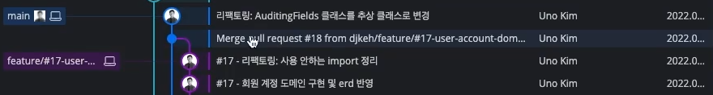

현재 **Feature/#16-view** 은 **Feature/#17-user-account-erd** 의 변경사항을 모르는 상태이다.

> 동일한 main 브랜치에서 서로 다른 개발자가 A는 View를 만들고, B는 도메인 구현 및 리팩토링 작업 시작하여 B 개발자는 작업을 마치고, **Push** 후 **Merge**까지 이뤄진 상태이다.

**나는 어떻게... 해야할까❓❓**

최신 main 브랜치까지 반영하는 편이 좋을 것이다.

**1. 다른 작업자의 코드 Remote, 나의 코드 Remote**

현재 다른 작업자의 코드가 Remote까지 나가있고, 만약 나의 브랜치까지 **Remote**로 나가있다면 나의 작업 브랜치에 **main** 브랜치를 **Merge** 시켜야한다.

**=> Merge main to Feature/#16-view**

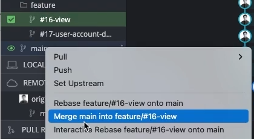

**2. 다른 작업자의 코드 Remote, 나의 코드 Local**

자유롭게 Rebase를 통해 해결할 수 있다.

> 원래 시작한 main 브랜치가 아닌 최신화된 main에서 작업한 것으로 Rebase하는 것이다.  
> **=> Reabase feature/#16-view onto main**

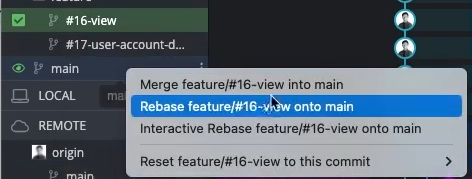

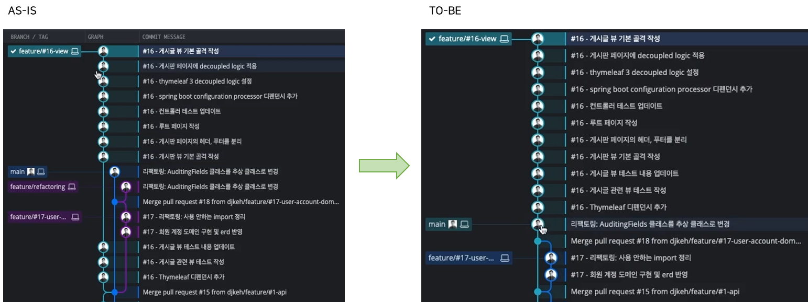

다른 작업자가 작업한 내용이 현재 브랜치에 적용된 것을 확인할 수 있다.

UserAccount 도메인에 경우 Service를 재실행하여 UserAccount  도메인이 추가되었는지 확인할 수있다.

---

### **로그인 페이지 만들기**

로그인 페이지는 직접 구현하지 않을 것이고 Spring Security에서 제공해주는 로그인 페이지와 로그아웃 페이지를 이용할 것이다.

#### **의존성 추가**

Spring Web, Spring Security, Thymeleaf를 선택하여 디펜던시를 추가한다.

```java
implementation 'org.springframework.boot:spring-boot-starter-security'
implementation 'org.springframework.boot:spring-boot-starter-thymeleaf'
implementation 'org.springframework.boot:spring-boot-starter-web'
implementation 'org.thymeleaf.extras:thymeleaf-extras-springsecurity5'
```

⚠️ **주의 사항**

* **Thymeleaf를 사용한다면 Security와 Thymeleaf를 동시에 넣어서 디펜던시를 확인해야 한다.**  
  Thymeleaf를 제외할 경우, thymeleaf-extras-springsecurity5가 제외되기 때문

스프링 시큐리티를 설치하였을 경우, 옵션을 변경하지 않는 이상 모든 페이지에 대한 접근 권한이 사라지고 로그인을 성공한 경우에만 접근가능해지게 된다.

**Login 페이지와 Logout 페이지는 어떻게 생성되는걸까 ❓**❓****

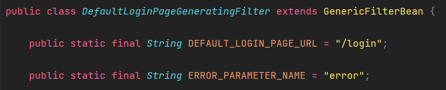

**DefaultLoginPageGeneratingFilter** 클래스를 보면 로그인 페이지가 만들어지고 있는 것을 볼 수 있다.

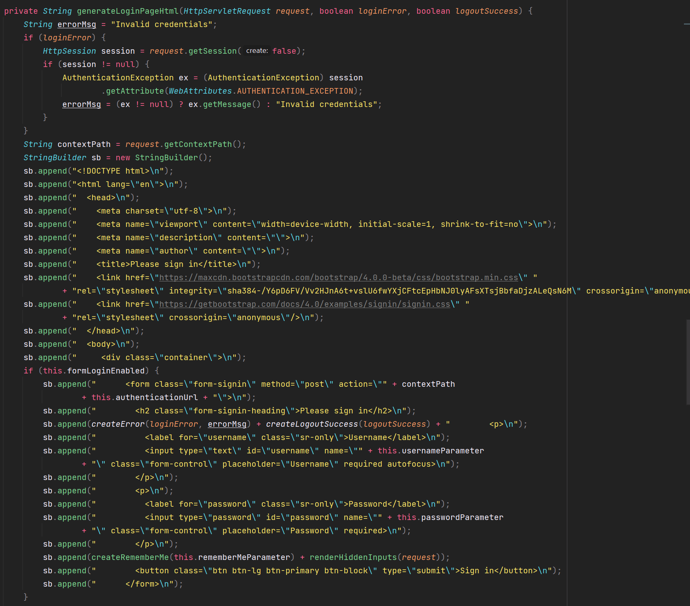

**DefaultLoginPageGeneratingFilter** 클래스에 **generateLoginPageHtml()** 메소드를 통해 로그인 페이지 코드를 확인할 수 있는데, 로그인 페이지는 미리 준비되어 있다가 **AutoConfiguration**에 의해서 **Security** 부분이 자동 설정되면서 로그인 페이지가 그려지게 된다.

---

#### **SecurityConfig 설정**

시큐리티 때문에 로그인을 하지 않으면, 아무것도 할 수 없는 상태이다. 현재 로그인 기능을 구현하지 않아 데이터베이스에서 조회해서 인증으로 이어지게끔 기능을 구현하지 않았다. 그래서 미리 SecurityConfig를 통해 이 문제를 해결할 필요가 있다.

**Spring Security의 변화**

SpringBoot 2.7 에서 발생한 많은 변경점 때문에 최신 IDE 에서 잘못 동작하는 것도 있었다. 그중 하나가 Auto-Configuration 이 있다.

[**문제 1**](https://github.com/spring-projects/spring-boot/wiki/Spring-Boot-2.7-Release-Notes#changes-to-auto-configuration)

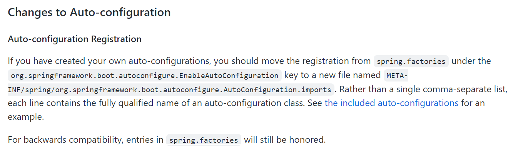

SpringBoot 2.7 Release Note 참고

> 기존에 Auto-configuration에 대한 정보가 **spring.factories**라고 해서 특정 경로에 있었는데, 그 내용이 위치가 변경되었다. 이런 것 때문에 Autowired하면 IDE가 알아서 찾아서 봐줬어야 하는데 Spring Boot 2.7을 사용할 경우 Intellij가 아직 준비가 안되어 있는 상황이다. 이 문제를 Major 문제로 이슈 티켓이 발행되었고, 해결되었는데 반영이 2022.1.3 버전에서 된다고 한다. (현재 최신버전은 2022.3 으로 해결이 된 상태)

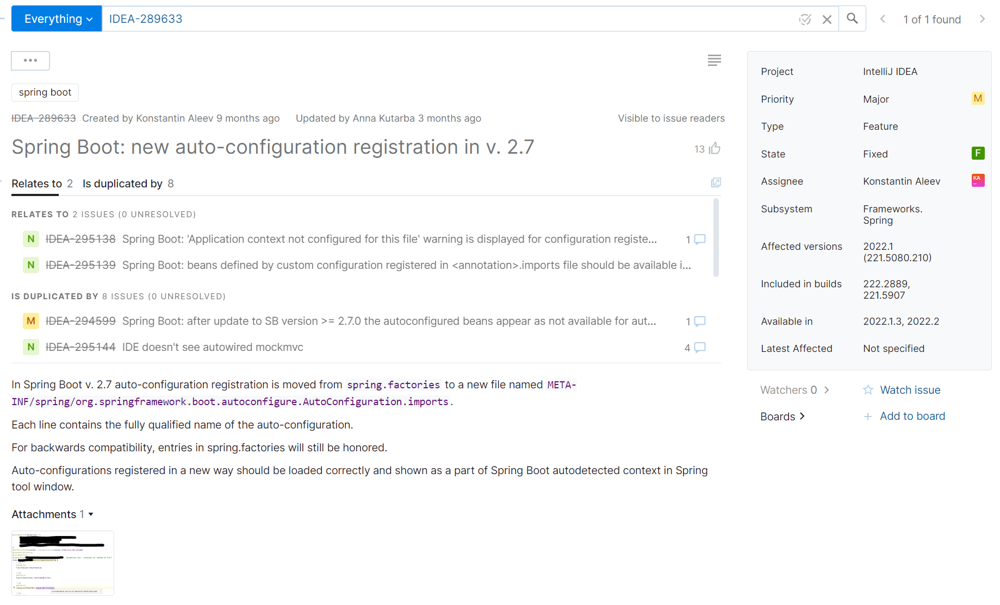

JetBrain Issue

[**문제 2**](https://spring.io/blog/2022/02/21/spring-security-without-the-websecurityconfigureradapter)

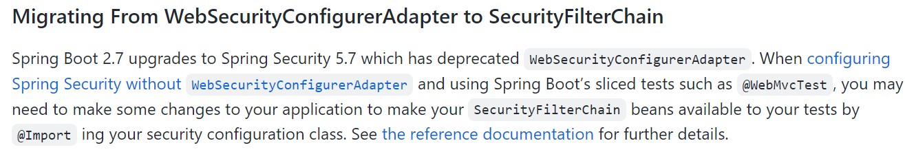

기존의 **WebSecurityConfigurerAdapter**가 **Deprecated**되고 **SecurityFilterChain**으로 변경되었다.

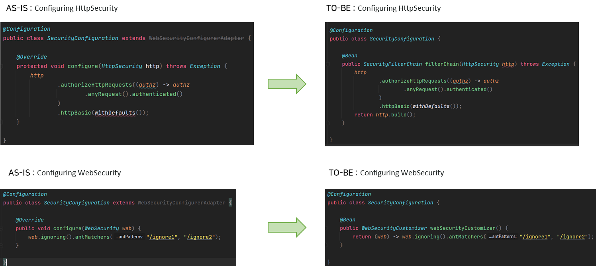

> 기존 상속을 받아 구현했던 구조에서 Bean 컴포넌트 방식으로 전환되었다.

모든 경로에 대한 접근을 허용하도록 변경하는 코드를 구현하도록 하겠다.

```java
@Configuration
public class SecurityConfig {

    @Bean
    public SecurityFilterChain securityFilterChain(HttpSecurity http) throws Exception {

        return http
                .authorizeHttpRequests(auth -> auth.anyRequest().permitAll())
                .formLogin().and()
                .build();
    }
}
```

> Spring Security 공식 문서에 예제를 보면 **@EnableWebSecurity**이 붙은 것을 볼 수 있는데, Spring Boot에서 Spring Security 연동해서 사용할 때는 AutoConfig 안에 들어가있어서 **@EnableWebSecurity**를 넣지 않아도 된다.

Spring Security를 적용하였으므로 기존 테스트 코드를 실행하여 작동여부를 확인해야한다.

#### **🔥 Spring Security 적용 후 Unauthorized 에러 발생**

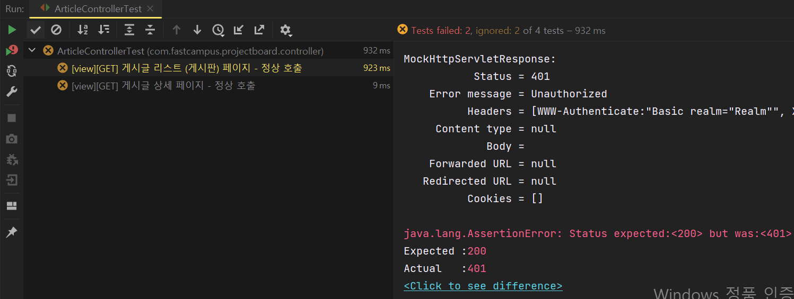

> Security를 적용하기 전에 코드이기 때문에 인증이 안되어있으므로 테스트가 실패하는 것을 볼 수 있다.   
> 기본 WebSecurity를 불러와서 발생하는 문제로 SecurityConfig 설정을 불러온다면 해결할 수 있는 간단한 문제이다.

```java
@DisplayName("View 컨트롤러 - 게시글")
@Import(SecurityConfig.class)
@WebMvcTest(ArticleController.class)
class ArticleControllerTest {}
```

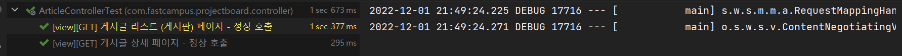

#### **로그인 페이지 테스트**

이전에는 여러가지 모듈이 합쳐져있는 상태에서 slice test를 하여 힘들었지만, 이제는 그런게 많이 발전하였다. 지금은 Spring Security가 적용된 상태에서 복잡한 경우에는 문제가 될 수 있지만, 기초적인  상태에서 **@WebMvcTest**만으로도 Security가 적용된 테스트를 얼마든지 할 수 있다.

```java
@DisplayName("View 컨트롤러 - 인증")
@Import(SecurityConfig.class)
@WebMvcTest
public class AuthControllerTest {

    private final MockMvc mvc;

    public AuthControllerTest(@Autowired MockMvc mvc) {
        this.mvc = mvc;
    }

    @DisplayName("[view][GET] 로그인 페이지 - 정상 호출")
    @Test
    void givenNothing_whenTryingToLogIn_thenReturnsLogInView() throws Exception {
        // Given

        // When & Then
        mvc.perform(get("/login"))
                .andExpect(status().isOk())
                .andExpect(content().contentTypeCompatibleWith(MediaType.TEXT_HTML));
    }
}
```

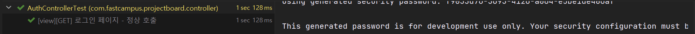

실행결과 : 정상 작동

#### **Commit을 통해 알아보는 진행상황**

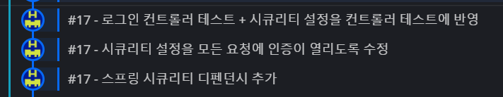

---

### **View에 디자인 붙이기!**

#### **🎒 준비물 - Bootstrap**

**Bootstrap 라이브러리를 이용하여 게시판 서비스의 디자인을 구성할 것이다.**

[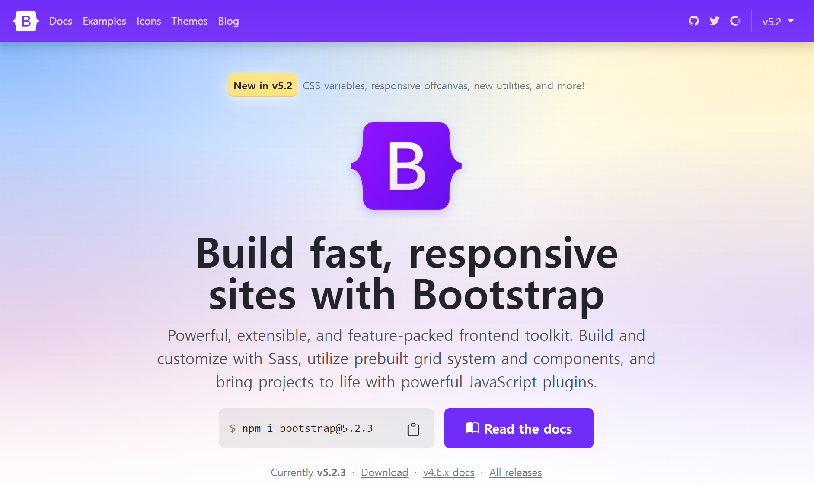](https://getbootstrap.com/)

**사용방법은?**

* **Install via package manager**npm 등에 명령을 이용해 설치하는 방법
* **Include via CDN**link를 이용해 외부 리소스를 받아 사용하는 방법으로 페이지를 로딩할 때마다 따로 캐싱을 하거나 웹브라우저가 캐싱을 해주지 않을 경우 매번 다운 받게된다. 덩치가 크다면 로딩시간이 길어질 수 있다.

#### **Bootstrap 적용**

**게시판 페이지**

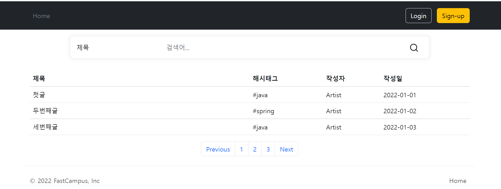

**게시글 페이지**

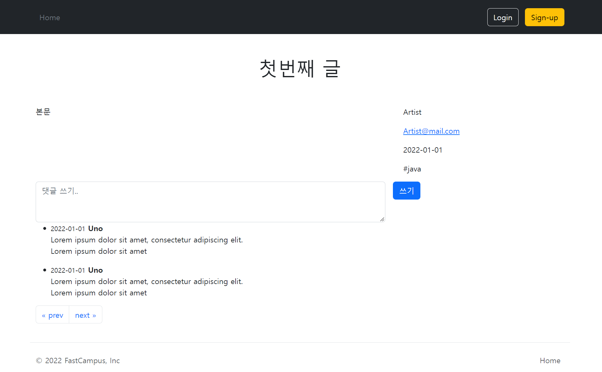

#### **Commit을 통해 알아보는 진행상황**

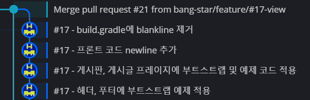
