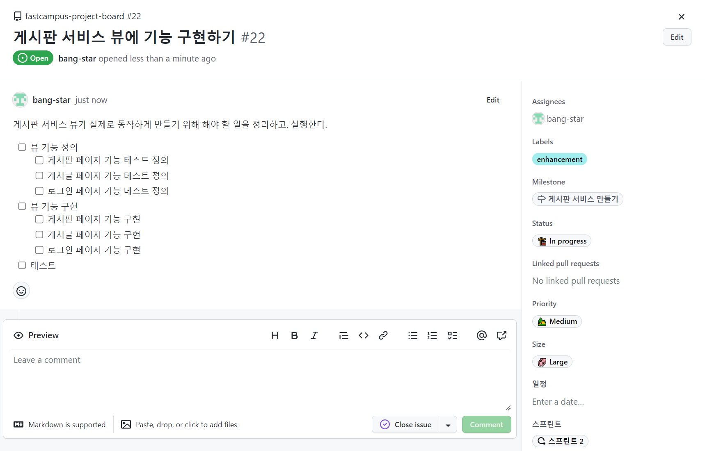
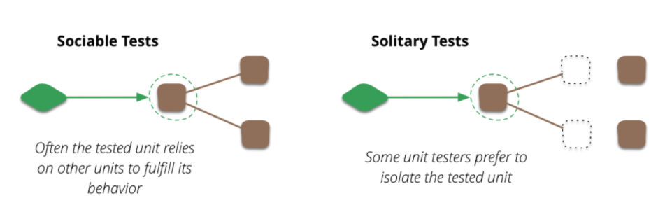
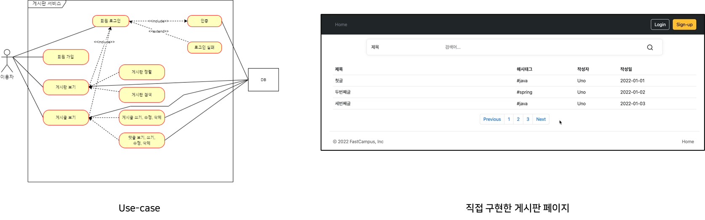
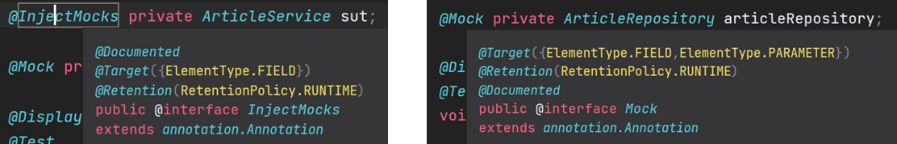
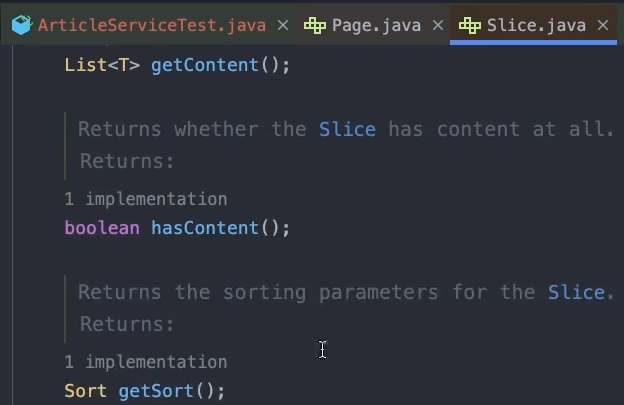
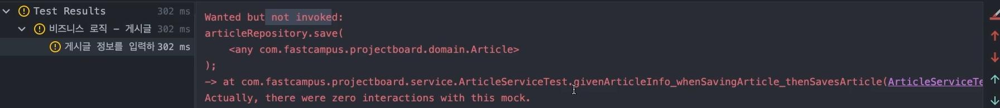
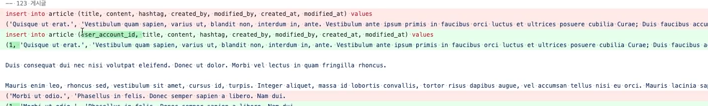

## **뷰 기능 정의**



**UnitTest 방식**



* **solitary test** - TestDouble(Dummy, Fake, Stubs, Spies, Mocks)을 사용해서 상호작용이 있는 유닛 클래스 등을 완벽하게 분리시킨 채 테스트
* **sociable test** - 의존성이 있는 다른 코드들과 함께 테스트 ✔️

테스트 방식은 solitary test 방식으로 선정하여 실제 데이터베이스에 데이터가 들어갔는지 확인하지 않고 동작 여부만 판단하는 테스트로 진행할 예정이다.

---

### **게시판 페이징 기능 테스트 정의**

#### **게시판 페이지에서 구현되어야 하는 기능 목록**

유즈 케이스 또는 직접 구현한 화면 등을 통해 다음과 같은 기능을 유추할 수 있다.



* 검색
* 각 게시글 페이지로 이동
* 페이지네이션
* 홈 버튼 → 게시판 페이지로 리다이렉션
* 정렬 기능

#### **게시판 서비스와 테스트 클래스 생성**

**서비스 비즈니스 로직을 Spring Boot에 Slice Test 기능을 사용하지 않고 작성하는 방향으로 접근하려 한다.**

테스트는 가능한한 가볍게 만드는 것이 좋기 때문에 불필요한 Spring Boot Application context가 실행되는데 걸리는 시간을 줄이려 한다. 대신 디펜던시가 추가되어야하는 부분이 있다면 Mocking을 통해 접근하도록 하려 한다. 많이 사용되는 도구로 **Mockito**가 있다.

더보기

[**Mockito**](https://site.mockito.org/)

* Mock 객체를 쉽게 만들고, 관리하고, 검증할 수 있는 방법을 제공하는 프레임워크
* Spring 테스트 패키지에 이미 포함되어 있어 설치과정이 필요 없다.

**게시판 서비스**

```java
@RequiredArgsConstructor
@Service
class ArticleService {
	private final ArticleRepository articleRepository;
}
```

**게시판 서비스 테스트**

```java
@ExtendWith(MockitoExtension.class)
class ArticleServiceTest {
    @InjectMocks private ArticleService sut;
    @Mock private ArticleRepository articleRepository;
}
```

* **@ExtendWith(MockitoExtension.class)**
  + 해당 어노테이션을 사용하면 **@Mock**, **@Spy**, **@InjectMocks** 와 같은 MockitoAnnotations를 사용할 수 있다.
  + JUnit 5에서 Mockito의 Mock 객체를 사용하기 위한 Annotation이다.
  + Unit 4에서는 **@RunWith(MockitoJUnitRunner.class)**이라 사용된다.
* **@InjectMock과 @Mock의 차이**
  + **@InjectMocks  
    **@InjectMocks**** 는 의존성을 필요로 하는 field에 붙이는 어노테이션으로, **@Mock** 이나 **@Spy** 어노테이션이 붙은 filed를 주입받는다. 생성자 방식으로 의존성을 주입받는 클래스를 테스트 할 때 ****@InjectMocks**** 이 필요하다.
  + ****@Mock******@Mock** 애노테이션은 모의 클래스를 만들 때 사용하고, 만약 **@Mock** 어노테이션을 사용하지 않는다면 **Mockito.mock()** 으로 직접 모의 클래스를 설정해 주어야 한다.  

    현재 **@Mock** 은 생성자 주입을 지원하지만, ****@InjectMocks**** 은 생성자 주입을 지원하지 않기 때문에 통일성을 주고자 field 주입 방식을 사용하였다.



* **sut**  
  System under test라는 의미로 테스트 할 때 많이 사용되는 naming 중 하나로 테스트 대상이라는 의미이다.
* **articleRepository**테스트 중간에 Mocking하기 위해 필요함.

---

#### ****알고리즘 설계****

**1. 검색**

**ArticleServiceTest**

```java
@DisplayName("게시글을 검색하면, 게시글 리스트를 반환한다.")
@Test
void givenSearchParameters_whenSearchingArticles_thenReturnsArticleList() {
    // Given

    // When
    List<ArticleDto> articles = sut.searchArticles(SearchType.TITLE, "search keyword");

    // Then
    assertThat(articles).isNotNull();
}
```

**ArticleDto**

```java
package com.fastcampus.projectboard.dto;

public record ArticleDto(
        String title,
        String content,
        String hashtag,
        LocalDateTime createdAt,
        String createdBy,
) {
    public static ArticleDto of(UserAccountDto userAccountDto, String title, String content, String hashtag, LocalDateTime createdAt, String createdBy, LocalDateTime modifiedAt, String modifiedBy) {
        return new ArticleDto(id, userAccountDto, title, content, hashtag, createdAt, createdBy, modifiedAt, modifiedBy);
    }
}
```

\* 참고 - 현재 인증 기능을 구현되지 않았으므로 인증 기능을 생각하지 않고 ArticleDto를 구현하였다.

**SearchType**

```java
package com.fastcampus.projectboard.domain.type;

public enum SearchType {
    TITLE, CONTENT, ID, NICKNAME, HASHTAG
}
```

**ArticleService**

```java
package com.fastcampus.projectboard.service;

@RequiredArgsConstructor
@Transactional
@Service
public class ArticleService {
    private final ArticleRepository articleRepository;

    @Transactional(readOnly = true)
    public List<ArticleDto> searchArticles(SearchType searchType, String searchKeyword) {
    	return List.of();
    }
}
```

**2. 각 게시글 페이지로 이동**

ArticleServiceTest

```java
@DisplayName("게시글을 검색하면, 게시글 리스트를 반환한다.")
@Test
void givenArticleId_whenSearchingArticle_thenReturnsArticle() {
    // Given

    // When
    ArticleDto article = sut.searchArticle(1L);

    // Then
    assertThat(article).isNotNull();
}
```

**ArticleService**

```java
package com.fastcampus.projectboard.service;

@RequiredArgsConstructor
@Transactional
@Service
public class ArticleService {
    private final ArticleRepository articleRepository;

    @Transactional(readOnly = true)
    public ArticleDto searchArticle(Long articleId) {
    	return null;
    }
}
```

**3. 페이지네이션**

해당 페이지에서 페이징과 관련된 정보를 보내줘야하는데 현재 페이징과 관련된 기능을 구현할 필요가 없고, 게시글 리스트를 반환할 때 페이지로 보내주면 된다. 

* List to Page로 전환

ArticleServiceTest

```java
@DisplayName("게시글을 검색하면, 게시글 리스트를 반환한다.")
@Test
void givenSearchParameters_whenSearchingArticles_thenReturnsArticleList() {
    // Given

    // When
    Page<ArticleDto> articles = sut.searchArticles(SearchType.TITLE, "search keyword");

    // Then
    assertThat(articles).isNotNull();
}
```

ArticleService

```java
package com.fastcampus.projectboard.service;

@RequiredArgsConstructor
@Transactional
@Service
public class ArticleService {
    private final ArticleRepository articleRepository;

    @Transactional(readOnly = true)
    public Page<ArticleDto> searchArticles(SearchType searchType, String searchKeyword) {
    	return Page.empty();
    }
}
```

> Page 안에는 이미 Paging과 관련된 정보가 담겨 있다. 프론트에서 받아서 링크가 동작하도록 유도를 해주면 된다.

**4. 홈 버튼 → 게시판 페이지로 리다이렉션**

서비스 로직보다는 Controller의 로직이다.

MainController

```java
package com.fastcampus.projectboard.controller;

@Controller
public class MainController {

    @GetMapping("/")
    public String root(){
        return "redirect:/articles";
    }
}
```

MainControllerTest

```java
package com.fastcampus.projectboard.controller;

@Import(SecurityConfig.class)
@WebMvcTest(MainController.class)
class MainControllerTest {

    private final MockMvc mvc;

    public MainControllerTest(@Autowired MockMvc mvc) { this.mvc = mvc; }

    @Test
    void givenNothing_whenRequestingRootPage_thenRedirectToArticlesPage() throws Exception {
        // Given

        // When & Then
        mvc.perform(get("/"))
                .andExpect(status().is3xxRedirection());
    }
}
```

**5. 정렬 기능**

정렬 기능은 Page에 Slice에 정렬 기능이 내재되어 있다.



**🔥 핵심 요약 🔥**

> **비즈니스 로직의 테스트 코드를 작성할 때 어떤 방식으로 출발하는지는 중요하다.**비즈니스 로직을 시작해서 테스트 코드를 구상하고 SpringBootTest를 사용하지 않아 Application Context가 실행되지 않기 때문에 필요한 의존성은 Mocking하는 방식으로 접근해서 가능한한 빠른 테스트를 실행할 수 있게 하는 것이 중요하다.

---

### **게시글 페이지 기능 테스트 정의**

#### **설계**

**게시글 페이지에서 구현되어야 하는 기능 목록**

* 게시글 저장하기
* 게시글 읽기(게시판 테스트에 포함됨)
* 게시글 수정하기
* 게시글 삭제하기
* 게시글에 댓글 쓰기
* 게시글에 댓글 읽기
* 게시글에 댓글 수정하기
* 게시글에 댓글 삭제하기

요약해보면 게시글에 대한 CRUD, 댓글에 대한 CRUD 테스트를 진행하는 것이다.

#### 알고리즘 설계

**1. 게시글 저장하기**

ArticleServiceTest

```java
package com.fastcampus.projectboard.service;

@DisplayName("비즈니스 로직 - 게시글")
@ExtendWith(MockitoExtension.class)
class ArticleServiceTest {

    @DisplayName("게시글 정보를 입력하면, 게시글을 생성한다.")
    @Test
    void givenArticleInfo_whenSavingArticle_thenSavesArticle() {
        // Given
        given(articleRepository.save(any(Article.class))).willReturn(null);

        // When
        sut.saveArticle(ArticleDto.of(LocalDateTime.now(), "artist", "new title", "new content", "#java"));

        // Then
        then(articleRepository).should().save(any(Article.class));
    }
}
```

* **given(articleRepository.save(any(Article.class))).willReturn(null)**articleRepository에서 save 메소드가 호출될 것이다라는 정보를 전달하는 것일뿐 큰 의미 없음. 즉 코드적인 명시일 뿐
* **then(articleRepository).should().save(any(Article.class))**  
  articleRepository에서 save 메소드를 호출했는지 검사하는 코드

ArticleService

```java
package com.fastcampus.projectboard.service;

@RequiredArgsConstructor
@Transactional
@Service
public class ArticleService {

    public void saveArticle(ArticleDto dto) {
    }
}
```



실행 결과를 통해 원하는 결과가 정상작동함을 확인.

**2. 게시글 수정하기**

**ArticleServiceTest**

```java
@DisplayName("게시글의 수정 정보를 입력하면, 게시글을 수정한다.")
@Test
void givenModifiedArticleInfo_whenUpdatingArticle_thenUpdatesArticle() {
    // Given
    given(articleRepository.save(any(Article.class))).willReturn(null);

    // When
    sut.updateArticle(1L, ArticleUpdateDto.of("title", "content", "#java"));

    //Then
    then(articleRepository).should().save(any(Article.class));
}
```

게시글 정보를 수정할 때는 생성 날짜, 생성자 정보가 필요 없기 때문에 Dto가 변경될 필요가 있다.

**ArticleUpdateDto**

```java
public record ArticleUpdateDto(
        String title,
        String content,
        String hashtag
){

    public static ArticleUpdateDto of(String title, String content, String hashtag) {
        return new ArticleUpdateDto(title, content, hashtag);
    }
}
```

**ArticleService**

```java
package com.fastcampus.projectboard.service;

public class ArticleService {

    public void updateArticle(long articleId, ArticleUpdateDto dto) {}
}
```

**3. 게시글 삭제하기**

**ArticleServiceTest**

```java
@DisplayName("게시글 ID를 입력하면, 게시글을 삭제한다.")
@Test
void givenArticleId_whenDeletingArticle_thenDeletesArticle() {
    // Given
    willDoNothing().given(articleRepository).delete(any(Article.class));

    // When
    sut.deleteArticle(1L);

    //Then
    then(articleRepository).should().delete(any(Article.class));
}
```

**ArticleService**

```java
public class ArticleService {
    public void deleteArticle(long articleId) {}
}
```

**4. 댓글 CRUD(게시글과 동일한 원리)**

**ArticleCommentService**

```java
@RequiredArgsConstructor
@Transactional
@Service
public class ArticleCommentService {
    private final ArticleRepository articleRepository;
    private final ArticleCommentRepository articleCommentRepository;

    @Transactional(readOnly = true)
    public List<ArticleCommentDto> searchArticleComment(Long articleId) {
        return List.of();
    }

    public void saveArticleComment(ArticleCommentDto dto) {
    }

    public void updateArticleComment(long articleCommentId, ArticleCommentUpdateDto dto) {
    }

    public void deleteArticleComment(long articleCommentId) {
    }
}
```

ArticleCommentDto

```java
package com.fastcampus.projectboard.dto;

public record ArticleCommentDto(
        LocalDateTime createdAt,
        String createdBy,
        LocalDateTime modifiedAt,
        String modifiedBy,
        String content
){
    public static ArticleCommentDto of(LocalDateTime createdAt, String createdBy, LocalDateTime modifiedAt, String modifiedBy, String content) {
        return new ArticleCommentDto(createdAt, createdBy, modifiedAt, modifiedBy, content);
    }
}
```

**ArticleCommentServiceTest**

```java
@DisplayName("비즈니스 로직 - 댓글")
@ExtendWith(MockitoExtension.class)
class ArticleCommentServiceTest {

    @InjectMocks private ArticleCommentService sut;

    @Mock private ArticleRepository articleRepository;
    @Mock private ArticleCommentRepository articleCommentRepository;

    @DisplayName("게시글 ID로 조회하면, 해당하는 댓글 리스트를 반환한다.")
    @Test
    void givenArticleId_whenSearchingArticleComments_thenReturnsArticleComments() {
        // Given
        Long articleId = 1L;
        given(articleRepository.findById(articleId)).willReturn(Optional.of(
                                        Article.of("title", "content", "#java")));

        // When
        List<ArticleCommentDto> articleComments = sut.searchArticleComment(articleId);

        //Then
        assertThat(articleComments).isNotNull();
        then(articleRepository).should().findById(articleId);
    }

    @DisplayName("댓글 정보를 입력하면, 댓글을 저장한다.")
    @Test
    void givenArticleCommentInfo_whenSavingArticleComment_thenSavesArticleComment() {
        // Given
        given(articleCommentRepository.save(any(ArticleComment.class))).willReturn(null);

        // When
        sut.saveArticleComment(ArticleCommentDto.of(LocalDateTime.now(), "artist", LocalDateTime.now(), "artist", "content"));

        //Then
        then(articleCommentRepository).should().save(any(ArticleComment.class));
    }

    @DisplayName("댓글 정보를 재입력하면, 댓글을 수정한다.")
    @Test
    void givenArticleCommentInfo_whenUpdatingArticleComment_thenUpdatesArticleComment() {
        // Given
        given(articleCommentRepository.save(any(ArticleComment.class))).willReturn(null);

        // When
        sut.updateArticleComment(1L, ArticleCommentUpdateDto.of("content"));

        //Then
        then(articleCommentRepository).should().save(any(ArticleComment.class));
    }

    @DisplayName("댓글 ID를 입력하면, 댓글을 삭제한다.")
    @Test
    void givenArticleCommentInfo_whenDeletingArticleComment_thenDeletesArticleComment() {
        // Given
        willDoNothing().given(articleCommentRepository).delete(any(ArticleComment.class));

        // When
        sut.deleteArticleComment(1L);

        //Then
        then(articleCommentRepository).should().delete(any(ArticleComment.class));
    }
}
```

---

### **로그인 페이지 기능 테스트 정의**

로그인 페이지의 구현 기능을 직접 구현하지 않고 이미 만들어져 있는 기능을 가져와 쓰기 위해 Spring Scurity 모듈을 넣어서 로그인 페이지가 정상 작동하고 있다.

---

### **개선된 사항**

#### **도메인 수정 - 회원 계정과 게시글, 댓글 관계 연결**

연관관계 부분이 미비하였기 때문에 보완하는 작업을 진행하였다.

**1. ERD 변경**

[원문에서 이미지 보기](https://to-be-a-artist.tistory.com/247)

> **- user\_account Entity를 추가하여 게시글과 댓글에 FK로 추가함.**  
> 게시글과 댓글이 user\_account의 아이디를 들고 있도록 하여 게시글을 쓴 사람이 누군인지, 댓글을 작성한 사람이 누군인지 알 수 있도록 연결을 하였다.  
>   
> **- 이미 사용되고 있는 예약어 또는 클래스 명 중복을 피하도록 필드명과 클래스명을 설정함.**Spring Security에 UserDetails 구현체 중 User 라는 클래스가 존재함.  
> MySQL 예약어 중에 password라는 예약어가 존재함.

**2. 게시글 클래스**

```java
@Getter
@ToString(callSuper = true)
@Table(indexes = {
        @Index(columnList = "title"),
        @Index(columnList = "hashtag"),
        @Index(columnList = "createdAt"),
        @Index(columnList = "createdBy")
})
@Entity
public class Article extends AuditingFields {
    @Id
    @GeneratedValue(strategy = GenerationType.IDENTITY)
    private Long id;

    @Setter @ManyToOne(optional = false) private UserAccount userAccount;

    @Setter @Column(nullable = false) private String title;                                         // 제목
    @Setter @Column(nullable = false, length = 10000) private String content;                       // 본문

    @Setter private String hashtag;                                                                 // 해시태그

    @ToString.Exclude
    @OrderBy("createdAt DESC")
    @OneToMany(mappedBy = "article", cascade = CascadeType.ALL)
    private final Set<ArticleComment> articleComments = new LinkedHashSet<>();


    protected Article() {}

    private Article(UserAccount userAccount, String title, String content, String hashtag) {
        this.userAccount = userAccount;
        this.title = title;
        this.content = content;
        this.hashtag = hashtag;
    }

    public static Article of(UserAccount userAccount, String title, String content, String hashtag) {
        return new Article(userAccount, title, content, hashtag);
    }

    @Override
    public boolean equals(Object o) {
        if (this == o) return true;
        if(!(o instanceof Article article)) return false;
        return id != null && id.equals(article.id);
    }

    @Override
    public int hashCode() {
        return Objects.hash(id);
    }
}
```

* **@ToString(callSuper = true)**callSuper 속성을 통해 부모 클래스의 필드까지 출력하도록 설정함. 즉 생성일시, 생성자, 수정일시, 수정자 정보를 함께 출력할 수 있도록 추가함.
* **@Setter @ManyToOne(optional = false) private UserAccount userAccount**게시글 정보에 UserAccount 정보를 함께 저장하도록 설정
* **@OrderBy("createdAt DESC")**양방향 바인딩으로 게시글에 연관된 댓글리스트를 뽑기 위해 만든 articleComments을 생성일시(즉 시간순으로) 정렬하는 옵션을 추가함.

**3. 댓글 클래스**

```java
package com.fastcampus.projectboard.domain;

@Getter
@ToString(callSuper = true)
@Table(indexes = {
        @Index(columnList = "content"),
        @Index(columnList = "createdAt"),
        @Index(columnList = "createdBy")
})
@Entity
public class ArticleComment extends AuditingFields {

    @Id
    @GeneratedValue(strategy = GenerationType.IDENTITY)
    private Long id;

    @Setter @ManyToOne(optional = false) private Article article;               // 게시글 (ID)
    @Setter @ManyToOne(optional = false) private UserAccount userAccount;       // 유저 정보 (ID)

    @Setter @Column(nullable = false, length = 500) private String content;     // 본문


    protected ArticleComment() { }

    private ArticleComment(Article article, UserAccount userAccount, String content) {
        this.article = article;
        this.userAccount = userAccount;
        this.content = content;
    }

    public static ArticleComment of(Article article, UserAccount userAccount, String content) {
        return new ArticleComment(article, userAccount, content);
    }

    @Override
    public boolean equals(Object o) {
        if (this == o) return true;
        if (!(o instanceof ArticleComment that)) return false;
        return id != null && id.equals(that.id);
    }

    @Override
    public int hashCode() {
        return Objects.hash(id);
    }
}
```

게시글 클래스와 동일하게 적용.

**4. 테스트 데이터 업데이트**



user\_account\_id 컬럼이 추가되어 user\_account 정보가 함께 게시글과 댓글에 등록되도록 업데이트함.

**5. JpaRepository Test**

2번과 3번 내용을 반영하는 테스트로 업데이트함.

```java
package com.fastcampus.projectboard.repository;

@Import(JpaConfig.class)
@DataJpaTest
@DisplayName("JPA 연결 테스트")
class JpaRepositoryTest {

    private final ArticleRepository articleRepository;
    private final ArticleCommentRepository articleCommentRepository;
    private final UserAccountRepository userAccountRepository;

    public JpaRepositoryTest(
            @Autowired ArticleRepository articleRepository,
            @Autowired ArticleCommentRepository articleCommentRepository,
            @Autowired UserAccountRepository userAccountRepository
    ) {
        this.articleRepository = articleRepository;
        this.articleCommentRepository = articleCommentRepository;
        this.userAccountRepository = userAccountRepository;
    }

    @DisplayName("insert 테스트")
    @Test
    void givenTestData_whenInserting_thenWorksFine(){
        // Given
        long previousCount = articleRepository.count();
        UserAccount userAccount = userAccountRepository.save(UserAccount.of("uno", "pw", null, null, null));
        Article article = Article.of(userAccount, "new article", "new content", "#spring");

        // When
        articleRepository.save(article);

        // Then
        assertThat(articleRepository.count()).isEqualTo(previousCount + 1);
    }
}
```

* private final UserAccountRepository userAccountRepository가 추가됨.
* 게시글 생성 과정에서 필요한 userAccount  정보를 임의로 생성하는 작업이 추가됨.

**6. 메인 페이지로 이동(Redirect to Forward)**

단순 조회 접근이고, url 루트 경로를 유지한 채로 게시판 페이지를 대표로 만들고 싶은 상황이므로 forward 가 더 적절해보인다.

**MainController**

```java
@Controller
public class MainController {

    @GetMapping("/")
    public String root(){
        return "forward:/articles";
    }
}
```

**MainControllerTest**

```java
@Import(SecurityConfig.class)
@WebMvcTest(MainController.class)
class MainControllerTest {

    private final MockMvc mvc;

    public MainControllerTest(@Autowired MockMvc mvc) { this.mvc = mvc; }

    @Test
    void givenNothing_whenRequestingRootPage_thenRedirectToArticlesPage() throws Exception {
        // Given

        // When & Then
        mvc.perform(get("/"))
                .andExpect(status().isOk())
                .andExpect(view().name("forward:/articles"))
                .andExpect(forwardedUrl("/articles"))
                .andDo(MockMvcResultHandlers.print());
    }
}
```

**7. 서비스 로직 테스트 코드 업데이트 및 DTO 재설계, 쿼리 메소드 작성**

**ArticleCommentServiceTest**

```java
package com.fastcampus.projectboard.service;

@DisplayName("비즈니스 로직 - 댓글")
@ExtendWith(MockitoExtension.class)
class ArticleCommentServiceTest {

    @InjectMocks private ArticleCommentService sut;

    @Mock private ArticleRepository articleRepository;
    @Mock private ArticleCommentRepository articleCommentRepository;

    @DisplayName("게시글 ID로 조회하면, 해당하는 댓글 리스트를 반환한다.")
    @Test
    void givenArticleId_whenSearchingArticleComments_thenReturnsArticleComments() {
        // Given
        Long articleId = 1L;
        ArticleComment expected = createArticleComment("content");
        given(articleCommentRepository.findByArticle_Id(articleId)).willReturn(List.of(expected));

        // When
        List<ArticleCommentDto> actual = sut.searchArticleComments(articleId);

        // Then
        assertThat(actual)
                .hasSize(1)
                .first().hasFieldOrPropertyWithValue("content", expected.getContent());
        then(articleCommentRepository).should().findByArticle_Id(articleId);
    }

    @DisplayName("댓글 정보를 입력하면, 댓글을 저장한다.")
    @Test
    void givenArticleCommentInfo_whenSavingArticleComment_thenSavesArticleComment() {
        // Given
        ArticleCommentDto dto = createArticleCommentDto("댓글");
        given(articleRepository.getReferenceById(dto.articleId())).willReturn(createArticle());
        given(articleCommentRepository.save(any(ArticleComment.class))).willReturn(null);

        // When
        sut.saveArticleComment(dto);

        // Then
        then(articleRepository).should().getReferenceById(dto.articleId());
        then(articleCommentRepository).should().save(any(ArticleComment.class));
    }

    @DisplayName("댓글 저장을 시도했는데 맞는 게시글이 없으면, 경고 로그를 찍고 아무것도 안 한다.")
    @Test
    void givenNonexistentArticle_whenSavingArticleComment_thenLogsSituationAndDoesNothing() {
        // Given
        ArticleCommentDto dto = createArticleCommentDto("댓글");
        given(articleRepository.getReferenceById(dto.articleId())).willThrow(EntityNotFoundException.class);

        // When
        sut.saveArticleComment(dto);

        // Then
        then(articleRepository).should().getReferenceById(dto.articleId());
        then(articleCommentRepository).shouldHaveNoInteractions();
    }

    @DisplayName("댓글 정보를 입력하면, 댓글을 수정한다.")
    @Test
    void givenArticleCommentInfo_whenUpdatingArticleComment_thenUpdatesArticleComment() {
        // Given
        String oldContent = "content";
        String updatedContent = "댓글";
        ArticleComment articleComment = createArticleComment(oldContent);
        ArticleCommentDto dto = createArticleCommentDto(updatedContent);
        given(articleCommentRepository.getReferenceById(dto.id())).willReturn(articleComment);

        // When
        sut.updateArticleComment(dto);

        // Then
        assertThat(articleComment.getContent())
                .isNotEqualTo(oldContent)
                .isEqualTo(updatedContent);
        then(articleCommentRepository).should().getReferenceById(dto.id());
    }

    @DisplayName("없는 댓글 정보를 수정하려고 하면, 경고 로그를 찍고 아무 것도 안 한다.")
    @Test
    void givenNonexistentArticleComment_whenUpdatingArticleComment_thenLogsWarningAndDoesNothing() {
        // Given
        ArticleCommentDto dto = createArticleCommentDto("댓글");
        given(articleCommentRepository.getReferenceById(dto.id())).willThrow(EntityNotFoundException.class);

        // When
        sut.updateArticleComment(dto);

        // Then
        then(articleCommentRepository).should().getReferenceById(dto.id());
    }

    @DisplayName("댓글 ID를 입력하면, 댓글을 삭제한다.")
    @Test
    void givenArticleCommentId_whenDeletingArticleComment_thenDeletesArticleComment() {
        // Given
        Long articleCommentId = 1L;
        willDoNothing().given(articleCommentRepository).deleteById(articleCommentId);

        // When
        sut.deleteArticleComment(articleCommentId);

        // Then
        then(articleCommentRepository).should().deleteById(articleCommentId);
    }

    private ArticleCommentDto createArticleCommentDto(String content) {
        return ArticleCommentDto.of(
                1L,
                1L,
                createUserAccountDto(),
                content,
                LocalDateTime.now(),
                "uno",
                LocalDateTime.now(),
                "uno"
        );
    }

    private UserAccountDto createUserAccountDto() {
        return UserAccountDto.of(
                1L,
                "uno",
                "password",
                "uno@mail.com",
                "Uno",
                "This is memo",
                LocalDateTime.now(),
                "uno",
                LocalDateTime.now(),
                "uno"
        );
    }

    private ArticleComment createArticleComment(String content) {
        return ArticleComment.of(
                Article.of(createUserAccount(), "title", "content", "hashtag"),
                createUserAccount(),
                content
        );
    }

    private UserAccount createUserAccount() {
        return UserAccount.of(
                "uno",
                "password",
                "uno@email.com",
                "Uno",
                null
        );
    }

    private Article createArticle() {
        return Article.of(
                createUserAccount(),
                "title",
                "content",
                "#java"
        );
    }
}
```

* **fixture를 통해 테스트용 데이터를 세팅하여 재사용하도록 함.**createArticleCommentDto(), createUserAccountDto(), createArticleComment(), createUserAccount(), createArticle()
* **테스트 데이터명 변경(expected, actual)을 통해 가독성을 높임.**
* **부족했던 댓글 CRUD 동작을 보완.**
* **간단한 예외처리를 추가함.**
  + **댓글 저장을 시도했는데 맞는 게시글이 없으면, 경고 로그를 찍고 아무것도 하지 않도록 하는 테스트  
    givenNonexistentArticleComment\_whenUpdatingArticleComment\_thenLogsWarningAndDoesNothing()**
  + **없는 댓글 정보를 수정하려고 하면, 경고 로그를 찍고 아무 것도 **하지 않도록 하는 테스트**  
    givenNonexistentArticleComment\_whenUpdatingArticleComment\_thenLogsWarningAndDoesNothing()**

**ArticleServiceTest**

```java
package com.fastcampus.projectboard.service;

@DisplayName("비즈니스 로직 - 게시글")
@ExtendWith(MockitoExtension.class)
class ArticleServiceTest {

    @InjectMocks private ArticleService sut;

    @Mock private ArticleRepository articleRepository;

    @DisplayName("검색어 없이 게시글을 검색하면, 게시글 리스트를 반환한다.")
    @Test
    void givenSearchParameters_whenSearchingArticles_thenReturnsArticleList() {
        // Given
        Pageable pageable = Pageable.ofSize(20);
        given(articleRepository.findAll(pageable)).willReturn(Page.empty());

        // When
        Page<ArticleDto> articles = sut.searchArticles(null, null, pageable);

        // Then
        assertThat(articles).isEmpty();
        then(articleRepository).should().findAll(pageable);
    }

    @DisplayName("검색어와 함께 게시글을 검색하면, 게시글 페이지를 반환한다.")
    @Test
    void givenSearchParameters_whenSearchingArticles_thenReturnsArticlePage() {
        // Given
        SearchType searchType = SearchType.TITLE;
        String searchKeyword = "title";
        Pageable pageable = Pageable.ofSize(20);
        given(articleRepository.findByTitleContaining(searchKeyword, pageable)).willReturn(Page.empty());

        // When
        Page<ArticleDto> articles = sut.searchArticles(searchType, searchKeyword, pageable);

        // Then
        assertThat(articles).isEmpty();
        then(articleRepository).should().findByTitleContaining(searchKeyword, pageable);
    }

    @DisplayName("게시글을 조회하면, 게시글을 반환한다.")
    @Test
    void givenArticleId_whenSearchingArticle_thenReturnsArticle() {
        // Given
        Long articleId = 1L;
        Article article = createArticle();
        given(articleRepository.findById(articleId)).willReturn(Optional.of(article));

        // When
        ArticleWithCommentsDto dto = sut.getArticle(articleId);

        // Then
        assertThat(dto)
                .hasFieldOrPropertyWithValue("title", article.getTitle())
                .hasFieldOrPropertyWithValue("content", article.getContent())
                .hasFieldOrPropertyWithValue("hashtag", article.getHashtag());
        then(articleRepository).should().findById(articleId);
    }

    @DisplayName("없는 게시글을 조회하면, 예외를 던진다.")
    @Test
    void givenNonexistentArticleId_whenSearchingArticle_thenThrowsException() {
        // Given
        Long articleId = 0L;
        given(articleRepository.findById(articleId)).willReturn(Optional.empty());

        // When
        Throwable t = catchThrowable(() -> sut.getArticle(articleId));

        // Then
        assertThat(t)
                .isInstanceOf(EntityNotFoundException.class)
                .hasMessage("게시글이 없습니다 - articleId: " + articleId);
        then(articleRepository).should().findById(articleId);
    }

    @DisplayName("게시글 정보를 입력하면, 게시글을 생성한다.")
    @Test
    void givenArticleInfo_whenSavingArticle_thenSavesArticle() {
        // Given
        ArticleDto dto = createArticleDto();
        given(articleRepository.save(any(Article.class))).willReturn(createArticle());

        // When
        sut.saveArticle(dto);

        // Then
        then(articleRepository).should().save(any(Article.class));
    }

    @DisplayName("게시글의 수정 정보를 입력하면, 게시글을 수정한다.")
    @Test
    void givenModifiedArticleInfo_whenUpdatingArticle_thenUpdatesArticle() {
        // Given
        Article article = createArticle();
        ArticleDto dto = createArticleDto("새 타이틀", "새 내용", "#springboot");
        given(articleRepository.getReferenceById(dto.id())).willReturn(article);

        // When
        sut.updateArticle(dto);

        // Then
        assertThat(article)
                .hasFieldOrPropertyWithValue("title", dto.title())
                .hasFieldOrPropertyWithValue("content", dto.content())
                .hasFieldOrPropertyWithValue("hashtag", dto.hashtag());
        then(articleRepository).should().getReferenceById(dto.id());
    }

    @DisplayName("없는 게시글의 수정 정보를 입력하면, 경고 로그를 찍고 아무 것도 하지 않는다.")
    @Test
    void givenNonexistentArticleInfo_whenUpdatingArticle_thenLogsWarningAndDoesNothing() {
        // Given
        ArticleDto dto = createArticleDto("새 타이틀", "새 내용", "#springboot");
        given(articleRepository.getReferenceById(dto.id())).willThrow(EntityNotFoundException.class);

        // When
        sut.updateArticle(dto);

        // Then
        then(articleRepository).should().getReferenceById(dto.id());
    }

    @DisplayName("게시글의 ID를 입력하면, 게시글을 삭제한다")
    @Test
    void givenArticleId_whenDeletingArticle_thenDeletesArticle() {
        // Given
        Long articleId = 1L;
        willDoNothing().given(articleRepository).deleteById(articleId);

        // When
        sut.deleteArticle(1L);

        // Then
        then(articleRepository).should().deleteById(articleId);
    }


    private UserAccount createUserAccount() {
        return UserAccount.of(
                "uno",
                "password",
                "uno@email.com",
                "Uno",
                null
        );
    }

    private Article createArticle() {
        return Article.of(
                createUserAccount(),
                "title",
                "content",
                "#java"
        );
    }

    private ArticleDto createArticleDto() {
        return createArticleDto("title", "content", "#java");
    }

    private ArticleDto createArticleDto(String title, String content, String hashtag) {
        return ArticleDto.of(1L,
                createUserAccountDto(),
                title,
                content,
                hashtag,
                LocalDateTime.now(),
                "Uno",
                LocalDateTime.now(),
                "Uno");
    }

    private UserAccountDto createUserAccountDto() {
        return UserAccountDto.of(
                1L,
                "uno",
                "password",
                "uno@mail.com",
                "Uno",
                "This is memo",
                LocalDateTime.now(),
                "uno",
                LocalDateTime.now(),
                "uno"
        );
    }

}
```

* **fixture를 통해 테스트용 데이터를 세팅하여 재사용하도록 함.**
* **Paging 기능 추가**
* ****간단한 예외상황에 대한 처리를 추가****

**ArticleUpdateDto를 삭제하고 ArticleDto로 통일**

```java
package com.fastcampus.projectboard.dto;

public record ArticleDto(
        Long id,
        UserAccountDto userAccountDto,
        String title,
        String content,
        String hashtag,
        LocalDateTime createdAt,
        String createdBy,
        LocalDateTime modifiedAt,
        String modifiedBy
) {
    public static ArticleDto of(Long id, UserAccountDto userAccountDto, String title, String content, String hashtag, LocalDateTime createdAt, String createdBy, LocalDateTime modifiedAt, String modifiedBy) {
        return new ArticleDto(id, userAccountDto, title, content, hashtag, createdAt, createdBy, modifiedAt, modifiedBy);
    }

    public static ArticleDto from(Article entity) {
        return new ArticleDto(
                entity.getId(),
                UserAccountDto.from(entity.getUserAccount()),
                entity.getTitle(),
                entity.getContent(),
                entity.getHashtag(),
                entity.getCreatedAt(),
                entity.getCreatedBy(),
                entity.getModifiedAt(),
                entity.getModifiedBy()
        );
    }

    public Article toEntity() {
        return Article.of(
                userAccountDto.toEntity(),
                title,
                content,
                hashtag
        );
    }

}
```

* Entity의 주요 정보를 Dto가 갖고 있도록 변경하였고, 응답 시 원하는 데이터를 가공하여 전달하도록 변경함.
* **Entity to Dto로 변환해주는 메소드 구현(from)**
* **Dto to Entity(toEntity)  

  Article은 Dto에 대한 정보를 몰라도 된다. Article은 Dto와 연관관계는 끊어져있고, Dto만 연관관계 맵핑을 하기 위해 **Article에 대해 알고** 있다. 즉 Article의 변화는 Dto에 영향을 받겠지만, Dto에 변화는 Article에 영향을 주지 않는다.  
  이는 OSIV와 관련이 있다.**

> **에러 메시지[[OSIV](tistory-249.html)]**spring.jpa.open-in-view is enabled by default. Therefore, database queries may be performed during view rendering. Explicitly configure spring.jpa.open-in-view to disable this warning  
>   
> **원인**  
> open-in-view는 기본적으로 true로 셋팅이 되어 있는데, 이는 문제가 될 수 있으므로 직접 사용할지 여부를 설정하라고 하는 에러 메시지다. OSIV 측면에서 매우 부적절하다고 한다. 즉 성능이나 scalability 즉 확장성 측면에서 문제가 될 수 있다.  
>   
> **해결 방법**application.property(yaml)에서 open-in-view 속성을 설정해 두면 된다.

**ArticleCommentService**

```java
package com.fastcampus.projectboard.service;

@RequiredArgsConstructor
@Transactional
@Service
public class ArticleCommentService {
    private final ArticleRepository articleRepository;
    private final ArticleCommentRepository articleCommentRepository;

    @Transactional(readOnly = true)
    public List<ArticleCommentDto> searchArticleComments(Long articleId) {
        return List.of();
    }

    public void saveArticleComment(ArticleCommentDto dto) {
    }

    public void updateArticleComment(ArticleCommentDto dto) {
    }

    public void deleteArticleComment(Long articleCommentId) {
    }
}
```

* 메소드명을 변경하고, 구현할 메소드를 생성함.

**ArticleRepository**

```java
@RepositoryRestResource
public interface ArticleRepository extends
        JpaRepository<Article, Long>,
        QuerydslPredicateExecutor<Article>,
        QuerydslBinderCustomizer<QArticle> {

    Page<Article> findByTitle(String title, Pageable pageable);

}
```

* 검색어와 함께 게시글을 검색하는 경우에 필요한 메소드 생성(findByTitle). 추가적인 메소드 구현 필요

**ArticleCommentRepository**

```java
@RepositoryRestResource
public interface ArticleCommentRepository extends
        JpaRepository<ArticleComment, Long>,
        QuerydslPredicateExecutor<ArticleComment>,
        QuerydslBinderCustomizer<QArticleComment> {

    List<ArticleComment> findByArticle_Id(Long articleId);
}
```

* 게시글 ID를 통해 댓글을 찾는 메소드 생성(findByArticle\_Id)

**ArticleResponse & ArticleCommentResponse&ArticleWithCommentsResponse**

* articleDto와 다르게 정보의 일부만 가지고 있거나 가공된 형태로 가지고 있다.
* Controller에서만 사용되는 전용 Dto이고 각 Controller는 ResponseDto로 의존성이 최소화될 것이다.

```java
package com.fastcampus.projectboard.dto.response;

public record ArticleResponse(
        Long id,
        String title,
        String content,
        String hashtag,
        LocalDateTime createdAt,
        String email,
        String nickname
) implements Serializable {

    public static ArticleResponse of(Long id, String title, String content, String hashtag, LocalDateTime createdAt, String email, String nickname) {
        return new ArticleResponse(id, title, content, hashtag, createdAt, email, nickname);
    }

    public static ArticleResponse from(ArticleDto dto) {
        String nickname = dto.userAccountDto().nickname();
        if (nickname == null || nickname.isBlank()) {
            nickname = dto.userAccountDto().userId();
        }

        return new ArticleResponse(
                dto.id(),
                dto.title(),
                dto.content(),
                dto.hashtag(),
                dto.createdAt(),
                dto.userAccountDto().email(),
                nickname
        );
    }

}
```

Response 구조는 동일하므로 생략

---

**코드에 더 관심이 있으시분은 참고해주세요.**

**Refer**

* [[Java Record]](tistory-248.html)
* [[OSIV]](tistory-249.html)
* [[게시판 서비스 - github]](https://github.com/bang-star/fastcampus-project-board)
