4월 10일 일요일, 항해99기 7기 신청을 했다..  고민을 하고 하고 하고 하고 하고 해서 결정한 곳입니다

항해99는 사전 학습을 할 수 있습니다. 

신청했다고 무조건 합격하는 것이 아니라 사전 학습을 완료 후 테스트를 합격해야

실제로 99일 항해일지를 작성할 수 있게 됩니다.

---

제가 들어야할 과목은 크게 4개 과목입니다.

오늘부터 차근차근 빠르게 가야합니다.. (다른 분들보다 늦게 시작했어요!! 비밀 쉿!!)

오늘은 파이썬 기본 강의 10개를 들었습니다.

기존에 파이썬을 학습하여 프로젝트한 경험이 있으나 사용하지 않은지 오래되어... 기억이.... 가물가물 했습니다

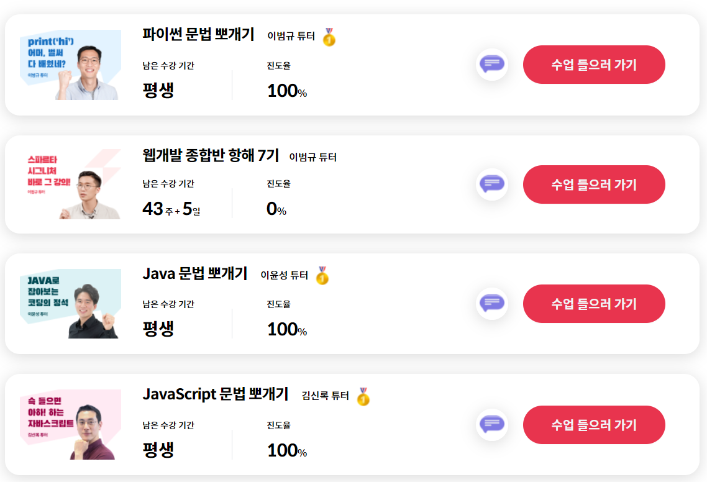

Today

과목 : 파이썬 문법 뽀개기 1주차

강사 : 이범규 튜터님

오늘 학습일지

강의 목록(50% 딜성)

    1.1 필수 프로그램 설치

    1.2 파이썬 기초 문법 뽀개기

    1.3 파이썬 시작하기

    1.4 변수 선언과 자료형

    1.5 문자열 다루기

    1.6 리스트와 딕셔너리

    1.7 조건문

    1.8 반복문

    1.9 반복문 - 연습문제

    1.10 함수

---

오늘 개인적인 일로 인해 많이 하지 못했지만.. 내일은 더열심히 할 예정입니다!!

내일은 무조건 더 많이 할 예정이고 약속입니다

---

#### Summary

1. 문자열

   - 파이썬 언어는 다른 언어에 비해 함수명이 간결하다.

      Ex) 문자열로 형변환 : Str(문자열)

           문자열 길이 : len(문자열)

           문자열 분할 : 문자열.split(기준)

           문자열 슬라이싱 : 문자열[N:M]                 // N이상 M 미만이며 N과 M이 없을 경우 전체 복사가 된다.

   - 예제

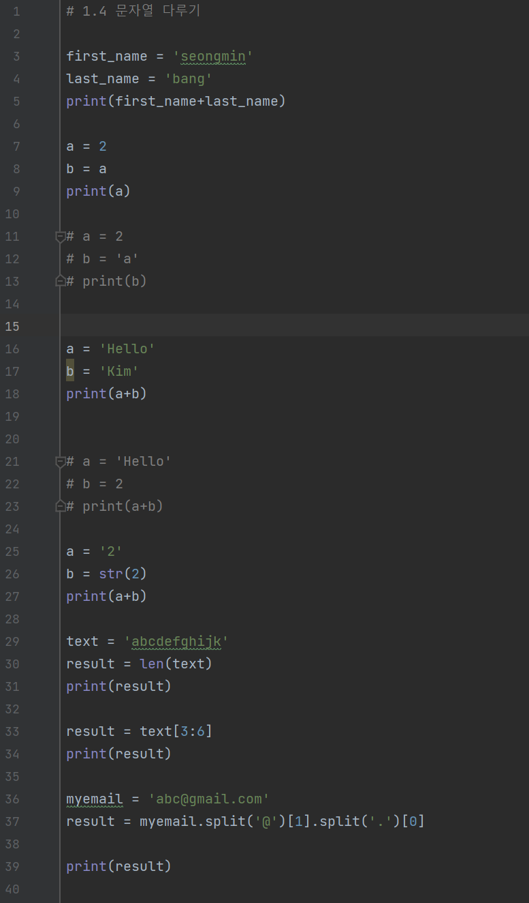

---

  2. 리스트와 딕셔너리

     - 리스트는 순서가 중요하게 값을 담는 자료형!

                    append() 메소드를 사용하여 기존 리스트에 값을 추가 할 수 있다.

                    sort() 메소드를 통해 리스트 내부를 정렬할 수 있다.(reverse=true를 사용하면 내림차순으로 정렬)

                   인덱스 값으로 -1을 사용하면 마지막 인덱스의 값이 반환된다.

                   (A in List)를 사용하여 List에 A 값이 존재하는지 알 수 있다.

     - 딕셔너리는 key와 value로 값을 담는 자료형! 이라고 하셨습니다.

                       인덱스가 아닌 key값을 통해 value에 접근할 수 있다.

                       리스트와 딕셔너리가 조합되어 사용된다.

                       ('key' in 딕셔너리)를 사용하면 딕셔너리에 'key'값이 존재하는지 파악할 수 있다.

     - 예제

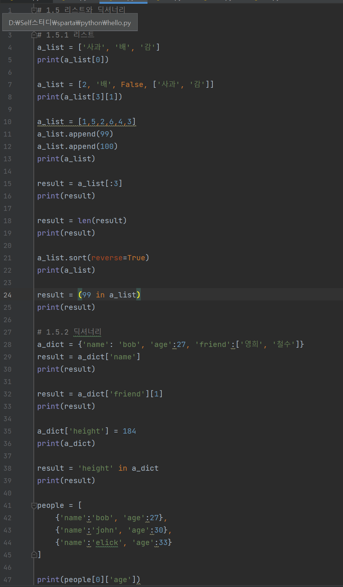

---

3. 조건문

  - 소괄호, 중괄호를 사용하지 않는 것이 다른 언어와 큰 차이점이다.

        - 세미콜론도 사용하지 않고, 중요한 것은 들여쓰기입니다.

        Ex) 타언어 : if(n>5) {return n;}

             파이썬 : if n>5: return n

        - 예제

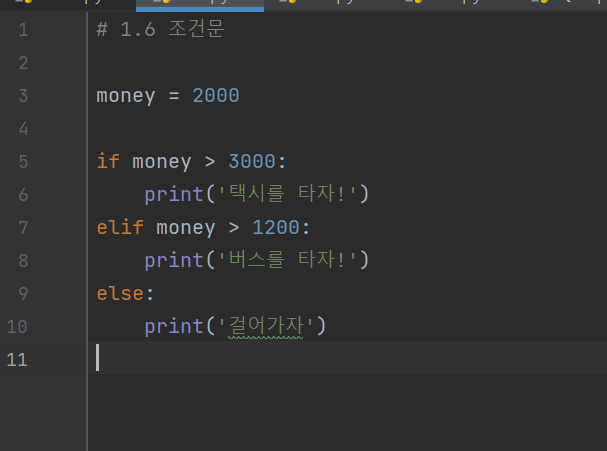

---

  4. 반복문

         - enumerate 라는 내장 함수를 사용하여 인덱스를 대신합니다.

         Ex) 타언어 : for(int i=0; i<5; i++)

              파이썬 : for n int Enumerate(numbers):

          - 예제

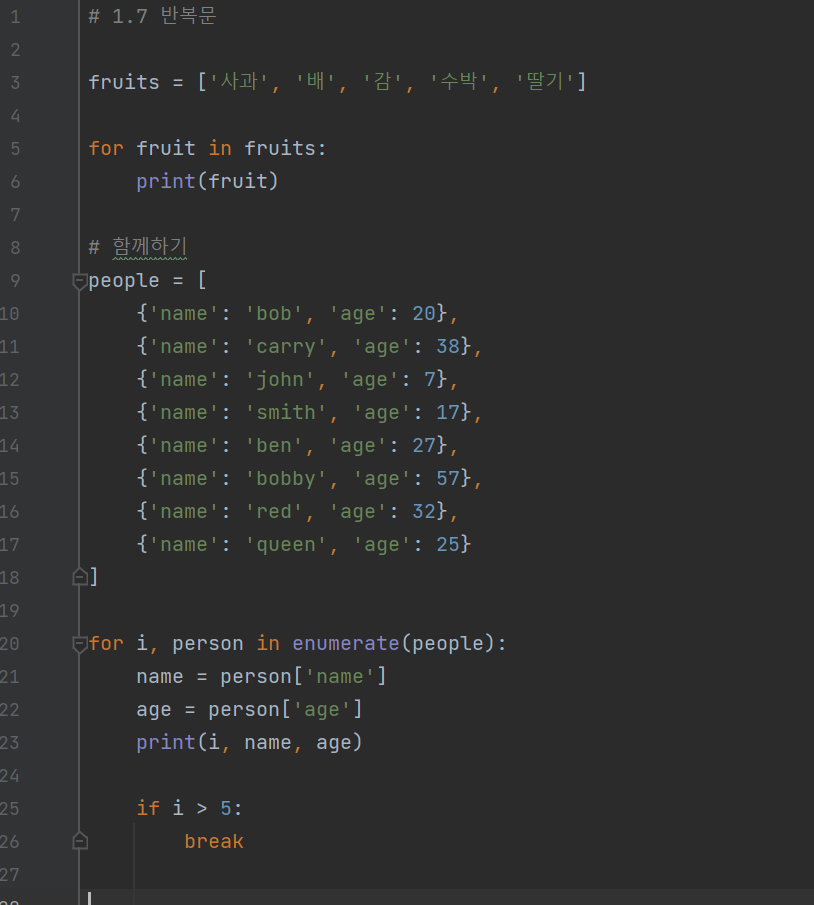

---

   5. 연습문제 풀이

* 숫자들의 평균 구하기

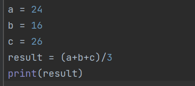

* 문자열의 앞의 반만 출력

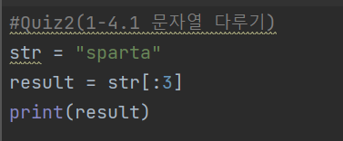

* 전화번호의 지역번호 출력하기

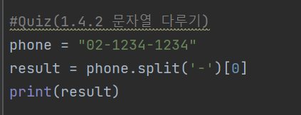

* 딕셔너리에서 원하는 정보를 찾아보기

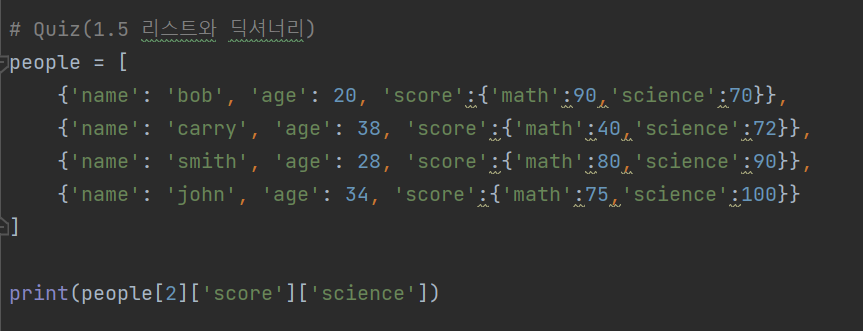

* 사람의 나이 출력하기

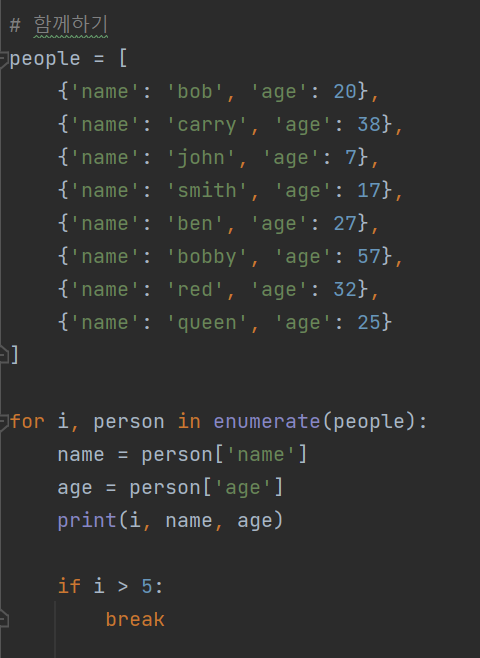

* 리스트에서 짝수만 출력하는 함수

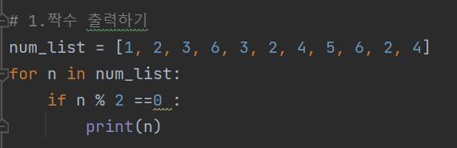

* 리스트에서 짝수의 개수 출력

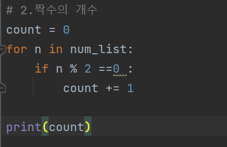

* 리스트 안에 있는 모든 숫자 더하기

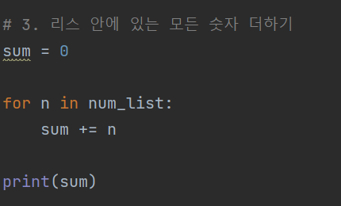

* 리스트 안에 있는 자연수 중 가장 큰 숫자 구하기

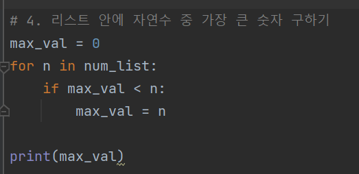

* 주민등록번호를 입력받아 성별을 출력하는 함수

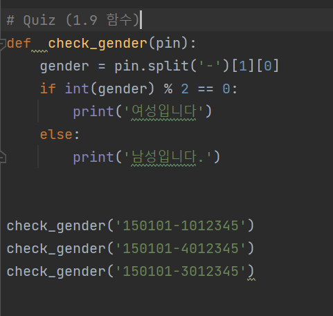

#### 후기

프로그래밍 기본 문법은 이미 알고 있었지만, 그래도 새로운 마음으로 경험하고 배운다는 생각으로 모두 보고 있다.

시작이 반이라는 말이 있듯이 반왔다!! 얼른 끝내고 웹 공부하러 가즈아!!

