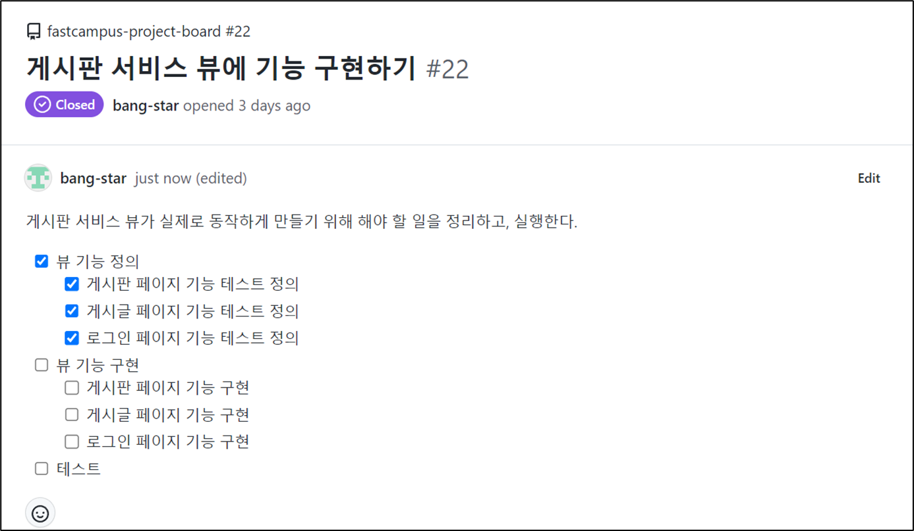
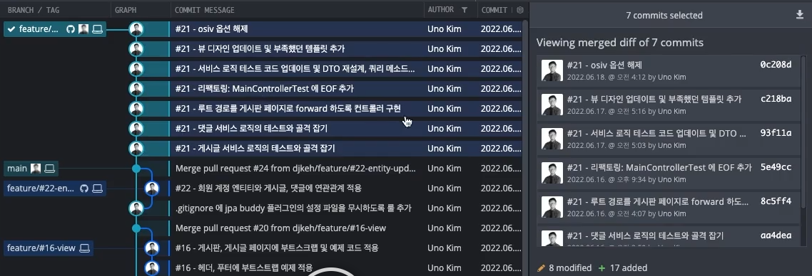
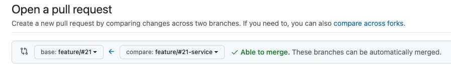
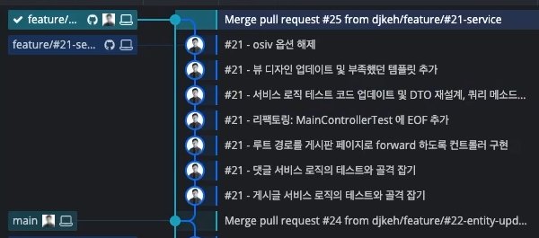
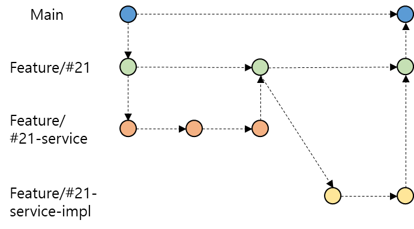

이 문제는 게시판 서비스를 구현하면서 겪은 상황이다.

게시판 서비스 뷰에 기능 구현하기 Issue를 진행하면서 많은 commit과 파일이 생성되고 변경되었다.

> 아직 뷰 기능 구현은 하지도 못 했는데...   
>   
> 변경점이 25개 ???!!  
>   
> 
>
> 코드 리뷰를 받을 파일의 개수가 현재 25개인데...  
> 앞으로 얼마나 더 생길지 모른다...  
>   
> 본인이 봐도 코드 리뷰하기에는 사이즈가 꽤 크다... ㅠㅠ  
>   
> 이럴때는 어떻게 해야할까??   
>   
> 여러 가지 방식이 있겠지만, 사용할 방법은 Feature 브랜치를 분산시키는 방식이다.

다음과 같이 이슈 번호에 맞춰 브랜치를 분리시킨다.

* **feature/#21**
  + **feature/#21-service**
  + **feature/#21-service-impl**

**feature/#21**은 부모의 역할을 하고 **feature/#21-service**과 **feature/#21-service-impl**은 자식의 역할은 맡는다.

**feature/#21** 브랜치를 원격 **Repo**에 **Push 하고**

**feature/#21-service 과** **feature/#21-service-imple 브랜치**는 구현 완료될때 원격 **Repo**에 **Push**한다.

자식 브랜치에서 구현된 기능과 **Merge**되는 base 브랜치를 **main**이 아닌 부모 브랜치로 설정한다.

main 브랜치로 모든 변경점을 한 번에 **Merge** 하는 것이 아니라

브랜치를 세분화하여 개발하고 해당 이슈에 대한 모든 작업이 완료되면

해당 이슈에 대한 브랜치로 통합시켜 효율적으로 코드 리뷰를 할 수 있도록 하는 방식이다.

다음과 같이 브랜치 작업 내용이 부모 브랜치로 반영된 결과를 볼 수 있다.

이 과정을 그림으로 표현하면 다음과 같다.

> 부족한 점이 있다면 말씀해주세요!!   
> 궁금한 점이 있으시다면 말씀해주세요!!  
>   
> 이상. 오늘도 한걸음 성장하는 나!  
>   
> 
