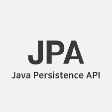

### **findById와 getReferenceById(getOne)의 차이**

---

JpaRepository를 보면 findById와 getOne두가지의 비슷한 기능을 하는 메서드가 존재한다.

#### **메소드 시그니처**

---

```
T getOne(ID id);
Optional<T> findById(ID id);
```

둘다 Id를 파라미터로 받도록 되어있는데, 단순히 Optional로 결과를 받는 차이밖에 보이지 않는다.

#### **메소드 특징**

---

**getReferenceById(getOne)**

> Returns a reference to the entity with the given identifier. Depending on how the JPA persistence provider is implemented this is very likely to always return an instance and throw an javax.persistence.EntityNotFoundException on first access. Some of them will reject invalid identifiers immediately.

getById() 는 원래 getOne() 이었으나 해당 메소드가 Deprecated 되고 대체되었다.

**getReferenceById**은 내부적으로 **EntityManager.getReference()**메소드를 호출하기 때문에 엔티티를 직접 반환하는게 아니라 프록시만 반환한다. 프록시만 반환하기 때문에 실제로 사용하기 전까지는 DB 에 접근하지 않으며, 만약 나중에 프록시에서 DB 에 접근하려고 할 때 데이터가 없다면 EntityNotFoundException 이 발생합니다.

이 메서드는 lazy loading을 지원하는데, 호출되는 시점에는 일단 proxy를 가져오며 실제로 가져온 엔티티의 속성에 접근하는 순간 DB에 접근하는 방식을 사용한다.

**findById**

> Retrieves an entity by its id.

실제 DB를 바로 조회해서 필요한 데이터를 가져온다. 당연히 반환되는 객체도 데이터가 매핑되어있는 실제 엔티티 객체이다.

정확히 말하면 영속성 컨텍스트의 1차 캐시를 먼저 확인하고 데이터가 없으면 실제 DB 에 데이터가 있는지 확인합니다.

> 특징으로만 봐서.. 아 다르구나?라고 생각하시겠지만  
>   
> 실제로 어떻게 다른지 모르시겠죠?   
> 저도 그래요.. ㅎ  
>   
> 그럼 예시를 통해 함께 알아보시죠!

#### **예시를 통한 설명**

---

**findById()**

```java
public void updateArticle(ArticleDto dto) {
    Article article = articleRepository.findById(dto.id());
    article.setTitle("updated title");
    articleRepository.save(artile);
}
```

게시글 수정이 원하는 작업(articleRepository.save)이다.

그런데 아이디를 조회하는 작업( articleRepository.findById(dto.id()))에 대한 Query를 날리고 싶은가?

개발자는 이미 아이디가 존재하는 것을 알고 있으며, 없을 경우 에러 처리를 하면 된다.

업데이트 하고 싶지만 못하니까 엔티티를 영속성 컨텍스트에서 가져와야 해서 이 과정에서 Select Query가 발생한다.

**실행 결과**

```java
Hibernate: select article0_.id as id1_0_0_, article0_.title as title2_0_0_ from article article0_ where article0_.id=?
Hibernate: insert into article (article_id, title) values (?, ?, ?)
```

> 코드 작성한 순서대로 예상한대로 동작한다. 실제 DB에 접근해서 Article를 만들고 이를 통해 연관관계를 매핑한다.  
> 그 이후 Article 테이블에 저장하는 쿼리를 실행한다.

**getReferenceById()**

```java
public void updateArticle(ArticleDto dto) {
    Article article = articleRepository.getReferenceById(dto.id());
    article.setTitle("updated title");
    articleRepository.save(artile);
}
```

#### 

Select Query가 발생하지 않으면 더 좋지 않을까? 해서 Reference만 가져오는 방식이 생겼는데

그것이 바로 **getReferenceById(getOne)**이다.

**실행 결과**

```java
Hibernate: insert into article (article_id, title) values (?, ?, ?)
```

> Article 테이블에 저장하는 쿼리만 실행한다.

### **정리**

---

실제로 Id기반으로 연관관계는 매핑이 잘 되지만, article의 데이터를 사용하지 않는 예제코드에서는 굳이 Article **테이블을 접근할 필요가 없기때문에 이 경우 성능적으로 이득을 얻을 수 있는것이다.**

그러나 **DB자체에 foriegn key 제약조건이 걸려있지 않다면 잘못된 데이터가 들어갈수 있다.**
