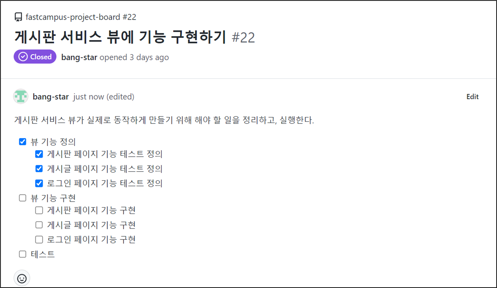
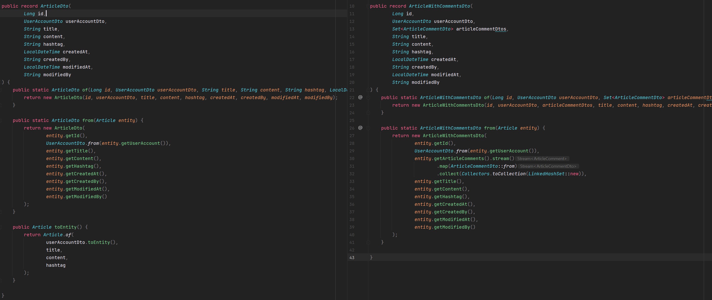
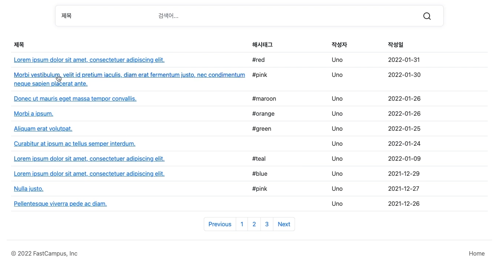
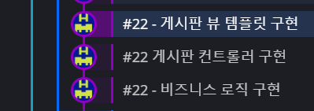

## **게시판 페이지 기능 구현**

---



게시판, 게시글, 로그인 페이지에 대한 기능 테스트 정의를 완료하였고, 본격적으로 기능을 구현할 것이다.

테스트는 기능 구현을 하면서 함께할 것이다.

현재 브랜치에 변경점이 많기 때문에 분산해서 코드 리뷰를 쉽게 할 수 있는 방안이 필요하다...

방법은 따로 정리해두었습니다. ▶ **[이슈에 변경점이 많다면??](tistory-250.html)**

### **Service**

---

#### **검색**

**테스트 코드**

```java
@DisplayName("검색어 없이 게시글을 검색하면, 게시글 리스트를 반환한다.")
@Test
void givenSearchParameters_whenSearchingArticles_thenReturnsArticleList() {
    // Given
    Pageable pageable = Pageable.ofSize(20);
    given(articleRepository.findAll(pageable)).willReturn(Page.empty());

    // When
    Page<ArticleDto> articles = sut.searchArticles(null, null, pageable);

    // Then
    assertThat(articles).isEmpty();
    then(articleRepository).should().findAll(pageable);
}

@DisplayName("검색어와 함께 게시글을 검색하면, 게시글 페이지를 반환한다.")
@Test
void givenSearchParameters_whenSearchingArticles_thenReturnsArticlePage() {
    // Given
    SearchType searchType = SearchType.TITLE;
    String searchKeyword = "title";
    Pageable pageable = Pageable.ofSize(20);
    given(articleRepository.findByTitleContaining(searchKeyword, pageable)).willReturn(Page.empty());

    // When
    Page<ArticleDto> articles = sut.searchArticles(searchType, searchKeyword, pageable);

    // Then
    assertThat(articles).isEmpty();
    then(articleRepository).should().findByTitleContaining(searchKeyword, pageable);
}
```

**서비스 구현**

```java
@Transactional(readOnly = true)
public Page<ArticleDto> searchArticles(SearchType searchType, String searchKeyword, Pageable pageable) {
    if (searchKeyword == null || searchKeyword.isBlank()) {
        return articleRepository.findAll(pageable).map(ArticleDto::from);
    }

    return switch (searchType) {
        case TITLE -> articleRepository.findByTitleContaining(searchKeyword, pageable).map(ArticleDto::from);
        case CONTENT -> articleRepository.findByContentContaining(searchKeyword, pageable).map(ArticleDto::from);
        case ID -> articleRepository.findByUserAccount_UserIdContaining(searchKeyword, pageable).map(ArticleDto::from);
        case NICKNAME -> articleRepository.findByUserAccount_NicknameContaining(searchKeyword, pageable).map(ArticleDto::from);
        case HASHTAG -> articleRepository.findByHashtag("#" + searchKeyword, pageable).map(ArticleDto::from);
    };
}
```

```java
@RepositoryRestResource
public interface ArticleRepository extends
        JpaRepository<Article, Long>,
        QuerydslPredicateExecutor<Article>,
        QuerydslBinderCustomizer<QArticle> {

    Page<Article> findByTitleContaining(String title, Pageable pageable);
    Page<Article> findByContentContaining(String content, Pageable pageable);
    Page<Article> findByUserAccount_UserIdContaining(String userId, Pageable pageable);
    Page<Article> findByUserAccount_NicknameContaining(String nickname, Pageable pageable);
    Page<Article> findByHashtag(String hashtag, Pageable pageable);

    @Override
    default void customize(QuerydslBindings bindings, QArticle root){
        bindings.excludeUnlistedProperties(true);
        bindings.including(root.title, root.content, root.hashtag, root.createdAt, root.createdBy);
        bindings.bind(root.title).first(StringExpression::containsIgnoreCase);      // like '${v}$'
        bindings.bind(root.content).first(StringExpression::containsIgnoreCase);
        bindings.bind(root.hashtag).first(StringExpression::containsIgnoreCase);
        bindings.bind(root.createdAt).first(DateTimeExpression::eq);
        bindings.bind(root.createdBy).first(StringExpression::containsIgnoreCase);
    }
}
```

> **\* 검색어가 없거나 빈 문자열인 경우, 전체 페이지에 대한 페이징 쿼리를 반환해준다.**  
> → findAll()의 Page를 반환하는데 Page 내부 map 메서드를 통해 Article을 ArticleDto로 형 변환  
>   
> ****\***검색어가 있는 경우, 검색 타입에 따라 다른 Query를 생성한다.  
> →** Enum Type에 따른 다른 결과를 Query를 생성  
> → Exact Matching이 아닌 부분 매칭이 가능하도록 Containg 추가  
>   
> ****\***해시태그 검색 시, #은 자동으로 붙여지도록 한다.** ****\***Service는 Article과 ArticleDto까지 알고, Controller에서 어떤 데이터를 보여줄지는 알지 못한다.  
> **\***Service 코드에서 Entity 정보를 노출되지 않고 있다.**

---

#### **조회 -** **게시글 단건 조회**

```java
@DisplayName("게시글을 조회하면, 게시글을 반환한다.")
@Test
void givenArticleId_whenSearchingArticle_thenReturnsArticle() {
    // Given
    Long articleId = 1L;
    Article article = createArticle();
    given(articleRepository.findById(articleId)).willReturn(Optional.of(article));

    // When
    ArticleWithCommentsDto dto = sut.getArticle(articleId);

    // Then
    assertThat(dto)
            .hasFieldOrPropertyWithValue("title", article.getTitle())
            .hasFieldOrPropertyWithValue("content", article.getContent())
            .hasFieldOrPropertyWithValue("hashtag", article.getHashtag());
    then(articleRepository).should().findById(articleId);
}

@DisplayName("없는 게시글을 조회하면, 예외를 던진다.")
@Test
void givenNonexistentArticleId_whenSearchingArticle_thenThrowsException() {
    // Given
    Long articleId = 0L;
    given(articleRepository.findById(articleId)).willReturn(Optional.empty());

    // When
    Throwable t = catchThrowable(() -> sut.getArticle(articleId));

    // Then
    assertThat(t)
            .isInstanceOf(EntityNotFoundException.class)
            .hasMessage("게시글이 없습니다 - articleId: " + articleId);
    then(articleRepository).should().findById(articleId);
}
```

```java
@RequiredArgsConstructor
@Transactional
@Service
public class ArticleService {
    private final ArticleRepository articleRepository;

    @Transactional(readOnly = true)
    public ArticleWithCommentsDto getArticle(Long articleId) {
        return articleRepository.findById(articleId)
                .map(ArticleWithCommentsDto::from)
                .orElseThrow(() -> new EntityNotFoundException("게시글이 없습니다 - articleId: " + articleId));
    }
}
```

* **게시글 단건 조회 시 해당 게시글에 대한 댓글을 함께 불러올 수 있는 ArticleWithCommentsDto 사용**

**ArticleDto VS ArticleWithCommentsDto**



> \* Domain에 있었던 articleCommentsDtos가 추가  
> \* entity로부터 변환할 때, entity에서 ArticleComments를 불러오고 stream 해서 ArticleCommentDto로 변환해서 동일한 타입으로 넣어주는 방식 추가  
>   
> 즉 댓글 Collection이 추가된 것 외에는 동일하다.

---

#### **게시글 저장**

```java
@DisplayName("게시글 정보를 입력하면, 게시글을 생성한다.")
@Test
void givenArticleInfo_whenSavingArticle_thenSavesArticle() {
    // Given
    ArticleDto dto = createArticleDto();
    given(articleRepository.save(any(Article.class))).willReturn(createArticle());

    // When
    sut.saveArticle(dto);

    // Then
    then(articleRepository).should().save(any(Article.class));
}
```

```java
public void saveArticle(ArticleDto dto) {
    articleRepository.save(dto.toEntity());
}
```

---

#### **게시글 수정**

```java
@DisplayName("게시글의 수정 정보를 입력하면, 게시글을 수정한다.")
@Test
void givenModifiedArticleInfo_whenUpdatingArticle_thenUpdatesArticle() {
    // Given
    Article article = createArticle();
    ArticleDto dto = createArticleDto("새 타이틀", "새 내용", "#springboot");
    given(articleRepository.getReferenceById(dto.id())).willReturn(article);

    // When
    sut.updateArticle(dto);

    // Then
    assertThat(article)
            .hasFieldOrPropertyWithValue("title", dto.title())
            .hasFieldOrPropertyWithValue("content", dto.content())
            .hasFieldOrPropertyWithValue("hashtag", dto.hashtag());
    then(articleRepository).should().getReferenceById(dto.id());
}

@DisplayName("없는 게시글의 수정 정보를 입력하면, 경고 로그를 찍고 아무 것도 하지 않는다.")
@Test
void givenNonexistentArticleInfo_whenUpdatingArticle_thenLogsWarningAndDoesNothing() {
    // Given
    ArticleDto dto = createArticleDto("새 타이틀", "새 내용", "#springboot");
    given(articleRepository.getReferenceById(dto.id())).willThrow(EntityNotFoundException.class);

    // When
    sut.updateArticle(dto);

    // Then
    then(articleRepository).should().getReferenceById(dto.id());
}
```

```java
public void updateArticle(ArticleDto dto) {
    try {
        Article article = articleRepository.getReferenceById(dto.id());
        if (dto.title() != null) { article.setTitle(dto.title()); }
        if (dto.content() != null) { article.setContent(dto.content()); }
        article.setHashtag(dto.hashtag());
    } catch (EntityNotFoundException e) {
        log.warn("게시글 업데이트 실패. 게시글을 찾을 수 없습니다 - dto: {}", dto);
    }
}
```

> **\* 수정 작업 시, findById()를 사용하는 것은 비효율적이므로 getReferenceById()를 사용하였다.**  
> **\* Not Null 필드인 title, content에 대하여 Null인지 검사함.**  
> **\* Record으로 사용하기 때문에 get이 붙지 않은 getter를 사용하고 있음.**  
> **\* save 메서드를 명시하지 않는다.**  
> Class level에 있는 @Transactional에 의해서 메소드 단위로 Transactional이 묶여 있다. 그래서 Transactional 끝날 때 영속성 콘텍스트는 article이 끝난 것을 감지해낸다. 감지 분에 대해서 Query를 날리기 때문에 내부적으로 update Query가 실행이 되기 때문에 save 메서드를 명시할 필요가 없다.  
> **\* getReferenceId를 이용하여 없는 게시글 Id에 대해 에러가 발생하는지 여부를 판단할 수 있음.**  
>   
> [**참고**] [findById vs getReferenceById()](tistory-251.html)

### **Controller**

---

#### **ArticleControllerTest**

**ArticleController**

```java
package com.fastcampus.projectboard.controller;

@RequiredArgsConstructor
@RequestMapping("/articles")
@Controller
public class ArticleController {

    private final ArticleService articleService;

    @GetMapping
    public String articles(
            @RequestParam(required = false) SearchType searchType,
            @RequestParam(required = false) String searchValue,
            @PageableDefault(size = 10, sort="createdAt", direction = Sort.Direction.DESC) Pageable pageable,
            ModelMap map
    ){
        map.addAttribute("articles", articleService.searchArticles(searchType, searchValue, pageable).map(ArticleResponse::from));

        return "articles/index";
    }

    @GetMapping("/{articleId}")
    public String article(@PathVariable Long articleId, ModelMap map){
        ArticleWithCommentsResponse article = ArticleWithCommentsResponse.from(articleService.getArticle(articleId));
        map.addAttribute("article", article);
        map.addAttribute("articleComments",article.articleCommentsResponse());

        return "articles/detail";
    }
}
```

**ArticleControllerTest**

```java
@DisplayName("View 컨트롤러 - 게시글")
@Import(SecurityConfig.class)
@WebMvcTest(ArticleController.class)
class ArticleControllerTest {

    private final MockMvc mvc;

    @MockBean private ArticleService articleService;

    public ArticleControllerTest(@Autowired MockMvc mvc) {
        this.mvc = mvc;
    }

    @DisplayName("[view][GET] 게시글 리스트 (게시판) 페이지 - 정상 호출")
    @Test
    void givenNothing_whenRequestingArticlesView_thenReturnsArticlesView() throws Exception {
        // Given
        given(articleService.searchArticles(eq(null), eq(null), any(Pageable.class))).willReturn(Page.empty());

        // When & Then
        mvc.perform(get("/articles"))
                .andExpect(status().isOk())
                .andExpect(content().contentTypeCompatibleWith(MediaType.TEXT_HTML))
                .andExpect(view().name("articles/index"))
                .andExpect(model().attributeExists("articles"));

        then(articleService).should().searchArticles(eq(null), eq(null), any(Pageable.class));
    }

    @DisplayName("[view][GET] 게시글 상세 페이지 - 정상 호출")
    @Test
    void givenNothing_whenRequestingArticleView_thenReturnsArticleView() throws Exception {
        // Given
        Long articleId = 1L;
        given(articleService.getArticle(articleId)).willReturn(createArticleWithCommentsDto());

        // When & Then
        mvc.perform(get("/articles/"+articleId))
                .andExpect(status().isOk())
                .andExpect(content().contentTypeCompatibleWith(MediaType.TEXT_HTML))
                .andExpect(view().name("articles/detail"))
                .andExpect(model().attributeExists("article"))
                .andExpect(model().attributeExists("articleComments"));

        then(articleService).should().getArticle(articleId);
    }

    @Disabled("구현 중")
    @DisplayName("[view][GET] 게시글 검색 전용 페이지 - 정상 호출")
    @Test
    void givenNothing_whenRequestingArticleSearchView_thenReturnsArticleSearchView() throws Exception {
        // Given

        // When & Then
        mvc.perform(get("/articles/search"))
                .andExpect(status().isOk())
                .andExpect(content().contentTypeCompatibleWith(MediaType.TEXT_HTML))
                .andExpect(view().name("articles/search"));
    }

    @Disabled("구현 중")
    @DisplayName("[view][GET] 게시글 해시태그 검색 페이지 - 정상 호출")
    @Test
    void givenNothing_whenRequestingArticleHashtagSearchView_thenReturnsArticleHashtagSearchView() throws Exception {
        // Given

        // When & Then
        mvc.perform(get("/articles/search-hashtag"))
                .andExpect(status().isOk())
                .andExpect(content().contentTypeCompatibleWith(MediaType.TEXT_HTML))
                .andExpect(view().name("articles/search-hashtag"));
    }

    private ArticleWithCommentsDto createArticleWithCommentsDto() {
        return ArticleWithCommentsDto.of(
                1L,
                createUserAccountDto(),
                Set.of(),
                "title",
                "content",
                "#java",
                LocalDateTime.now(),
                "artist",
                LocalDateTime.now(),
                "artist"
        );
    }

    private UserAccountDto createUserAccountDto() {
        return UserAccountDto.of(1L,
                "artist",
                "pw",
                "artist@mail.com",
                "artist",
                "memo",
                LocalDateTime.now(),
                "artist",
                LocalDateTime.now(),
                "artist"
        );
    }
}
```

* **@MockBean**Controller 테스트에서 API 입출력만 보기 위해 Controller에 Service와의 연결을 끊기 위해 사용됨.
  + Spring Test 도구에서 주는 것이고 내부 구조는 Mockito이다.
  + Slice 테스트에서 사용하면 된다.
  + 생성자 주입을 지원하지 않고 타입과 필드에 대해서만 지원한다.
* [**Mokito ArgumentMather 사용**](https://www.digitalocean.com/community/tutorials/mockito-argument-matchers-any-eq)
  + **eq**
  + **any**
* **Fixture를 사용하여 테스트 용에 Dto 생성**
  + createArticleWithCommentsDto()
  + createUserAccountDto()
* **@PageableDefault**명시 차원에서 협업에 도움이 될 수 있도록 하기 위해 값을 넣음.

### **View Template**

---

**게시판 페이지**

```html
<!DOCTYPE html>
<html lang="ko">
<head>
    <meta charset="UTF-8">
    <meta name="viewport" content="width=device-width, initial-scale=1">
    <meta name="description" content="">
    <meta name="author" content="Artist Bang">
    <title>게시판 페이지</title>

    <link href="https://cdn.jsdelivr.net/npm/bootstrap@5.2.0-beta1/dist/css/bootstrap.min.css" rel="stylesheet" integrity="sha384-0evHe/X+R7YkIZDRvuzKMRqM+OrBnVFBL6DOitfPri4tjfHxaWutUpFmBp4vmVor" crossorigin="anonymous">
    <link href="/css/search-bar.css" rel="stylesheet">
</head>

<body>

    <header id="header">
        헤더 삽입부
        <hr>
    </header>

    <main class="container">

        <div class="row">
            <div class="card card-margin search-form">
                <div class="card-body p-0">
                    <form id="card search-form">
                        <div class="row">
                            <div class="col-12">
                                <div class="row no-gutters">
                                    <div class="col-lg-3 col-md-3 col-sm-12 p-0">
                                        <label for="search-type" hidden>검색 유형</label>
                                        <select class="form-control" id="search-type">
                                            <option>제목</option>
                                            <option>본문</option>
                                            <option>id</option>
                                            <option>닉네임</option>
                                            <option>해시태그</option>
                                        </select>
                                    </div>
                                    <div class="col-lg-8 col-md-6 col-sm-12 p-0">
                                        <label for="search-value" hidden>검색어</label>
                                        <input type="text" placeholder="검색어..." class="form-control" id="search-value" name="search-value">
                                    </div>
                                    <div class="col-lg-1 col-md-3 col-sm-12 p-0">
                                        <button type="submit" class="btn btn-base">
                                            <svg xmlns="http://www.w3.org/2000/svg" width="24" height="24" viewBox="0 0 24 24" fill="none" stroke="currentColor" stroke-width="2" stroke-linecap="round" stroke-linejoin="round" class="feather feather-search">
                                                <circle cx="11" cy="11" r="8"></circle>
                                                <line x1="21" y1="21" x2="16.65" y2="16.65"></line>
                                            </svg>
                                        </button>
                                    </div>
                                </div>
                            </div>
                        </div>
                    </form>
                </div>
            </div>
        </div>

        <table class="table" id="article-table">
            <thead>
            <tr>
                <th class="title col-6">제목</th>
                <th class="hashtag col-2">해시태그</th>
                <th class="user-id col">작성자</th>
                <th class="created-at col">작성일</th>
            </tr>
            </thead>
            <tbody>
            <tr>
                <td class="title"><a>첫글</a></td>
                <td class="hashtag">#java</td>
                <td class="user-id">Uno</td>
                <td class="created-at"><time>2022-01-01</time></td>
            </tr>
            <tr>
                <td>두번째글</td>
                <td>#spring</td>
                <td>Artist</td>
                <td><time>2022-01-02</time></td>
            </tr>
            <tr>
                <td>세번째글</td>
                <td>#java</td>
                <td>Artist</td>
                <td><time>2022-01-03</time></td>
            </tr>
            </tbody>
        </table>

        <nav aria-label="Page navigation example">
            <ul class="pagination justify-content-center">
                <li class="page-item"><a class="page-link" href="#">Previous</a></li>
                <li class="page-item"><a class="page-link" href="#">1</a></li>
                <li class="page-item"><a class="page-link" href="#">2</a></li>
                <li class="page-item"><a class="page-link" href="#">3</a></li>
                <li class="page-item"><a class="page-link" href="#">Next</a></li>
            </ul>
        </nav>
    </main>

    <footer id="footer">
        <hr>
        푸터 삽입부
    </footer>

<script src="https://cdn.jsdelivr.net/npm/bootstrap@5.2.0-beta1/dist/js/bootstrap.bundle.min.js" integrity="sha384-pprn3073KE6tl6bjs2QrFaJGz5/SUsLqktiwsUTF55Jfv3qYSDhgCecCxMW52nD2" crossorigin="anonymous"></script>
</body>
</html>
```

**게시판 페이지에 로직**

```html
<?xml version="1.0"?>
<thlogic>
    <attr sel="#header" th:replace="header :: header" />
    <attr sel="#footer" th:replace="footer :: footer" />

    <attr sel="#article-table">
        <attr sel="tbody" th:remove="all-but-first">
            <attr sel="tr[0]" th:each="article : ${articles}">
                <attr sel="td.title/a" th:text="${article.title}" th:href="@{'/articles/' + ${article.id}}" />
                <attr sel="td.hashtag" th:text="${article.hashtag}" />
                <attr sel="td.user-id" th:text="${article.nickname}" />
                <attr sel="td.created-at/time" th:datetime="${article.createdAt}" th:text="${#temporals.format(article.createdAt, 'yyyy-MM-dd')}" />
            </attr>
        </attr>
    </attr>
</thlogic>
```

* table에 id를 설정하고 첫 번째 글 기반으로 게시글을 정보를 출력함.  
  + **th:remove="all-but-first"** - 테이블에 첫번째 글을 제외한 내용을 제거.
  + **th:each="article: ${articles}"** - modelmap으로 삽입되는 articles정보를 foreach로 반복해서 출력.
  + **th:href="@{'/articles/' + ${article.id}}"** - 게시글 아이디를 href 값으로 설정
  + **th:text="${#temporals.format(article.createdAt, 'yyyy-MM-dd')}"** - temporals.format을 사용하여 작성일자를 표시



데이터 베이스로부터 게시글 정보를 받아서 게시판 서비스가 완성된 것을 확인할 수 있다.

**Commit으로 바라보는 작업 리스트**


