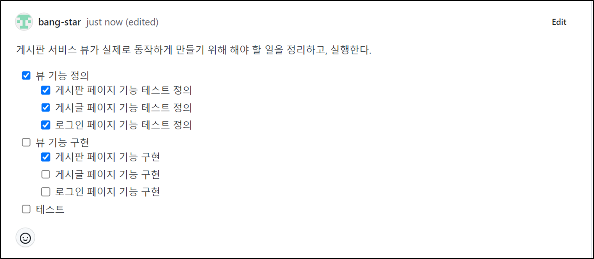
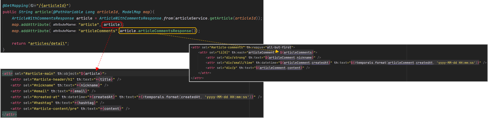
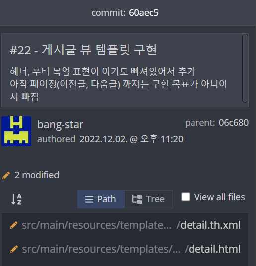
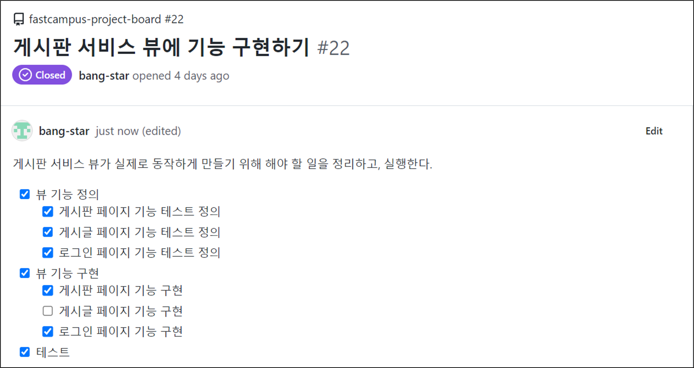
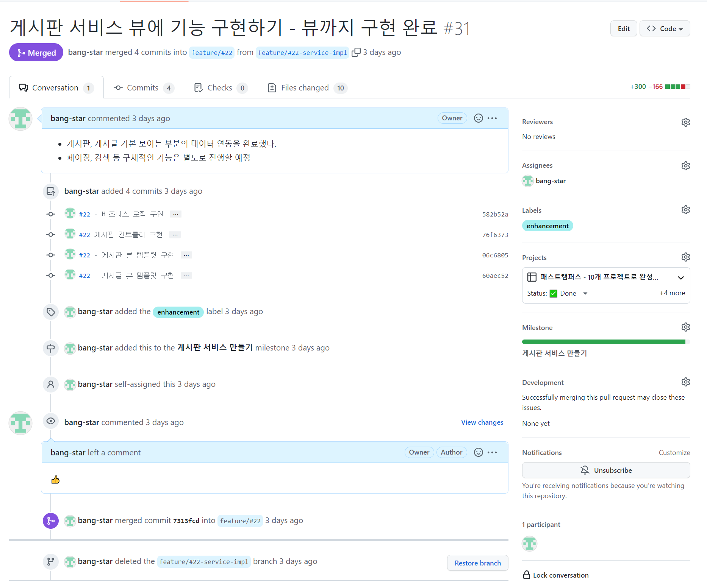
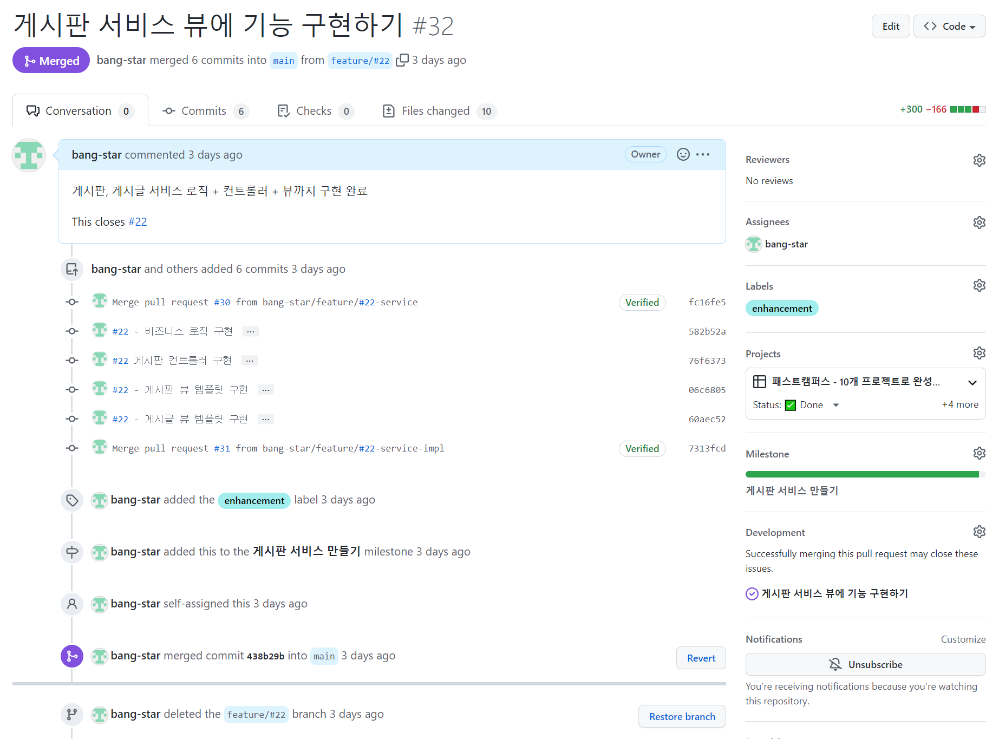
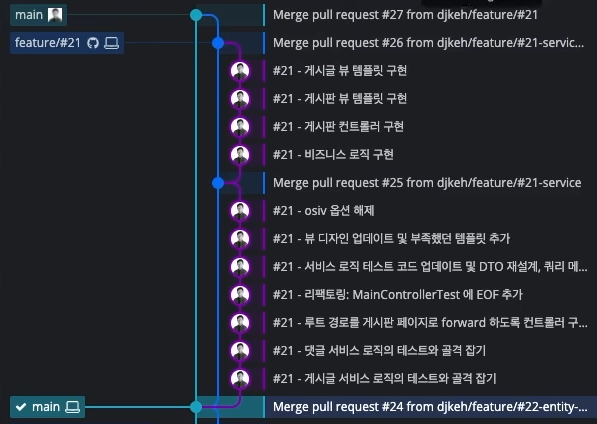

## **뷰 기능 구현**

---



게시판 페이지 기능 구현이 완료되었고, 게시글 페이지와 로그인 페이지 기능 구현이 남은 상태이다.

### **게시글 페이지 기능 구현**

---

서비스 코드에서 기본 기능 CRUD를 모두 구현하고 테스트를 통과시켰었다. 그리고 기능을 Controller에 있는 것까지 전부 완료하였다. 서비스 코드, 비즈니스 코드와 Controller가 완성된 상태이기 때문에 View 작업만 하면 된다.

```html
<!DOCTYPE html>
<html lang="ko">
<head>
    <meta charset="UTF-8">
    <meta name="viewport" content="width=device-width, initial-scale=1">
    <meta name="description" content="">
    <meta name="author" content="Artist Bang">
    <title>게시글 페이지</title>

    <link href="https://cdn.jsdelivr.net/npm/bootstrap@5.2.0-beta1/dist/css/bootstrap.min.css" rel="stylesheet" integrity="sha384-0evHe/X+R7YkIZDRvuzKMRqM+OrBnVFBL6DOitfPri4tjfHxaWutUpFmBp4vmVor" crossorigin="anonymous">
    <link href="/css/articles/article-content.css" rel="stylesheet">
</head>

<body>

    <header id="header">
        헤더 삽입부
        <hr>
    </header>

    <main id="article-main" class="container">
        <header id="article-header" class="py-5 text-center">
            <h1>첫번째 글</h1>
        </header>

        <div class="row g-5">
            <section class="col-md-5 col-lg-4 order-md-last">
                <aside>
                    <p><span id="nickname">Artist</span></p>
                    <p><a id="email" href="mailto:artist@gmail.com">artist@mail.com</a></p>
                    <p><time id="created-at" datetime="2022-01-01T00:00:00">2022-01-01</time></p>
                    <p><span id="hashtag">#java</span></p>
                </aside>
            </section>

            <article id="article-content" class="col-md-7 col-lg-8">
                <pre>본문<br><br></pre>
            </article>
        </div>

        <div class="row g-5">
            <section>
                <form class="row g-3">
                    <div class="col-8">
                        <label for="comment-textbox" hidden>댓글</label>
                        <textarea class="form-control" id="comment-textbox" placeholder="댓글 쓰기.." rows="3"></textarea>
                    </div>
                    <div class="col-auto">
                        <label for="comment-submit" hidden>댓글 쓰기</label>
                        <button class="btn btn-primary" id="comment-submit" type="submit">쓰기</button>
                    </div>
                </form>

                <ul id="article-comments" class="row col-7">
                    <li>
                        <div>
                            <strong>Artist</strong>
                            <small><time>2022-01-01</time></small>
                            <p>
                                Lorem ipsum dolor sit amet, consectetur adipiscing elit.<br>
                                Lorem ipsum dolor sit amet
                            </p>
                        </div>
                    </li>
                    <li>
                        <div>
                            <strong>Artist</strong>
                            <small><time>2022-01-01</time></small>
                            <p>
                                Lorem ipsum dolor sit amet, consectetur adipiscing elit.<br>
                                Lorem ipsum dolor sit amet
                            </p>
                        </div>
                    </li>
                </ul>

            </section>
        </div>

        <div class="row g-5">
            <nav aria-label="Page navigation example">
                <ul class="pagination">
                    <li class="page-item">
                        <a class="page-link" href="#" aria-label="Previous">
                            <span aria-hidden="true">&laquo; prev</span>
                        </a>
                    </li>
                    <li class="page-item">
                        <a class="page-link" href="#" aria-label="Next">
                            <span aria-hidden="true">next &raquo;</span>
                        </a>
                    </li>
                </ul>
            </nav>
        </div>

    </main>

    <footer id="footer">
       <hr>
       푸터 삽입부
    </footer>

    <script src="https://cdn.jsdelivr.net/npm/bootstrap@5.2.0-beta1/dist/js/bootstrap.bundle.min.js" integrity="sha384-pprn3073KE6tl6bjs2QrFaJGz5/SUsLqktiwsUTF55Jfv3qYSDhgCecCxMW52nD2" crossorigin="anonymous"></script>
</body>
</html>
```

* **header, footer에 Mockup에 화면 구성**  
  서버를 키지 않고도 순수 HTML파일을 통해 페이지 구도를 이해할 수 있게 표현하기 위함.
* **main과 main-header에 id 값 부여**  
  main 내부 header에 이름 치환을 위함.
* **게시글 작성자 정보를 넣기 위해 id 값 부여**div-section 내부 aside태그안에 값들에 대하여 id설정
* **본문(article 태그)에 해당하는 정보를 넣기 위해 id 값 부여**
* **댓글 정보를 넣기 위해 id 값 부여(article-comments)**



* **타임리프 문법에 th:object 사용하여 생략문법(article.title to title) 사용.**  
  AS-IS : th:text="${article.title}"  // th-object 필요 없음.  
  TO-BE : th:text="\*{title}"
* **댓글의 경우, 아이디로 Select하고 반복문을 사용할 것이라 th:remove옵션을 통해 첫번째 li를 제외하고 제거.**
* **th:each를 사용하여 반복문을 사용.**

**Commit**



### **로그인 페이지 기능 구현**

---

Spring Security에서 기본 로그인 페이지를 제공하는 것을 사용하기 때문에 로그인 페이지는 이미 구현이 되어 있다.

기능은 인증 기능을 구현하면서 들어갈 예정이다.



테스트는 테스트 정의 및 기능을 구현하면서 동시에 하여 작업이 완료되었다.

### **Push And Merge**

---

#### **Feature/#22-service-impl to Feature/#22**

Merge되는 base 브랜치는 main이 아닌 부모 브랜치로 설정하였던 feature/#22로 설정



---

#### **Feature/#22 to main**

**feature/#22에 저장된 모든 변경점을 main 브랜치로 Merge**



**Commit으로 바라보는 작업내용**


