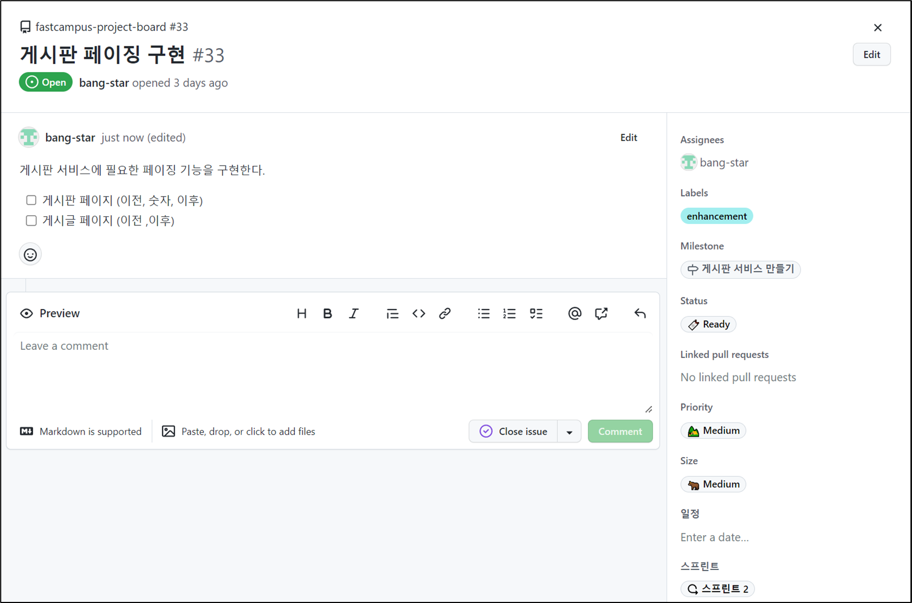
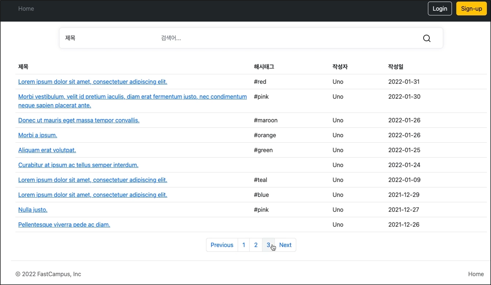
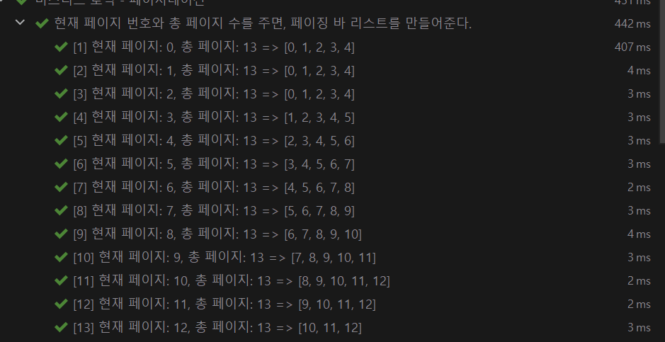

## **게시판 페이징 구현**

---



### **구상**

---



페이지네이션 바를 구현하는 방법은 여러가지가 있는데, 그중에서 중간 숫자가 현재 페이지가 되도록 할 것이다.

예시로 현재 페이지가 3페이지이고 페이지네이션 바의 크기는 5개이다.

현재 페이지가 3으로 1, 2, **3**, 4, 5과 같이 현재 페이지의 숫자가 페이지네이션 바에 중간에 배치되도록할 것이다.

### **로직을 어떻게 설계할까?**

---

* Utility 클래스로 만드는 방법
* 페이지네이션 바에 정보를 하나의 정보로 보고 도메인 Object로 설계하는 방법
* Spring Service 빈으로 등록하여 사용하는 방법 ✔

#### **Service Bean 등록하기**

```java
@Service
public class PaginationService {}
```

---

#### **페이지네이션 바**

* 페이지네이비션 바의 길이 설정
* 페이지네이션 바에 대한 정보는 List 형태에 숫자로 내려주면 된다.

```java
@Service
public class PaginationService {

    private static final int BAR_LENGTH = 5;

    public List<Integer> getPaginationBarNumbers(int currentPageNumber, int totalPages){
        return null;
    }

    public int currentBarLength(){
        return BAR_LENGTH;
    }
}
```

> **필요한 데이터**: 현재 페이지, 전체 페이지 수

---

**페이지네이션 서비스에 대한 테스트 작성**

```java
@DisplayName("비즈니스 로직 - 페이지네이션")
@SpringBootTest(webEnvironment = SpringBootTest.WebEnvironment.NONE, classes = PaginationService.class)
class PaginationServiceTest {

    // #1. 생성자 주입
    private final PaginationService sut;

    public PaginationServiceTest(@Autowired PaginationService paginationService) {
        this.sut = paginationService;
    }
}
```

> **#1. 생성자 주입**   
> 필요한 의존성이 없기 때문에 PagenationService를 new 하여 생성하여도 문제 없다.  
>   
>  **#2. SpringBootTest 옵션 설정**
>
> * webEnvironment = SpringBootTest.WebEnvironment.NONE 으로 설정하여 테스트 경량화
> * classes = PaginationService.class 은 기본 값으로 SpringBootTestsApplication에서 시작하는 모든 빈 스캔 대상들을 Configuration으로 불러들이면서 통합테스트 역할을 하게 되는데, 원하는 클래스 빈만 불러오도록 설정하여 테스트 경령화.

**1. 현재 페이지 번호와 총 페이지 수를 주면, 페이징 바 리스트 반환하는 테스트**

```java
@DisplayName("현재 페이지 번호와 총 페이지 수를 주면, 페이징 바 리스트를 만들어준다.")
@MethodSource
@ParameterizedTest(name = "[{index}] 현재 페이지: {0}, 총 페이지: {1} => {2}")
void givenCurrentPageNumberAndTotalPages_whenCalculating_thenReturnsPaginationBarNumbers(int currentPageNumber, int totalPages, List<Integer> expected){
    // Given

    // When
    List<Integer> actual = sut.getPaginationBarNumbers(currentPageNumber, totalPages);

    //Then
    assertThat(actual).isEqualTo(expected);
}

static Stream<Arguments> givenCurrentPageNumberAndTotalPages_whenCalculating_thenReturnsPaginationBarNumbers(){
    // currentPageNumber, totalPages, expected
    return Stream.of(
      arguments(0, 13, List.of(0, 1, 2, 3, 4)),
      arguments(1, 13, List.of(0, 1, 2, 3, 4)),
      arguments(2, 13, List.of(0, 1, 2, 3, 4)),
      arguments(3, 13, List.of(1, 2, 3, 4, 5)),
      arguments(4, 13, List.of(2, 3, 4, 5, 6)),
      arguments(5, 13, List.of(3, 4, 5, 6, 7)),
      arguments(6, 13, List.of(4, 5, 6, 7, 8)),
      arguments(7, 13, List.of(5, 6, 7, 8, 9)),
      arguments(8, 13, List.of(6, 7, 8, 9, 10)),
      arguments(9, 13, List.of(7, 8, 9, 10, 11)),
      arguments(10, 13, List.of(8, 9, 10, 11, 12)),
      arguments(11, 13, List.of(9, 10, 11, 12)),
      arguments(12, 13, List.of(10, 11, 12))
    );
}
```

* **@Test 어노테이션이 아닌 @ParameterizedTest 사용하고 source는 Method 주입방식 사용**
* **테스트 데이터는 DB에 저장된 게시글 123개 기반으로 설계**
* **페이지 인덱스는 0부터 시작한다는 것을 유의하여야함.**
* **테스트 결과의 가독성을 위한 포맷팅 설정**

> **@ParameterizedTest**
>
> * 여러 argument를 이용해 동일한 테스트를 여러 번 실행하여 테스트를 할 수 있다.
> * @ParameterizedTest를 사용하기 위해서는 최소 하나의 source 어노테이션을 붙여주어야한다.
> * source 어노테이션 방법으로는 ValueSource, NullSouce, EmptySource, NullAndEmptySource, EnumSource, MethodSource, CsvSouce 등이 있다.

**2. 현재 설정되어 있는 페이지네이션 바의 길이를 알려주는 테스트**

```java
@DisplayName("현재 설정되어 있는 페이지네이션 바의 길이를 알려준다.")
@Test
void given_when_then(){
    // Given

    // When
    int barLength = sut.currentBarLength();

    //Then
    assertThat(barLength).isEqualTo(5);
}
```

**해당 테스트가 필요한 이유는?**

> 현재 페이지네이션 기능이 설정한 기본 값인 페이지네이션의 길이를 명시적으로 표현하여  
> 코드 리뷰를 하게 될 때 협업하는 동료들이 쉽게 인지할 수 있도록 하기 위함이다.

---

#### **페이지네이션 서비스 구현**

```java
@Service
public class PaginationService {

    private static final int BAR_LENGTH = 5;

    public List<Integer> getPaginationBarNumbers(int currentPageNumber, int totalPages){
        int startNumber = Math.max(currentPageNumber - (BAR_LENGTH / 2), 0);
        int endNumber = Math.min(startNumber + BAR_LENGTH, totalPages);

        return IntStream.range(startNumber, endNumber).boxed().toList();
    }

    public int currentBarLength(){
        return BAR_LENGTH;
    }
}
```

> **페이지네이션의 정보**  
>
> + **시작 번호 = 현재 페이지 - ( 페이지네이션 바의 길이 / 2)**  
>   현재 페이지가 0, 1, 2 페이지일 경우 음수가 되기 때문에 0과 비교하여 최대값으로 설정
>
> * **끝 번호 = 시작 번호와 페이지네이션 바의 길이의 합**  
>   시작번호가 8, 9, 10, 11, 12일 경우 총 페이지의 수를 벗어나기 때문에 총 페이지 수와 비교하여 최소값으로 설정

**테스트 결과**



---

#### ****ArticleController에 Pagination 적용****

****1. PaginationService 등록****

```java
class ArticleControllerTest {

    private final MockMvc mvc;

    @MockBean private ArticleService articleService;
    @MockBean private PaginationService paginationService;
}
```

****2. Pagination 적용****

```java
@DisplayName("[view][GET] 게시글 리스트 (게시판) 페이지 - 정상 호출")
@Test
void givenNothing_whenRequestingArticlesView_thenReturnsArticlesView() throws Exception {
    // Given
    given(articleService.searchArticles(eq(null), eq(null), any(Pageable.class))).willReturn(Page.empty());
    given(paginationService.getPaginationBarNumbers(anyInt(), anyInt())).willReturn(List.of(0, 1, 2, 3, 4));

    // When & Then
    mvc.perform(get("/articles"))
            .andExpect(status().isOk())
            .andExpect(content().contentTypeCompatibleWith(MediaType.TEXT_HTML))
            .andExpect(view().name("articles/index"))
            .andExpect(model().attributeExists("articles"))
            .andExpect(model().attributeExists("paginationBarNumbers"));

    then(articleService).should().searchArticles(eq(null), eq(null), any(Pageable.class));
    then(paginationService).should().getPaginationBarNumbers(anyInt(), anyInt());
}
```

* **anyInt() - getPaginationBarNumber의 인자가 Primitive 타입이기 때문에 Null이 될 수 없기 때문에 anyInt()**any()는 null이 될 수 있음을 유의해야한다.
* **paginationBarNumbers에 대한 애트리뷰트 테스트 추가**

**3. 게시글 리스트 (게시판) 페이지 - 페이징, 정렬 기능 테스트 추가**

**(1) TEST 코드**

```java
@DisplayName("[view][GET] 게시글 리스트 (게시판) 페이지 - 페이징, 정렬 기능")
@Test
void givenPagingAndSortingParams_whenRequestingArticlePage_thenReturnsArticlesPage() throws Exception {
    // Given
    String sortName = "title";
    String direction = "desc";
    int pageNumber = 0;
    int pageSize = 5;
    Pageable pageable = PageRequest.of(pageNumber, pageSize, Sort.by(Sort.Order.desc(sortName)));
    List<Integer> barNumbers = List.of(1, 2, 3, 4, 5);
    given(articleService.searchArticles(null, null, pageable)).willReturn(Page.empty());
    given(paginationService.getPaginationBarNumbers(pageable.getPageNumber(), Page.empty().getTotalPages())).willReturn(barNumbers);

    // When & Then
    mvc.perform(get("/articles")
                    .queryParam("page", String.valueOf(pageNumber))
                    .queryParam("size", String.valueOf(pageSize))
                    .queryParam("sort", sortName + "," + direction))
            .andExpect(status().isOk())
            .andExpect(content().contentTypeCompatibleWith(MediaType.TEXT_HTML))
            .andExpect(view().name("articles/index"))
            .andExpect(model().attributeExists("articles"))
            .andExpect(model().attribute("paginationBarNumbers", barNumbers));

    then(articleService).should().searchArticles(null, null, pageable);
    then(paginationService).should().getPaginationBarNumbers(pageable.getPageNumber(), Page.empty().getTotalPages());
}
```

페이징과 정렬 기능은 Page에 내장되어 있어 이미 구현된 상태로 페이징과 정렬에 대한 테스트가 가능하다.

> **Given**  
> - 정렬과 관련된 파라미터("title", "desc")  
> - 페이징과 관련된 파라미터(pageNumber, pageSize, pageable)  
> - 페이징 검증 대상(barNumbers)

**(2) 비즈니스 로직(**Controller)****

```java
@RequiredArgsConstructor
@RequestMapping("/articles")
@Controller
public class ArticleController {

    private final ArticleService articleService;
    private final PaginationService paginationService;

    @GetMapping
    public String articles(
            @RequestParam(required = false) SearchType searchType,
            @RequestParam(required = false) String searchValue,
            @PageableDefault(size = 10, sort="createdAt", direction = Sort.Direction.DESC) Pageable pageable,
            ModelMap map
    ){
        Page<ArticleResponse> articles = articleService.searchArticles(searchType, searchValue, pageable).map(ArticleResponse::from);
        List<Integer> barNumbers = paginationService.getPaginationBarNumbers(pageable.getPageNumber(), articles.getTotalPages());

        map.addAttribute("articles", articles);
        map.addAttribute("paginationBarNumbers", barNumbers);

        return "articles/index";
    }

    @GetMapping("/{articleId}")
    public String article(@PathVariable Long articleId, ModelMap map){
        ArticleWithCommentsResponse article = ArticleWithCommentsResponse.from(articleService.getArticle(articleId));
        map.addAttribute("article", article);
        map.addAttribute("articleComments",article.articleCommentsResponse());

        return "articles/detail";
    }
}
```

**(3) View**

**게시판 페이지**

```html
<nav id="pagination" aria-label="Page navigation example">
    <ul class="pagination justify-content-center">
        <li class="page-item"><a class="page-link" href="#">Previous</a></li>
        <li class="page-item"><a class="page-link" href="#">1</a></li>
        <li class="page-item"><a class="page-link" href="#">Next</a></li>
    </ul>
</nav>
```

* 1,2,3에서 1만 남긴 이유는 Previous, Next와 다르게 페이지 번호는 반복해서 사용할 수 있기 때문이다.

**Thymeleaf 로직**

```html
<attr sel="#pagination">
    <attr sel="li[0]/a"
          th:text="'previous'" th:href="@{/articles(page=${articles.number - 1})}"
          th:class="'page-link' + (${articles.number} <= 0 ? ' disabled' : '')" />
    <attr sel="li[1]" th:class="page-item" th:each="pageNumber : ${paginationBarNumbers}">
        <attr sel="a"
              th:text="${pageNumber + 1}"
              th:href="@{/articles(page=${pageNumber})}"
              th:class="'page-link' + (${pageNumber} == ${articles.number} ? ' disabled' : '')" />
    </attr>
    <attr sel="li[2]/a"
    	  th:text="'next'" th:href="@{/articles(page=${articles.number + 1})}"
          th:class="'page-link' + (${articles.number} >= ${articles.totalPages - 1} ? ' disabled' : '')" />
</attr>
```

> **1**. **Select** #pagination  
> **2**. **Select** li 태그 중 첫 번째 태그의 a태그  
>     **Set** th:text="previous", link는 @{/articles(page=${article.number - 1})}로 표기 ( `(`는 queryParameter로 됨)  
>     **IF**    article.number 가 0 이하인 경우, 비활성화(disabled)  
>   
> **3.** **Select** li 태그 중 두 번째 태그의 a태그  
>     **Set** paginationBarNumbers를 받아서 반복문을 사용하여 뿌려준다.  
>     **IF** 현재 페이지라면 비활성화(disabled)  
>   
> **4. Select** li 태그 중 세 번째 태그의 a태그  
>     **Set** th:text="next", link는 @{/articles(page=${article.number + 1})}로 표기  
>     **IF** article.number 가 총 페이지수 -1 보다 큰거나 같은 경우, 비활성화(disabled)

**❗ 작업한 내용 Commit**


