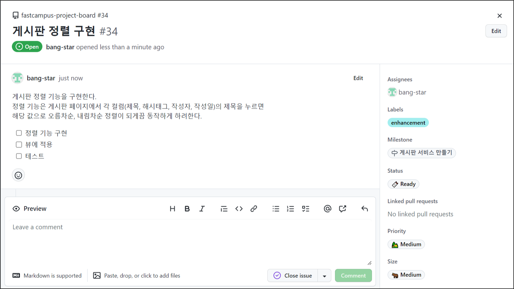
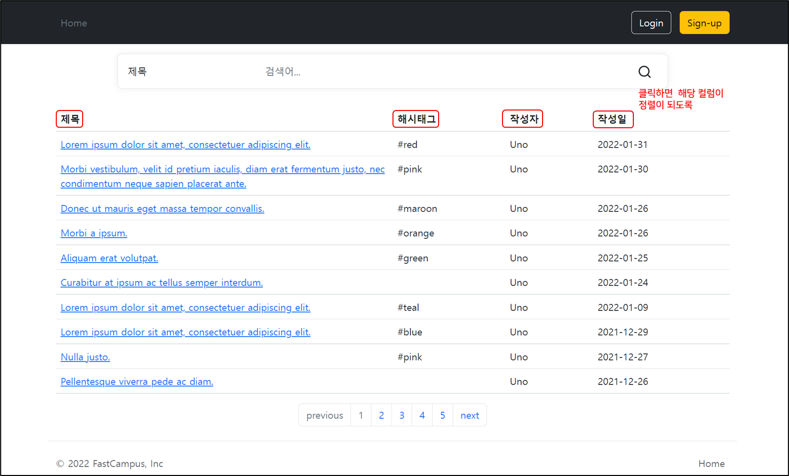
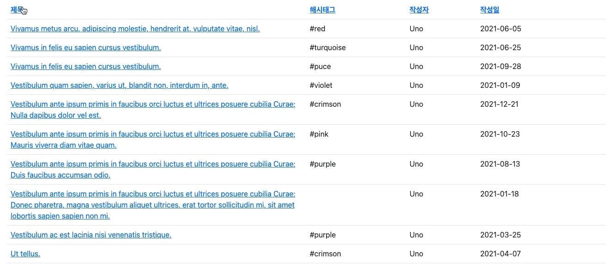
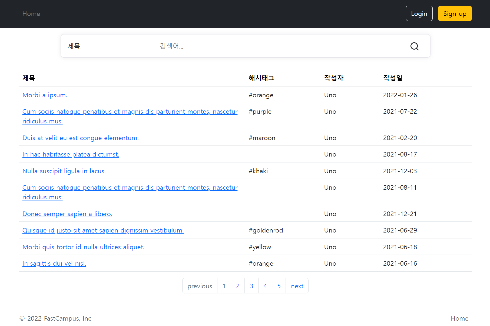

## **게시판 정렬 구현**

---



Issue 내용을 기반으로 작업을 진행할 것이다.

### **구상**

---



### **구현**

---

**현재 모든 기능에 대한 구현이 끝난 상태로, View에 적용만 하면 된다. 정렬 기능은 Spring Data에서 제공하는 Page 인터페이스를 사용함으로써 자연스럽게 Page 기능이 나올 수 있게끔 준비를 해둔상태이다.**

```java
@GetMapping
public String articles(
        @RequestParam(required = false) SearchType searchType,
        @RequestParam(required = false) String searchValue,
        @PageableDefault(size = 10, sort="createdAt", direction = Sort.Direction.DESC) Pageable pageable,
        ModelMap map
){
    Page<ArticleResponse> articles = articleService.searchArticles(searchType, searchValue, pageable).map(ArticleResponse::from);
    List<Integer> barNumbers = paginationService.getPaginationBarNumbers(pageable.getPageNumber(), articles.getTotalPages());

    map.addAttribute("articles", articles);
    map.addAttribute("paginationBarNumbers", barNumbers);

    return "articles/index";
}
```

> Page 인터페이스는 현재 페이지, 페이지와 관련된 각종 기능과 값들이 계산되어 들어가 있기 때문에 사용하기만 하면 되고 View에 표현만 해주면 된다.

**View**

```html
<table class="table" id="article-table">
    <thead>
    <tr>
        <th class="title col-6"><a>제목</a></th>
        <th class="hashtag col-2"><a>해시태그</a></th>
        <th class="user-id col"><a>작성자</a></th>
        <th class="created-at col"><a>작성일</a></th>
    </tr>
    </thead>
```

테이블의 head 부분인 **제목**, **해시태그**, **작성자**, **작성일** 을 **Clickable**하게 만들어야 하는데

각 제목은 클래스가 현재 붙어있는 상태있으므로 각 제목을 Select 해서 사용하면 된다.

**Thymeleaf 로직**

```html
    <attr sel="main" th:object="${articles}">
    <attr sel="#article-table">
        <attr sel="thead/tr">
            <attr sel="th.title/a" th:text="'제목'" th:href="@{/articles(
            page=${articles.number},
            sort='title' + (*{sort.getOrderFor('title')} != null ? (*{sort.getOrderFor('title').direction.name} != 'DESC' ? ',desc' : '') : '')
        )}"/>
            <attr sel="th.hashtag/a" th:text="'해시태그'" th:href="@{/articles(
            page=${articles.number},
            sort='hashtag' + (*{sort.getOrderFor('hashtag')} != null ? (*{sort.getOrderFor('hashtag').direction.name} != 'DESC' ? ',desc' : '') : '')
        )}"/>
            <attr sel="th.user-id/a" th:text="'작성자'" th:href="@{/articles(
            page=${articles.number},
            sort='userAccount.userId' + (*{sort.getOrderFor('userAccount.userId')} != null ? (*{sort.getOrderFor('userAccount.userId').direction.name} != 'DESC' ? ',desc' : '') : '')
        )}"/>
            <attr sel="th.created-at/a" th:text="'작성일'" th:href="@{/articles(
            page=${articles.number},
            sort='createdAt' + (*{sort.getOrderFor('createdAt')} != null ? (*{sort.getOrderFor('createdAt').direction.name} != 'DESC' ? ',desc' : '') : '')
        )}"/>
        </attr>
```

> **Select** thead에 tr 태그  
>     **Select** th태그에 클래스가 title인 줄에 a태그 선택    **Set**th:text="제목", th:href=링크  
>     **Select**th태그에 클래스가 hashtag인 줄에 a태그 선택    **Set** th:text="해시태그", th:href=링크  
>     **Select**th태그에 클래스가 user-id인 줄에 a태그 선택    **Set** th:text="작성자", th:href=링크  
>     **Select**th태그에 클래스가 created-at인 줄에 a태그 선택    **Set** th:text="작성일", th:href=링크  
>   
> **링크의 구조  
> ① th:href="@{/articles( page=${articles.number}, sort='title' + (\*{sort.getOrderFor('title')} != null ?(\*sort.getOrderFor('title').direction.name} != 'DESC' ? ',desc' : '') : ''))}**/articles에서 page 정보와 sort 정보를 새로 넣어준다.   
> **page 정보**page 정보는 articles에 같이 들어있는 페이징 정보중에 number가 있다. 그것을 이용해 현재 페이지를 알 수 있다.  
> 자바 코드에서는 articles.getNumber() 메소드를 통해 확인할 수 있는데, Thymeleaf 문법에서는 필드처럼 접근하고 있다.  
>   
> **sort 정보** sort에는 정렬하고 싶은 내용을 넣는데, sort 파라미터에 데이터와 데이터를 넣는 형식은 Spring Data에 Page 인터페이스에 의해서 기준이 정의되어 있다. 그것에 따라서 맞춰 넣어주면 된다.  
> **(코드 분석)** sort='컬럼명' + sort.getOrderFor(컬럼명)이 정렬이 되어있는지 확인하고 정렬 상태가 내림차순이 아니였다면 내림차순으로 가고, 아닐 경우 오름차순으로 가게 한다.  
>   
> \* sort는 articles에 sort를 접근한 것이다.  
> \* sort.getOrderFor()은 현재 정렬 정보를 반환한다.  
>   
> **⚠️ 주의사항**3번째 select th.user-id에서 sort를 보면 `userAcoount.userId`라고 되어있는데, Controller에서 반환해주는 형태가 ArticleResponse라고 해서 정렬할 때 ArticleResponse를 보고 참고하면 안된다. `userAcoount.userId`를 기반으로 데이터베이스에 Query를 날리는 부분은 Persistence layer에서 이뤄지기 때문이다. ArticleReponse로 받았지만 결국엔 Service에서 repository에 메소드를 사용한다. 사실 Dto들을 거쳐왔을 뿐이지 최종적으로 repository에 도달하는 내용은 도메인 코드이다. 실제 Article에서 검색하려고 하는 것은 Article 클래스에 필드들이다.   
> **정리하면 Controller가 처리하고 응답 값은 Dto가 최종적으로 View에서 받게되는 데이터인 것은 맞지만, 그렇다고 해서 뒤에서 볼때 페이징에서 사용되는 값은 같은 Dto에 적용되는 것은 아니다. 서비스 로직을 타고 내려가서 Dto를 거쳐서 실제로 paeable에 적용되고 실제 기능을 하는 것은 Repository에 영향을 미치는 것은 도메인 코드이다.**  
> `userAcoount.userId`는 Article 클래스의 userAccount 필드에 userId 값이다.



정렬이 적용된 게시판 페이지

테이블 제목이 링크가 되면서 디자인이 보기 좋지 않으므로 디자인을 수정이 필요하다.

```css
/* 게시글 테이블 제목 */
#article-table > thead a {
  text-decoration: none;
  color: black;
}
```



테이블 제목의 링크 형태에 디자인을 제거

---

> Thymeleaf 문법에 대한 이해가 부족하였던 것 같다.  
>   
> 부족한 부분이 많지만...  
>   
> 부족한 부분이 있다면!! 말씀해주세요!!  
>   
> 열심히 발전하겠습니다!  
>   
> 어제보다 발전한 나!  
>   
> 
