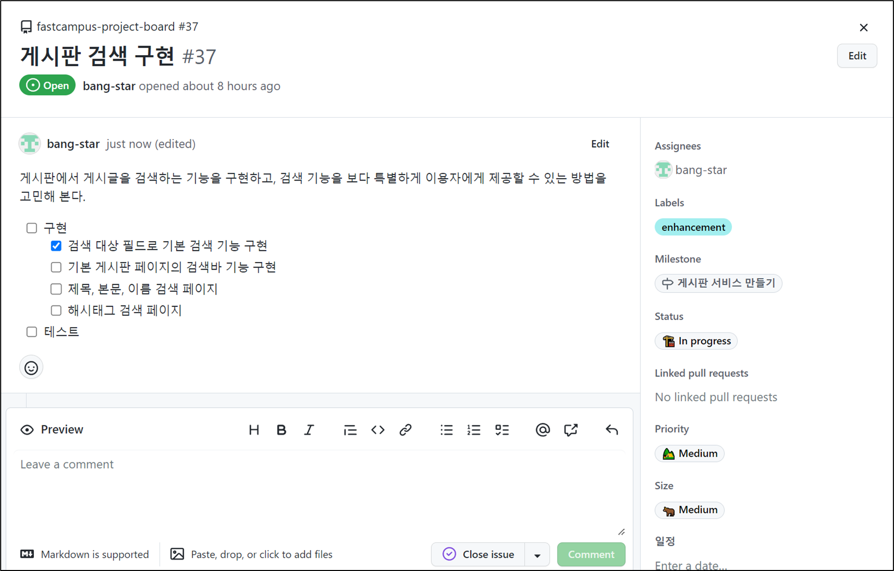
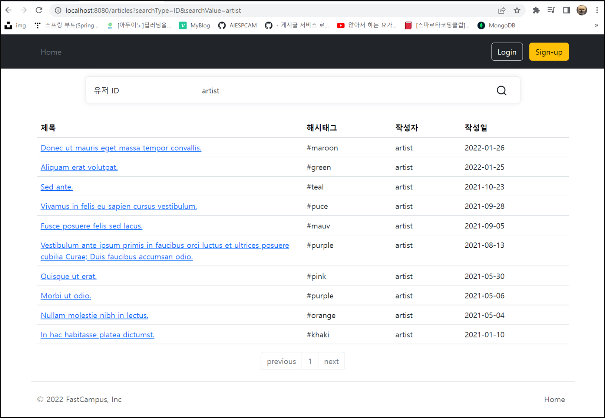
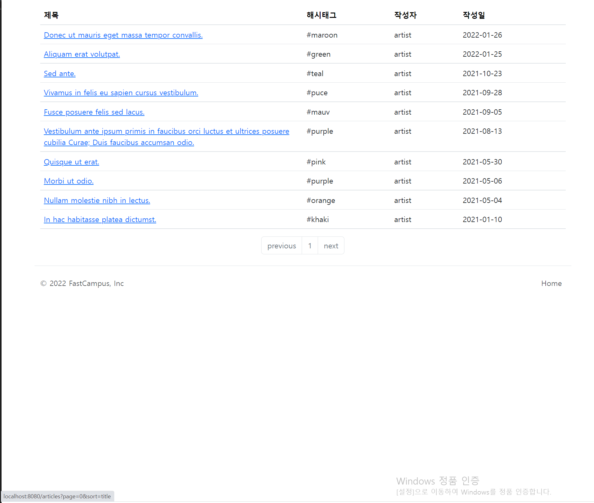
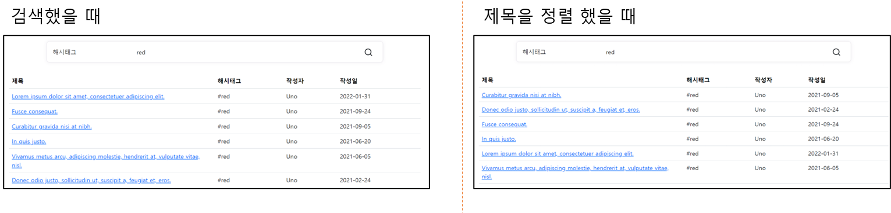
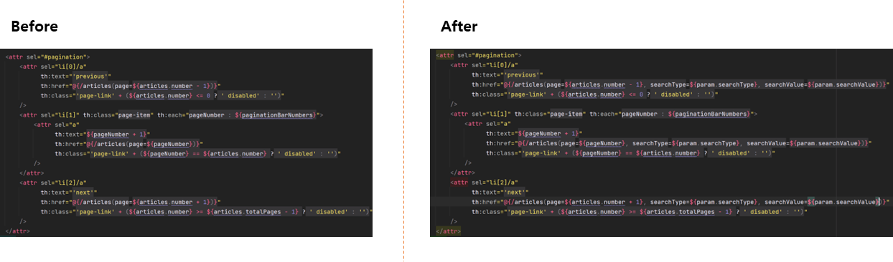
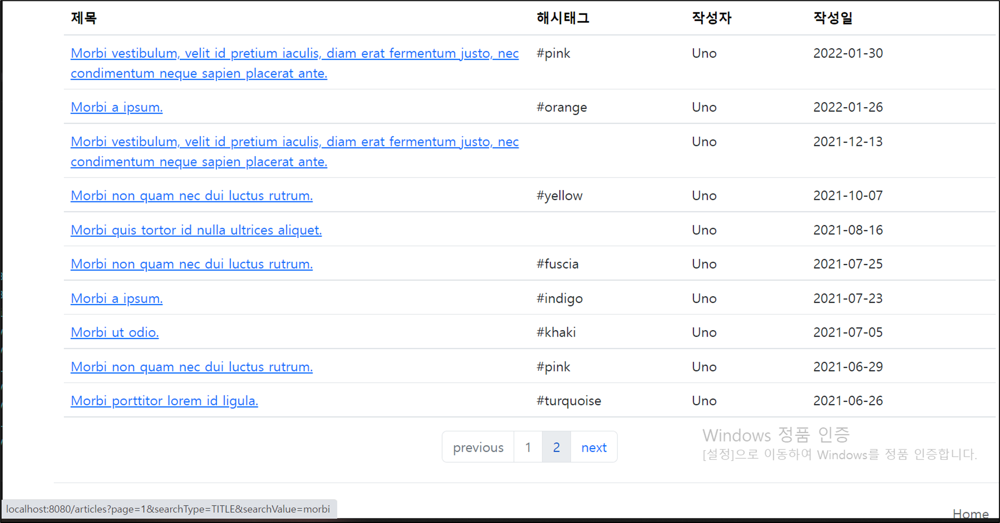

## **게시판 검색 구현**

---



**검색 대상 필드로 기본 검색 기능**은 개발을 진행하면서 완료함.

### 기본 게시판 페이지의 검색바 기능 구현

---

#### **테스트**

기존에 만들었던 게시글 리스트(게시판) 페이지 테스트 코드를 이용하여 검색할 때 테스트를 만들어보자.

```java
@DisplayName("[view][GET] 게시글 리스트 (게시판) 페이지 - 검색어 함께 호출")
@Test
void givenSearchKeyword_whenSearchingArticlesView_thenReturnsArticlesView() throws Exception {
    // Given
    SearchType searchType = SearchType.TITLE;
    String searchValue = "title";
    given(articleService.searchArticles(eq(searchType), eq(searchValue), any(Pageable.class))).willReturn(Page.empty());
    given(paginationService.getPaginationBarNumbers(anyInt(), anyInt())).willReturn(List.of(0, 1, 2, 3, 4));

    // When & Then
    mvc.perform(get("/articles")
                    .queryParam("searchType", String.valueOf(searchType))
                    .queryParam("searchValue", searchValue)
            )
            .andExpect(status().isOk())
            .andExpect(content().contentTypeCompatibleWith(MediaType.TEXT_HTML))
            .andExpect(view().name("articles/index"))
            .andExpect(model().attributeExists("articles"))
            .andExpect(model().attributeExists("searchTypes"));

    then(articleService).should().searchArticles(eq(searchType), eq(searchValue), any(Pageable.class));
    then(paginationService).should().getPaginationBarNumbers(anyInt(), anyInt());
}
```

********😧****** 변경된 점**

* **검색 기능에 초점을 맞춰진 테스트이기 때문에 Pageable에 대한 정보는 그대로 Mock을 사용한다.**
* **queryParam을 통해 searchType과 searchValue를 파라미터로 전달한다.**
* **페이지네이션은 다른 테스트에서 이미 검사하므로 삭제**  
  **Why❓** 검사하고 싶은 타겟만 구체적으로 테스트에 넣어서 테스트 분량을 최소화하고 읽는 상대방이 테스트의 목표를 이해할 수 있게끔 집중하는 하는 것도 중요하다.
* **searchType에 대한 모델 attribute 추가******Why❓**** 검색 타입에 대한 정보를 서버로 부터 내려받게 하여 변경에 용이하게 하기 위함.

---

#### **Controller**

```java
package com.fastcampus.projectboard.controller;

@RequiredArgsConstructor
@RequestMapping("/articles")
@Controller
public class ArticleController {

    private final ArticleService articleService;
    private final PaginationService paginationService;

    @GetMapping
    public String articles(
            @RequestParam(required = false) SearchType searchType,
            @RequestParam(required = false) String searchValue,
            @PageableDefault(size = 10, sort="createdAt", direction = Sort.Direction.DESC) Pageable pageable,
            ModelMap map
    ){
        Page<ArticleResponse> articles = articleService.searchArticles(searchType, searchValue, pageable).map(ArticleResponse::from);
        List<Integer> barNumbers = paginationService.getPaginationBarNumbers(pageable.getPageNumber(), articles.getTotalPages());

        map.addAttribute("articles", articles);
        map.addAttribute("paginationBarNumbers", barNumbers);
        map.addAttribute("searchTypes", SearchType.values());

        return "articles/index";
    }

    @GetMapping("/{articleId}")
    public String article(@PathVariable Long articleId, ModelMap map){
        ArticleWithCommentsResponse article = ArticleWithCommentsResponse.from(articleService.getArticle(articleId));

        map.addAttribute("article", article);
        map.addAttribute("articleComments",article.articleCommentsResponse());
        map.addAttribute("totalCount", articleService.getArticleCount());

        return "articles/detail";
    }
}
```

---

#### **View 적용**

**현재 검색 유형과 검색어가 **Mockup으로 들어가있는 상태로 이 부분을 치환해주어야 한다.****

**AS-IS**

```html
<div class="row">
    <div class="card card-margin search-form">
        <div class="card-body p-0">
            <form id="card">
                <div class="row">
                    <div class="col-12">
                        <div class="row no-gutters">
                            <div class="col-lg-3 col-md-3 col-sm-12 p-0">
                                <label for="search-type" hidden>검색 유형</label>
                                <select class="form-control" id="search-type">
                                    <option>제목</option>
                                    <option>본문</option>
                                    <option>id</option>
                                    <option>닉네임</option>
                                    <option>해시태그</option>
                                </select>
                            </div>
                            <div class="col-lg-8 col-md-6 col-sm-12 p-0">
                                <label for="search-value" hidden>검색어</label>
                                <input type="text" placeholder="검색어..." class="form-control" id="search-value" name="search-value">
                            </div>
                            <div class="col-lg-1 col-md-3 col-sm-12 p-0">
                                <button type="submit" class="btn btn-base">
                                    <svg xmlns="http://www.w3.org/2000/svg" width="24" height="24" viewBox="0 0 24 24" fill="none" stroke="currentColor" stroke-width="2" stroke-linecap="round" stroke-linejoin="round" class="feather feather-search">
                                        <circle cx="11" cy="11" r="8"></circle>
                                        <line x1="21" y1="21" x2="16.65" y2="16.65"></line>
                                    </svg>
                                </button>
                            </div>
                        </div>
                    </div>
                </div>
            </form>
        </div>
    </div>
</div>
```

**변경이 필요한 사항**

* selecting이 가능하게 하기 위해 **id**는 부여되어 있지만, 값이 전달되기 위해 **name**을 추가적으로 설정(camelCase)
* **form**에 **id**는 현재 필요하지 않으므로 제거하고 **action**과 **method** 지정
* 검색어 **input**에 **name**은 실제 데이터이므로 **camelCase**로 대응

**TO-BE**

```html
<div class="row">
            <div class="card card-margin search-form">
                <div class="card-body p-0">
                    <form action="/articles" method="get">
                        <div class="row">
                            <div class="col-12">
                                <div class="row no-gutters">
                                    <div class="col-lg-3 col-md-3 col-sm-12 p-0">
                                        <label for="search-type" hidden>검색 유형</label>
                                        <select class="form-control" id="search-type" name="searchType">
                                            <option>제목</option>
                                            <option>본문</option>
                                            <option>id</option>
                                            <option>닉네임</option>
                                            <option>해시태그</option>
                                        </select>
                                    </div>
                                    <div class="col-lg-8 col-md-6 col-sm-12 p-0">
                                        <label for="search-value" hidden>검색어</label>
                                        <input type="text" placeholder="검색어..." class="form-control" id="search-value" name="searchValue">
                                    </div>
                                    <div class="col-lg-1 col-md-3 col-sm-12 p-0">
                                        <button type="submit" class="btn btn-base">
                                            <svg xmlns="http://www.w3.org/2000/svg" width="24" height="24" viewBox="0 0 24 24" fill="none" stroke="currentColor" stroke-width="2" stroke-linecap="round" stroke-linejoin="round" class="feather feather-search">
                                                <circle cx="11" cy="11" r="8"></circle>
                                                <line x1="21" y1="21" x2="16.65" y2="16.65"></line>
                                            </svg>
                                        </button>
                                    </div>
                                </div>
                            </div>
                        </div>
                    </form>
                </div>
            </div>
        </div>
```

**View 로직 추가**

```html
<attr sel="main" th:object="${articles}">
    <attr sel="#search-type" th:remove="all-but-first">
        <attr sel="option[0]"
              th:each="searchType : ${searchTypes}"
              th:value="${searchType.name}"
              th:text="${searchType.description}"
              th:selected="${param.searchType != null && (param.searchType.toString == searchType.name)}"
        />
    </attr>
    <attr sel="#search-value" th:value="${param.searchValue}"/>

    <attr sel="#article-table">
    </attr>
    <attr sel="#pagination">
    </attr>
</attr>
```

> **1. search-type을 select 해서 option 태그 중 한개만 남기고 제거한다.**  
> **2. option에 첫번째 요소를 선택하여 model로 전달된 searchTypes를 반복문을 사용하여**  
> searchType에 name과 description을 포함하여 각각 출력한다.  
> **3. **GET파라미터에 searchType이 있을 때,** 파라미터에 searchType과 searchType.name이 같다면 **searchType으로 자동 선택****  
> 직전까지 검색했던 내용이 있다면 URI에 붙여져있을 것이고, 검색한 내용이 없다면 비어져있을 것이다.  
> 검색한 내용이 있다면 이전에 검색한 searchType.name을 선택한다는 의미이다.  
> (예시) 처음 유저 ID를 기준으로 검색하였다. 두번째 설정하지 않고 검색하면 어떻게 되는 것일까?   
> 검색한 이후에 searchType은 제목으로 돌아가 있다. 연속적으로 동일한 searchType을 검색하고 싶은데 제목으로 되돌아간다면 불편함을 느낄 수 있다. 이처럼 연속으로 검색하는 사용자를 배려하기 위해 직전에 Select했던 항목을 다음 검색에도 반영되도록 하는 작업이다.   
>   
> **4. 검색어도 3번과 동일하게 직전에 검색한 검색어를 유지하고 싶어서 파라미터에 검색어 값을 value로 설정함.**



> 만약 이 상태에서 제목을 눌러서   
> 정렬을 하고 싶다면  
> 정렬이 정상작동 될까??  
>   
> ...
>
> 
>
> 다음과 같이 예상 링크를 볼 수 있다  
>   
>  페이지와 sort 정보만 있고   
> 검색어 정보는 들어가 있지 않다.
>
> 
>
> GET Parameter에 검색 정보가 있어야 하는데  
> 구현할 때 이 부분을 감안하지 않았었다.

---

#### **정렬 기능과 연동**

방법은 간단하다. 뷰 로직에 검색어와 검색타입에 대한 파라미터 정보를 추가해주면 된다.

```html
<attr sel="#article-table">
    <attr sel="thead/tr">
        <attr sel="th.title/a" th:text="'제목'" th:href="@{/articles(
        page=${articles.number},
        sort='title' + (*{sort.getOrderFor('title')} != null ? (*{sort.getOrderFor('title').direction.name} != 'DESC' ? ',desc' : '') : ''),
        searchType=${param.searchType}, searchValue=${param.searchValue}
    )}"/>
        <attr sel="th.hashtag/a" th:text="'해시태그'" th:href="@{/articles(
        page=${articles.number},
        sort='hashtag' + (*{sort.getOrderFor('hashtag')} != null ? (*{sort.getOrderFor('hashtag').direction.name} != 'DESC' ? ',desc' : '') : ''),
        searchType=${param.searchType}, searchValue=${param.searchValue}
    )}"/>
        <attr sel="th.user-id/a" th:text="'작성자'" th:href="@{/articles(
        page=${articles.number},
        sort='userAccount.userId' + (*{sort.getOrderFor('userAccount.userId')} != null ? (*{sort.getOrderFor('userAccount.userId').direction.name} != 'DESC' ? ',desc' : '') : ''),
        searchType=${param.searchType}, searchValue=${param.searchValue}
    )}"/>
        <attr sel="th.created-at/a" th:text="'작성일'" th:href="@{/articles(
        page=${articles.number},
        sort='createdAt' + (*{sort.getOrderFor('createdAt')} != null ? (*{sort.getOrderFor('createdAt').direction.name} != 'DESC' ? ',desc' : '') : ''),
        searchType=${param.searchType}, searchValue=${param.searchValue}
    )}"/>
</attr>
```



> 드디어 검색 기능 끝!!  
>   
> ... 잠깐!  
> 
>
> 페이징 기능을 확인하였는가?  
>   
> 페이징 기능에 URL도 연결하지 않았으므로  
> 연결이 필요하다.

---

#### **페이징 기능과 연동**

**현재 페이지 정보만 파라미터로 주어지고 있는데 이 부분에 검색어 관련 정보를 함께 넣어주면 된다.**



다음과 같이 간단하게 연동 가능하다.



페이지네이션이 검색 기능과 함께 연동됨을 파라미터를 통해 확인 가능

#### **Commit으로 점검하는 작업리스트**


