## **게시판 검색 구현**

---

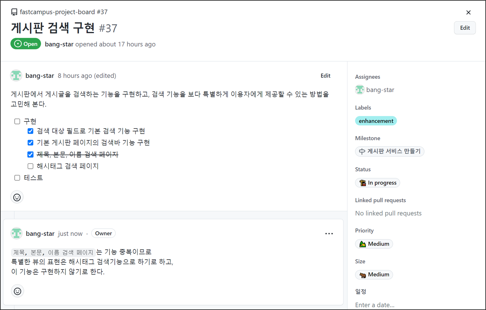

게시판 페이지에서 하려던 작업 중 **제목, 본문, 이름 검색 페이지**는 따로 만들지 않으려 한다. 

이미 제목, 본문, 유저 ID, 닉네임, 해시태그로 기본 검색이 가능한 상태이기 때문에 제외시키고 특별한 방법으로 검색하는 기능은 해시태그 검색 페이지만 구현하려 한다.

## **구상**

---

### **현재 상태 점검**

---

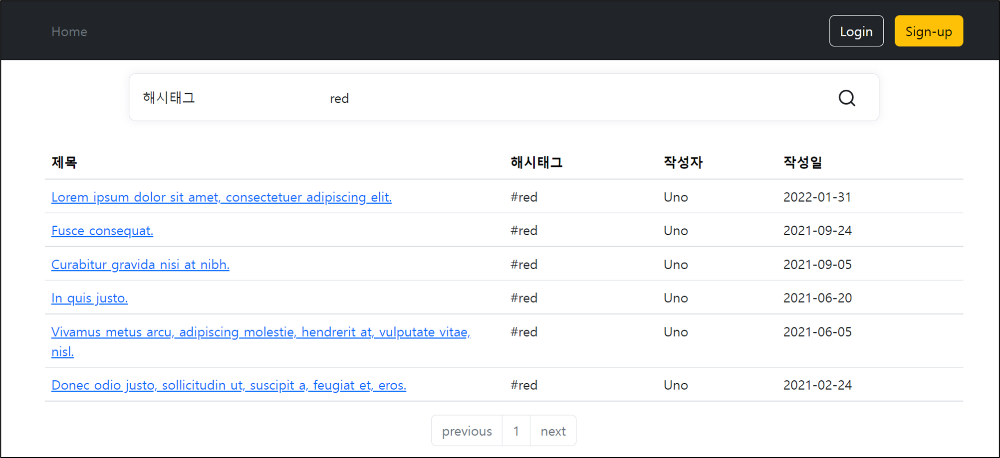

현재 기본 검색은 되는데, 해시태그에 의미를 부여하여 별도의 색다른 페이지로 보여주는 것은 어떨까라는 생각이 들었다.

이를 위해 해시태그만을 위한 검색 페이지를 만들려 한다.

새로운 페이지를 만들어야 하고, 관련된 테스트를 만들어야 하고, Controller도 만들어야하고 변경점이 많을 것으로 판단되어 따로 분리해서 작업을 하려 한다.

이와 같이 작업을 분리하여 구현한다는 것을 협업하는 사람들과 이야기를 갖고 명시를 해두는 것이 좋다.

### **작업 분리**

---

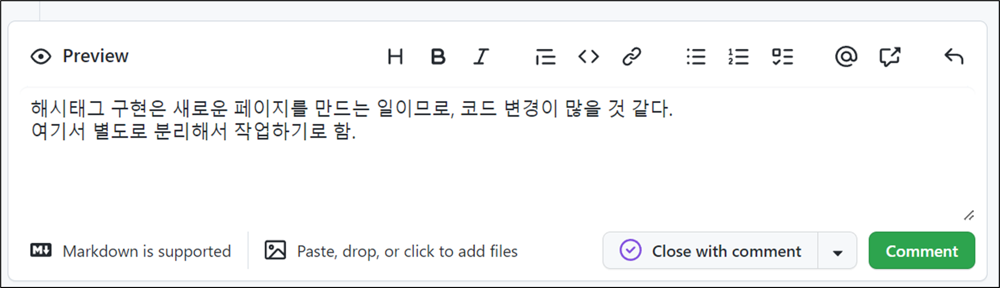

해시태그 검색 페이지 구현을 위한 이슈를 생성한다.

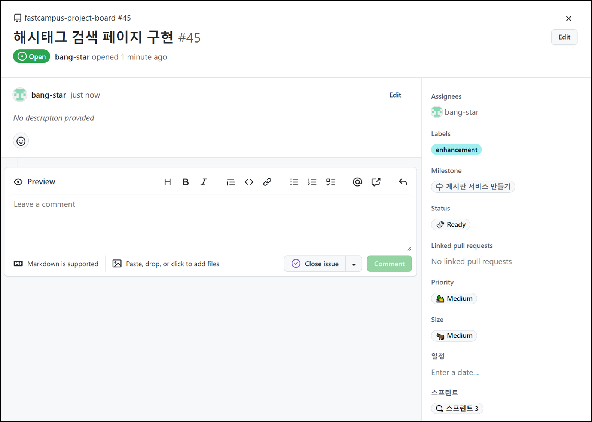

이슈 번호로 게시판 검색 구현에 매칭시켜둔다.


해시태그 구현은 분리해서 작업하기로 하였으므로 작업내용을 **Push And Merge**하여 **main** 브랜치에 반영시킨다.

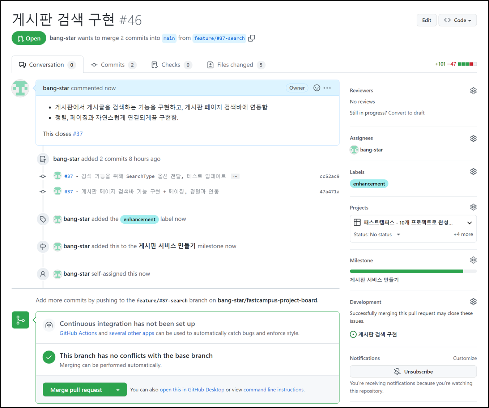

### **TO-DO LIST**

---

Merge를 하고 해시태그 검색 페이지 구현을 위해 작업 리스트를 명시한다.

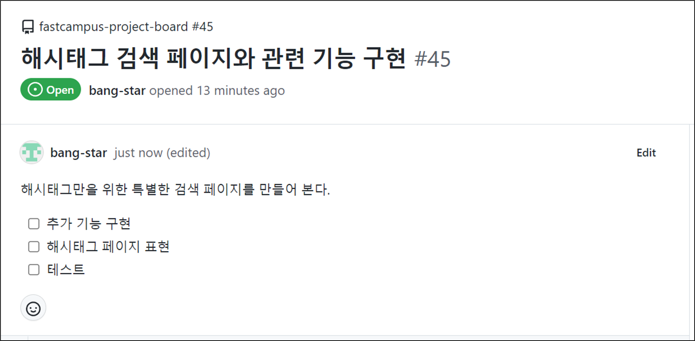

## **해시태그 검색 페이지와 관련 기능 구현**

---

### **🤔 서비스에서 어떤 기능이 필요할까?**

---

1. 검색어 없이 게시글을 해시태그 검색하면, 빈 페이지를 반환
2. 게시글을 해시태그 검색하면, 게시글 페이지를 반환
3. 해시태그를 조회하면, 유니크한 해시태그 리스트를 반환

### **검색어 없이 게시글을 해시태그 검색하면, 빈 페이지 반환**

#### **TEST**

```java
@DisplayName("검색어 없이 게시글을 해시태그 검색하면, 빈 페이지를 반환한다.")
@Test
void givenNoSearchParameters_whenSearchingArticlesHashtag_thenReturnsEmptyPage() {
    // Given
    Pageable pageable = Pageable.ofSize(20);

    // When
    Page<ArticleDto> articles = sut.searchArticlesViaHashtag(null, pageable);

    // Then
    assertThat(articles).isEqualTo(Page.empty(pageable));
    then(articleRepository).shouldHaveNoInteractions();
}
```

* 해시태그만을 위한 검색이므로 SearchType은 필요 없음
* 빈 페이지를 반환하는 확인 필요
* 영속성 Layer까지 내려갈 필요가 없으므로 articleRepository가 작동할 필요 없음

#### **Service**

```java
@Transactional(readOnly = true)
public Page<ArticleDto> searchArticlesViaHashtag(String hashtag, Pageable pageable) {
    if(hashtag == null || hashtag.isBlank()){
        return Page.empty(pageable);
    }

    return articleRepository.findByHashtag(hashtag, pageable).map(ArticleDto::from);
}
```

### **게시글을 해시태그 검색하면, 게시글 페이지 반환**

---

#### **TEST**

```java
@DisplayName("게시글을 해시태그 검색하면, 게시글 페이지를 반환한다.")
@Test
void givenHashtag_whenSearchingArticlesViaHashtag_thenReturnsArticlesPage() {
    // Given
    String hashtag = "#java";
    Pageable pageable = Pageable.ofSize(20);
    given(articleRepository.findByHashtag(hashtag, pageable)).willReturn(Page.empty(pageable));

    // When
    Page<ArticleDto> articles = sut.searchArticlesViaHashtag(hashtag, pageable);

    // Then
    assertThat(articles).isEqualTo(Page.empty(pageable));
    then(articleRepository).should().findByHashtag(hashtag, pageable);
}
```

* 해시태그만을 위한 검색이므로 SearchType 필요
* 결과물 페이지보다 과정이 중요하므로 Page는 Page.empty로  처리
* findByHashtag가 실행되었는지 확인

#### **Service**

[Service 코드](tistory-257.html#toc-Service)는 `검색어 없이 게시글을 해시태그 검색하면, 빈 페이지를 반환`할 때 구현한 Service 코드에서 이미 구현이 되어 있다.

### **해시태그를 조회하면, 유니크한 해시태그 리스트를 반환**

---

#### **TEST**

```java
@DisplayName("게시글 수를 조회하면, 게시글 수를 반환한다")
void givenNothing_whenCalling_thenReturnHashtags(){
    // Given
    List<String> expectedHashtags = List.of("#java", "#spring", "#boot");
    given(articleRepository.findAllDistinctHashtages()).willReturn(expectedHashtags);

    // When
    List<String> actualHashtags = sut.getHashtags();

    //Then
    assertThat(actualHashtags).isEqualTo(expectedHashtags);
    then(articleRepository).should().findAllDistinctHashtages();
}
```

> 아무것도 호출하지 않으면, 전체 해시태그 리스트를 반환하는 작업이다. 이때 반환해주는 해시태그 리스트는 중복을 제거한 상태를 원한다.   
>   
> 현재 원하는 출력 결과는 도메인 모양이 아닌 해시태그 문자열 리스트만 추출하는 것이다.  
>   
> **어떻게 해야할까?**  
> 기본적으로 Spring Data JPA Query 메소드는 도메인 단위로 출력하도록 만들어준다. 다시 말해 특정 필드만 뽑아서 추출하는 쿼리를 만들 수 없다. 이를 만들기 위해서는 복잡한 쿼리를 만들 수 있는 QueryBuilder를 사용해야 하고 이를 위해서는 Querydsl을 사용해야 한다. 다행히 API를 만들때 Spring Data REST와 연동하기 위해서 Querydsl 라이브러리를 포함시킨적이 있어 세팅이 완료되어 있어 바로 사용하기만 하면된다.

#### **Service**

```java
public List<String> getHashtags() {
    return articleRepository.findAllDistinctHashtags();
}
```

#### **Repository**

**1. repository 패키지 내에 querydsl 패키지 생성하고 ArticleRepositoryCustom 인터페이스 생성**

```java
package com.fastcampus.projectboard.repository.querydsl;

public interface ArticleRepositoryCustom {
    List<String> findAllDistinctHashtages();
}
```

> 모든 해시태그를 검색하는 작업이기 때문에 입력인자는 불필요하다.

**2. 동일한 패키지에 ArticleRepositoryCustom 인터페이스 구현체 생성(Impl 키워드는 약속으로 바꿀 수 없음)**

```java
package com.fastcampus.projectboard.repository.querydsl;

public class ArticleRepositoryCustomImpl extends QuerydslRepositorySupport implements ArticleRepositoryCustom {

    public ArticleRepositoryCustomImpl() {
        super(Article.class);
    }

    @Override
    public List<String> findAllDistinctHashtages() {
        return null;
    }
}
```

> \* Imple을 붙여주는 Querydsl이 자동으로 인식해준다.   
> \* 현재 코드는 Querydsl 사용을 위한 뼈대 코드라고 볼 수 있다.

**3. Querydsl 사용**

```java
public class ArticleRepositoryCustomImpl extends QuerydslRepositorySupport implements ArticleRepositoryCustom {

    public ArticleRepositoryCustomImpl() {
        super(Article.class);
    }

    public List<String> findAllDistinctHashtags() {
        QArticle article = QArticle.article;

        // Basic
        JPQLQuery<String> query = from(article)
                .distinct()
                .select(article.hashtag)
                .where(article.hashtag.isNotNull());

        return query.fetch();

        // Common
        return from(article)
                .distinct()
                .select(article.hashtag)
                .where(article.hashtag.isNotNull())
                .fetch();
    }
}
```

> \* Querydsl이 자동 생성한 QObject를 사용  
> \* JPQLQuery를 사용할 때 GenericType을 생략하고 가는 경우가 있는데, 넣어주는 것이 좋다.  
> \* 중복처리는 DB의 힘을 이용  
> \* Spring Data JPA와 다른 점은 하나의 컬럼만 설정(article.hashtag)  
> \* Null을 제외시키지 않음.  
>   
> 이 부분에 대한 테스트를 작성해도 되지만, Repository에 대한 테스트는 하지 않고 있다.

**4. Repository에 Custom한 Querydsl 연동**

```java
@RepositoryRestResource
public interface ArticleRepository extends
        JpaRepository<Article, Long>,
        ArticleRepositoryCustom,
        QuerydslPredicateExecutor<Article>,
        QuerydslBinderCustomizer<QArticle> {

    ...
}
```

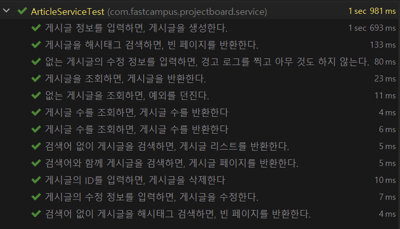

종합 테스트 실행 결과 : 성공

### **Controller 테스트**

---

#### **ArticleController**

```java
package com.fastcampus.projectboard.controller;

@RequiredArgsConstructor
@RequestMapping("/articles")
@Controller
public class ArticleController {

    private final ArticleService articleService;
    private final PaginationService paginationService;

    @GetMapping("/search-hashtag")
    public String searchHashtag(
            @RequestParam(required = false) String searchValue,
            @PageableDefault(size = 10, sort="createdAt", direction = Sort.Direction.DESC) Pageable pageable,
            ModelMap map
    ){

        return "articles/search-hashtag";
    }
}
```

> ArticleController에 게시판 조회, 게시글 단건 조회만 구현되어 있어서 해시태그 검색을 구현함.

#### **ArticleControllerTest**

Hashtag View에 대한 테스트가 필요한데, 이전에 구현을 해두었고 Disabled처리만 해제해주면 된다.

* **검색 파라미터가 없는 경우에 대한 테스트**

```java
@DisplayName("[view][GET] 게시글 해시태그 검색 페이지 - 정상 호출")
@Test
void givenNothing_whenRequestingArticleSearchHashtagView_thenReturnsArticleSearchHashtagView() throws Exception {
    // Given
    List<String> hashtags = List.of("#java", "#spring", "#boot");
    given(articleService.searchArticlesViaHashtag(eq(null), any(Pageable.class))).willReturn(Page.empty());
    given(articleService.getHashtags()).willReturn(hashtags);
    given(paginationService.getPaginationBarNumbers(anyInt(), anyInt())).willReturn(List.of(1, 2, 3, 4, 5));

    // When & Then
    mvc.perform(get("/articles/search-hashtag"))
            .andExpect(status().isOk())
            .andExpect(content().contentTypeCompatibleWith(MediaType.TEXT_HTML))
            .andExpect(view().name("articles/search-hashtag"))
            .andExpect(model().attribute("articles", Page.empty()))
            .andExpect(model().attribute("hashtags", hashtags))
            .andExpect(model().attribute("searchType", SearchType.HASHTAG))
            .andExpect(model().attributeExists("paginationBarNumbers"));

    then(articleService).should().searchArticlesViaHashtag(eq(null), any(Pageable.class));
    then(articleService).should().getHashtags();
    then(paginationService).should().getPaginationBarNumbers(anyInt(), anyInt());
}
```

> \* 데이터 검사를 하는 것이 아니므로 빈페이지 반환될 것이라고 명시  
> \* view-name 검사  
> \* controller에서 전달되는 model 검사

* **검색어 파라미터가 있는 경우에 대한 테스트**

```java
@DisplayName("[view][GET] 게시글 해시태그 검색 페이지 - 정상 호출, 해시태그 입력")
@Test
void givenHashtag_whenRequestingArticleSearchHashtagView_thenReturnsArticleSearchHashtagView() throws Exception {
    // Given
    String hashtag = "#java";
    List<String> hashtags = List.of("#java", "#spring", "#boot");
    given(articleService.searchArticlesViaHashtag(eq(hashtag), any(Pageable.class))).willReturn(Page.empty());
    given(articleService.getHashtags()).willReturn(hashtags);
    given(paginationService.getPaginationBarNumbers(anyInt(), anyInt())).willReturn(List.of(1, 2, 3, 4, 5));

    // When & Then
    mvc.perform(get("/articles/search-hashtag")
                    .queryParam("searchValue", hashtag)
            )
            .andExpect(status().isOk())
            .andExpect(content().contentTypeCompatibleWith(MediaType.TEXT_HTML))
            .andExpect(view().name("articles/search-hashtag"))
            .andExpect(model().attribute("articles", Page.empty()))
            .andExpect(model().attribute("hashtags", hashtags))
            .andExpect(model().attributeExists("paginationBarNumbers"))
            .andExpect(model().attribute("searchType", SearchType.HASHTAG));

    then(articleService).should().searchArticlesViaHashtag(eq(hashtag), any(Pageable.class));
    then(articleService).should().getHashtags();
    then(paginationService).should().getPaginationBarNumbers(anyInt(), anyInt());
}
```

> \* GET 파라미터에 해시태그 값 추가.

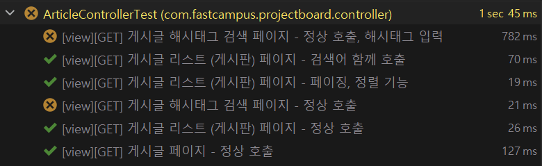

현재 구현이 되어 있지 않으므로 테스트 실패 확인

#### **ArticleController 구현**

```html
@GetMapping("/search-hashtag")
public String searchHashtag(
        @RequestParam(required = false) String searchValue,
        @PageableDefault(size = 10, sort="createdAt", direction = Sort.Direction.DESC) Pageable pageable,
        ModelMap map
){
    Page<ArticleResponse> articles = articleService.searchArticlesViaHashtag(searchValue, pageable).map(ArticleResponse::from);
    List<Integer> barNumbers = paginationService.getPaginationBarNumbers(pageable.getPageNumber(), articles.getTotalPages());
    List<String> hashtags = articleService.getHashtags();

    map.addAttribute("articles", articles);
    map.addAttribute("hashtags", hashtags);
    map.addAttribute("paginationBarNumbers", barNumbers);
    map.addAttribute("searchType", SearchType.HASHTAG);

    return "articles/search-hashtag";
}
```

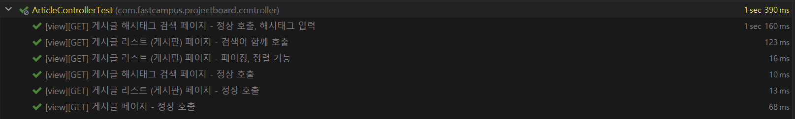

테스트 실행결과 : 성공

#### **View**

**search-hashtag**

```html
<!DOCTYPE html>
<html lang="ko">
<head>
    <meta charset="UTF-8">
    <meta name="viewport" content="width=device-width, initial-scale=1">
    <meta name="description" content="">
    <meta name="author" content="Artist Bang">
    <title>해시태그 검색</title>

    <link href="https://cdn.jsdelivr.net/npm/bootstrap@5.2.0-beta1/dist/css/bootstrap.min.css" rel="stylesheet" integrity="sha384-0evHe/X+R7YkIZDRvuzKMRqM+OrBnVFBL6DOitfPri4tjfHxaWutUpFmBp4vmVor" crossorigin="anonymous">
    <link href="/css/articles/table-header.css" rel="stylesheet">
</head>
<body>
    <header id="header">
        헤더 삽입부
        <hr>
    </header>

    <main class="container">
        <header class="py-5 text-center">
            <h1>Hashtags</h1>
        </header>

        <section class="row">
            <div id="hashtags" class="col-9 d-flex flex-wrap justify-content-evenly">
                <div class="p-2">
                    <h2 class="text-center lh-lg font-monospace"><a href="#">#java</a></h2>
                </div>
            </div>
        </section>

        <hr>

        <table class="table" id="article-table">
            <thead>
            <tr>
                <th class="title col-6"><a>제목</a></th>
                <th class="content col-4"><a>본문</a></th>
                <th class="user-id"><a>작성자</a></th>
                <th class="created-at"><a>작성일</a></th>
            </tr>
            </thead>
            <tbody>
            <tr>
                <td class="title"><a>첫글</a></td>
                <td class="content"><span class="d-inline-block text-truncate" style="max-width: 300px;">본문</span></td>
                <td class="user-id">Artist</td>
                <td class="created-at"><time>2022-01-01</time></td>
            </tr>
            <tr>
                <td>두번째글</td>
                <td>본문</td>
                <td>Artist</td>
                <td><time>2022-01-02</time></td>
            </tr>
            <tr>
                <td>세번째글</td>
                <td>본문</td>
                <td>Artist</td>
                <td><time>2022-01-03</time></td>
            </tr>
            </tbody>
        </table>

        <nav id="pagination" aria-label="Page navigation">
            <ul class="pagination justify-content-center">
                <li class="page-item"><a class="page-link" href="#">Previous</a></li>
                <li class="page-item"><a class="page-link" href="#">1</a></li>
                <li class="page-item"><a class="page-link" href="#">Next</a></li>
            </ul>
        </nav>

    </main>

    <footer id="footer">
        <hr>
        푸터 삽입부
    </footer>

    <script src="https://cdn.jsdelivr.net/npm/bootstrap@5.2.0-beta1/dist/js/bootstrap.bundle.min.js" integrity="sha384-pprn3073KE6tl6bjs2QrFaJGz5/SUsLqktiwsUTF55Jfv3qYSDhgCecCxMW52nD2" crossorigin="anonymous"></script>
</body>
</html>
```

**search-hash 페이지에 대한 thymeleaf 로직**

```html
<?xml version="1.0"?>
<thlogic>
    <attr sel="#header" th:replace="header :: header" />
    <attr sel="#footer" th:replace="footer :: footer" />

    <attr sel="main" th:object="${articles}">
        <attr sel="#hashtags" th:remove="all-but-first">
            <attr sel="div" th:each="hashtag : ${hashtags}">
                <attr sel="a" th:class="'text-reset'" th:text="${hashtag}" th:href="@{/articles/search-hashtag(
            page=${param.page},
            sort=${param.sort},
            searchType=${searchType.name},
            searchValue=${hashtag}
        )}" />
            </attr>
        </attr>

        <attr sel="#article-table">
            <attr sel="thead/tr">
                <attr sel="th.title/a" th:text="'제목'" th:href="@{/articles/search-hashtag(
            page=${articles.number},
            sort='title' + (*{sort.getOrderFor('title')} != null ? (*{sort.getOrderFor('title').direction.name} != 'DESC' ? ',desc' : '') : ''),
            searchType=${searchType.name},
            searchValue=${param.searchValue}
        )}"/>
                <attr sel="th.content/a" th:text="'본문'" th:href="@{/articles/search-hashtag(
            page=${articles.number},
            sort='content' + (*{sort.getOrderFor('content')} != null ? (*{sort.getOrderFor('content').direction.name} != 'DESC' ? ',desc' : '') : ''),
            searchType=${searchType.name},
            searchValue=${param.searchValue}
        )}"/>
                <attr sel="th.user-id/a" th:text="'작성자'" th:href="@{/articles/search-hashtag(
            page=${articles.number},
            sort='userAccount.userId' + (*{sort.getOrderFor('userAccount.userId')} != null ? (*{sort.getOrderFor('userAccount.userId').direction.name} != 'DESC' ? ',desc' : '') : ''),
            searchType=${searchType.name},
            searchValue=${param.searchValue}
        )}"/>
                <attr sel="th.created-at/a" th:text="'작성일'" th:href="@{/articles/search-hashtag(
            page=${articles.number},
            sort='createdAt' + (*{sort.getOrderFor('createdAt')} != null ? (*{sort.getOrderFor('createdAt').direction.name} != 'DESC' ? ',desc' : '') : ''),
            searchType=${searchType.name},
            searchValue=${param.searchValue}
        )}"/>
            </attr>
            <attr sel="tbody" th:remove="all-but-first">
                <attr sel="tr[0]" th:each="article : ${articles}">
                    <attr sel="td.title/a" th:text="${article.title}" th:href="@{'/articles/' + ${article.id}}" />
                    <attr sel="td.content/span" th:text="${article.content}" />
                    <attr sel="td.user-id" th:text="${article.nickname}" />
                    <attr sel="td.created-at/time" th:datetime="${article.createdAt}" th:text="${#temporals.format(article.createdAt, 'yyyy-MM-dd')}" />
                </attr>
            </attr>
        </attr>

        <attr sel="#pagination">
            <attr sel="ul">
                <attr sel="li[0]/a"
                      th:text="'previous'"
                      th:href="@{/articles(page=${articles.number - 1}, searchType=${searchType.name}, searchValue=${param.searchValue})}"
                      th:class="'page-link' + (${articles.number} <= 0 ? ' disabled' : '')"
                />
                <attr sel="li[1]" th:class="page-item" th:each="pageNumber : ${paginationBarNumbers}">
                    <attr sel="a"
                          th:text="${pageNumber + 1}"
                          th:href="@{/articles(page=${pageNumber}, searchType=${searchType.name}, searchValue=${param.searchValue})}"
                          th:class="'page-link' + (${pageNumber} == ${articles.number} ? ' disabled' : '')"
                    />
                </attr>
                <attr sel="li[2]/a"
                      th:text="'next'"
                      th:href="@{/articles(page=${articles.number + 1}, searchType=${searchType.name}, searchValue=${param.searchValue})}"
                      th:class="'page-link' + (${articles.number} >= ${articles.totalPages - 1} ? ' disabled' : '')"
                />
            </attr>
        </attr>
    </attr>
</thlogic>
```

> \* 게시판 페이지에서 복사하여 변형하여 구현함.  
> \* 검색파라미터에 검색타입을 연동해서 사용할 수 있도록 함(파라미터가 아닌 서버에서 받도록 함)  
> \* 테이블의 body는 기존 테이블과 다르게 해시태그 전용 페이지이므로 해시태그 항목이 없애고 본문을 넣도록 함.  
> \* 본문은 길이가 길기 때문에 앞글자 몇개만 따서 preview로 볼 수 있도록 함.  
> \* 해시태그들은 검색이 연동되도록 설정함.

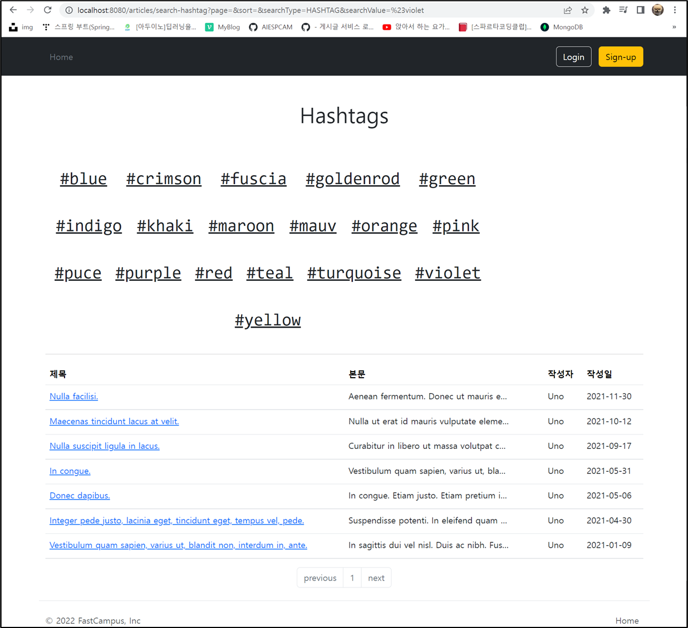

해시태그 전용 검색 페이지 실행 결과 : 정상 작동

### **정리**

---

#### **Push And Merge**

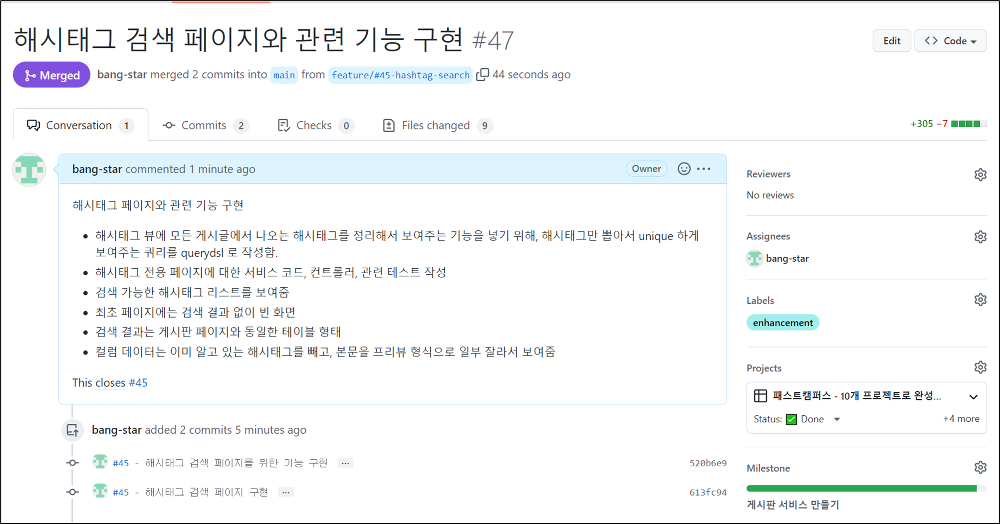

**Commit으로 확인하는 작업 리스트**


#### **요약**

> 1. Spring Data JPA를 사용할 때 Domain이 아닌 데이터를 원하는 경우, Querydsl을 사용하여 원하는 결과물을 만들어낼 수 있다.  
> 2. 자연스러운 query가 되기 위해서는 Method Chaining을 한다고 하면 Select부터 시작하면 자연스러울 것이라 생각했는데, JPQLQuery와 QuerydslSupport을 이용할 때는 From 부터 시작해야 한다.
