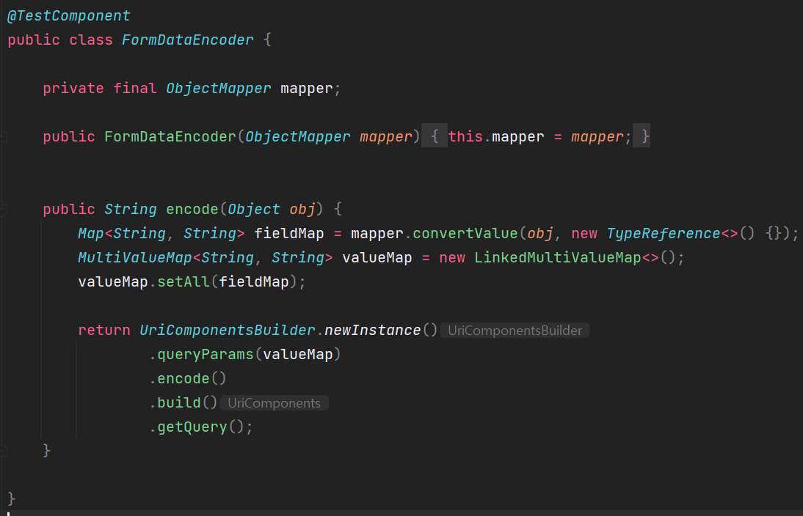
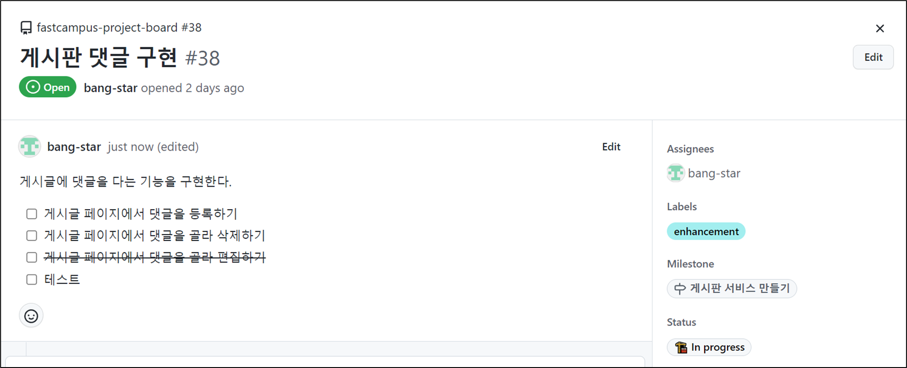
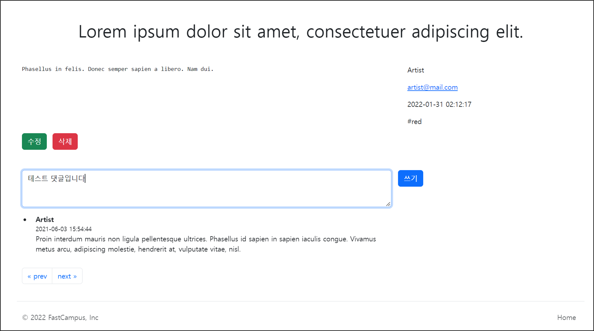
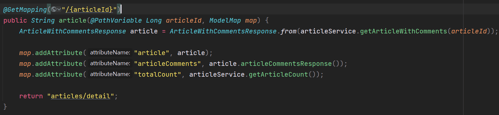
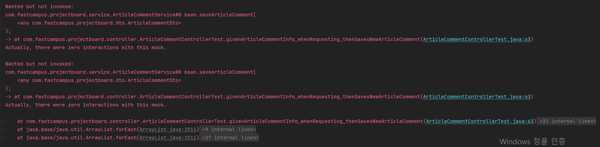
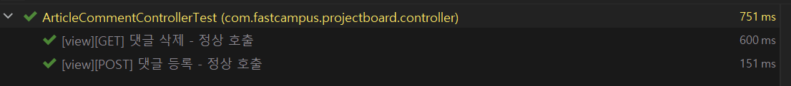
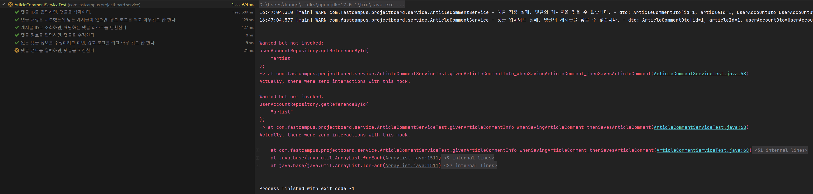
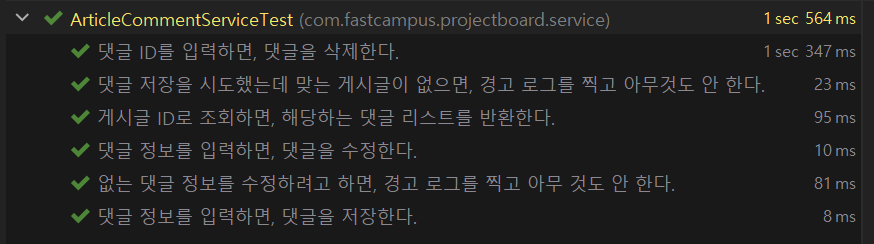

## **게시글 댓글 구현**

---

**변경된 점**

변경된 것이 몇가지 있는데, 그중 FormDataEncoder가 있다.

**FormDataEncoder** 는 기본 비즈니스 로직과 관계 없이 테스트 목적으로 만든 코드이다. Spring 빈으로 등록해서 편리하게 주입 방법으로 사용하고 싶어 **@TestComponent** 어노테이션을 붙여주어 **ObjectMapper**는 자연스럽게 빈으로 인식되어 주입 받을 수 있게끔 하였다.



> **encode 메소드**object를 받아서 MultiValueMap으로 바꿔주고 MultiValueMap을 UriComponentBuilder에 넣어서 Query Parameter 부분만 추출해서 원하는 결과물이 만들어지도록 구현하였다.

```java
@DisplayName("객체를 넣으면, url encoding 된 form body data 형식의 문자열을 돌려준다.")
@Test
void givenObject_whenEncoding_thenReturnsFormEncodedString() {
    // Given
    TestObject obj = new TestObject(
            "This 'is' \"test\" string.",
            List.of("hello", "my", "friend").toString().replace(" ", ""),
            String.join(",", "hello", "my", "friend"),
            null,
            1234,
            3.14,
            false,
            BigDecimal.TEN,
            TestEnum.THREE
    );

    // When
    String result = formDataEncoder.encode(obj);

    // Then
    assertThat(result).isEqualTo(
            "str=This%20'is'%20%22test%22%20string." +
                    "&listStr1=%5Bhello,my,friend%5D" +
                    "&listStr2=hello,my,friend" +
                    "&nullStr" +
                    "&number=1234" +
                    "&floatingNumber=3.14" +
                    "&bool=false" +
                    "&bigDecimal=10" +
                    "&testEnum=THREE"
    );
}

record TestObject(
        String str,
        String listStr1,
        String listStr2,
        String nullStr,
        Integer number,
        Double floatingNumber,
        Boolean bool,
        BigDecimal bigDecimal,
        TestEnum testEnum
) {}

enum TestEnum {
    ONE, TWO, THREE
}
```

> 테스트 코드를 보면 여러가지 유형을 가진 테스트용 오브젝트를 생성하여  
> 여러가지 데이터를 넣어 encode 하였을 때 결과가 어떤 문자열이 나오는지를 보여주는 테스트이다.  
> 결과물을 보면 각 부분이 들어가고 **&** 연산자로 각 데이터를 구분해서 출력해주는 모습을 볼 수 있다.  
> 이 형태는 Form Data에 Format이기도 하다. POST 형태로 데이터를 전송해 줄 때 Body 부분에 들어가는 문자열이다.  
>   
> 이러한 데이터를 만들어주는 라이브러리나 도구를 찾기가 어려워서 직접 구현하게 되었다. 이 내용은 비즈니스 로직에는 필요 없기 때문에 테스트 전용 도구로만 사용하고 있다.

**[개발 현황](https://github.com/bang-star/fastcampus-project-board)**

[GitHub - bang-star/fastcampus-project-board: 패스트캠퍼스 게시판 만들기 프로젝트. 자바 + 스프링부트 관

패스트캠퍼스 게시판 만들기 프로젝트. 자바 + 스프링부트 관련 기술들을 공부한다. Contribute to bang-star/fastcampus-project-board development by creating an account on GitHub.

github.com](https://github.com/bang-star/fastcampus-project-board)

### **Issue를 통해 알아보는 작업 리스트**

---



* 댓글 수정 기능은 지금 구현하지 않을 것이다.

> 댓글 등록은 쓰기 버튼을 눌러서 댓글 리스트에 등록하면 되고  
> 댓글 삭제는 댓글 옆에 삭제 버튼을 넣어서 구현이 가능하다.  
>   
> **수정은 어떻게 해야할까??**해당 댓글을 선택하여 수정 버튼을 누르면 댓글이 수정가능하도록 TextArea가 만들어져야 한다.  
> 이 부분은 서버 사이드 구현이 아닌 클라이언트 사이드 구현하는 방법이 더 보편적이다.   
> 클라이언트 사이드 개발을 하지 않기 위해 최대한 서버 사이드에서 개발할 수 있는 게시판을 만들고 있기 때문에  
> 만들지 않을 것이다.



### **Controller**

---

#### **Controller****기본 골격**

```java
@RequiredArgsConstructor
@RequestMapping("/comments")
@Controller
public class ArticleCommentController {

    private final ArticleCommentService articleCommentService;

}
```

ArticleController에서 게시글을 불러올때 해당 게시글에 대한 댓글리스트를 함께 불러오고 있어 ArticleController에서는 댓글 생성과 삭제 부분만 구현해주면 된다.



게시글 페이지 이동 시 게시글 정보와 댓글 리스트를 함께 전달하는 ArticleController 구현 부분

---

#### **댓글 생성**

**Controller**

```java
@PostMapping("/new")
public String postNewArticleComment(ArticleCommentRequest articleCommentRequest) {
    return "redirect:/articles/" + articleCommentRequest.articleId();
}
```

**Dto**

```java
public record ArticleCommentRequest(Long articleId, String content) {

    public static ArticleCommentRequest of(Long articleId, String content) {
        return new ArticleCommentRequest(articleId, content);
    }

    public ArticleCommentDto toDto(UserAccountDto userAccountDto){
        return ArticleCommentDto.of(
                articleId,
                userAccountDto,
                content
        );
    }
}
```

> 댓글 Dto를 만들때 유저정보는 댓글 Request 정보로 부터 받지 못하는데 별도로 인증을 통해 받는 작업이 필요하지만, 현재 인증 구현이 되어 있지 않은 상태다. 그점을 고려해서 UserAccountDto 를 외부에서 입력할 수 있게 열어둔 상태

---

#### **댓글 삭제**

```java
@DeleteMapping("/{commentId}/delete")
public String deleteArticleComment(@PathVariable Long commentId, Long articleId) {
    return "redirect:/articles/" + articleId;
}
```

* 댓글 삭제된 후, 생성된 후, 해당 게시글로 돌아가기 위해서는 게시글 Id가 필요하다.

---

#### **테스트 정의**

**Controller 파트**

```java
package com.fastcampus.projectboard.controller;

@DisplayName("View 컨트롤러 - 댓글")
@Import({SecurityConfig.class, FormDataEncoder.class})
@WebMvcTest(ArticleCommentController.class)
class ArticleCommentControllerTest {

    private final MockMvc mvc;
    private final FormDataEncoder formDataEncoder;

    @MockBean ArticleCommentService articleCommentService;

    public ArticleCommentControllerTest(
            @Autowired MockMvc mvc,
            @Autowired FormDataEncoder formDataEncoder) {
        this.mvc = mvc;
        this.formDataEncoder = formDataEncoder;
    }


    @DisplayName("[view][POST] 댓글 등록 - 정상 호출")
    @Test
    void givenArticleCommentInfo_whenRequesting_thenSavesNewArticleComment() throws Exception {
        // Given
        long articleId = 1L;
        ArticleCommentRequest request = ArticleCommentRequest.of(articleId, "test comment");
        willDoNothing().given(articleCommentService).saveArticleComment(any(ArticleCommentDto.class));

        // When & Then
        mvc.perform(
                post("/comments/new")
                        .contentType(MediaType.APPLICATION_FORM_URLENCODED)
                        .content(formDataEncoder.encode(request))
                        .with(csrf())
                )
                .andExpect(status().is3xxRedirection())
                .andExpect(view().name("redirect:/articles/" + articleId))
                .andExpect(redirectedUrl("/articles/" + articleId));
        then(articleCommentService).should().saveArticleComment(any(ArticleCommentDto.class));
    }

    @DisplayName("[view][GET] 댓글 삭제 - 정상 호출")
    @Test
    void givenArticleCommentIdToDelete_whenRequesting_thenDeletesArticleComment() throws Exception {
        // Given
        long articleId = 1L;
        long articleCommentId = 1L;
        willDoNothing().given(articleCommentService).deleteArticleComment(articleCommentId);

        // When & Then
        mvc.perform(
                post("/comments/" + articleCommentId + "/delete")
                        .contentType(MediaType.APPLICATION_FORM_URLENCODED)
                        .content(formDataEncoder.encode(Map.of("articleId", articleId)))
                        .with(csrf())
                )
                .andExpect(status().is3xxRedirection())
                .andExpect(view().name("redirect:/articles/" + articleId))
                .andExpect(redirectedUrl("/articles/" + articleId));
        then(articleCommentService).should().deleteArticleComment(articleCommentId);
    }

}
```

> \* Controller에서 입출력만 검사하고, Service Layer와 분리  
> \* formDataEncoder 이용해 request 오브젝트를 formData 형식으로 인코딩



테스트 코드 실행 결과 : 구현이 되지 않았다는 에러 발생

---

#### **Controller 구현**

```java
@PostMapping("/new")
public String postNewArticleComment(ArticleCommentRequest articleCommentRequest) {
    // TODO: 인증 정보를 넣어줘야 한다.
    articleCommentService.saveArticleComment(articleCommentRequest.toDto(UserAccountDto.of(
            "artist", "asdf1234", "artist", "artist@mail.com", "memo"
    )));

    return "redirect:/articles/" + articleCommentRequest.articleId();
}

@DeleteMapping("/{commentId}/delete")
public String deleteArticleComment(@PathVariable Long commentId, Long articleId) {
    articleCommentService.deleteArticleComment(commentId);

    return "redirect:/articles/" + articleId;
}
```

> \* 댓글을 작성한 사용자 인증 정보가 필요한데, 현재는 인증 구현이 되어있지 않아 임시 데이터를 사용한다.



테스트 실행 결과 : 정상 작동

### **Service**

---

#### **댓글 저장**

**1. 테스트**

```java
@DisplayName("댓글 정보를 입력하면, 댓글을 저장한다.")
@Test
void givenArticleCommentInfo_whenSavingArticleComment_thenSavesArticleComment() {
    // Given
    ArticleCommentDto dto = createArticleCommentDto("댓글");
    given(articleRepository.getReferenceById(dto.articleId())).willReturn(createArticle());
    given(userAccountRepository.getReferenceById(dto.userAccountDto().userId())).willReturn(createUserAccount());
    given(articleCommentRepository.save(any(ArticleComment.class))).willReturn(null);

    // When
    sut.saveArticleComment(dto);

    // Then
    then(articleRepository).should().getReferenceById(dto.articleId());
    then(userAccountRepository).should().getReferenceById(dto.userAccountDto().userId());
    then(articleCommentRepository).should().save(any(ArticleComment.class));
}

@DisplayName("댓글 저장을 시도했는데 맞는 게시글이 없으면, 경고 로그를 찍고 아무것도 안 한다.")
@Test
void givenNonexistentArticle_whenSavingArticleComment_thenLogsSituationAndDoesNothing() {
    // Given
    ArticleCommentDto dto = createArticleCommentDto("댓글");
    given(articleRepository.getReferenceById(dto.articleId())).willThrow(EntityNotFoundException.class);

    // When
    sut.saveArticleComment(dto);

    // Then
    then(articleRepository).should().getReferenceById(dto.articleId());
    then(userAccountRepository).shouldHaveNoInteractions();
    then(articleCommentRepository).shouldHaveNoInteractions();
}
```

**변경 사항**

* 댓글 저장시, userAccountRepository과 interaction 추가됨.
* 댓글 저장 실패시, userAccountRepository과 interation이 없어야함을 검증
* 테스트 삭제 등 다른 테스트는 이미 구현이 완료되어 있던 상태.



테스트 코드 실행 결과 : 구현이 되지 않았다는 에러 발생

**2. 구현**

```java
public void saveArticleComment(ArticleCommentDto dto) {
    try{
        Article article = articleRepository.getReferenceById(dto.articleId());
        UserAccount userAccount = userAccountRepository.getReferenceById(dto.userAccountDto().userId());
        articleCommentRepository.save(dto.toEntity(article, userAccount));
    }catch (EntityNotFoundException e){
        log.warn("댓글 저장 실패. 댓글 작성에 필요한 정보를 찾을 수 없습니다. - {}", e.getLocalizedMessage());
    }
}
```

**변경 사항**

* 댓글 저장을 위해 게시글과 유저 정보가 필요하여 article과 userAccount를 조회하는 코드 추가
* 게시글과 유저 정보 조회과정에서 에러가 발생할 수 있어 폭넓게 에러를 확인할 수 있도록 변경



테스트 코드 실행 결과 : 정상 작동

### **View**

---

```html
<!DOCTYPE html>
<html lang="ko">
<head>
    <meta charset="UTF-8">
    <meta name="viewport" content="width=device-width, initial-scale=1">
    <meta name="description" content="">
    <meta name="author" content="Artist Bang">
    <title>게시글 페이지</title>

    <link href="https://cdn.jsdelivr.net/npm/bootstrap@5.2.0-beta1/dist/css/bootstrap.min.css" rel="stylesheet" integrity="sha384-0evHe/X+R7YkIZDRvuzKMRqM+OrBnVFBL6DOitfPri4tjfHxaWutUpFmBp4vmVor" crossorigin="anonymous">
    <link href="/css/articles/article-content.css" rel="stylesheet">
</head>

<body>

    <header id="header">
        헤더 삽입부
        <hr>
    </header>

    <main id="article-main" class="container">
        <header id="article-header" class="py-5 text-center">
            <h1>첫번째 글</h1>
        </header>

        <div class="row g-5">
            <section class="col-md-3 col-lg-4 order-md-last">
                <aside>
                    <p><span id="nickname">Artist</span></p>
                    <p><a id="email" href="mailto:artist@gmail.com">artist@mail.com</a></p>
                    <p><time id="created-at" datetime="2022-01-01T00:00:00">2022-01-01</time></p>
                    <p><span id="hashtag">#java</span></p>
                </aside>
            </section>

            <article id="article-content" class="col-md-9 col-lg-8">
                <pre>본문</pre>
            </article>
        </div>

        <div class="row g-5" id="article-buttons">
            <form id="delete-article-form">
                <div class="pb-5 d-grid gap-2 d-md-block">
                    <a class="btn btn-success me-md-2" role="button" id="update-article">수정</a>
                    <button class="btn btn-danger me-md-2" type="submit">삭제</button>
                </div>
            </form>
        </div>

        <div class="row g-5">
            <section>
                <form class="row g-3" id="comment-form">
                    <input type="hidden" class="article-id">
                    <div class="col-md-9 col-lg-8">
                        <label for="comment-textbox" hidden>댓글</label>
                        <textarea class="form-control" id="comment-textbox" placeholder="댓글 쓰기.." rows="3" required></textarea>
                    </div>
                    <div class="col-md-3 col-lg-4">
                        <label for="comment-submit" hidden>댓글 쓰기</label>
                        <button class="btn btn-primary" id="comment-submit" type="submit">쓰기</button>
                    </div>
                </form>

                <ul id="article-comments" class="row col-md-10 col-lg-8 pt-3">
                    <li>
                        <form class="comment-form">
                            <input type="hidden" class="article-id">
                            <div class="row">
                                <div class="col-md-10 col-lg-9">
                                    <strong>Uno</strong>
                                    <small><time>2022-01-01</time></small>
                                    <p>
                                        Lorem ipsum dolor sit amet, consectetur adipiscing elit.<br>
                                        Lorem ipsum dolor sit amet
                                    </p>
                                </div>
                                <div class="col-2 mb-3">
                                    <button type="submit" class="btn btn-outline-danger" id="delete-comment-button">삭제</button>
                                </div>
                            </div>
                        </form>
                    </li>
                    <li>
                        <div class="row">
                            <strong>Artist</strong>
                            <small><time>2022-01-01</time></small>
                            <p>
                                Lorem ipsum dolor sit amet, consectetur adipiscing elit.<br>
                                Lorem ipsum dolor sit amet
                            </p>
                        </div>
                    </li>
                </ul>

            </section>
        </div>

        <div class="row g-5">
            <nav id="pagination" aria-label="Page navigation">
                <ul class="pagination">
                    <li class="page-item">
                        <a class="page-link" href="#" aria-label="Previous">
                            <span aria-hidden="true">&laquo; prev</span>
                        </a>
                    </li>
                    <li class="page-item">
                        <a class="page-link" href="#" aria-label="Next">
                            <span aria-hidden="true">next &raquo;</span>
                        </a>
                    </li>
                </ul>
            </nav>
        </div>
    </main>

    <footer id="footer">
        <hr>
        푸터 삽입부
    </footer>

    <script src="https://cdn.jsdelivr.net/npm/bootstrap@5.2.0-beta1/dist/js/bootstrap.bundle.min.js" integrity="sha384-pprn3073KE6tl6bjs2QrFaJGz5/SUsLqktiwsUTF55Jfv3qYSDhgCecCxMW52nD2" crossorigin="anonymous"></script>
</body>
</html>
```

**변경 사항**

* **댓글 저장 후 돌아올 수 있도록 **form태그를 추가하여**게시글의 아이디 정보를 저장**
* **댓글 삭제 버튼 추가**

```html
<?xml version="1.0"?>
<thlogic>
    <attr sel="#header" th:replace="header :: header" />
    <attr sel="#footer" th:replace="footer :: footer" />

    <attr sel="#article-main" th:object="${article}">
        <attr sel="#article-header/h1" th:text="*{title}" />
        <attr sel="#nickname" th:text="*{nickname}" />
        <attr sel="#email" th:text="*{email}" />
        <attr sel="#created-at" th:datetime="*{createdAt}" th:text="*{#temporals.format(createdAt, 'yyyy-MM-dd HH:mm:ss')}" />
        <attr sel="#hashtag" th:text="*{hashtag}" />
        <attr sel="#article-content/pre" th:text="*{content}" />

        <attr sel="#article-buttons">
            <attr sel="#delete-article-form" th:action="'/articles/' + *{id} + '/delete'" th:method="post">
                <attr sel="#update-article" th:href="'/articles/' + *{id} + '/form'" />
            </attr>
        </attr>

        <attr sel=".article-id" th:name="articleId" th:value="*{id}" />
        <attr sel="#comment-form" th:action="@{/comments/new}" th:method="post">
            <attr sel="#comment-textbox" th:name="content" />
        </attr>


        <attr sel="#article-comments" th:remove="all-but-first">
            <attr sel="li[0]" th:each="articleComment : ${articleComments}">
                <attr sel="form" th:action="'/comments/' + ${articleComment.id} + '/delete'" th:method="post">
                    <attr sel="div/strong" th:text="${articleComment.nickname}" />
                    <attr sel="div/small/time" th:datetime="${articleComment.createdAt}" th:text="${#temporals.format(articleComment.createdAt, 'yyyy-MM-dd HH:mm:ss')}" />
                    <attr sel="div/p" th:text="${articleComment.content}" />
                </attr>
            </attr>
        </attr>

        <attr sel="#pagination">
            <attr sel="ul">
                <attr sel="li[0]/a"
                      th:href="*{id} - 1 <= 0 ? '#' : |/articles/*{id - 1}|"
                      th:class="'page-link' + (*{id} - 1 <= 0 ? ' disabled' : '')"
                />
                <attr sel="li[1]/a"
                      th:href="*{id} + 1 > ${totalCount} ? '#' : |/articles/*{id + 1}|"
                      th:class="'page-link' + (*{id} + 1 > ${totalCount} ? ' disabled' : '')"
                />
            </attr>
        </attr>
    </attr>
</thlogic>
```

**변경 사항**

* **게시글 id를 저장하는 부분이 두 곳이기 때문에 class selecter로 접근**
* **삭제 버튼 클릭시 동작할 수 있는 action url과 method 설정**

> 코드를 보면서 이상한 느낌이 들지 않으셨나요??  
>   
> REST API를 만들다보면 수정과 삭제 시 PUT, PATCH, DELETE 를 사용하는데  
> 현재 수정, 삭제 모두 POST를 사용하고 있습니다.  
>   
> 기존 Http Spec을 알고 계시는 분이라면   
> 바로 눈치를 채셨을 것입니다.   
>   
> Form 태그는 GET과 POST 밖에 다룰수 없다.   
> Restful API가 나온 뒤에 Form도 PUT, DELETE가 가능하도록 개선해야한다고   
> W3C Standard 페이지에서 제안이 나왔었는데 거절되었다...  
>   
> 실제 설계자분께서 "Form 태그에서   
> 실제 PUT, DELETE가 들어갈 상황은 없다" 라고 말씀하셨다.  
>   
> Form에 PUT과 DELETE를 사용하지 않은 이유가 있다.   
>   
> 우회하는 방법도 있긴 하다. Controller에서는 PUTMapping,  
> DeleteMapping을 사용하고 타임리프를 사용하고 있는 상황에서는  
> 해당링크에 delete/put을 넣어주면 이것을 우회동작하는 방식으로  
> 내부에서 자동으로 만들어준다.  
>   
> 하지만 POST를 사용할 것이다.. ㅎ  
>   
> 
