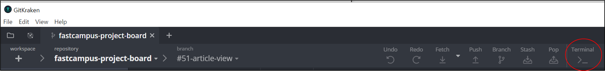
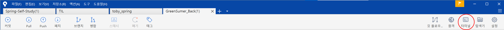
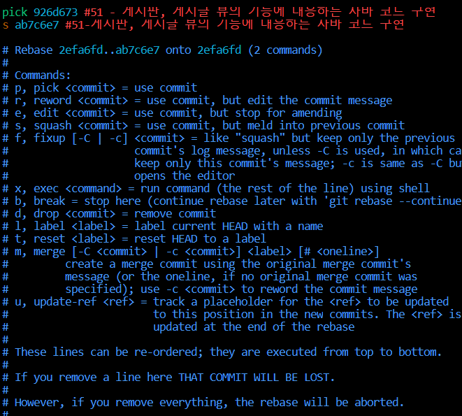
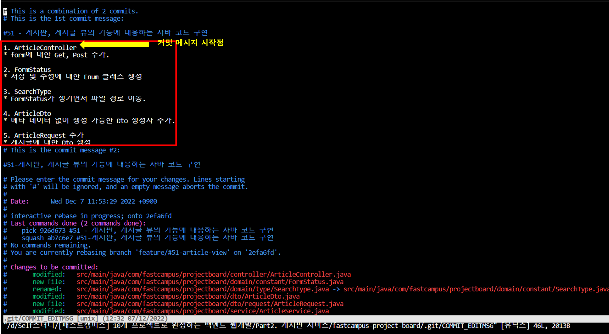
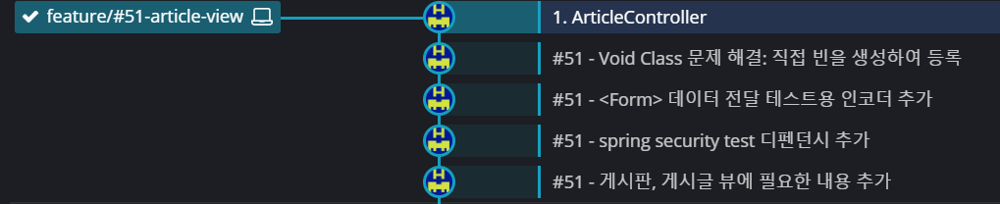

## **Commit 메시지 합치기**

---

개발하면서 생긴 문제를 해결하면서 학습한 내용입니다.

### **Commit 메시지를 합치게 된 이유**

---

Commit 메시지를 작성하다가 파일 일부를 빼고 Commit을 해버렸다...

어떻게 해야할까? 하다가... 

기존 commit에 파일을 추가하는 방법도 있지만, rebase commit을 하는 방법을 시도해보기로 하였다.

### **어떻게 Rebase Commit할까?**

---

**1. git bash(**terminal**)을 실행하다.**

* **gitKraken UI**

* **sourceTree**

**2. rebase 명령어 실행**

> git rebase -i HEAD~2

합치고 싶은 commit의 메시지의 개수를 입력하면 된다.

**3. VI 편집기에서 PICK, S 설정**

commit 메시지로 남길 원하는 commit을 **pick**

합쳐지길 원하는 commit을 **s**

커밋메시지를 동일하게 하였다면 커밋 ID를 보고 판단해야 하는 문제가 있기 때문에

필자는 커밋 메시지를 다르게 작성하였다.

* **PICK**은 #51 - 게시판....
* **S**는 #51-게시판...

정리하면 **PICK으로 커밋메시지를 남겨주고 S 파일은 PICK에 포함시키고, S 커밋은 삭제시켜!** 와 같다.

커밋 메시지가 3개 이상인 경우, 동일하게 합쳐지길 원하는 commit은 **S**로 설정하면 된다.

설정이 완료되었다면 ESC를 누르고 **:wq** 를 눌러 저장 종료해주면 된다.

**4. VI 편집기에서 Commit 메시지 확인 및 변경**

다음과 같이 로그에서 현재 커밋 메시지와 추가된 파일 목록을 확인할 수 있다.

커밋 메시지를 수정해주시고 설정이 완료되었다면 ESC를 누르고 **:wq** 를 눌러 저장 종료해주면 된다.

**커밋메시지 첫번째 줄에 커밋메시지를 추가해주지 않는다면?**

커밋 Description으로 커밋되는 것을 확인할 수 있다.

커밋 메시지 Head는 직접 작성해주셔야 합니다.

**5. 변경 사항 확인**

😅 제가 변경을 안해서 추가적으로 commit amend 했습니다..

**commit amend...**

