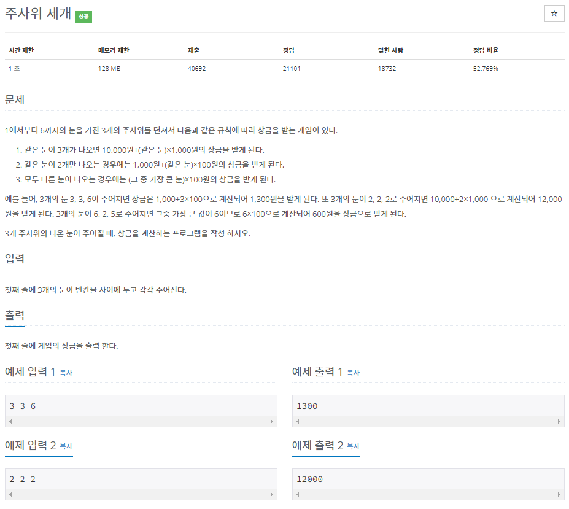
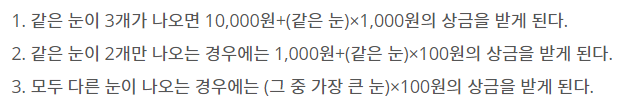
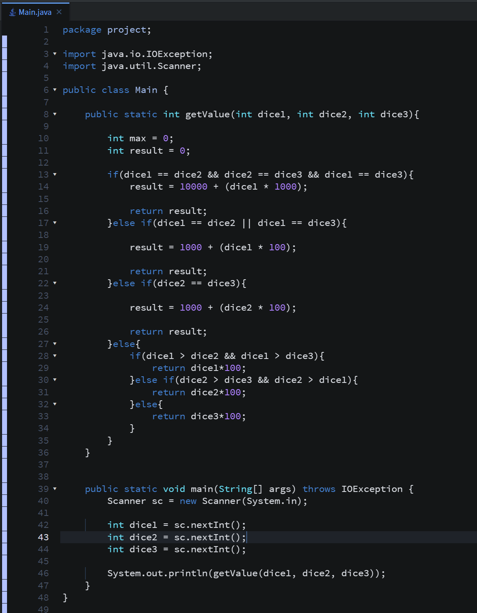
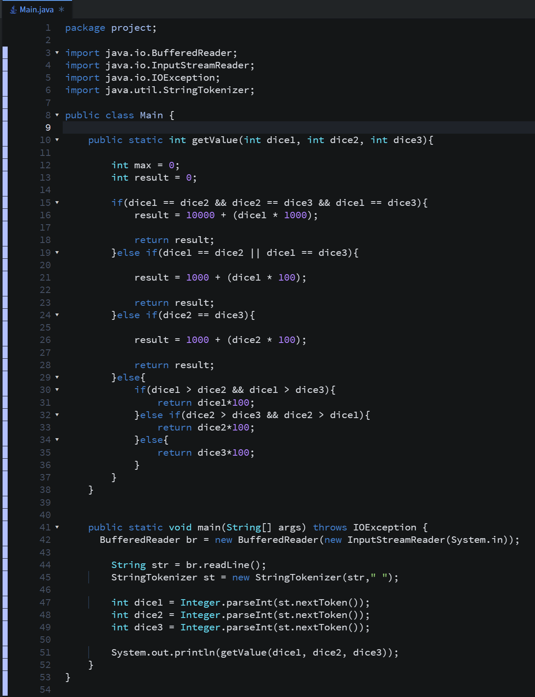
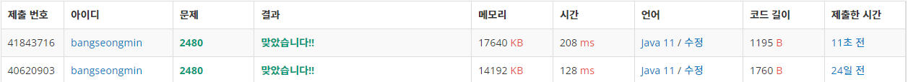

* 문제(2단계 - 7 )

* 간단 설명

  어렵게 생각하면 어렵겠지만, 간단하게 풀이가능한 문제입니다.

  조건은 다음과 같이 3가지입니다. 

  같은 눈에 개수의 따라 계산되는 식만 다르게 해주면 됩니다!! 

  (1 단계) 주사위 3개 눈의 값을 한 줄로 입력

  (2 단계) 동일 값의 개수를 파악한다

  (3 단계) 조건에 따라 계산을 하여 출력한다.

* 풀이

   (방법 1) Scanner

   (방법 2) BufferedReader

* 성능 비교

**(방법 1) 208ms**

**(방법 2) 128ms**

* 정리

  2일차가 24일전이지만... 얼른 포스팅하도록 노력하겠습니다!! ㅎㅎ
