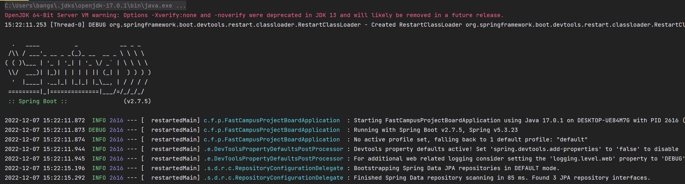
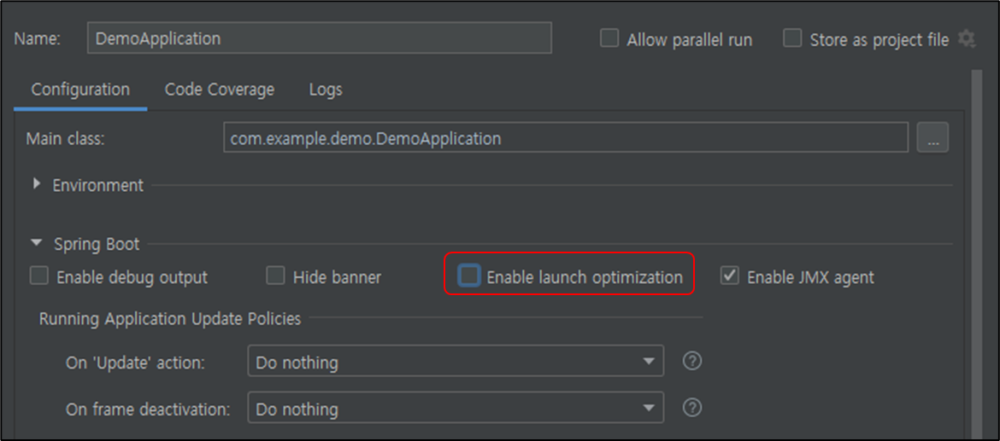
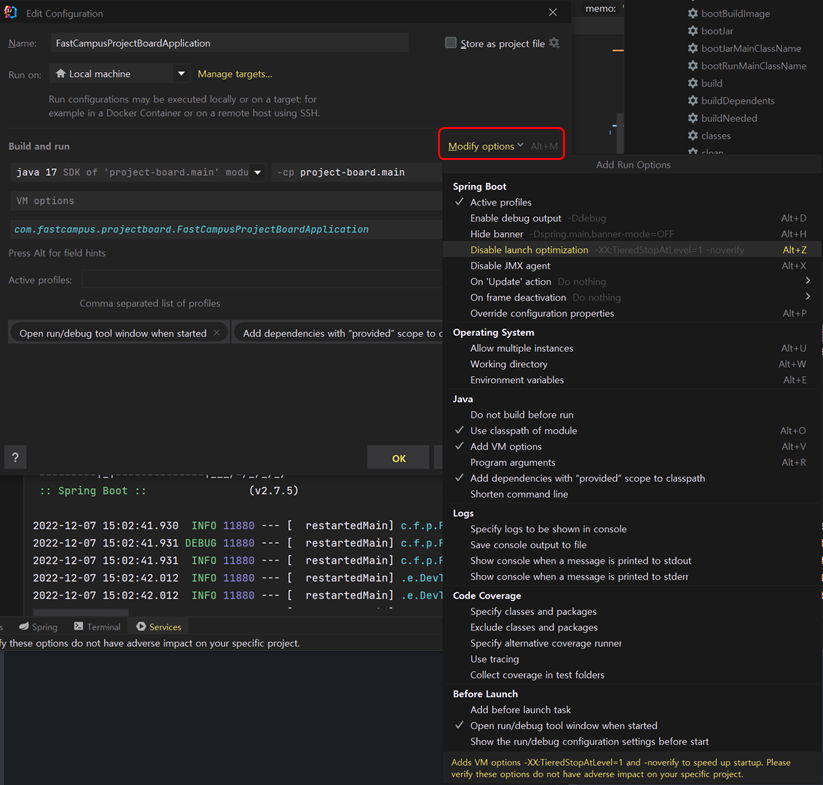
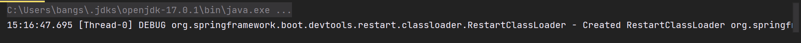
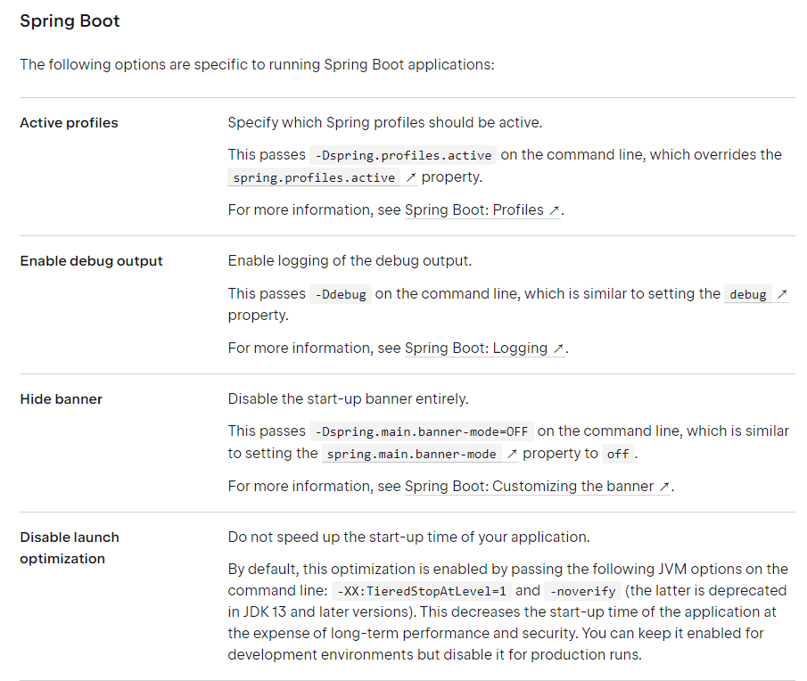

## **Intellij Warning**

---

Intellij IDE로 Spring Boot Application을 실행하면 다음과 같은 에러가 뜨는 것을 경험하였다.

**오류 메시지**

OpenJDK 64-Bit Server VM warning: Options -Xverify:none and - noverify were deprecated in JDK 13 and will likely be removed in a future release.

**원인**

JDK 13에서 -Xverify:none과 -noverify 옵션이 제거되면서 발생하는 오류라고 한다.

**해결 방법**

* Intellij Build Configuration에서 **Enable launch optimization**을 체크 해제 하는 방법

현재 2022.1.4버전을 사용하는 필자는 UI가 변경되어 이러한 화면을 찾을 수 없었다.

최신 버전을 사용하는 필자는 아래와 같이 설정이 가능하다.

위와 같이 설정을 마치면, 아래와 같이 경고가 사라지는 것을 볼 수 있다.

이외에도 다양한 옵션 설정이 가능하다.

**참고**

* <https://www.baeldung.com/jvm-tiered-compilation>
* <https://www.jetbrains.com/help/idea/run-debug-configuration-spring-boot.html#configuration-tab>
