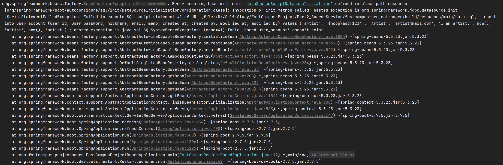
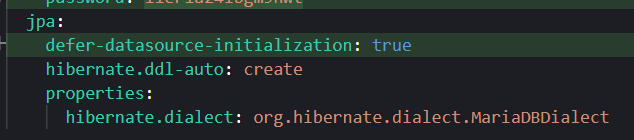

## **[에러] org.springframework.beans.factory.BeanCreationException: Error creating bean with name 'dataSourceScriptDatabaseInitializer' defined in class path resource**

---

### 원인은 무엇일까?

Spring 버전 2.4에서는 문제없이 작동하지만 Spring 2.5이후로는 SQL Script DataSource Initializeation의 기능이 변경되어

data.sql 스크립트는 hibernate가 초기화되기 전에 실행되며 hibernate에 의해 생성된 스키마에 데이터를 넣기 위해 data.sql을 사용하고 싶으면 추가적인 설정이 필요하다.

### 해결 방법은?

application.properties(yaml)에 spring.jpa.defer-datasource-initialization을 true로 설정해주면 된다.

