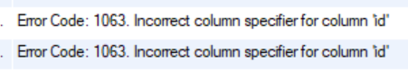

## Error Code: 1063, incorrect column specifier for column

---

### **원인**

도메인 클래스에 id값을 Long으로 설정하고 DB 테이블 id 값을 동일하게 적용하려고 할때 발생할 수 있는 문제이다.

Auto Increment를 하기 위해서는 int 타입 또는 float 타입을 설정해야하는데, Long 타입을 설정하였기 때문에 발생한 문제이다.

### 해결

문제 해결은 간단하다. long 타입 대신하여 bigint를 사용하면 해결된다.
