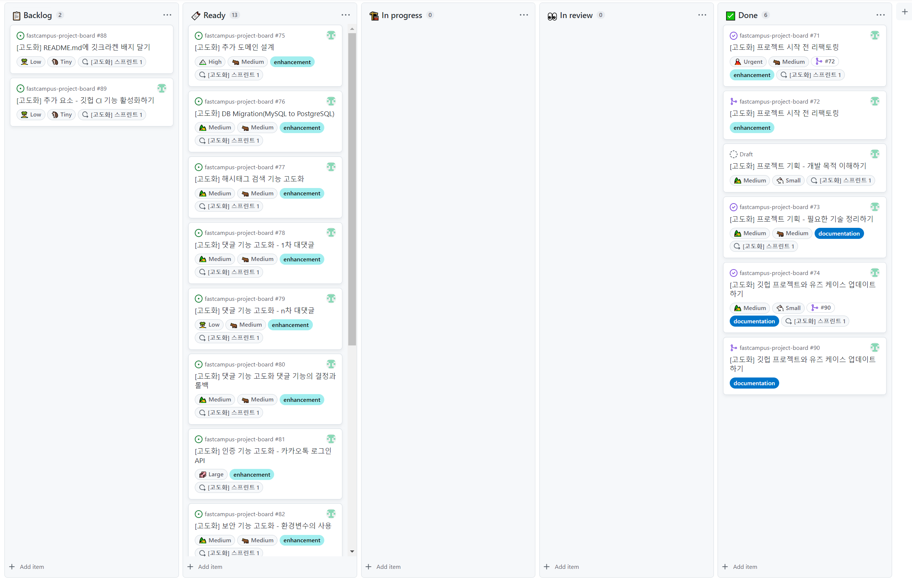

## **프로젝트 기획**

---

### **개발 목적 이해하기**

---

#### **게시판 서비스 고도화 프로젝트의 목표**

* 게시판 서비스 프로젝트의 목표를 그대로 이어간다.  
  + 누구나 이해하기 쉬운 소재로 명확한 기능 요구사항을 만들고  
    요구사항을 통해서 문서작업을 하고 문서작업을 토대로 개발을 이어나가는 것이다.
  + 이때 Java Spring Boot 기술 스택을 사용하고 기술적인 방법을 배워나가고 최신 버전의 기술과 기술 도구를 사용하면서 최신 기술 동향을 파악하고 새로운 문제를 직접 경험하며 해결해나가는 것이다.
* 기존 프로젝트에서 발전 가능한 아이디어를 고민한다.
* 새로운 아이디어를 구현하여 프로젝트를 발전시키는 경험을 한다.

---

#### **고객의 새로운 문제 정의와 해결**

* **DB Migration**(MySQL to PostgreSQL)
* **대댓글**
* **해시태그 기능 개선**하나의 게시글이 여러 개에 해시태그를 가질 수 있도록 변경할 것.
* **카카오톡 로그인**OAuth 2.0 기술을 이용하여 카카오톡 로그인 기술 활용
* **기능 배포 결정과 취소(Rollback)**기능 일부를 Rollback 하는 직접 시나리오를 만들어 진행할 것
* **Hashicorp Vault**민감 정보에 안전하게 보관할 수 있는 솔루션
* **Swagger UI**API를 자동으로 문서화해주는 도구

---

#### **게시판 만들기 프로젝트에서 변경된 도구 버전**

* IDE: [Intellij IDEA 2022.3 (Ultimate Edition)](https://www.jetbrains.com/idea/whatsnew/2022-3/)
* 언어: Java 17(유지)
* 프레임워크: Spring boot 2.7.0(유지)  
  + [2.7.1](https://github.com/spring-projects/spring-boot/releases/tag/v2.7.1)
  + [2.7.2](https://github.com/spring-projects/spring-boot/releases/tag/v2.7.2)
* 빌드 도구: gradle 7.4.1(유지)
* git GUI: GitKraken 8.8.0
  + [8.7.0](https://help.gitkraken.com/gitkraken-client/current/#version-8-7-0%20•)
  + [8.8.0](https://help.gitkraken.com/gitkraken-client/current/#version-8-8-0%206)

### **필요한 기술 정리하기**

---

#### **예상하는 세부 기능들**

* **대댓글 도메인의 설계**
* **해시태그 기능 개선을 위한 게시글 도메인의 수정 여부 검토**
* **관련 비즈니스 로직과 테스트 변경**
* **인증 기능 업데이트**: OAuth 2.0 + Kakoa 로그인
* **웹 화면 변경**
  + 게시판 페이지: 대댓글 표현
  + 로그인 페이지: Kakao 로그인 화면으로 변경
* **추가 의존성 조사 및 선택**
  + Spring Initializr - OAuth2 Client, Vault configuration
  + Swagger UI - SPringdoc-openapi

### **깃 헙 프로젝트와 유즈 케이스 업데이트하기**

---

[원문에서 이미지 보기](https://to-be-a-artist.tistory.com/267)

**변경된 사항**

* **카카오 로그인 인증**  
  카카오 로그인 인증이 추가됨에 따라 DB 인증 기능이 제거할 가능성이 있음.
* **회원가입**회원가입 페이지는 만들지 않게 됨에 따라 use-case에서 제거함.
* **게시판 보기 to 회원 로그인**게시판 보기 기능이 회원 로그인 관계없이 사용 가능한 기능인데 include 처리되어 있어 제거함.
