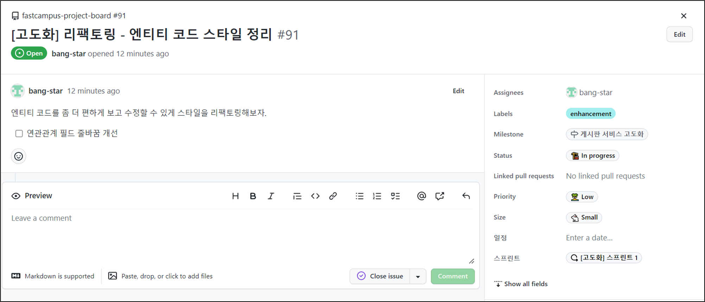
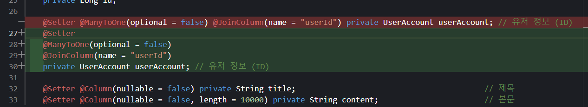
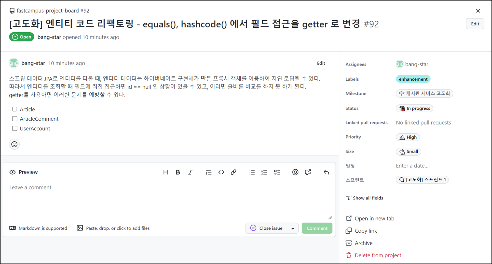
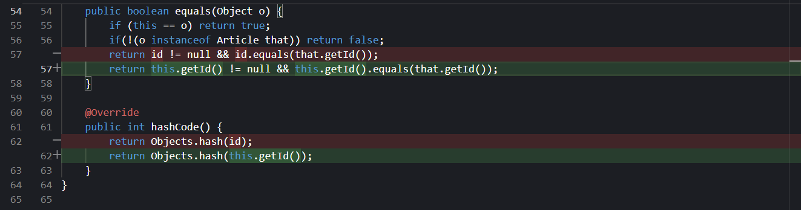
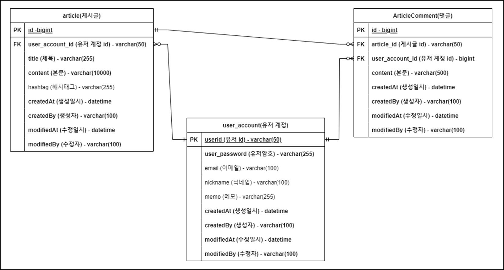
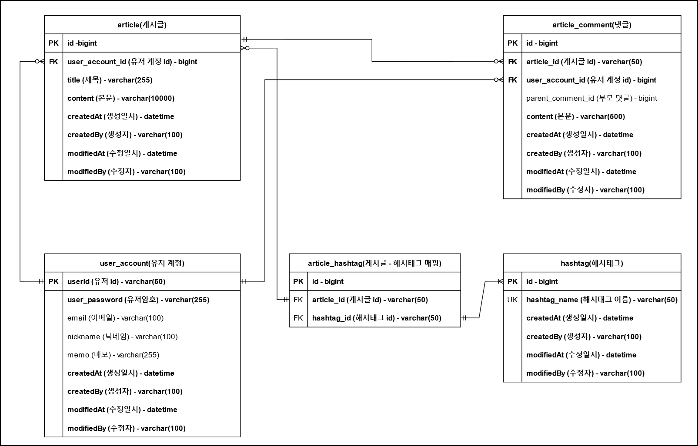
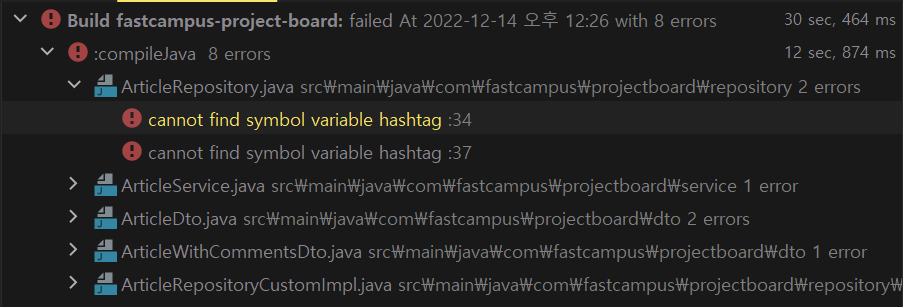
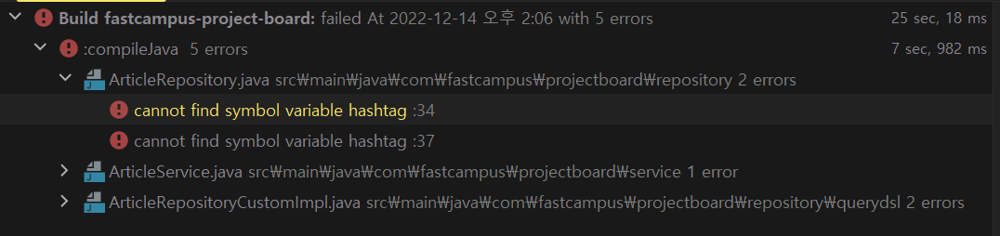
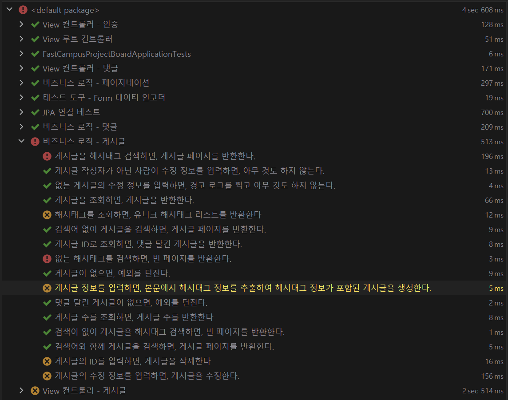

## **추가 도메인 설계**

---

### **리팩토링**

---

#### **엔티티 코드 리팩토링**




> 여러 줄로 쓰면 코드 줄이 길어져 한 줄로 코드를 작성했었는데   
> 요구사항이 늘어나면서 연관관계가 추가되면 어노테이션이나 코드 패턴이 점점 달라져서 정렬이 보기 좋지 않을 것으로 판단되어 이에 연관관계 필드만 우선 평범한 멀티 라인 스타일로 변경하게 되었다.

---

#### **엔티티 코드 리팩토링**



스프링 데이터 JPA로 엔티티를 다룰 때, 엔티티 데이터는 하이버네이트 구현체가 만든 프록시 객체를 이용하여 지연 로딩될 수 있다. 따라서 엔티티를 조회할 때 필드에 직접 접근하면 id == null 인 상황이 있을 수 있고, 이러면 올바른 비교를 하지 못 하게 된다. getter를 사용하면 이러한 문제를 예방할 수 있다.

**Article**



> 필드에 직접 접근하면, Hibernate가 지연 로딩하려고 만든 프록치 객체를 다룰 때 필드 값이 `null`일 수 있다.  
> 그렇게 되면 제대로 비교 로직을 수행할 수 없기 때문에 getter를 이용하도록 수정하였다.  
>   
> 이를 통해 프록시 객체를 타더라도 제대로 값을 읽어올 수 있게 되었다.  
>   
> **구체적인 설명**  
> 만약 지연로딩이 일어난 상황이라면 즉 영속성 컨텍스트에서 읽기 전인 상황(즉 필요하다고 느끼지 않아서 읽지 않고 프록시 객체만 가지고 있는 상황)이라면 id가 `null`일 수 있다. 그렇게 되면 `id != null` 조건에 의해 비교 자체가 불가능해지게 되고 원하지 않은 결과가 발생할게 된다.  
>   
> getter method를 사용하면 프록시 객체도 제대로 요구사항을 제대로 전달할 수 있게 되어 지연로딩에 문제 없이 제대로 값을 불러올 수 있게 된다.

> **[참고] N+1 Query**  
> JPA Query를 사용할 때 최적화된 Query를 뽑아낼 수 있는데, 대표적으로 N+1 Query가 있다.  
> **N+1 Query**는 보통 JPA를 사용하면서 부작용을 이야기할 때 많이 이야기하지만 엄밀히 말하면 항상 부작용은 아니다. 오히려 Query 최적화의 결과이다. 최적된 Query가 되느냐 부작용이 되느냐는 Query에 결과가 개발자가 의도하였는지, 의도하지 않았는지에 결정이 된다. 의도한대로 Inner Join을 하거나 하지 않거나 그것이 의도대로 동작했다면 최적화가 잘 된 JPQ Query일 것이고, 의도하지 않은 추가적인 Query가 발생하였다면 문제가 되는 것이다. 

### **기존 도메인 코드 분석**

---

도메인 분석은 기존 ERD 다이어그램을 통해 변경된 요구사항이 반영될 수 있도록 수정하는 단계이다.

#### **기존 ERD**



> **1. 게시글에 해시태그 필드에 해시태그를 하나만 저장할 수 있게 설계되어 있다.**  
> 목표하는 것은 하나의 게시글이 여러 개에 해시태그를 갖을 수 있도록 하는 것이 목표이다. 즉 1 게시글에 N개 해시태그를 갖는 1:N 관계가 된다. 조금 더 생각해 보면 하나의 해시태그도 여러 개에 게시글에 포함될 수 있다.   
> 정리하면 서로가 서로에게 1:N 관계이므로 M:N 관계로 다대다 관계이다.   
>   
> JPA에서 대응하는 어노테이션은 **ManyToMany** 이다. ManyToMany 관계를 만들기 위해서는 보통 데이터베이스 2개 사이에 맵핑 테이블을 만들어서 표현을 한다.   
>   
> **2. 댓글에 대댓글이 어떤 댓글에 댓글인가를 표현할 수 없는 상태이다.**게시글에 댓글인 것을 확인할 수 있으나 대댓글을 표현하려면 어떤 댓글은 특정 댓글에 자식 댓글이어야 한다.  
> 즉 댓글과 댓글 사이에 부모 자식 관계가 형성되어야 한다. 

---

#### **변경된 ERD**



**변경 사항**

**1. 게시글에서 해시태그 필드가 제거되었고, 해시태그 테이블이 추가되었다.**

> 해시태그 테이블은 해시태그 이름 필드와 메타데이터 4개가 있다. 해시태그 테이블이 심플한 데이블인데 메타데이터 4개가 동일하게 들어가는 것이 비효율적이라고 생각할 수 있다.   
>   
> 데이터의 효율성보다는 데이터에 관리적인 측면을 용이하게 하기 위해서 모든 부분에 메타데이터를 넣기로한 컨벤션을 설정한 상태이다.

**2. 게시글과 해시태그 관계는 매핑 테이블이 정한다.**

> 매핑 테이블은 기본적으로 두 개에 Key(게시글 id, 해시태그 id)를 하나에 레코드에 갖게 되어있어 어떤 게시글이 어떤 해시태그와 연결 되어있는지 알 수 있다.  
>   
> **🙋‍♀ 다른 테이블과 다르게 왜 메타데이터가 없을까?**=> 기획한 개발 방법이 매핑 테이블을 직접 만드는 방향으로 접근하지 않을 것이기 때문이다.   
> JPA 구현체에 기술을 이용하여 직접 만들지 않고 자동으로 생성되게 되어 일종의 커스텀 필드인 메타데이터는 프레임워크에서는 알 수 없기 때문에 자동으로 생성할 때는 자동으로 들어가지 않게 된다.

**3. 다대다 맵핑를 사용하는 이유**

> 다대다를 대신하여 ManyToOne 구조를 2번 사용하여 중간 매핑 테이블을 직접만들고 연관관계를 직접 이어주는 방식을 설계할 수 있다. 그렇게 되면 직접 데이터베이스 테이블을 만들어 직접 엔티티를 표현하게 되어 매핑 테이블은 추가적인 가공 또는 인덱스를 붙이는 작업 등에 직접적인 관리를 할 수 있게 된다.   
>   
> 그런데 ManyToMany를 이용하게 되면 매핑 테이블이 자동적으로 만들어져서 추가적인 가공 또는 인덱스를 붙이는 작업 등에 직접적인 관리를 할 수 없게 되고, 가장 중요한 것은 매핑 테이블이 자동으로 만들어지게 되어 매핑 테이블이 우리의 설계에서 숨겨져서 보이지 않는다는 문제가 발생한다.  
>   
> 예시) 협업 구조로 인프라 팀과 소프트웨어 개발 팀으로 나눴을 때 DBA는 ERD에서 자동생성되는 매핑 테이블을 보지 못할 수 있다. 실제로 존재하는 테이블이지만 설계에는 자바코드에 들어있지 않아 관리가 어려워지는 또는 누락되는 문제가 발생할 수 있다.   
>   
> **😠 그런데도 불구하고 왜? 다대다 맵핑을 사용하는가?**  
> 실무에서 사용하지 않는다는 이유로 실무에서 자주 사용하는 접근법만 다루게 되면 기본적으로 배울 수 있었던 부분들을 놓치게 될 수 있다. ManyToMany를 사용하지 않고 ManyToOne만 사용하게 되면 ManyToMany는 언제 연습할 수 있을까? 그래서 ManyToMany를 직접 사용하여 특징과 문제를 파악하여 ManyToOne를 사용했을 때와 비교하여 비교의 경험을 쌓기 위함이다.

### **해시태그 도메인 표현**

---

#### 기존 코드

```java
@Getter
@ToString(callSuper = true)
@Table(indexes = {
        @Index(columnList = "content"),
        @Index(columnList = "createdAt"),
        @Index(columnList = "createdBy")
})
@Entity
public class ArticleComment extends AuditingFields {

    @Id
    @GeneratedValue(strategy = GenerationType.IDENTITY)
    private Long id;

    @Setter
    @ManyToOne(optional = false)
    private Article article;               // 게시글 (ID)

    @Setter
    @ManyToOne(optional = false)
    @JoinColumn(name = "userId")
    private UserAccount userAccount;       // 유저 정보 (ID)

    @Setter @Column(nullable = false, length = 500) private String content;     // 본문


    protected ArticleComment() { }

    private ArticleComment(Article article, UserAccount userAccount, String content) {
        this.article = article;
        this.userAccount = userAccount;
        this.content = content;
    }

    public static ArticleComment of(Article article, UserAccount userAccount, String content) {
        return new ArticleComment(article, userAccount, content);
    }

    @Override
    public boolean equals(Object o) {
        if (this == o) return true;
        if (!(o instanceof ArticleComment that)) return false;
        return this.getId() != null && this.getId().equals(that.getId());
    }

    @Override
    public int hashCode() {
        return Objects.hash(this.getId());
    }
}
```

* 해시코드가 하나밖에 저장할 수 없는 구조  
  => 해시태그 전용 클래스를 생성하여 ManyToMany 구조로 변경

#### **Hashtag**

```java
@Getter
@ToString(callSuper = true)
@Table(indexes = {
                @Index(columnList = "hashtagName", unique = true),
                @Index(columnList = "createdAt"),
                @Index(columnList = "createdBy")
})
@Entity
public class Hashtag extends AuditingFields {
    @Id
    @GeneratedValue(strategy = GenerationType.IDENTITY)
    private Long id;

    @ToString.Exclude
    @ManyToMany(mappedBy = "hashtags")
    private Set<Article> articles = new LinkedHashSet<>();

    @Setter @Column(nullable = false) private String hashtagName;

    protected Hashtag() {}

    private Hashtag(String hashtagName) {
        this.hashtagName = hashtagName;
    }

    public static Hashtag of(String hashtagName){
        return new Hashtag(hashtagName);
    }

    @Override
    public boolean equals(Object o) {
        if (this == o) return true;
        if (!(o instanceof Hashtag that)) return false;
        return this.getId() != null && this.getId().equals(that.id);
    }

    @Override
    public int hashCode() {
        return Objects.hash(this.getId());
    }

}
```

* **ToString.Exclue 는 순환참조 문제를 해결하기 위함**
* **hashtagName, 생성일, 생성자에 Index 설정**인덱스는 추가 쓰기 및 저장 공간을 희생하여 테이블에 대한 데이터 검색 작업의 속도를 향상시키는 데이터 구조이다.
* **equalsAndhashcode에서 getter를 이용한 접근 방법 선택**  
  필드에 직접 접근하게 되면 Hibernate가 지연 로딩하려고 만든 프록치 객체를 다룰 때 필드 값이 `null`일 수 있다.  
  그렇게 되면 제대로 비교 로직을 수행할 수 없기 때문에 getter를 이용한다.

#### **게시글**

```java
@Getter
@ToString(callSuper = true)
@Table(indexes = {
        @Index(columnList = "title"),
        @Index(columnList = "createdAt"),
        @Index(columnList = "createdBy")
})
@Entity
public class Article extends AuditingFields {

    @Id
    @GeneratedValue(strategy = GenerationType.IDENTITY)
    private Long id;

    @Setter
    @ManyToOne(optional = false)
    @JoinColumn(name = "userId")
    private UserAccount userAccount; // 유저 정보 (ID)

    @Setter @Column(nullable = false) private String title;                                         // 제목
    @Setter @Column(nullable = false, length = 10000) private String content;                       // 본문

    @ToString.Exclude
    @JoinTable(
            name = "article_hashtag",
            joinColumns = @JoinColumn(name = "articleId"),
            inverseJoinColumns = @JoinColumn(name = "hashtagId")
    )
    @ManyToMany(cascade = {CascadeType.PERSIST, CascadeType.MERGE})
    private Set<Hashtag> hashtags = new LinkedHashSet<>();

    @ToString.Exclude
    @OrderBy("createdAt DESC")
    @OneToMany(mappedBy = "article", cascade = CascadeType.ALL)
    private final Set<ArticleComment> articleComments = new LinkedHashSet<>();


    protected Article() {}

    private Article(UserAccount userAccount, String title, String content) {
        this.userAccount = userAccount;
        this.title = title;
        this.content = content;
    }

    public static Article of(UserAccount userAccount, String title, String content) {
        return new Article(userAccount, title, content);
    }

    public void addHashtag(Hashtag hashtag){
        this.getHashtags().add(hashtag);
    }

    public void addHashtags(Collection<Hashtag> hashtags){
        this.getHashtags().addAll(hashtags);
    }

    public void clearHashtags(){
        this.getHashtags().clear();
    }

    @Override
    public boolean equals(Object o) {
        if (this == o) return true;
        if(!(o instanceof Article that)) return false;
        return this.getId() != null && this.getId().equals(that.getId());
    }

    @Override
    public int hashCode() {
        return Objects.hash(this.getId());
    }
}
```

* **게시글에만 cascade 옵션**
  + **Cascase옵션은 상태 변화를 전파시키는 옵션**(PERSIST는 insert, MERGE는 update)  
    비즈니스 로직은 게시글을 작성하면 알아서 해시태그가 사용되는 구조이고, 해시태그를 별도로 직접 관리하는 기능은 제공하지 않고 있다.
    - **Transient** - 객체를 생성하고, 값을 주어도 JPA나 Hibernate가 그 객체에 관해 아무것도 모르는 상태. 즉, 데이터베이스와 매핑된 것이 아무것도 없다.
    - **Persistent** - 저장을 하고나서, JPA가 아는 상태(관리하는 상태)가 된다. 그러나 .save()를 했다고 해서, 이 순간 바로 DB에 객체에 대한 데이터가 들어가는 것은 아니다. JPA가 persistent 상태로 관리하고 있다가, 후에 데이터를 저장한다(1차 캐시, Dirty Checking(변경사항 감지), Write Behind(최대한 늦게, 필요한 시점에 DB에 적용) 등의 기능을 제공한다)
    - **Detached** - JPA가 더이상 관리하지 않는 상태. JPA가 제공해주는 기능들을 사용하고 싶다면, 다시 persistent 상태로 돌아가야한다.
    - **Removed** - JPA가 관리하는 상태이긴 하지만, 실제 commit 이 일어날 때 삭제가 일어난다.
* **@JoinTable**  
  JoinTable 옵션은 ManyToMany 작성한는 엔티티 두개에 대해 주인관계를 설정하는 것이다.  
  게시글을 중심으로 해시태그가 변경될 수 있으므로 주인 입장을 게시글에게 주도록 하기 위해 게시글에 @JoinTable 어노테이션을 붙여 사용하는 것이다.   
  JoinTable은 ManyToMany에서 둘다 붙이는 것이 아니라 주인 역할을 하는 Entity에 붙여주게 된다.
  + name - 엔티티 이름(설정하지 않을 경우, 자동으로 생성되게 되는데 예측할 수 없는 이름을 만들어질 수 있음)
  + JoinColumns(주) - 현재 엔티티를 참조하는 외래키
  + inverseJoinColumns - 반대방향 엔티티를 참조하는 외래키  

    name 테이블에 JoinColumns과 inverseJoinColumns 은 필드명으로 동작하게 된다.
* **해시태그 추가, 컬렉션 추가, 초기화 작업을 위한 메소드를 추가하였다.**

다음과 같이 Entity에 변화로 인해 테스트에서 에러가 발생하고 있다.



제일 먼저 영향을 받는 곳은 Dto 코드이다.

Entity로부터 데이터를 받아들이고 변환하는 로직이 Dto에 들어있기 때문이다. 이와 같이 새로운 기능을 개발할 때 해당 기능이 도메인에 변경을 유발하게 될 경우, 변경에 영향이 많은 부분이 전파되게 된다.

---

#### **도메인 변경에 따른 수정 작업**

**ArticleWithCommentDto**

```java
public record ArticleWithCommentsDto(
        Long id,
        UserAccountDto userAccountDto,
        Set<ArticleCommentDto> articleCommentDtos,
        String title,
        String content,
        Set<HashtagDto> hashtagDtos,
        LocalDateTime createdAt,
        String createdBy,
        LocalDateTime modifiedAt,
        String modifiedBy
) {
    public static ArticleWithCommentsDto of(Long id, UserAccountDto userAccountDto, Set<ArticleCommentDto> articleCommentDtos, String title, String content, Set<HashtagDto> hashtagDtos, LocalDateTime createdAt, String createdBy, LocalDateTime modifiedAt, String modifiedBy) {
        return new ArticleWithCommentsDto(id, userAccountDto, articleCommentDtos, title, content, hashtagDtos, createdAt, createdBy, modifiedAt, modifiedBy);
    }

    public static ArticleWithCommentsDto from(Article entity) {
        return new ArticleWithCommentsDto(
                entity.getId(),
                UserAccountDto.from(entity.getUserAccount()),
                entity.getArticleComments().stream()
                        .map(ArticleCommentDto::from)
                        .collect(Collectors.toCollection(LinkedHashSet::new)),
                entity.getTitle(),
                entity.getContent(),
                entity.getHashtags().stream()
                        .map(HashtagDto::from)
                        .collect(Collectors.toUnmodifiableSet()),
                entity.getCreatedAt(),
                entity.getCreatedBy(),
                entity.getModifiedAt(),
                entity.getModifiedBy()
        );
    }

}
```

**HashtagDto**

```java
public record HashtagDto(
        Long id,
        String hashtagName,
        LocalDateTime createdAt,
        String createdBy,
        LocalDateTime modifiedAt,
        String modifiedBy
) {
    public static HashtagDto of(String hashtagName) {
        return new HashtagDto(null, hashtagName, null, null, null, null);
    }

    public static HashtagDto of(Long id, String hashtagName, LocalDateTime createdAt, String createdBy, LocalDateTime modifiedAt, String modifiedBy) {
        return new HashtagDto(id, hashtagName, createdAt, createdBy, modifiedAt, modifiedBy);
    }

    public static HashtagDto from(Hashtag entity){
        return new HashtagDto(
                entity.getId(),
                entity.getHashtagName(),
                entity.getCreatedAt(),
                entity.getCreatedBy(),
                entity.getModifiedAt(),
                entity.getModifiedBy()
        );
    }

    public Hashtag toEntity(){
        return Hashtag.of(hashtagName);
    }

}
```

**=> HashtagDto를 통해 ArticleWithCommentDto 에러해결**

**ArticleRequest**

```java
public record ArticleRequest(
        String title,
        String content
) {

    public static ArticleRequest of(String title, String content) {
        return new ArticleRequest(title, content);
    }

    public ArticleDto toDto(UserAccountDto userAccountDto) {
        return toDto(userAccountDto, null);
    }

    public ArticleDto toDto(UserAccountDto userAccountDto, Set<HashtagDto> hashtagDtos) {
        return ArticleDto.of(
                userAccountDto,
                title,
                content,
                hashtagDtos
        );
    }
}
```

**ArticleResponse**

```java
public record ArticleResponse(
        Long id,
        String title,
        String content,
        Set<String> hashtags,
        LocalDateTime createdAt,
        String email,
        String nickname
){

    public static ArticleResponse of(Long id, String title, String content, Set<String> hashtags, LocalDateTime createdAt, String email, String nickname) {
        return new ArticleResponse(id, title, content, hashtags, createdAt, email, nickname);
    }

    public static ArticleResponse from(ArticleDto dto) {
        String nickname = dto.userAccountDto().nickname();
        if (nickname == null || nickname.isBlank()) {
            nickname = dto.userAccountDto().userId();
        }

        return new ArticleResponse(
                dto.id(),
                dto.title(),
                dto.content(),
                dto.hashtagDtos().stream()
                        .map(HashtagDto::hashtagName)
                        .collect(Collectors.toUnmodifiableSet()),
                dto.createdAt(),
                dto.userAccountDto().email(),
                nickname
        );
    }

}
```

ArticleResponse가 변하였기 때문에 ArticleWithCommentResponse에 영향을 끼친다.

**ArticleWitchCommentReponse**

```java
public record ArticleWithCommentsResponse(
        Long id,
        String title,
        String content,
        Set<String> hashtags,
        LocalDateTime createdAt,
        String email,
        String nickname,
        String userId,
        Set<ArticleCommentResponse> articleCommentsResponse
){

    public static ArticleWithCommentsResponse of(Long id, String title, String content, Set<String> hashtags, LocalDateTime createdAt, String email, String nickname, String userId, Set<ArticleCommentResponse> articleCommentResponses) {
        return new ArticleWithCommentsResponse(id, title, content, hashtags, createdAt, email, nickname, userId, articleCommentResponses);
    }

    public static ArticleWithCommentsResponse from(ArticleWithCommentsDto dto) {
        String nickname = dto.userAccountDto().nickname();
        if (nickname == null || nickname.isBlank()) {
            nickname = dto.userAccountDto().userId();
        }

        return new ArticleWithCommentsResponse(
                dto.id(),
                dto.title(),
                dto.content(),
                dto.hashtagDtos().stream()
                        .map(HashtagDto::hashtagName)
                        .collect(Collectors.toUnmodifiableSet()),
                dto.createdAt(),
                dto.userAccountDto().email(),
                nickname,
                dto.userAccountDto().userId(),
                dto.articleCommentDtos().stream()
                        .map(ArticleCommentResponse::from)
                        .collect(Collectors.toCollection(LinkedHashSet::new))
        );
    }

}
```

**ArticleDto**

```java
public record ArticleDto(
        Long id,
        UserAccountDto userAccountDto,
        String title,
        String content,
        Set<HashtagDto> hashtagDtos,
        LocalDateTime createdAt,
        String createdBy,
        LocalDateTime modifiedAt,
        String modifiedBy
) {

    public static ArticleDto of(UserAccountDto userAccountDto, String title, String content, Set<HashtagDto> hashtagDtos) {
        return new ArticleDto(null, userAccountDto, title, content, hashtagDtos, null, null, null, null);
    }

    public static ArticleDto of(Long id, UserAccountDto userAccountDto, String title, String content, Set<HashtagDto> hashtagDtos, LocalDateTime createdAt, String createdBy, LocalDateTime modifiedAt, String modifiedBy) {
        return new ArticleDto(id, userAccountDto, title, content, hashtagDtos, createdAt, createdBy, modifiedAt, modifiedBy);
    }

    public static ArticleDto from(Article entity) {
        return new ArticleDto(
                entity.getId(),
                UserAccountDto.from(entity.getUserAccount()),
                entity.getTitle(),
                entity.getContent(),
                entity.getHashtags().stream()
                        .map(HashtagDto::from)
                        .collect(Collectors.toUnmodifiableSet()),
                entity.getCreatedAt(),
                entity.getCreatedBy(),
                entity.getModifiedAt(),
                entity.getModifiedBy()
        );
    }

    public Article toEntity(UserAccount userAccount) {
        return Article.of(
                userAccount,
                title,
                content
        );
    }

}
```

**HashtagWithArticlesDto**

해시태그와 연관된 게시글을 보기 위한 요구사항이 발생할 수 있기 때문에 생성함.

```java
public record HashtagWithArticlesDto(
        Long id,
        Set<ArticleDto> articles,
        String hashtagName,
        LocalDateTime createdAt,
        String createdBy,
        LocalDateTime modifiedAt,
        String modifiedBy
) {

    public static HashtagWithArticlesDto of(Set<ArticleDto> articles, String hashtagName) {
        return new HashtagWithArticlesDto(null, articles, hashtagName, null, null, null, null);
    }

    public static HashtagWithArticlesDto of(Long id, Set<ArticleDto> articles, String hashtagName, LocalDateTime createdAt, String createdBy, LocalDateTime modifiedAt, String modifiedBy) {
        return new HashtagWithArticlesDto(id, articles, hashtagName, createdAt, createdBy, modifiedAt, modifiedBy);
    }

    public static HashtagWithArticlesDto from(Hashtag entity) {
        return new HashtagWithArticlesDto(
                entity.getId(),
                entity.getArticles().stream()
                        .map(ArticleDto::from)
                        .collect(Collectors.toUnmodifiableSet())
                ,
                entity.getHashtagName(),
                entity.getCreatedAt(),
                entity.getCreatedBy(),
                entity.getModifiedAt(),
                entity.getModifiedBy()
        );
    }

    public Hashtag toEntity() {
        return Hashtag.of(hashtagName);
    }

}
```

변경을 하였지만 빌드 서비스 로직들이 영향을 받았기 때문에 테스트에 많은 에러가 발생하고 있다.



테스트용 data.sql 파일에서도 게시글에 해시태그가 사라짐에 따라 변경을 해줄 필요가 있다.

data.sql에서 게시글에 해시태그를 없애고, 해시태그 테이블을 생성하고, 게시글과 해시태그 매핑 테이블에 대한 테스트 데이터를 넣어줘야한다.

```sql
insert into article (user_id, title, content, created_by, modified_by, created_at, modified_at) values
('artist2', 'Quisque ut erat.', 'Vestibulum quam sapien, varius ut, blandit non, interdum in, ante. Vestibulum ante ipsum primis in faucibus orci luctus et ultrices posuere cubilia Curae; Duis faucibus accumsan odio. Curabitur convallis. Duis consequat dui nec nisi volutpat eleifend. Donec ut dolor. Morbi vel lectus in quam fringilla rhoncus. Mauris enim leo, rhoncus sed, vestibulum sit amet, cursus id, turpis. Integer aliquet, massa id lobortis convallis, tortor risus dapibus augue, vel accumsan tellus nisi eu orci. Mauris lacinia sapien quis libero. #pink', 'Kamilah', 'Murial', '2021-05-30 23:53:46', '2021-03-10 08:48:50'),
('artist2', 'Morbi ut odio.', 'Phasellus in felis. Donec semper sapien a libero. Nam dui. Proin leo odio, porttitor id, consequat in, consequat ut, nulla. Sed accumsan felis. Ut at dolor quis odio consequat varius. Integer ac leo. Pellentesque ultrices mattis odio. Donec vitae nisi. #purple', 'Arv', 'Keelby', '2021-05-06 11:51:24', '2021-05-23 08:34:54');

insert into hashtag (hashtag_name, created_at, modified_at, created_by, modified_by) values ('blue', now(), now(), 'artist', 'artist');

insert into article_hashtag (article_id, hashtag_id) values(1, 11);
```

**HashtagRepository**

Hashtag 도메인에 직접적인 영향을 받는 Repository는 필수적으로 필요하다.

```java
@RepositoryRestResource
public interface HashtagRepository extends
        JpaRepository<Hashtag, Long>,
        HashtagRepositoryCustom,
        QuerydslPredicateExecutor<Hashtag> {
    Optional<Hashtag> findByHashtagName(String hashtagName);
    List<Hashtag> findByHashtagNameIn(Set<String> hashtagNames);
}
```

**ArticleRepository**

```java
@RepositoryRestResource
public interface ArticleRepository extends
        JpaRepository<Article, Long>,
        ArticleRepositoryCustom,
        QuerydslPredicateExecutor<Article>,
        QuerydslBinderCustomizer<QArticle> {

    Page<Article> findByTitleContaining(String title, Pageable pageable);
    Page<Article> findByContentContaining(String content, Pageable pageable);
    Page<Article> findByUserAccount_UserIdContaining(String userId, Pageable pageable);
    Page<Article> findByUserAccount_NicknameContaining(String nickname, Pageable pageable);

    void deleteByIdAndUserAccount_UserId(Long articleId, String userid);

    @Override
    default void customize(QuerydslBindings bindings, QArticle root){
        bindings.excludeUnlistedProperties(true);
        bindings.including(root.title, root.content, root.hashtags, root.createdAt, root.createdBy);
        bindings.bind(root.title).first(StringExpression::containsIgnoreCase);      // like '${v}$'
        bindings.bind(root.content).first(StringExpression::containsIgnoreCase);
        bindings.bind(root.hashtags.any().hashtagName).first(StringExpression::containsIgnoreCase);
        bindings.bind(root.createdAt).first(DateTimeExpression::eq);
        bindings.bind(root.createdBy).first(StringExpression::containsIgnoreCase);
    }
}
```

**ArticleRepository에 Querydsl 부분**

```java
public interface ArticleRepositoryCustom {

    /**
     * @deprecated 해시태그 도메인을 새로 만들었으므로 이 코드는 더 이상 사용할 필요 없다.
     * @see HashtagRepositoryCustom #findAllHashtagNames()
     */
    @Deprecated
    List<String> findAllDistinctHashtags();

    Page<Article> findByHashtagNames(Collection<String> hashtagNames, Pageable pageable);
}
```

> **\* findAllDistinctHashtags는 @Deprecated 처리**  
> 기존에 사용하였던 findAllDistinctHashtags()는 articleRepository로부터 해시태그 문자열로 가져오는 메소드였다.  
> 해시태그 테이블이 분리되었으므로 사용할 필요가 없어졌지만, 하위 호환서이나 테스트 부작용을 우려하여 @Deprecated 처리하였다.   
>   
> **\* 해시태그 이름을 통해 게시글을 찾는 메소드를 추가**

```java
public class ArticleRepositoryCustomImpl extends QuerydslRepositorySupport implements ArticleRepositoryCustom {

    public ArticleRepositoryCustomImpl() {
        super(Article.class);
    }

    @Override
    public List<String> findAllDistinctHashtags() {
        QArticle article = QArticle.article;

        return from(article)
                .distinct()
                .select(article.hashtags.any().hashtagName)
                .fetch();
    }

    @Override
    public Page<Article> findByHashtagNames(Collection<String> hashtagNames, Pageable pageable) {
        QHashtag hashtag = QHashtag.hashtag;
        QArticle article = QArticle.article;

        JPQLQuery<Article> query = from(article)
                .innerJoin(article.hashtags, hashtag)
                .where(hashtag.hashtagName.in(hashtagNames));
        List<Article> articles = getQuerydsl().applyPagination(pageable, query).fetch();

        return new PageImpl<>(articles, pageable, query.fetchCount());
    }

}
```

해시태그 이름을 통해 게시글을 찾는 메소드에대한 Querydsl이다.

**ArticleService**

```java
@Slf4j
@RequiredArgsConstructor
@Transactional
@Service
public class ArticleService {

    private final ArticleRepository articleRepository;
    private final UserAccountRepository userAccountRepository;

    @Transactional(readOnly = true)
    public Page<ArticleDto> searchArticles(SearchType searchType, String searchKeyword, Pageable pageable) {
        if (searchKeyword == null || searchKeyword.isBlank()) {
            return articleRepository.findAll(pageable).map(ArticleDto::from);
        }

        return switch (searchType) {
            case TITLE -> articleRepository.findByTitleContaining(searchKeyword, pageable).map(ArticleDto::from);
            case CONTENT -> articleRepository.findByContentContaining(searchKeyword, pageable).map(ArticleDto::from);
            case ID -> articleRepository.findByUserAccount_UserIdContaining(searchKeyword, pageable).map(ArticleDto::from);
            case NICKNAME -> articleRepository.findByUserAccount_NicknameContaining(searchKeyword, pageable).map(ArticleDto::from);
            case HASHTAG -> articleRepository.findByHashtagNames(Arrays.stream(searchKeyword.split(" ")).toList(), pageable).map(ArticleDto::from);
        };
    }

    @Transactional(readOnly = true)
    public ArticleWithCommentsDto getArticleWithComments(Long articleId) {
        return articleRepository.findById(articleId)
                .map(ArticleWithCommentsDto::from)
                .orElseThrow(() -> new EntityNotFoundException("게시글이 없습니다 - articleId: " + articleId));
    }

    @Transactional(readOnly = true)
    public ArticleDto getArticle(Long articleId) {
        return articleRepository.findById(articleId)
                .map(ArticleDto::from)
                .orElseThrow(() -> new EntityNotFoundException("게시글이 없습니다 - articleId: " + articleId));
    }

    public void saveArticle(ArticleDto dto) {
        UserAccount userAccount = userAccountRepository.getReferenceById(dto.userAccountDto().userId());
        articleRepository.save(dto.toEntity(userAccount));
    }

    public void updateArticle(Long articleId, ArticleDto dto) {
        try {
            Article article = articleRepository.getReferenceById(articleId);
            UserAccount userAccount = userAccountRepository.getReferenceById(dto.userAccountDto().userId());

            if (article.getUserAccount().equals(userAccount)) {
                if (dto.title() != null) { article.setTitle(dto.title()); }
                if (dto.content() != null) { article.setContent(dto.content()); }
            }
        } catch (EntityNotFoundException e) {
            log.warn("게시글 업데이트 실패. 게시글을 수정하는데 필요한 정보를 찾을 수 없습니다 - {}", e.getLocalizedMessage());
        }
    }

    public void deleteArticle(long articleId, String userId) {
        articleRepository.deleteByIdAndUserAccount_UserId(articleId, userId);
    }

    public long getArticleCount() {
        return articleRepository.count();
    }

    @Transactional(readOnly = true)
    public Page<ArticleDto> searchArticlesViaHashtag(String hashtag, Pageable pageable) {
        if (hashtag == null || hashtag.isBlank()) {
            return Page.empty(pageable);
        }

        return articleRepository.findByHashtagNames(null, pageable).map(ArticleDto::from);
    }

    public List<String> getHashtags() {
        return articleRepository.findAllDistinctHashtags();
    }

}
```

**HashtagService**

```java
@Service
public class HashtagService {
    public Object parseHashtagNames(String content) {
        return null;
    }

    public Object findHashtagsByNames(Set<String> expectedHashtagNames) {
        return null;
    }

    public void deleteHashtagWithoutArticles(Object any) {
    }
}
```

이외에 테스트 코드는 위 코드를 반영하여 수정하였습니다.

자세한 코드는 [Github](https://github.com/bang-star/fastcampus-project-board)을 통해 참고해주세요.

**테스트 실행 결과**

테스트가 실패하는 이유는 도메인 코드가 변경되면서 대응하는 비즈니스 코드들이 전부다 깨졌기 때문이다.

테스트의 장점을 볼 수 있는데 변경으로 인해서 영향을 받는 기능이 무엇인지 쉽게 파악할 수 있다.

먼저 요구사항을 테스트에 반영하고, 그것에 맞춰 구현을 방식인 TDD를 할 수 있지만, 반대로 도메인 변경사항을 적용하였다. 기존에 테스트 코드가 잘 구성이 되어있어 구현코드가 변경하여 깨지는 테스트를 확인함으로써 어떤 부분이 영향을 받고 깨지는지를 확인할 수 있게 된다.



> 게시글에 해시태그 필드를 제거하고   
> 해시태그 테이블을 새로 생성하였을 뿐인데  
> 엄청난 변화를 만들어냈다...  
>   
> 거의 모든 Dto에 변화를 가져왔고   
> 게시글에 해시태그가 하나에서 여러개로 변경됨에 따라  
> 관련된 코드들이 전부 영향을 받았다.
