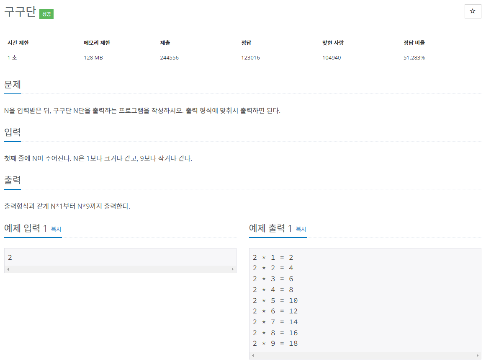
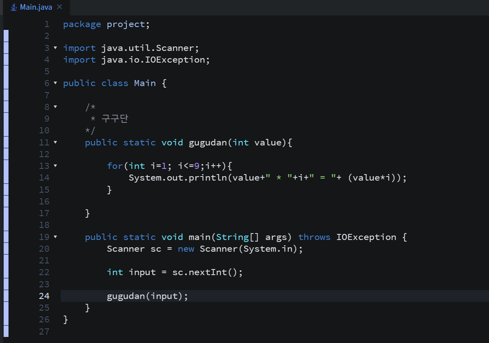
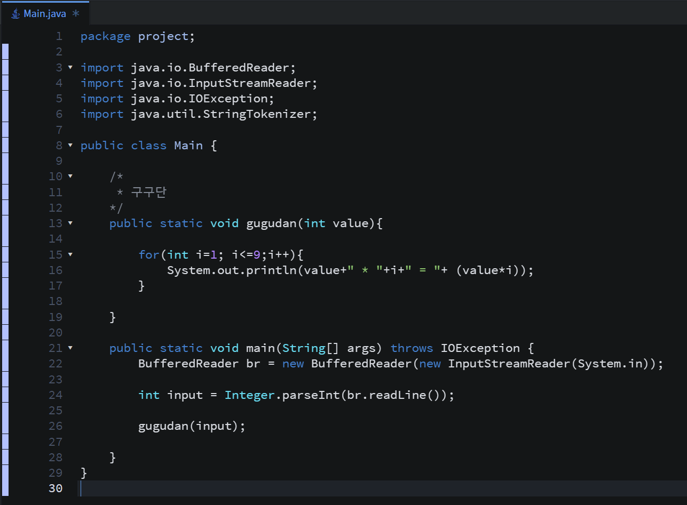
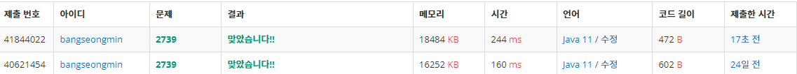

* 문제

---

* 간단설명

   주사위 문제는 간단하겠죠??

   간단하게 풀이 방법은 반복문이겠죠??

  (1 단계) N을 입력받는다

  (2 단계) N번 반복하여 구구단을 출력한다!!

---

* 풀이

  (방법 1 - Scanner)

---

  (방법 2 - BufferedReader)

---

* 성능 비교

방법 1 - 244ms

방법 2 - 160ms

---

* 정리

점점.. BufferedReader가 익숙해져가고 있습니다!! (좋은 징조)

