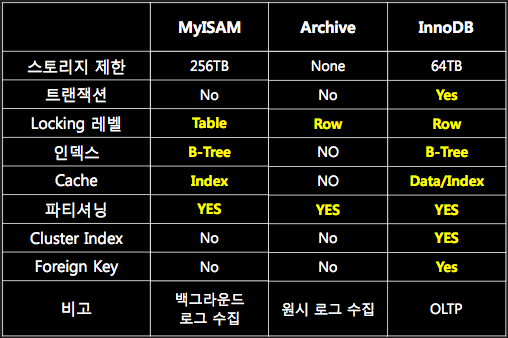

### **MySQL**

---

MySQL은 가장 널리 사용되고 있는 관계형 데이터베이스 관리 시스템(RDBMS: Relational DBMS)입니다.

MySQL은 오픈 소스이며, 다중 사용자와 다중 스레드를 지원합니다.

또한, C언어, C++, JAVA, PHP 등 여러 프로그래밍 언어를 위한 다양한 API를 제공하고 있습니다.

MySQL은 유닉스, 리눅스, 윈도우 등 다양한 운영체제에서 사용할 수 있으며, 특히 PHP와 함께 웹 개발에 자주 사용됩니다.

MySQL은 오픈 소스 라이센스를 따르기는 하지만, 상업적으로 사용할 때는 상업용 라이센스를 구입해야만 합니다.

#### **MySQL의 장점**

1. 오픈 소스 라이센스를 따르기 때문에 무료로 사용할 수 있습니다.

2. 다양한 운영체제에서 사용할 수 있으며, 여러 가지의 프로그래밍 언어를 지원합니다.

3. 크기가 큰 데이터 집합도 아주 빠르고 효과적으로 처리할 수 있습니다.

4. 널리 알려진 표준 SQL 형식을 사용합니다.

5. MySQL 응용 프로그램을 사용자의 용도에 맞게 수정할 수 있습니다.

---

#### **MySQL의 특징**

**1. 단일 코어에서 Nested Loop Join 처리**

MySQL에서는 **모든 SQL 처리를 단일 코어에서 Nested Loop Join 방식으로만 데이터를 처리**합니다. 병렬 처리라는 것은 없습니다. 물론 일부 3rd스토리지 엔진을 플러그인으로 설치를 하면 병렬 처리가 가능하다고는 하지만, 기본적인 스토리지 엔진에는 단일 코어 수행합니다. 그렇기 때문에 MySQL 입장에서는 CPU코어 개수를 늘리는 Scale-Out보다는 오히려 단위 처리량이 좋은 CPU로 Scale-Up을 하는 것이 훨씬 유리합니다.

게다가 모든 데이터 처리를 Nested Loop Join(이하 NL join)으로 처리합니다. NL join이란 선행 테이블(A)의 조건 검색 결과 값 하나하나를 엑세스 하면서 연결할 테이블(B)에 대입하여 조인하는 방식입니다. 프로그램적으로 풀자면 2 중 While문과 유사하다고 볼 수 있습니다. 처리할 데이터가 적으면 수행 속도가 빠르지만, A테이블 또는 B테이블 중 하나라도 연산을 해야할 데이터가 많아지만 쿼리 효율이 기하급수적으로 떨어집니다.

Outer Join이든, Sub Query든, Inner Join이든 모두 NL-Join으로만 처리합니다. DW 또는 데이터 분석 도구보다는 단순 처리를 위한 OLTP 프로세싱에 적합한 DBMS입니다.

**2. 다양한 스토리지 엔진**

MySQL은 다양한 스토리지 엔진을 지원합니다. MyISAM, InnoDB, Archive, Memory, NDB, Federated 등 기본 엔진 뿐만 아니라 3rd Party 스토리지 엔진도 간단하게 플러그인 형식으로 설치를 할 수 있습니다.

제가 자주 사용하는 스토리지 엔진 세 가지(MyISAM, InnoDB, Archive) 세 가지에 관한 간단한 비교 표입니다.

* **MyISAM Storage Engine**인덱스만 메모리에 올려서 테이블 잠금으로 데이터를 처리하는 스토리지 엔진으로 단순 백그라운드에서 로그 수집에 적합합니다. 동시 다발적으로 데이터 변경 작업을 수행하는 로직에는 절대 적합하지 않습니다. 특히 인덱스가 걸려있는 상태에서 대용량(500만 건 이상) 데이터 처리 시 단순 입력 상태에서도 테이블 잠금이 빈번하게 발생할 수 있다는 점을 명심하시기 바랍니다.
* **Archive Storage Engine**원시 로그 수집에 최적인 스토리지 엔진입니다. 트랜잭션, 인덱스 모두 지원하지 않지만, 테이블에서 데이터 처리를 행 단위 잠금으로 수행하기 때문에 동시 다발적으로 데이터 입력 상황에도 상당히 좋은 퍼포먼스를 제공합니다. 게다가 메모리에서 데이터 압축을 수행하면서 실제적으로 디스크에 기록하기 때문에, InnoDB 대비 꽤 좋은 디스크 용량 효율이 있습니다. 게다가 파티셔닝을 지원하기 때문에 추후 로그 정리 시에도 상당히 간단하죠.
* **InnoDB Storage Engine**현재 Oracle에서 가장 밀고 있는 스토리지 엔진으로 In-Memory 특성을 가지고 있습니다. 메모리에 인덱스/데이터 모두 올려서 데이터를 처리하기 때문에 데이터 접근 속도가 상당히 빠릅니다. 메모리가 많이 허용되면 엄청난 퍼포먼스를 발휘하는 엔진이죠. 게다가 트랜잭션을 제공하고, 동시 데이터 처리 시에도 행 단위 잠금으로 처리하기 때문에 실제적으로 InnoDB Storage Engine은 OLTP 성 대용량 처리에 가장 적합한 스토리지 엔진이라고 볼 수 있습니다.

**3. 데이터 복제(Replication) 기능**

MySQL은 물리적으로 독립적인 디스크 영역에 데이터를 복제(Replication)하여 데이터를 이중화할 수 있습니다.  하단 그림은 가장 대표적인 MySQL Replication Master-Slave구조를 나타낸 그림입니다. 마스터에서 데이터 변경이 작업이 일어나면, 해당 내역이 자동으로 슬레이브로 비동기적으로 전송되어 실제 마스터의 데이터 복사본을 유지하는 것을 의미합니다. 

특정 데이터 디스크 Fail시에도 다른 물리적으로 독립적인 디스크에 데이터가 존재하기 때문에, DB 버그가 아니라면 유실은 거의 없습니다. 게다가 디스크 읽기 분산이 가능하기 때문에 읽기 트래픽이 상당히 큰 서비스에 큰 효율을 갖습니다. 대신 데이터 반영은 오직 하나의 노드, 마스터에서만 가능하기 때문에 쓰기 관련된 부하 분산이 불가능합니다. 그리고 마스터 자체 장애는 쓰기 관련 전체 장애로 발생한다는 점도 꼭 기억하세요.

**[참고]**

* <http://www.tcpschool.com/mysql/mysql_intro_intro>
* <https://gywn.net/2011/12/mysql-three-features/>
