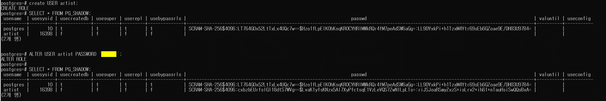
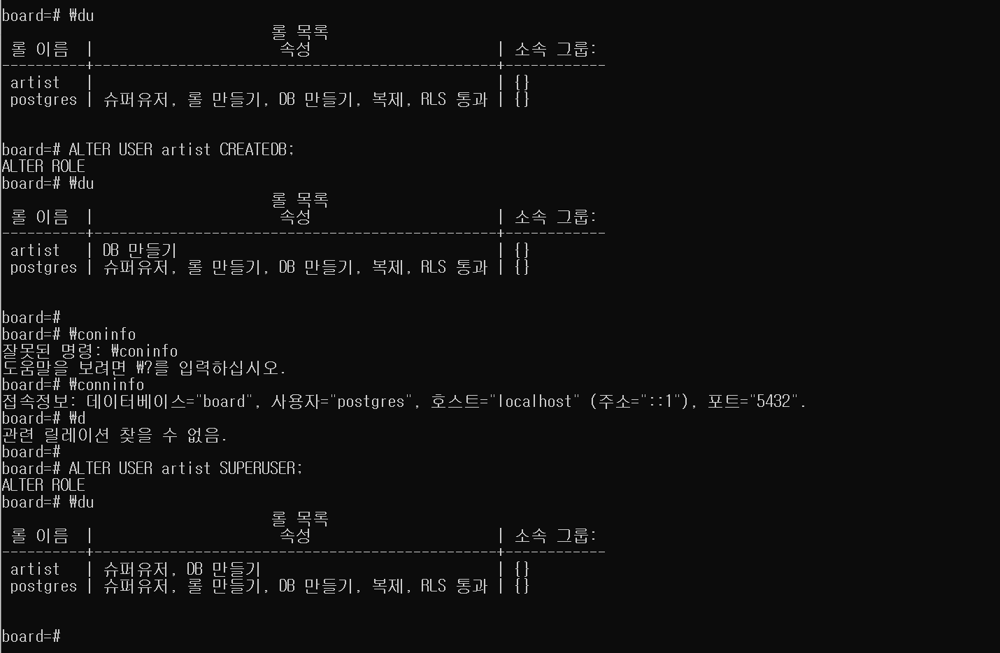

## PostgreSQL 사용자 생성하는 방법

---

psql 에서 CREATE USER 구문으로 사용자를 생성합니다.

psql 에서 ALTER USER 구문으로 사용자 비밀번호를 초기화 합니다.

CREATE USER 구문에서 PASSWORD 옵션을 사용하여 비밀번호를 초기화를 합니다.

## PostgreSQL 사용자 권한부여하는 방법

---

권한을 부여하기 전에 데이터베이스를 먼저 생성하고 해당 데이터베이스에 권한을 부여하도록 하겠다.

> MySQL과 MariaDB만 사용하다가..  
> 처음 사용해보는데 적응이 되지 않지만  
>   
> 화이팅!!
