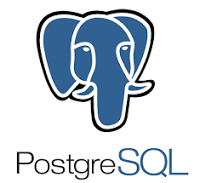
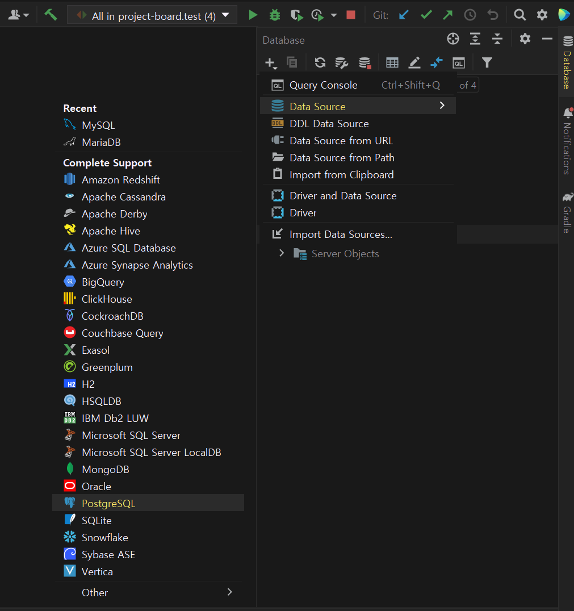
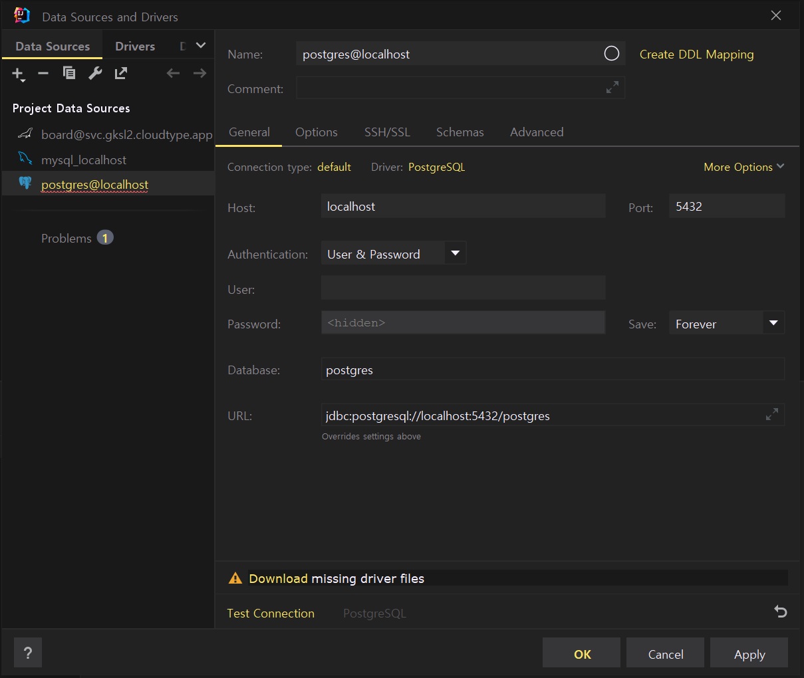
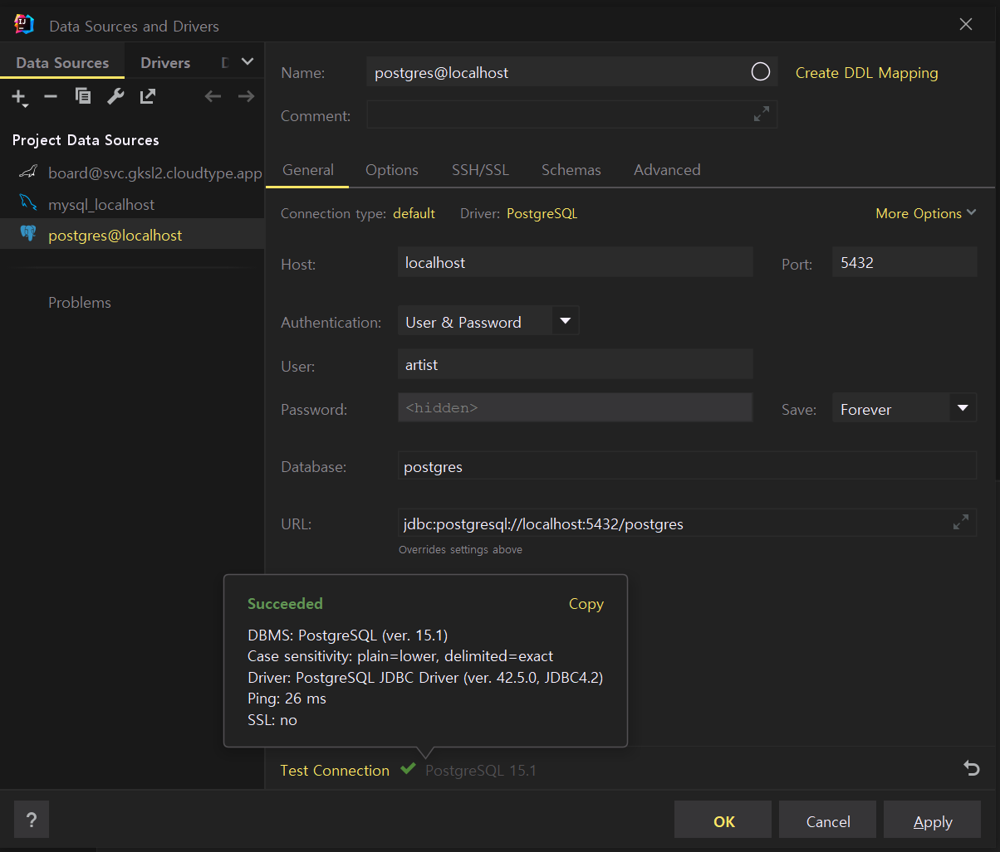
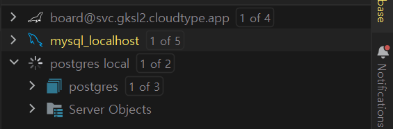
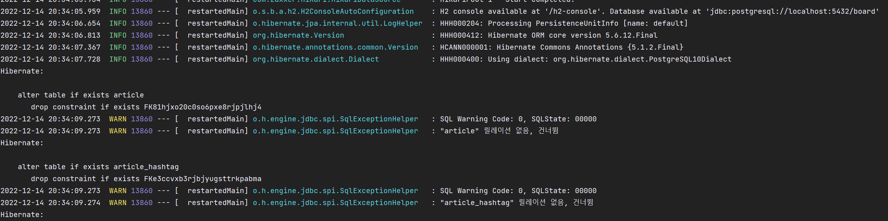
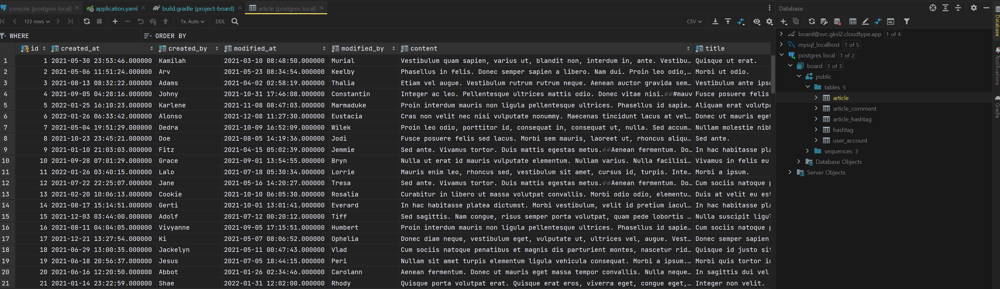

## DB Migration

---

[MySQL과 PostgreSQL 비교](https://to-be-a-artist.tistory.com/271)는 분리하여 포스팅하였습니다.

JPA 기술을 사용하면서 가져가는 대표적인 이점 중 하나는 DB 종속성을 끊어내는 것이다.

MySQL에서 작성하든지, Oracle에서 작성하든지 어떤 DB를 사용하든지 어떤 DB 시스템에 의존하는지 몰라도 된다.

추상화를 시켜두어서 자바 코드는 특정 데이터베이스에 종속되지 않은 그런 코드로 구성될 수 있게 만들어주기 때문이다.

현재 서비스는 정상적으로 돌아가지만, 비즈니스 로직을 변경하지 않아서 실제 서비스를 사용할 수 는 없지만 데이터베이스 마이그레이션은 할 수 있다.

### **IDE에 PostgreSQL 연결**

---

설치 및 유저 생성과 ROLE 부여는 아래 포스팅을 통해 확인할 수 있습니다.

* [Postgre 설치](tistory-272.html)
* [Postgre 사용자 추가 및 권한 부여](tistory-273.html)

#### DataSource 추가



---

#### DataSource And Drivers 설정

**1. Driver를 설치해주어야 합니다.**



**2. 유저와 패스워드 입력 후 테스트 커넥션 실행**



**3. 연동 성공**



---

#### **Spring Boot 설정**

**application.yaml 설정**

```java
spring:
  config.activate.on-profile: local
  datasource:
    url: jdbc:postgresql://localhost:5432/board
    username: artist
    password: artist
  jpa:
    open-in-view : false
    defer-datasource-initialization: true
    hibernate.ddl-auto: create
    show-sql: true
    properties:
      hibernate.format_sql: true
      hibernate.default_batch_fetch_size: 100
  sql.init.mode: always
  data.rest:
    base-path: /api
    detection-strategy: annotated
  thymeleaf3:
    decoupled-logic: true
```

driver-class-name을 설정하지 않은 이유는 url을 통해 자동으로 설정되기 때문이다.

**의존성 추가**

```java
runtimeOnly 'org.postgresql:postgresql'
```

**서비스 실행 결과**



**데이터베이스 테이블 정보 확인**


